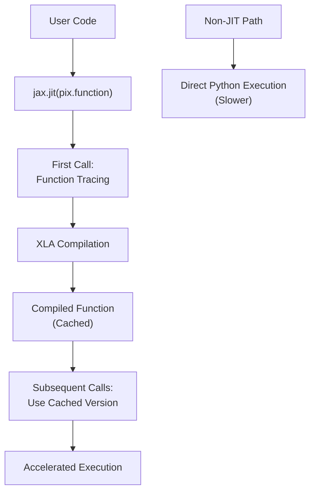
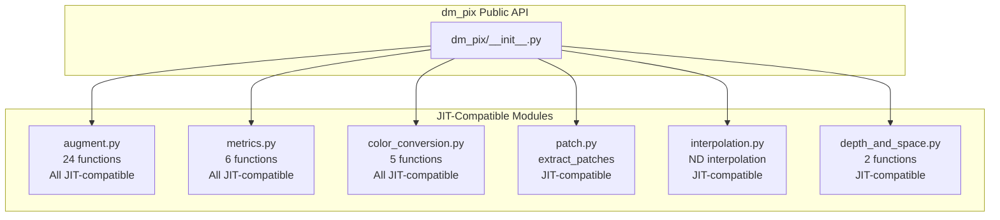
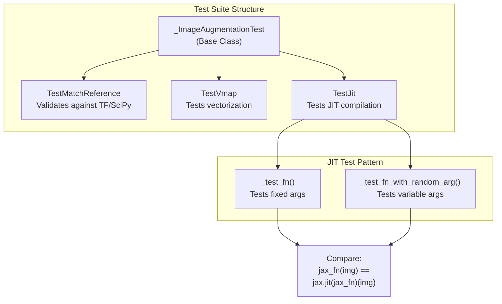
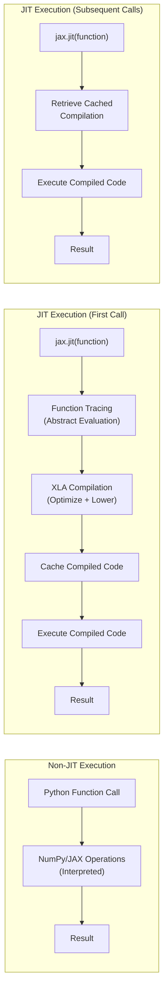

<!-- source: DeepWiki mcp.deepwiki.com · repo google-deepmind/dm_pix · page 6.1 JIT Compilation · fetched 2026-10-26 -->

# JIT Compilation

<details>
<summary>Relevant source files</summary>

The following files were used as context for generating this wiki page:

- [README.md](README.md)
- [dm_pix/_src/augment_test.py](dm_pix/_src/augment_test.py)
- [dm_pix/images/pix_logo.png](dm_pix/images/pix_logo.png)

</details>


## Purpose and Scope

This document explains how to use Just-In-Time (JIT) compilation with dm_pix functions using `jax.jit`. JIT compilation optimizes dm_pix functions for high-performance execution by compiling them to XLA operations. All functions in dm_pix are designed to be JIT-compatible.

For information about batch processing with automatic vectorization, see [Vectorization with vmap](#6.2). For multi-device parallel execution, see [Parallelization with pmap](#6.3).

## Overview

All dm_pix functions are pure, side-effect-free operations that can be wrapped with `jax.jit` to generate optimized machine code. JIT compilation traces the function once, compiles it to XLA (Accelerated Linear Algebra), and caches the compiled version for subsequent calls.

### JIT Compilation Workflow



Sources: [README.md:19](), [README.md:63-78]()

## Using jax.jit with dm_pix Functions

### Basic Usage Pattern

The standard pattern for JIT compilation wraps a dm_pix function with `jax.jit`:

```python
import dm_pix as pix
import jax

# Load image
image = load_image()  # Shape: (H, W, C)

# Non-jitted function call
result = pix.flip_left_right(image)

# JIT-compiled function call
jitted_fn = jax.jit(pix.flip_left_right)
result = jitted_fn(image)
```

Sources: [README.md:74-78]()

### Function Categories and JIT Support



Sources: [README.md:19](), [README.md:63-64]()

### Inline JIT Compilation

Functions can also be JIT-compiled inline without pre-creating the jitted function:

```python
# Inline JIT compilation
result = jax.jit(pix.adjust_brightness)(image, delta=0.2)

# Equivalent to:
jitted_brightness = jax.jit(pix.adjust_brightness)
result = jitted_brightness(image, delta=0.2)
```

Both patterns produce identical results and performance characteristics after the initial compilation.

Sources: [README.md:77-78]()

## Performance Considerations

### Compilation Overhead

The first call to a JIT-compiled function incurs compilation overhead:

| Execution Type | First Call | Subsequent Calls |
|----------------|------------|------------------|
| Non-JIT | Fast (immediate execution) | Fast (immediate execution) |
| JIT-compiled | Slow (tracing + compilation) | Very Fast (cached compilation) |

The compilation overhead is amortized over multiple calls, making JIT compilation beneficial for:
- Functions called repeatedly in training loops
- Functions used in inference pipelines
- Batch processing operations

Sources: [README.md:19]()

### Static vs Dynamic Arguments

JIT compilation requires distinguishing between static and dynamic arguments:

**Dynamic Arguments** (traced and part of computation):
- Image arrays (`jnp.ndarray`)
- Adjustment factors (brightness delta, contrast factor, etc.)
- Numeric parameters that vary per call

**Static Arguments** (fixed at compile time):
- Image shapes
- Kernel sizes (when derived from other static args)
- Mode strings (`'constant'`, `'mirror'`, `'nearest'`)
- Boolean flags

When a static argument changes, JAX recompiles the function. To mark arguments as static, use `static_argnums`:

```python
import functools

# Mark mode and order as static
jitted_affine = jax.jit(
    pix.affine_transform,
    static_argnums=(2, 3)  # mode and order parameters
)

# Different modes trigger recompilation
result1 = jitted_affine(image, matrix, 'nearest', 0)
result2 = jitted_affine(image, matrix, 'mirror', 1)  # Recompiles
```

Sources: [dm_pix/_src/augment_test.py:269-301]()

## Testing Infrastructure for JIT Compatibility

### TestJit Class Architecture

dm_pix includes comprehensive testing to ensure all functions work correctly under JIT compilation:



Sources: [dm_pix/_src/augment_test.py:488-509]()

### JIT Testing Implementation

The `TestJit` class implements two core test methods:

**`_test_fn` method** [dm_pix/_src/augment_test.py:502-508]():
```python
def _test_fn(self, images_list, jax_fn, reference_fn):
    del reference_fn  # unused
    jax_fn_jitted = jax.jit(jax_fn)
    for image_rgb in images_list:
        adjusted_jax = jax_fn(image_rgb)
        adjusted_jit = jax_fn_jitted(image_rgb)
        self.assertAllCloseTolerant(adjusted_jax, adjusted_jit)
```

**`_test_fn_with_random_arg` method** [dm_pix/_src/augment_test.py:490-500]():
```python
def _test_fn_with_random_arg(self, images_list, jax_fn, reference_fn, **kw_range):
    del reference_fn  # unused
    assert len(kw_range) == 1
    kw_name, (random_min, random_max) = list(kw_range.items())[0]
    jax_fn_jitted = jax.jit(jax_fn)
    for image_rgb in images_list:
        argument = np.random.uniform(random_min, random_max, size=())
        adjusted_jax = jax_fn(image_rgb, **{kw_name: argument})
        adjusted_jit = jax_fn_jitted(image_rgb, **{kw_name: argument})
        self.assertAllCloseTolerant(adjusted_jax, adjusted_jit)
```

Sources: [dm_pix/_src/augment_test.py:488-509]()

### Test Coverage

The test suite verifies JIT compatibility across all function categories:

| Function Category | Test Examples |
|-------------------|---------------|
| Color Adjustments | `test_adjust_brightness`, `test_adjust_contrast`, `test_adjust_gamma`, `test_adjust_hue`, `test_adjust_saturation` |
| Geometric Transforms | `test_rot90`, `test_flip`, `test_affine_transform`, `test_rotate` |
| Filters & Effects | `test_gaussian_blur`, `test_solarize`, `test_random_crop` |
| Advanced Transforms | `test_elastic_deformation`, `test_center_crop`, `test_pad_to_size`, `test_resize_with_crop_or_pad` |

Sources: [dm_pix/_src/augment_test.py:51-425]()

## Common Usage Patterns

### Pattern 1: Pre-JIT for Repeated Use

When a function is called multiple times with varying data but fixed parameters:

```python
# Pre-compile with fixed static parameters
jitted_gaussian = jax.jit(
    functools.partial(pix.gaussian_blur, kernel_size=13.1)
)

# Use in loop without recompilation
for image_batch in dataset:
    blurred = jitted_gaussian(image_batch, sigma=2.0)
```

### Pattern 2: JIT with Multiple Arguments

For functions with multiple dynamic arguments:

```python
# JIT compile multi-argument function
jitted_adjust = jax.jit(pix.adjust_brightness)

# Call with different deltas (no recompilation)
bright_img = jitted_adjust(image, delta=0.3)
dark_img = jitted_adjust(image, delta=-0.2)
```

### Pattern 3: Conditional Static Arguments

For functions where mode strings affect compilation:

```python
# Separate JIT compilations for different modes
jitted_rotate_nearest = jax.jit(
    functools.partial(pix.rotate, mode='nearest', order=0)
)

jitted_rotate_mirror = jax.jit(
    functools.partial(pix.rotate, mode='mirror', order=1)
)
```

Sources: [dm_pix/_src/augment_test.py:269-301](), [dm_pix/_src/augment_test.py:314-317]()

## Execution Flow Comparison



Sources: [README.md:19](), [README.md:74-78]()

## Practical Example: Augmentation Pipeline

```python
import jax
import jax.numpy as jnp
import dm_pix as pix

# Define augmentation pipeline
def augment_pipeline(image, key):
    key1, key2, key3 = jax.random.split(key, 3)
    image = pix.random_brightness(key1, image, max_delta=0.3)
    image = pix.random_contrast(key2, image, lower=0.8, upper=1.2)
    image = pix.random_flip_left_right(key3, image)
    return image

# JIT-compile entire pipeline
jitted_augment = jax.jit(augment_pipeline)

# First call: compilation overhead
key = jax.random.PRNGKey(42)
augmented_image = jitted_augment(image, key)  # Slow (tracing + compilation)

# Subsequent calls: fast execution
for i in range(100):
    key = jax.random.PRNGKey(i)
    augmented_image = jitted_augment(image, key)  # Fast (cached)
```

This pattern demonstrates JIT compilation of a composite augmentation pipeline, where all internal dm_pix function calls are fused into a single optimized kernel.

Sources: [README.md:74-78]()

## Debugging JIT Compilation Issues

### Common Issues and Solutions

| Issue | Cause | Solution |
|-------|-------|----------|
| Recompilation on every call | Static argument changing | Use `static_argnums` or `functools.partial` |
| Compilation takes too long | Complex function graph | Profile with `jax.profiler` or simplify function |
| Numerical differences | Floating-point precision | Expected; use tolerant comparison (see test suite) |
| Shape errors | Dynamic shapes | Ensure input shapes are consistent or use shape polymorphism |

### Tolerance in Comparisons

The test suite uses platform-specific tolerance for JIT comparisons [dm_pix/_src/augment_test.py:45-49]():

```python
def assertAllCloseTolerant(self, x, y):
    # Increase tolerance on TPU due to lower precision.
    tol = 1e-2 if jax.local_devices()[0].platform == "tpu" else 1e-4
    np.testing.assert_allclose(x, y, rtol=tol, atol=tol)
    self.assertEqual(x.dtype, y.dtype)
```

This accounts for minor numerical differences between non-JIT and JIT execution due to optimization and hardware-specific implementations.

Sources: [dm_pix/_src/augment_test.py:45-49]()

## Integration with Other JAX Transformations

JIT compilation composes with other JAX transformations:

```python
# JIT + vmap: Compile batch-processed function
jitted_vmap_fn = jax.jit(jax.vmap(pix.adjust_brightness))
batch_results = jitted_vmap_fn(image_batch, delta_batch)

# vmap + JIT: Equivalent alternative
vmap_jitted_fn = jax.vmap(jax.jit(pix.adjust_brightness))
batch_results = vmap_jitted_fn(image_batch, delta_batch)

# JIT + pmap: Compile multi-device function
jitted_pmap_fn = jax.jit(jax.pmap(pix.flip_left_right))
multi_device_results = jitted_pmap_fn(sharded_images)
```

For more details on these patterns, see [Vectorization with vmap](#6.2) and [Parallelization with pmap](#6.3).

Sources: [README.md:63-91]()

---

