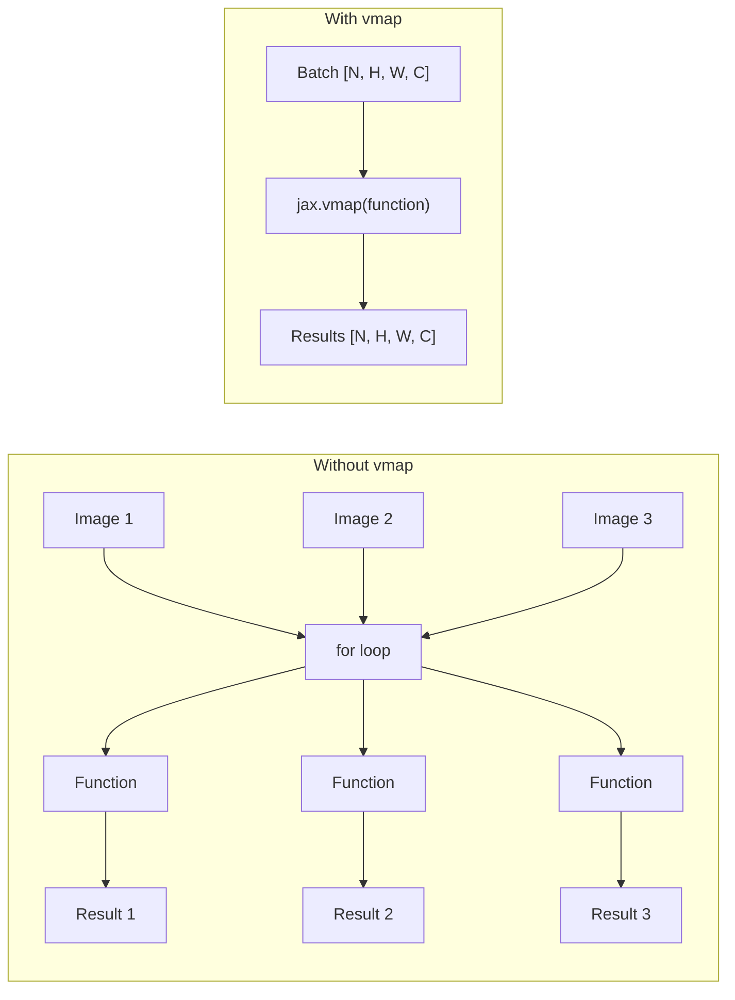
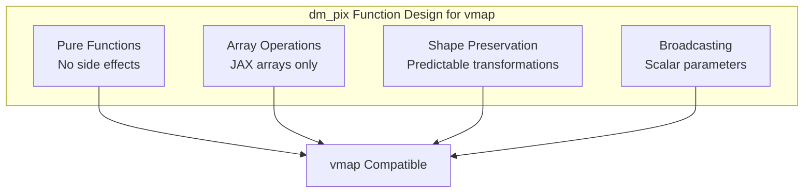
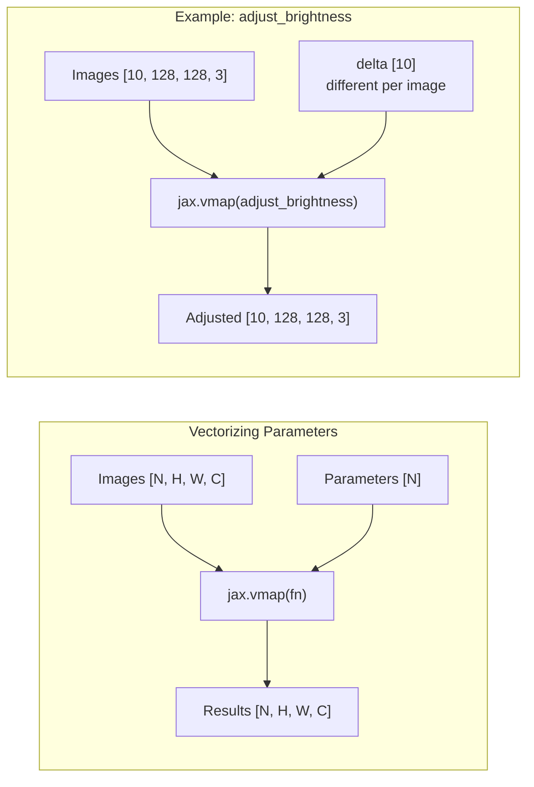
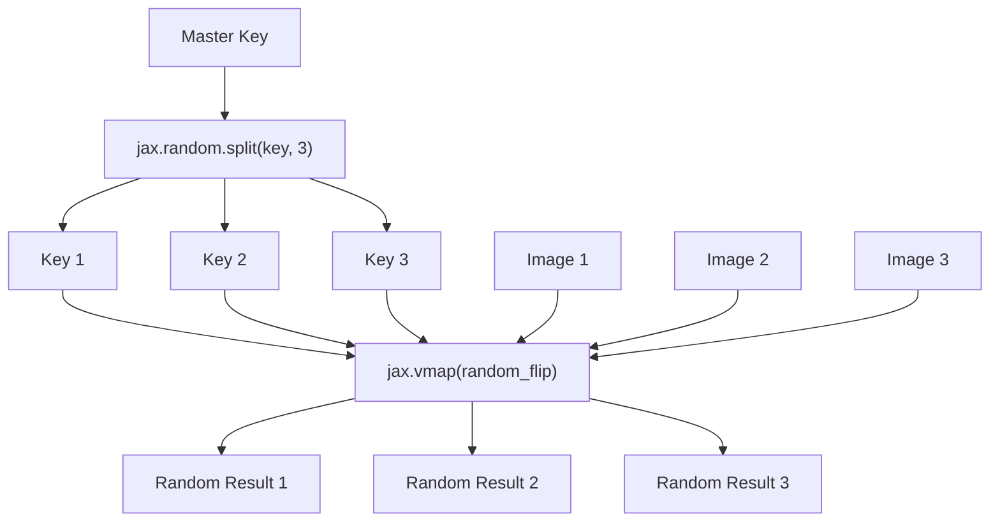
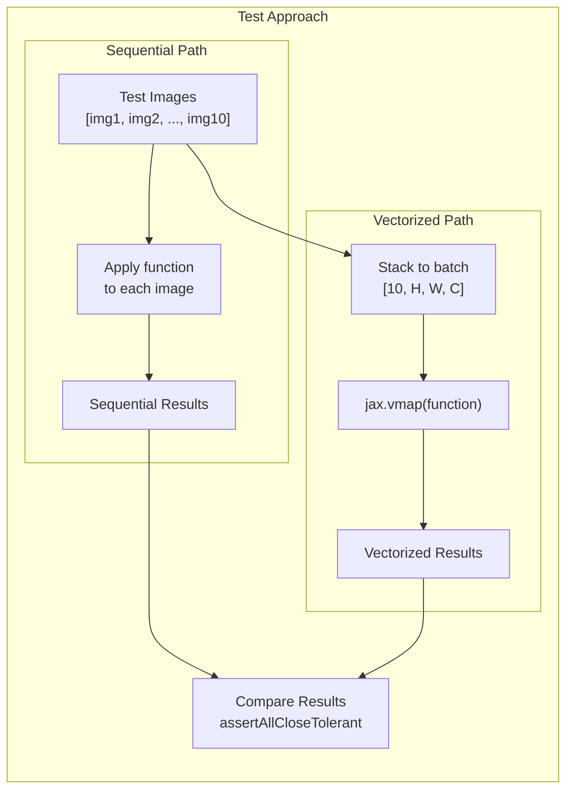
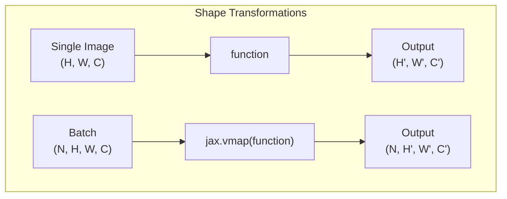

<!-- source: DeepWiki mcp.deepwiki.com · repo google-deepmind/dm_pix · page 6.2 Vectorization with vmap · fetched 2026-10-26 -->

# Vectorization with vmap

<details>
<summary>Relevant source files</summary>

The following files were used as context for generating this wiki page:

- [README.md](README.md)
- [dm_pix/_src/augment_test.py](dm_pix/_src/augment_test.py)
- [dm_pix/images/pix_logo.png](dm_pix/images/pix_logo.png)

</details>


This document explains how to use `jax.vmap` to vectorize image processing operations in dm_pix. For information about JIT compilation, see [JIT Compilation](#6.1). For multi-device parallelization, see [Parallelization with pmap](#6.3).

## Purpose and Scope

This page covers automatic vectorization of dm_pix functions using `jax.vmap`, enabling efficient batch processing of images without explicit loops. All functions in dm_pix are designed to support vectorization through `vmap`, allowing single-image operations to be automatically transformed into batch operations.

## What is vmap

`jax.vmap` (vectorized map) is a JAX transformation that automatically vectorizes a function to operate over an additional batch dimension. Instead of writing explicit loops to process multiple images, `vmap` transforms a single-image function into a batch-processing function.



**Key Benefits:**
- **Automatic parallelization**: Operations are vectorized at the hardware level
- **No explicit loops**: Cleaner, more readable code
- **Performance**: Leverages SIMD and GPU/TPU parallelism
- **Composability**: Can be combined with `jit`, `grad`, and other JAX transformations

Sources: [README.md:63-91]()

## dm_pix Function Compatibility

All functions in dm_pix are designed to work seamlessly with `vmap`. This compatibility is achieved through:

1. **Pure functional design**: No side effects or mutable state
2. **Array-based operations**: All operations use JAX arrays
3. **Consistent shapes**: Functions preserve or predictably transform array shapes
4. **Broadcastable parameters**: Scalar parameters can be vectorized



**Tested Functions:**
The following dm_pix functions are verified to work with `vmap` through automated tests:

| Category | Functions | Test Coverage |
|----------|-----------|---------------|
| Color Adjustments | `adjust_brightness`, `adjust_contrast`, `adjust_gamma`, `adjust_saturation`, `adjust_hue` | ✓ |
| Geometric Transforms | `flip_left_right`, `flip_up_down`, `rot90`, `rotate`, `affine_transform` | ✓ |
| Filters | `gaussian_blur`, `solarize` | ✓ |
| Cropping/Padding | `center_crop`, `pad_to_size`, `resize_with_crop_or_pad`, `random_crop` | ✓ |
| Advanced Transforms | `elastic_deformation` | ✓ |

Sources: [dm_pix/_src/augment_test.py:456-485](), [README.md:19]()

## Basic Usage: Batching Single Images

The most common pattern is to apply a single-image function to a batch of images by wrapping it with `vmap`.

### Simple Batch Processing

```python
import dm_pix as pix
import jax
import jax.numpy as jnp

# Single image: shape (H, W, C)
single_image = load_image()  # e.g., (131, 111, 3)

# Create a batch: shape (N, H, W, C)
batch_images = jnp.stack([image1, image2, image3], axis=0)  # (3, 131, 111, 3)

# Apply function to single image
result_single = pix.flip_left_right(single_image)  # (131, 111, 3)

# Vectorize the function for batch processing
flip_batch = jax.vmap(pix.flip_left_right)
result_batch = flip_batch(batch_images)  # (3, 131, 111, 3)
```

The batch dimension (first axis) is automatically mapped over by `vmap`.

Sources: [README.md:80-91](), [dm_pix/_src/augment_test.py:478-485]()

## Vectorizing Function Parameters

`vmap` can vectorize not just the images but also function parameters, allowing different parameter values for each image in the batch.



### Example: Variable Brightness per Image

```python
import dm_pix as pix
import jax
import jax.numpy as jnp

# Batch of images
images = jnp.stack([img1, img2, img3], axis=0)  # (3, H, W, C)

# Different brightness delta for each image
deltas = jnp.array([0.1, -0.2, 0.3])  # (3,)

# Vectorize both image and parameter
adjust_batch = jax.vmap(pix.adjust_brightness)
results = adjust_batch(images, deltas)  # (3, H, W, C)
```

Each image gets its corresponding delta value:
- `img1` adjusted by +0.1
- `img2` adjusted by -0.2
- `img3` adjusted by +0.3

Sources: [dm_pix/_src/augment_test.py:458-476]()

## vmap with Random Operations

Random augmentation functions that use PRNG keys require special handling with `vmap` to ensure each image gets a unique random transformation.

### Pattern: Splitting PRNG Keys

```python
import dm_pix as pix
import jax
import jax.numpy as jnp

# Batch of images
batch_images = jnp.stack([img1, img2, img3], axis=0)  # (3, H, W, C)

# Create unique keys for each image
key = jax.random.PRNGKey(0)
keys = jax.random.split(key, num=3)  # (3, 2)

# Vectorize the random function
random_flip_batch = jax.vmap(pix.random_flip_left_right)
results = random_flip_batch(keys, batch_images)  # (3, H, W, C)
```

Each image receives:
- A unique PRNG key from the `keys` array
- Independent random decisions for flipping



**Important**: Without splitting keys, all images would receive identical "random" transformations.

Sources: [dm_pix/_src/augment_test.py:60-65](), [dm_pix/_src/augment_test.py:171-179]()

## vmap Testing Infrastructure

The `TestVmap` class ensures all dm_pix functions work correctly with `vmap` by comparing vectorized results against sequential single-image processing.

### Test Strategy



### Test Implementation

The test class verifies vmap compatibility through two key methods:

**`_test_fn` (deterministic functions):**
```python
def _test_fn(self, images_list, jax_fn, reference_fn):
    # Apply vmap to function
    fn_vmap = jax.vmap(jax_fn)
    
    # Process batch with vmap
    outputs_vmaped = list(fn_vmap(np.stack(images_list, axis=0)))
    
    # Process each image individually
    for image_rgb, adjusted_vmap in zip(images_list, outputs_vmaped):
        adjusted_jax = jax_fn(image_rgb)
        self.assertAllCloseTolerant(adjusted_jax, adjusted_vmap)
```

**`_test_fn_with_random_arg` (functions with parameters):**
```python
def _test_fn_with_random_arg(self, images_list, jax_fn, reference_fn, **kw_range):
    kw_name, (random_min, random_max) = list(kw_range.items())[0]
    arguments = [np.random.uniform(random_min, random_max, size=()) 
                 for _ in images_list]
    
    # Apply vmap with vectorized parameters
    fn_vmap = jax.vmap(jax_fn)
    outputs_vmaped = list(fn_vmap(
        np.stack(images_list, axis=0),
        **{kw_name: np.stack(arguments, axis=0)}))
    
    # Verify each result matches individual processing
    for image_rgb, argument, adjusted_vmap in zip(images_list, arguments, outputs_vmaped):
        adjusted_jax = jax_fn(image_rgb, **{kw_name: argument})
        self.assertAllCloseTolerant(adjusted_jax, adjusted_vmap)
```

### Test Coverage

All augmentation functions are tested with vmap:

| Test Method | Functions Covered | Lines |
|-------------|-------------------|-------|
| `test_adjust_brightness` | `adjust_brightness`, `random_brightness` | [53-65]() |
| `test_adjust_contrast` | `adjust_contrast`, `random_contrast` | [69-80]() |
| `test_adjust_gamma` | `adjust_gamma`, `random_gamma` | [84-95]() |
| `test_adjust_saturation` | `adjust_saturation`, `random_saturation` | [99-123]() |
| `test_adjust_hue` | `adjust_hue`, `random_hue` | [129-140]() |
| `test_flip` | `flip_left_right`, `flip_up_down`, `random_flip_*` | [162-189]() |
| `test_rot90` | `rot90` | [144-156]() |
| `test_affine_transform` | `affine_transform` | [202-267]() |
| `test_rotate` | `rotate` | [283-301]() |
| `test_solarize` | `solarize` | [305-310]() |
| `test_gaussian_blur` | `gaussian_blur` | [314-317]() |
| `test_random_crop` | `random_crop` | [321-324]() |
| `test_elastic_deformation` | `elastic_deformation` | [328-356]() |
| `test_center_crop` | `center_crop` | [363-377]() |
| `test_pad_to_size` | `pad_to_size` | [384-400]() |
| `test_resize_with_crop_or_pad` | `resize_with_crop_or_pad` | [407-425]() |

Sources: [dm_pix/_src/augment_test.py:456-485]()

## Common Patterns and Best Practices

### Pattern 1: Simple Batch Processing

When all images receive the same transformation:

```python
# Stack images into batch
batch = jnp.stack(images, axis=0)

# Apply vectorized function
results = jax.vmap(pix.flip_left_right)(batch)
```

### Pattern 2: Per-Image Parameters

When each image needs different parameters:

```python
# Prepare batch and parameters
batch = jnp.stack(images, axis=0)  # (N, H, W, C)
factors = jnp.array([1.2, 0.8, 1.5, ...])  # (N,)

# Apply with vectorized parameters
results = jax.vmap(pix.adjust_contrast)(batch, factors)
```

### Pattern 3: Combining with JIT

For maximum performance, combine `vmap` with `jit`:

```python
# Compose transformations
@jax.jit
@jax.vmap
def augment_batch(images, keys):
    flipped = pix.random_flip_left_right(keys, images)
    return pix.adjust_brightness(flipped, 0.1)

# Apply to batch
results = augment_batch(batch_images, batch_keys)
```

### Pattern 4: Nested vmap

For processing batches across multiple dimensions:

```python
# Shape: (num_datasets, images_per_dataset, H, W, C)
nested_data = ...

# Apply to each image in all datasets
process_all = jax.vmap(jax.vmap(pix.flip_left_right))
results = process_all(nested_data)
```

Sources: [README.md:67-91]()

## Shape Transformations with vmap

Understanding how `vmap` affects array shapes is crucial for debugging and designing pipelines.



**General Rule**: If a function transforms shape `(H, W, C)` to `(H', W', C')`, then `vmap` transforms `(N, H, W, C)` to `(N, H', W', C')`.

### Examples:

| Function | Single Shape | Batch Input | Batch Output |
|----------|--------------|-------------|--------------|
| `flip_left_right` | `(128, 128, 3)` | `(10, 128, 128, 3)` | `(10, 128, 128, 3)` |
| `center_crop(h=64, w=64)` | `(128, 128, 3)` | `(10, 128, 128, 3)` | `(10, 64, 64, 3)` |
| `pad_to_size(h=256, w=256)` | `(128, 128, 3)` | `(10, 128, 128, 3)` | `(10, 256, 256, 3)` |
| `rgb_to_grayscale` | `(128, 128, 3)` | `(10, 128, 128, 3)` | `(10, 128, 128, 1)` |

Sources: [dm_pix/_src/augment_test.py:478-485]()

## Performance Considerations

### Memory Usage

`vmap` processes entire batches simultaneously, requiring sufficient memory:

```python
# Single image: H * W * C * 4 bytes (float32)
# Batch: N * H * W * C * 4 bytes

# Example: 10 images of 256x256x3
# Memory: 10 * 256 * 256 * 3 * 4 = 7.86 MB
```

**Tip**: For large batches, consider processing in chunks:

```python
def process_large_batch(images, chunk_size=32):
    num_images = len(images)
    results = []
    
    for i in range(0, num_images, chunk_size):
        chunk = images[i:i+chunk_size]
        results.append(jax.vmap(pix.flip_left_right)(chunk))
    
    return jnp.concatenate(results, axis=0)
```

### Compilation Overhead

The first call to a vmapped function triggers JIT compilation:

```python
# First call: compiles + executes (slower)
result1 = jax.vmap(pix.flip_left_right)(batch)

# Subsequent calls: uses cached compilation (faster)
result2 = jax.vmap(pix.flip_left_right)(batch)
```

### Optimal Batch Sizes

- **GPU/TPU**: Larger batches (32-256) typically perform better
- **CPU**: Smaller batches (4-32) may be more efficient
- **Memory constraints**: Adjust based on available device memory

Sources: [README.md:19]()

## Combining vmap with Other JAX Transformations

### vmap + jit (Recommended)

Always wrap vmapped functions with `jit` for best performance:

```python
# Efficient: jit wraps vmap
@jax.jit
def process_batch(images):
    return jax.vmap(pix.adjust_brightness)(images, 0.2)

# Less efficient: separate jit and vmap
vmapped_fn = jax.vmap(jax.jit(pix.adjust_brightness))
```

### vmap + grad

Compute gradients over batches:

```python
def loss_fn(image, target):
    processed = pix.adjust_brightness(image, 0.5)
    return jnp.sum((processed - target) ** 2)

# Gradient for batch
batch_grad_fn = jax.vmap(jax.grad(loss_fn))
gradients = batch_grad_fn(batch_images, batch_targets)
```

### vmap + pmap

Combine batch processing with multi-device parallelism:

```python
# Process batches across multiple devices
# Shape: (num_devices, batch_per_device, H, W, C)
multi_device_batch = ...

# Each device processes its batch with vmap
process_fn = jax.pmap(lambda imgs: jax.vmap(pix.flip_left_right)(imgs))
results = process_fn(multi_device_batch)
```

Sources: [README.md:63-91]()

## Debugging vmap Issues

### Common Error: Shape Mismatch

```python
# Error: incompatible batch dimensions
images = jnp.zeros((10, 128, 128, 3))
parameters = jnp.zeros((5,))  # Wrong! Should be (10,)

jax.vmap(pix.adjust_brightness)(images, parameters)  # Raises error
```

**Solution**: Ensure all vectorized arguments have matching batch dimensions.

### Common Error: Incompatible Operations

Some operations are not automatically vectorizable:

```python
# Error: vmap cannot vectorize over conditionals on traced values
def bad_function(image):
    if jnp.max(image) > 0.5:  # Conditional on array value
        return pix.adjust_brightness(image, 0.1)
    return image

jax.vmap(bad_function)(batch)  # May fail or give unexpected results
```

**Solution**: Use `jnp.where` for conditional operations:

```python
def good_function(image):
    delta = jnp.where(jnp.max(image) > 0.5, 0.1, 0.0)
    return pix.adjust_brightness(image, delta)

jax.vmap(good_function)(batch)  # Works correctly
```

### Debugging Tips

1. **Test with single image first**: Verify function works without vmap
2. **Check shapes**: Print shapes before and after vmap
3. **Use small batches**: Start with batch size 2-3 for debugging
4. **Compare outputs**: Verify vmapped results match sequential processing

Sources: [dm_pix/_src/augment_test.py:456-485]()

## Summary

All dm_pix functions support `jax.vmap` for efficient batch processing:

| Concept | Key Points |
|---------|------------|
| **Basic Usage** | Wrap function with `jax.vmap`, apply to batched arrays |
| **Parameter Vectorization** | Pass arrays of parameters to apply different values per image |
| **Random Operations** | Split PRNG keys to ensure independent random transformations |
| **Testing** | `TestVmap` class verifies all functions work correctly with vmap |
| **Best Practices** | Combine with `jit`, handle memory constraints, use appropriate batch sizes |
| **Composition** | Can combine with `grad`, `pmap`, and other JAX transformations |

For multi-device parallelization across GPUs/TPUs, see [Parallelization with pmap](#6.3).

Sources: [README.md:63-91](), [dm_pix/_src/augment_test.py:456-485]()

---

