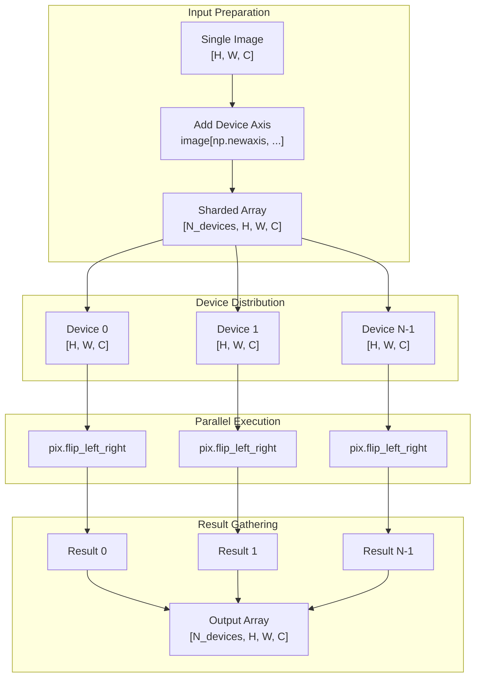
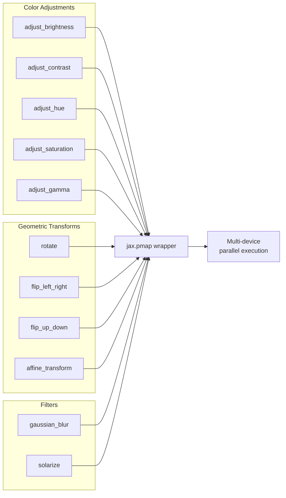
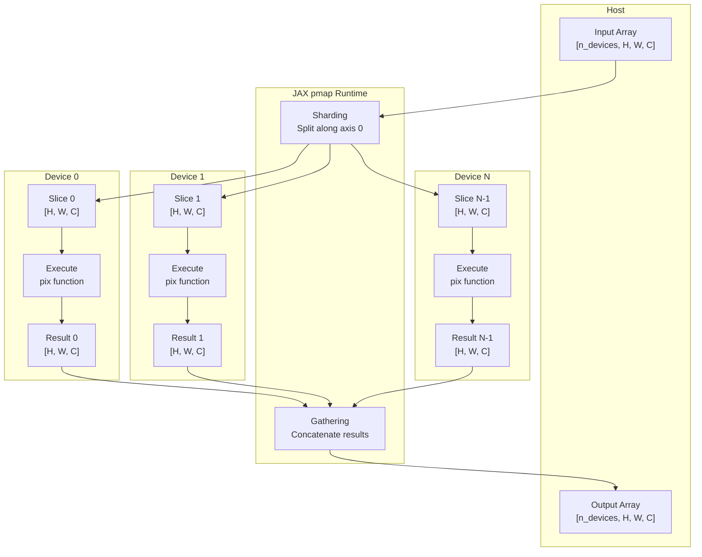
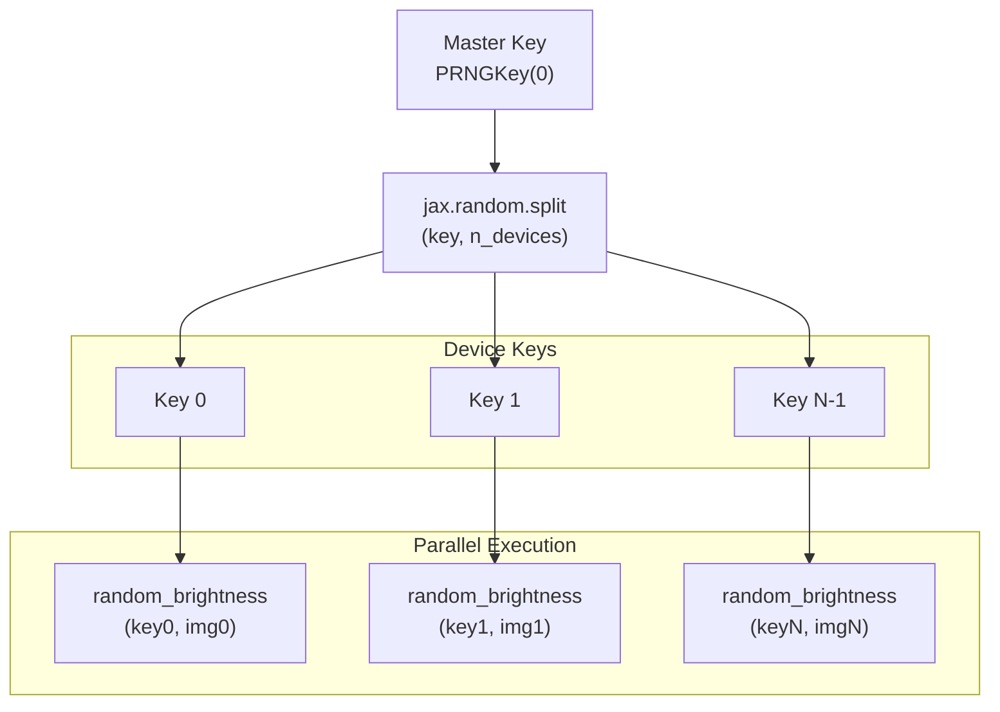
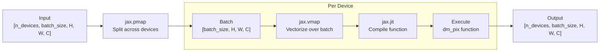
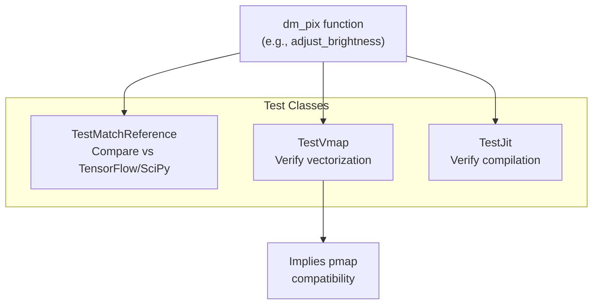

<!-- source: DeepWiki mcp.deepwiki.com · repo google-deepmind/dm_pix · page 6.3 Parallelization with pmap · fetched 2026-10-26 -->

# Parallelization with pmap

<details>
<summary>Relevant source files</summary>

The following files were used as context for generating this wiki page:

- [README.md](README.md)
- [dm_pix/_src/augment_test.py](dm_pix/_src/augment_test.py)
- [dm_pix/images/pix_logo.png](dm_pix/images/pix_logo.png)

</details>


## Purpose and Scope

This page documents how to use `jax.pmap` (parallel map) for multi-device parallelization with dm_pix functions. `pmap` enables automatic distribution of computation across multiple accelerators (GPUs, TPUs) or CPU cores, executing the same function on different data shards in parallel.

For single-device optimization, see [JIT Compilation](#6.1). For automatic batching on a single device, see [Vectorization with vmap](#6.2). This page focuses specifically on multi-device parallel execution.

**Sources:** [README.md:1-151]()

## Overview of jax.pmap

`jax.pmap` (parallel map) transforms a function to execute in parallel across multiple devices. It automatically:
- Shards input arrays across the first axis, distributing chunks to available devices
- Executes the function on each device with its data shard
- Gathers results from all devices back into a single array

All dm_pix functions are designed to be compatible with `jax.pmap`, enabling efficient parallel image processing on multi-accelerator systems.

**Sources:** [README.md:19](), [README.md:63-91]()

## Data Sharding Requirements

When using `pmap`, input arrays must have a leading "device axis" that will be sharded across available devices. Each device processes one slice along this axis.

### Sharding Pattern



**Key Requirements:**
- Input must have shape `[n_devices, ...]` where `n_devices` equals the number of available devices
- Each device processes `input[i, ...]` where `i` is its device index
- The device axis is removed during execution; functions see arrays without the leading axis
- Results are automatically gathered with the device axis restored

**Sources:** [README.md:80-85]()

## Basic Usage Pattern

The standard pattern for using `pmap` with dm_pix functions:

```python
import dm_pix as pix
import jax
import numpy as np

# Load image
image = load_image()  # Shape: [H, W, C]

# Add device axis for pmap (assuming single device for demonstration)
image = image[np.newaxis, ...]  # Shape: [1, H, W, C]

# Create pmap'd function
flip_left_right_pmap = jax.pmap(pix.flip_left_right)

# Execute on all devices in parallel
result = flip_left_right_pmap(image)  # Shape: [1, H, W, C]
```

For systems with multiple devices, the input would naturally have multiple images:

```python
# Multi-device example with 4 GPUs
images = np.stack([image1, image2, image3, image4])  # Shape: [4, H, W, C]
results = jax.pmap(pix.flip_left_right)(images)      # Shape: [4, H, W, C]
```

**Sources:** [README.md:68-91]()

## Function Compatibility

All dm_pix functions are compatible with `jax.pmap`. This includes:

| Module | Functions | pmap Support |
|--------|-----------|--------------|
| **augment.py** | 24 augmentation functions | ✓ Full support |
| **metrics.py** | 6 quality metrics | ✓ Full support |
| **color_conversion.py** | 5 color space conversions | ✓ Full support |
| **patch.py** | Patch extraction | ✓ Full support |
| **interpolation.py** | ND interpolation | ✓ Full support |
| **depth_and_space.py** | Spatial transforms | ✓ Full support |

### Augmentation Functions with pmap



**All functions maintain correctness when pmapped** because they:
1. Operate independently on each input array
2. Do not require cross-device communication
3. Are pure functions without side effects
4. Handle arbitrary batch dimensions transparently

**Sources:** [README.md:63-65](), [dm_pix/_src/augment_test.py:1-566]()

## Execution Model

### Device Mapping and Execution Flow



**Execution Characteristics:**
- **Parallel:** All devices execute simultaneously
- **Independent:** No inter-device communication required for dm_pix functions
- **Synchronous:** All devices must complete before returning
- **SPMD:** Single Program, Multiple Data execution model

**Sources:** [README.md:63-91]()

## Using pmap with Random Functions

Random augmentation functions in dm_pix require PRNG keys. When using `pmap`, each device should receive a different key to ensure independent randomness:

```python
import jax
import jax.numpy as jnp
import dm_pix as pix

# Create different keys for each device
key = jax.random.PRNGKey(0)
keys = jax.random.split(key, num=jax.local_device_count())  # Shape: [n_devices, 2]

# Images for each device
images = ...  # Shape: [n_devices, H, W, C]

# pmap the random function
random_brightness_pmap = jax.pmap(
    lambda key, img: pix.random_brightness(key, img, max_delta=0.5)
)

# Execute with different keys per device
results = random_brightness_pmap(keys, images)
```

### PRNG Key Splitting for pmap



**Important:** Each device must receive a unique PRNG key to ensure:
- Independent random behavior across devices
- Reproducibility when given the same master key
- No correlation between augmentations on different devices

**Sources:** [dm_pix/_src/augment_test.py:60-66](), [dm_pix/_src/augment_test.py:171-179]()

## Performance Considerations

### When to Use pmap

| Scenario | Recommended Approach | Reason |
|----------|---------------------|---------|
| Multiple GPUs/TPUs available | `pmap` | Maximizes hardware utilization |
| Processing large image batches | `pmap` then `vmap` | Distribute batches across devices, vectorize within each |
| Single GPU, large batch | `vmap` | Lower overhead than pmap on single device |
| Single GPU, single image | `jit` | Minimal overhead |
| Real-time processing | `jit` + `pmap` | JIT compile once, pmap for throughput |

### Combining pmap with vmap and jit

For maximum performance, combine transformations:

```python
import jax
import dm_pix as pix

# Process multiple batches across multiple devices
# Each device processes a batch of images

# Option 1: pmap outer, vmap inner
@jax.pmap
def process_batch_on_device(batch):
    # batch shape: [batch_size, H, W, C]
    return jax.vmap(pix.flip_left_right)(batch)

# Input shape: [n_devices, batch_size, H, W, C]
# Each device processes batch_size images in parallel via vmap

# Option 2: jit + pmap for compiled multi-device execution
process_parallel = jax.pmap(jax.jit(pix.adjust_brightness))
```

### Transformation Composition Flow



**Performance Tips:**
1. **JIT compile first:** `jax.pmap(jax.jit(fn))` for best performance
2. **Balance load:** Ensure `n_devices` divides batch size evenly
3. **Minimize transfers:** Keep data on devices across multiple operations
4. **Profile:** Use JAX profiling tools to identify bottlenecks

**Sources:** [README.md:63-96]()

## Testing pmap Compatibility

The dm_pix test suite does not include explicit pmap tests, but all functions are tested with `vmap` and `jit`, which provides confidence in pmap compatibility. The testing pattern from `augment_test.py` demonstrates the transformation testing approach:

### Test Structure



**Test Pattern Implications:**
- Functions passing `vmap` tests are automatically `pmap` compatible
- Pure functional design ensures no device-specific behavior
- No global state or side effects that could break in multi-device context

**Sources:** [dm_pix/_src/augment_test.py:456-486](), [dm_pix/_src/augment_test.py:488-509]()

## Common Patterns and Examples

### Pattern 1: Parallel Image Processing Pipeline

```python
import jax
import jax.numpy as jnp
import dm_pix as pix

# Multi-stage processing across devices
@jax.pmap
def augmentation_pipeline(image, key):
    """Apply multiple augmentations in sequence."""
    # Each device gets different images and keys
    key1, key2, key3 = jax.random.split(key, 3)
    
    image = pix.random_brightness(key1, image, max_delta=0.3)
    image = pix.random_contrast(key2, image, lower=0.8, upper=1.2)
    image = pix.gaussian_blur(image, sigma=1.0, kernel_size=5)
    
    return image

# Prepare inputs
n_devices = jax.local_device_count()
images = ...  # Shape: [n_devices, H, W, C]
keys = jax.random.split(jax.random.PRNGKey(0), n_devices)

# Execute in parallel
augmented = augmentation_pipeline(images, keys)
```

### Pattern 2: Metrics Computation Across Dataset

```python
import jax
import dm_pix as pix

@jax.pmap
def compute_ssim(reference, distorted):
    """Compute SSIM between image pairs on each device."""
    return pix.ssim(reference, distorted)

# Compare multiple image pairs in parallel
references = ...  # Shape: [n_devices, H, W, C]
distorted = ...   # Shape: [n_devices, H, W, C]

ssim_scores = compute_ssim(references, distorted)  # Shape: [n_devices]
```

### Pattern 3: Geometric Transformations

```python
import jax
import jax.numpy as jnp
import dm_pix as pix

@jax.pmap
def rotate_random_angle(image, angle):
    """Rotate images by different angles on each device."""
    return pix.rotate(image, angle=angle, order=1)

# Different rotation angles per device
n_devices = jax.local_device_count()
images = ...  # Shape: [n_devices, H, W, C]
angles = jnp.linspace(0, jnp.pi, n_devices)  # Different angle per device

rotated = rotate_random_angle(images, angles)
```

**Sources:** [dm_pix/_src/augment_test.py:53-96](), [dm_pix/_src/augment_test.py:283-302]()

## Debugging Multi-Device Code

### Common Issues and Solutions

| Issue | Symptom | Solution |
|-------|---------|----------|
| Shape mismatch | "Expected leading dimension to match device count" | Ensure first axis size equals `jax.local_device_count()` |
| Device axis in wrong position | Incorrect output shapes | Always use axis=0 as device axis |
| Uneven data distribution | Some devices idle | Pad data to make divisible by device count |
| Random augmentations identical | Same output across devices | Split PRNG keys per device |
| Out of memory | Single device OOM | Reduce per-device batch size in nested vmap |

### Checking Device Count

```python
import jax

# Query available devices
n_devices = jax.local_device_count()
devices = jax.local_devices()

print(f"Available devices: {n_devices}")
print(f"Device types: {[d.platform for d in devices]}")

# Ensure data matches device count
assert images.shape[0] == n_devices, \
    f"First dimension ({images.shape[0]}) must equal device count ({n_devices})"
```

### Debugging Execution

```python
import jax

# Enable debug logging
jax.config.update('jax_log_compiles', True)

# Check where computation runs
with jax.profiler.trace("/tmp/jax-trace"):
    result = jax.pmap(pix.flip_left_right)(images)

# Verify result shape includes device axis
print(f"Input shape: {images.shape}")
print(f"Output shape: {result.shape}")
assert result.shape[0] == images.shape[0]  # Device axis preserved
```

**Sources:** [README.md:80-85]()

## Limitations and Constraints

### Device Axis Requirements

- **Fixed at axis 0:** The device axis must always be the first dimension
- **Static size:** Device count must be known at compile time
- **Equal sharding:** Cannot distribute unevenly across devices with standard pmap

### Cross-Device Communication

dm_pix functions do not require collective operations (all-reduce, all-gather, etc.). Each function operates independently on its input shard. For workflows requiring cross-device communication, use:
- `jax.lax.psum` for reductions across devices
- `jax.lax.all_gather` for collecting data
- `jax.lax.pswapaxes` for device-to-device transfers

However, standard dm_pix usage does not need these operations.

### Memory Considerations

Each device holds a complete copy of:
- The compiled function
- Its input data shard
- Intermediate computation results
- Output data shard

**Memory usage per device ≈ Total memory / device count**

**Sources:** [README.md:80-85]()

## Summary

All dm_pix functions support `jax.pmap` for multi-device parallel execution:

1. **Compatibility:** All 40+ functions work with pmap without modification
2. **Usage:** Add device axis as first dimension, wrap function with `jax.pmap`
3. **Performance:** Combine with `jit` and `vmap` for optimal throughput
4. **Randomness:** Split PRNG keys per device for random augmentations
5. **Testing:** vmap compatibility tests provide confidence in pmap behavior

The library's pure functional design ensures pmap works transparently, enabling efficient image processing on multi-accelerator systems.

**Sources:** [README.md:1-151](), [dm_pix/_src/augment_test.py:1-566]()

---

