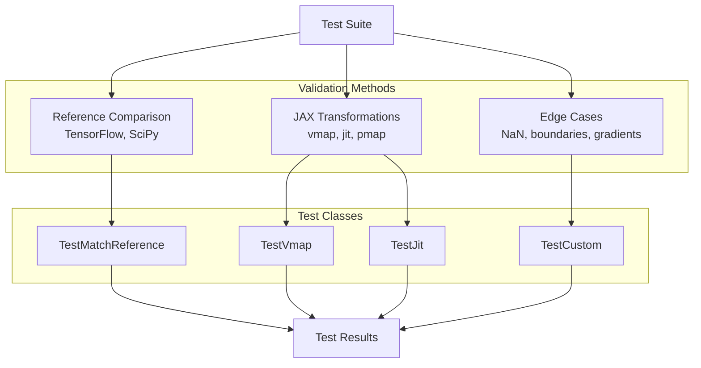
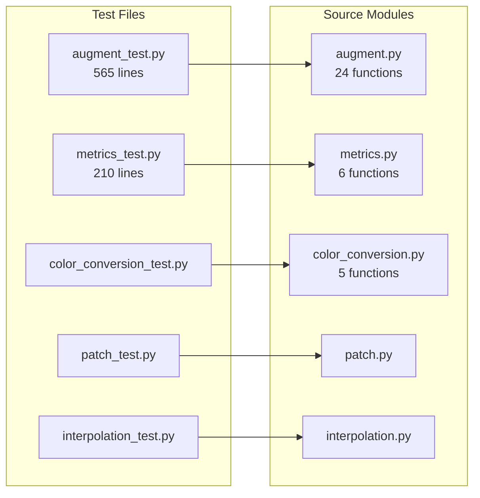
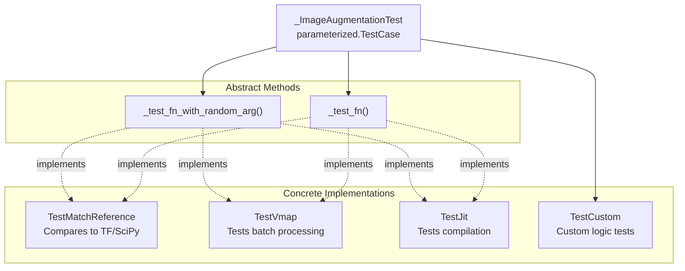
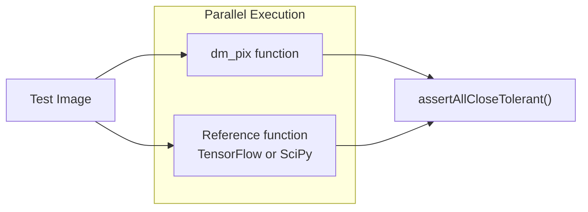
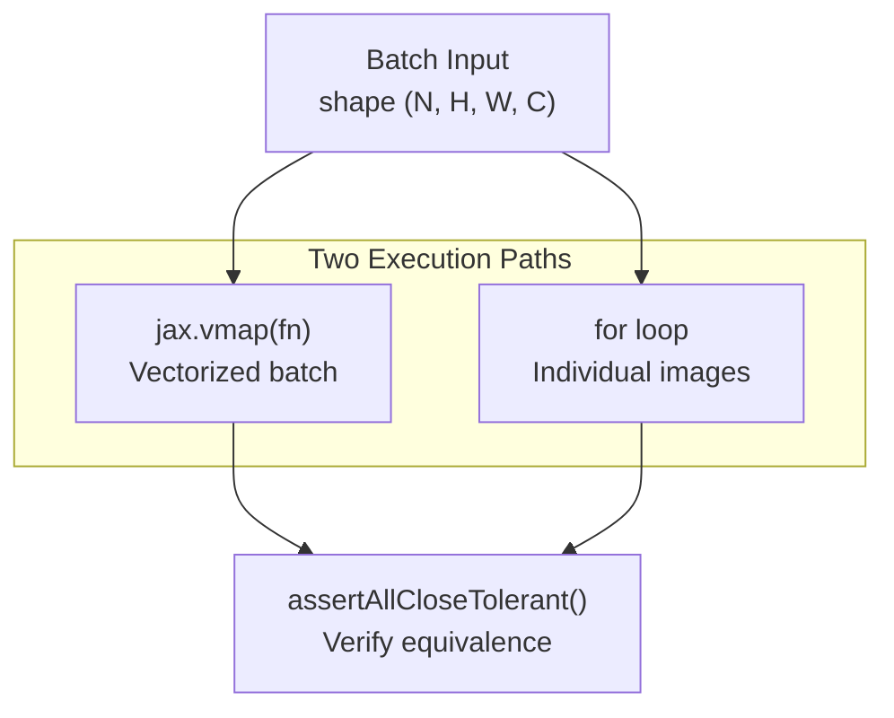
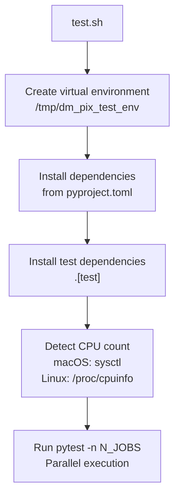

<!-- source: DeepWiki mcp.deepwiki.com · repo google-deepmind/dm_pix · page 7 Testing and Quality Assurance · fetched 2026-10-26 -->

# Testing and Quality Assurance

<details>
<summary>Relevant source files</summary>

The following files were used as context for generating this wiki page:

- [dm_pix/_src/augment_test.py](dm_pix/_src/augment_test.py)
- [dm_pix/_src/metrics_test.py](dm_pix/_src/metrics_test.py)
- [test.sh](test.sh)

</details>


This document describes the testing infrastructure, validation strategies, and quality assurance processes for the dm_pix library. It covers the test suite architecture, validation methods (reference comparison, JAX transformations, and edge case testing), and practical procedures for running tests.

For information about the CI/CD pipeline and automated testing on push/PR, see [Continuous Integration Workflow](#8.1). For details about JAX integration and transformation compatibility, see [JAX Integration](#6).

---

## Overview of Testing Strategy

dm_pix employs a comprehensive three-pronged validation strategy to ensure correctness and compatibility with JAX transformations:



**Sources:** [dm_pix/_src/augment_test.py:35-563](), [dm_pix/_src/metrics_test.py:24-209]()

---

## Test Suite Structure

The test suite is organized by module, with test coverage proportional to module importance:

| Test Module | Importance | Functions Tested | Primary Validation Methods |
|------------|-----------|------------------|---------------------------|
| `augment_test.py` | 15.61 | 24 augmentation functions | Reference, vmap, jit, edge cases |
| `metrics_test.py` | 12.84 | 6 quality metrics | Reference (TF), chex.all_variants, NaN handling |
| `color_conversion_test.py` | 5.15 | 5 color space conversions | Reference, JAX transformations |
| `patch_test.py` | Cluster 5.34 | Patch extraction | Reference (TF) |
| `interpolation_test.py` | 2.31 | ND linear interpolation | Edge cases, boundary handling |



**Sources:** [dm_pix/_src/augment_test.py:1-14](), [dm_pix/_src/metrics_test.py:1-13]()

---

## Test Architecture

### Base Test Class Pattern

The augmentation test suite uses an abstract base class pattern with concrete implementations for each validation strategy:



The base class `_ImageAugmentationTest` [dm_pix/_src/augment_test.py:35-426]() defines two abstract helper methods:
- `_test_fn_with_random_arg()`: Tests functions with randomized parameters
- `_test_fn()`: Tests functions with fixed parameters

Each concrete test class implements these methods according to its validation strategy.

**Sources:** [dm_pix/_src/augment_test.py:35-50](), [dm_pix/_src/augment_test.py:428-563]()

### Test Fixtures and Data

Standard test images are generated as module-level constants:

| Constant | Shape | Range | Purpose |
|----------|-------|-------|---------|
| `_IMG_SHAPE` | (131, 111, 3) | N/A | Standard test image dimensions |
| `_RAND_FLOATS_IN_RANGE` | (10, 131, 111, 3) | [0.0, 1.0] | Valid image data |
| `_RAND_FLOATS_OUT_OF_RANGE` | (10, 131, 111, 3) | [-0.5, 1.5] | Out-of-bounds data |
| `_KERNEL_SIZE` | 13.1 | N/A | Gaussian blur kernel size |

Tests are parameterized to run on both in-range and out-of-range data [dm_pix/_src/augment_test.py:27-32](), ensuring robustness to invalid inputs.

**Sources:** [dm_pix/_src/augment_test.py:27-32]()

---

## Validation Methods

### Reference Implementation Validation

The `TestMatchReference` class validates correctness by comparing outputs against established reference implementations:



#### Reference Libraries by Function Type

| Function Type | Reference Library | Example Functions |
|--------------|------------------|-------------------|
| Color adjustments | TensorFlow | `adjust_brightness`, `adjust_contrast`, `adjust_hue`, `adjust_saturation`, `adjust_gamma` |
| Geometric transforms | SciPy | `affine_transform`, `rotate` |
| Cropping/Padding | TensorFlow | `center_crop`, `resize_with_crop_or_pad`, `pad_to_size` |
| Quality metrics | TensorFlow | `psnr`, `ssim` |

#### Tolerance Configuration

The `assertAllCloseTolerant()` helper method adjusts numerical tolerance based on hardware platform:

```python
# From dm_pix/_src/augment_test.py:45-49
tol = 1e-2 if jax.local_devices()[0].platform == "tpu" else 1e-4
np.testing.assert_allclose(x, y, rtol=tol, atol=tol)
self.assertEqual(x.dtype, y.dtype)
```

TPU platforms use relaxed tolerance (1e-2) due to lower precision arithmetic, while CPU/GPU use tighter tolerance (1e-4).

**Sources:** [dm_pix/_src/augment_test.py:428-453](), [dm_pix/_src/augment_test.py:45-49](), [dm_pix/_src/metrics_test.py:43-50](), [dm_pix/_src/metrics_test.py:86-146]()

### JAX Transformation Testing

Two dedicated test classes verify compatibility with JAX's core transformations:

#### TestVmap - Batch Processing Verification



The test verifies that `jax.vmap(fn)(batch)` produces identical results to processing each image individually [dm_pix/_src/augment_test.py:456-485](). This ensures functions can be efficiently batched without changing behavior.

#### TestJit - Compilation Verification

The `TestJit` class verifies that JIT-compiled functions produce identical outputs to eager execution [dm_pix/_src/augment_test.py:488-508]():

```python
# Pattern from augment_test.py
jax_fn_jitted = jax.jit(jax_fn)
adjusted_jax = jax_fn(image_rgb, **kwargs)
adjusted_jit = jax_fn_jitted(image_rgb, **kwargs)
self.assertAllCloseTolerant(adjusted_jax, adjusted_jit)
```

**Sources:** [dm_pix/_src/augment_test.py:456-508]()

### Edge Case Testing

#### NaN Handling

Metrics functions support optional NaN ignoring via the `ignore_nans` parameter. Tests verify this functionality:

```python
# From metrics_test.py:53-61
psnr = functools.partial(metrics.psnr, ignore_nans=True)
values_jax_nan = psnr(
    self._img1.at[:, 0, 0, 0].set(np.nan),
    self._img1.at[:, 0, 0, 0].set(np.nan),
)
assert not np.any(np.isnan(values_jax_nan))
```

This pattern is tested for `psnr`, `simse`, and `ssim` functions [dm_pix/_src/metrics_test.py:53-80](), [dm_pix/_src/metrics_test.py:179-205]().

#### Gradient Stability

The SSIM test suite includes gradient stability verification for pathological cases like flat regions:

```python
# From metrics_test.py:170-176
def test_ssim_finite_grad(self):
    img = np.zeros((64, 64, 3))
    grad = self.variant(jax.grad(metrics.ssim))(img, img)
    np.testing.assert_equal(grad, np.zeros_like(grad))
```

This ensures gradient-based optimization remains stable even when computing similarity on uniform images.

#### Boundary Conditions

Custom tests verify behavior at image size boundaries:

| Test Case | Validates |
|-----------|-----------|
| `test_center_crop_size_bigger_than_original` | Crop size larger than image returns original size |
| `test_pad_to_size_when_target_size_smaller_than_original` | Pad target smaller than image returns original size |

**Sources:** [dm_pix/_src/metrics_test.py:52-80](), [dm_pix/_src/metrics_test.py:170-176](), [dm_pix/_src/augment_test.py:511-561]()

---

## Test Infrastructure Components

### Chex Integration

The `chex` library provides critical testing utilities:

#### chex.all_variants

The `@chex.all_variants` decorator automatically tests functions across multiple JAX transformation contexts [dm_pix/_src/metrics_test.py:43-50](), [dm_pix/_src/metrics_test.py:85-146]():

```python
# From metrics_test.py
class MSETest(chex.TestCase, absltest.TestCase):
    @chex.all_variants
    def test_psnr_match(self):
        psnr = self.variant(metrics.psnr)
        # Test runs with: no transform, jit, vmap, pmap, etc.
```

This ensures functions work correctly when:
- Executed eagerly (no transformation)
- JIT-compiled (`jax.jit`)
- Vectorized (`jax.vmap`)
- Parallelized across devices (`jax.pmap`)

#### chex.TestCase

Inheriting from `chex.TestCase` provides the `self.variant()` method for wrapping functions under test, enabling automatic multi-context execution.

**Sources:** [dm_pix/_src/metrics_test.py:24-209]()

### Parameterized Testing

The `absl.testing.parameterized` module enables concise test case generation:

```python
# From augment_test.py:51-58
@parameterized.named_parameters(
    ("in_range", _RAND_FLOATS_IN_RANGE),
    ("out_of_range", _RAND_FLOATS_OUT_OF_RANGE))
def test_adjust_brightness(self, images_list):
    self._test_fn_with_random_arg(...)
```

Complex parameter combinations use `@parameterized.product`:

```python
# From augment_test.py:269-282
@parameterized.product(
    parameters_base=[
        ("in_range", "nearest", 0),
        ("in_range", "nearest", 1),
        ("in_range", "mirror", 1),
        # ... more combinations
    ],
    cval=(0.0, 1.0, -2.0),
    angle=(0.0, np.pi / 4, -np.pi / 4),
)
def test_rotate(self, parameters_base, cval, angle):
    # Generates 72 test cases (8 × 3 × 3)
```

**Sources:** [dm_pix/_src/augment_test.py:51-96](), [dm_pix/_src/augment_test.py:269-301]()

---

## Running Tests

### Using test.sh

The `test.sh` script provides a complete test execution environment:



**Execution steps:**

1. **Environment creation** [test.sh:18-24](): Creates isolated virtual environment at `/tmp/dm_pix_test_env`
2. **Dependency installation** [test.sh:27-35]():
   - Upgrades pip and setuptools
   - Installs package and test dependencies
   - Prints JAX version for debugging
3. **CPU detection** [test.sh:37-42](): Determines available CPU cores for parallel testing
4. **Test execution** [test.sh:44-45](): Runs pytest with `-n N_JOBS` for parallel test execution

**Usage:**

```bash
bash test.sh
```

The virtual environment persists at `/tmp/dm_pix_test_env` and can be removed manually when no longer needed.

**Sources:** [test.sh:1-46]()

### Direct pytest Usage

For more control, invoke pytest directly:

```bash
# Run all tests
pytest dm_pix

# Run specific test module
pytest dm_pix/_src/augment_test.py

# Run specific test class
pytest dm_pix/_src/augment_test.py::TestMatchReference

# Run specific test method
pytest dm_pix/_src/augment_test.py::TestMatchReference::test_adjust_brightness

# Parallel execution with 8 workers
pytest -n 8 dm_pix

# Verbose output
pytest -v dm_pix

# Stop on first failure
pytest -x dm_pix
```

### JAX Configuration

Tests configure JAX for consistent numerical behavior:

```python
# From augment_test.py:564
jax.config.update("jax_default_matmul_precision", "float32")
```

This ensures float32 precision for matrix operations, preventing precision-related test failures.

**Sources:** [test.sh:44-45](), [dm_pix/_src/augment_test.py:564]()

---

## Known Test Limitations

### TensorFlow Reference Bugs

Some tests work around known bugs in TensorFlow reference implementations:

#### Saturation Adjustment Edge Case

The `test_adjust_saturation` method perturbs inputs to avoid a TensorFlow rounding error when green and blue channels have nearly identical values [dm_pix/_src/augment_test.py:100-112]():

```python
# Perturb to avoid TF bug
rgb_new[..., 1] += 0.001 * (np.abs(rgb[..., 2] - rgb[..., 1]) < 1e-3)
```

#### Hue Adjustment Range Limitation

CPU TensorFlow uses a different hue adjustment algorithm outside [0, 1] range. Tests disable out-of-range validation for `adjust_hue` [dm_pix/_src/augment_test.py:125-128]().

### SciPy Interpolation Mode Limitations

Due to JAX issues [#11097](https://github.com/jax-ml/jax/issues/11097), not all SciPy interpolation modes are tested for `affine_transform` [dm_pix/_src/augment_test.py:191-201]():

```python
# Only testing: "nearest" (order 0,1), "mirror" (order 1)
# Not testing: "constant", "wrap", "reflect" due to scipy/jax bugs
```

**Sources:** [dm_pix/_src/augment_test.py:100-140](), [dm_pix/_src/augment_test.py:191-201]()

---

