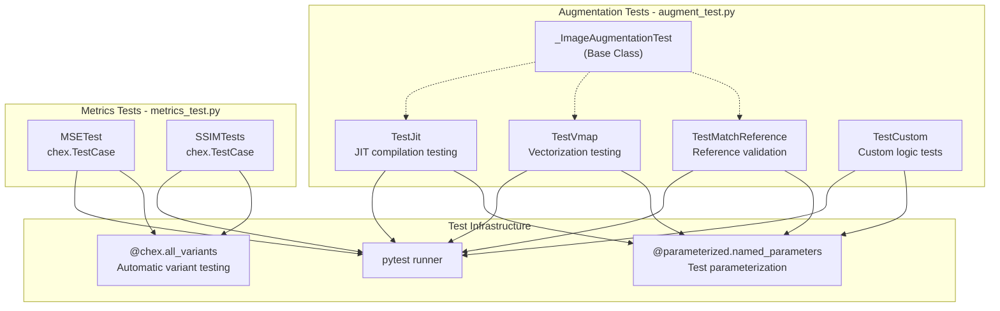
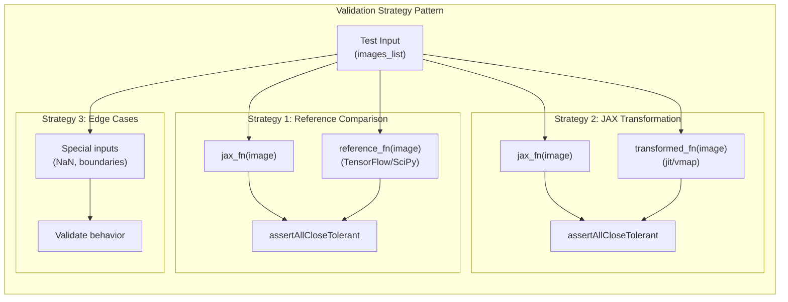
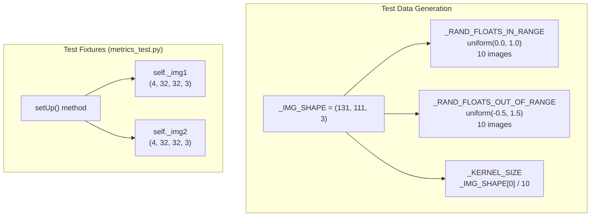

<!-- source: DeepWiki mcp.deepwiki.com · repo google-deepmind/dm_pix · page 7.1 Test Architecture · fetched 2026-10-26 -->

# Test Architecture

<details>
<summary>Relevant source files</summary>

The following files were used as context for generating this wiki page:

- [dm_pix/_src/augment_test.py](dm_pix/_src/augment_test.py)
- [dm_pix/_src/metrics_test.py](dm_pix/_src/metrics_test.py)
- [test.sh](test.sh)

</details>


## Purpose and Scope

This document describes the testing infrastructure for dm_pix, including the test framework design, validation strategies, and test suite organization. It covers the pytest-based testing architecture, the use of `chex.all_variants` for automatic multi-context testing, and how tests validate correctness against reference implementations.

For information about running tests in practice, see [Running Tests](#7.3). For details on how tests validate against reference implementations, see [Reference Implementation Validation](#7.2).

## Testing Framework Overview

The dm_pix test suite uses `pytest` as the primary test runner, with specialized extensions for JAX-specific testing:

| Component | Purpose | Key Features |
|-----------|---------|--------------|
| `pytest` | Test runner and framework | Parameterized tests, fixtures, parallel execution |
| `chex.TestCase` | JAX transformation testing | Automatic testing across jit/vmap/pmap variants |
| `parameterized.TestCase` | Test parameterization | Named parameters, product combinations |
| `absltest.TestCase` | Base test functionality | Assertion helpers, test lifecycle |

The test architecture separates concerns into distinct test classes, each validating a specific aspect of function correctness: reference implementation matching, JAX transformation compatibility, and edge case handling.

**Sources:** [dm_pix/_src/augment_test.py:1-566](), [dm_pix/_src/metrics_test.py:1-210]()

## Test Suite Organization



**Test Suite Structure**

The augmentation test suite follows an inheritance-based architecture where `_ImageAugmentationTest` defines the testing interface and three subclasses implement different validation strategies. The metrics test suite uses composition with `chex.TestCase` for automatic variant testing.

**Sources:** [dm_pix/_src/augment_test.py:35-563](), [dm_pix/_src/metrics_test.py:24-209]()

## Base Test Class Architecture

### _ImageAugmentationTest Class

The `_ImageAugmentationTest` base class [dm_pix/_src/augment_test.py:35-426]() defines the testing interface with two abstract methods:

```python
# Interface methods (implemented by subclasses)
def _test_fn(self, images_list, jax_fn, reference_fn):
    pass

def _test_fn_with_random_arg(self, images_list, jax_fn, reference_fn, **kw_range):
    pass
```

These methods are implemented differently by each test class:

| Test Class | `_test_fn` Implementation | `_test_fn_with_random_arg` Implementation |
|------------|---------------------------|-------------------------------------------|
| `TestMatchReference` | Compares JAX output to reference | Generates random arguments, compares outputs |
| `TestVmap` | Compares vmap'd output to sequential | Compares vmap'd output to sequential with random args |
| `TestJit` | Compares JIT'd output to eager | Compares JIT'd output to eager with random args |

### Test Helper Methods

The base class provides `assertAllCloseTolerant` [dm_pix/_src/augment_test.py:45-49]() which adjusts tolerance based on hardware:

```python
def assertAllCloseTolerant(self, x, y):
    # Increase tolerance on TPU due to lower precision.
    tol = 1e-2 if jax.local_devices()[0].platform == "tpu" else 1e-4
    np.testing.assert_allclose(x, y, rtol=tol, atol=tol)
    self.assertEqual(x.dtype, y.dtype)
```

This ensures tests pass on TPU hardware where lower precision arithmetic may produce slightly different results.

**Sources:** [dm_pix/_src/augment_test.py:35-49]()

## Test Validation Strategies



**Strategy 1: Reference Implementation Validation**

The `TestMatchReference` class [dm_pix/_src/augment_test.py:428-454]() validates dm_pix functions against established libraries:

- **TensorFlow**: Used for color adjustments (`tf.image.adjust_brightness`, `tf.image.adjust_contrast`, etc.)
- **SciPy**: Used for geometric transforms (`scipy.ndimage.affine_transform`, `scipy.ndimage.rotate`)
- **TensorFlow Keras**: Used for cropping operations (`tf.keras.layers.CenterCrop`)

Example test implementation [dm_pix/_src/augment_test.py:445-453]():

```python
def _test_fn(self, images_list, jax_fn, reference_fn):
    if reference_fn is None:
        return
    for image_rgb in images_list:
        adjusted_jax = jax_fn(image_rgb)
        adjusted_reference = reference_fn(image_rgb)
        if hasattr(adjusted_reference, "numpy"):
            adjusted_reference = adjusted_reference.numpy()
        self.assertAllCloseTolerant(adjusted_jax, adjusted_reference)
```

**Strategy 2: JAX Transformation Validation**

The `TestVmap` class [dm_pix/_src/augment_test.py:456-486]() ensures functions work correctly when vectorized:

```python
def _test_fn(self, images_list, jax_fn, reference_fn):
    del reference_fn  # unused.
    fn_vmap = jax.vmap(jax_fn)
    outputs_vmaped = list(fn_vmap(np.stack(images_list, axis=0)))
    assert len(images_list) == len(outputs_vmaped)
    for image_rgb, adjusted_vmap in zip(images_list, outputs_vmaped):
        adjusted_jax = jax_fn(image_rgb)
        self.assertAllCloseTolerant(adjusted_jax, adjusted_vmap)
```

The `TestJit` class [dm_pix/_src/augment_test.py:488-509]() ensures functions compile correctly:

```python
def _test_fn(self, images_list, jax_fn, reference_fn):
    del reference_fn  # unused.
    jax_fn_jitted = jax.jit(jax_fn)
    for image_rgb in images_list:
        adjusted_jax = jax_fn(image_rgb)
        adjusted_jit = jax_fn_jitted(image_rgb)
        self.assertAllCloseTolerant(adjusted_jax, adjusted_jit)
```

**Strategy 3: Edge Case and Custom Logic Testing**

The `TestCustom` class [dm_pix/_src/augment_test.py:511-561]() validates behavior not covered by reference implementations, such as:

- Center crop behavior when target size exceeds image dimensions [dm_pix/_src/augment_test.py:521-536]()
- Pad-to-size behavior when target is smaller than original [dm_pix/_src/augment_test.py:545-560]()

**Sources:** [dm_pix/_src/augment_test.py:428-561](), [dm_pix/_src/metrics_test.py:43-206]()

## chex.all_variants Pattern

The metrics test suite uses `chex.all_variants` [dm_pix/_src/metrics_test.py:43-50]() to automatically test functions across different JAX transformation contexts:

```python
@chex.all_variants
def test_psnr_match(self):
    psnr = self.variant(metrics.psnr)
    values_jax = psnr(self._img1, self._img2)
    values_tf = tf.image.psnr(self._img1, self._img2, max_val=1.0).numpy()
    np.testing.assert_allclose(values_jax, values_tf, rtol=1e-3, atol=1e-3)
```

The `@chex.all_variants` decorator automatically runs the test with:
- Eager mode execution
- JIT-compiled execution (`jax.jit`)
- No-op variant (for control)

This pattern is more concise than the augmentation test's explicit `TestVmap` and `TestJit` classes, trading explicitness for automation.

**Sources:** [dm_pix/_src/metrics_test.py:43-50](), [dm_pix/_src/metrics_test.py:85-146]()

## Test Data and Fixtures



### Augmentation Test Data

The augmentation tests define module-level constants [dm_pix/_src/augment_test.py:27-32]():

| Constant | Purpose | Generation |
|----------|---------|------------|
| `_IMG_SHAPE` | Standard test image dimensions | `(131, 111, 3)` |
| `_RAND_FLOATS_IN_RANGE` | Valid range images | `np.random.uniform(0., 1., size=(10,) + _IMG_SHAPE)` |
| `_RAND_FLOATS_OUT_OF_RANGE` | Extended range images | `np.random.uniform(-0.5, 1.5, size=(10,) + _IMG_SHAPE)` |
| `_KERNEL_SIZE` | Blur kernel size | `_IMG_SHAPE[0] / 10.` |

These constants are used with `@parameterized.named_parameters` to test functions with both valid and out-of-range inputs.

### Metrics Test Fixtures

The metrics tests use `setUp()` method [dm_pix/_src/metrics_test.py:26-41]() to generate test fixtures:

```python
def setUp(self):
    super().setUp()
    key = jax.random.PRNGKey(0)
    key1, key2 = jax.random.split(key)
    self._img1 = jax.random.uniform(
        key1,
        shape=(4, 32, 32, 3),
        minval=0.0,
        maxval=1.0,
    )
    self._img2 = jax.random.uniform(
        key2,
        shape=(4, 32, 32, 3),
        minval=0.0,
        maxval=1.0,
    )
```

This creates reproducible random test images using a fixed PRNG seed.

**Sources:** [dm_pix/_src/augment_test.py:27-32](), [dm_pix/_src/metrics_test.py:26-41]()

## Parameterized Testing Pattern

### Named Parameters

Tests use `@parameterized.named_parameters` to run the same test logic with different input configurations [dm_pix/_src/augment_test.py:51-58]():

```python
@parameterized.named_parameters(("in_range", _RAND_FLOATS_IN_RANGE),
                                ("out_of_range", _RAND_FLOATS_OUT_OF_RANGE))
def test_adjust_brightness(self, images_list):
    self._test_fn_with_random_arg(
        images_list,
        jax_fn=augment.adjust_brightness,
        reference_fn=tf.image.adjust_brightness,
        delta=(-0.5, 0.5))
```

This creates two test cases: `test_adjust_brightness_in_range` and `test_adjust_brightness_out_of_range`.

### Product Parameterization

Complex tests use `@parameterized.product` to test all combinations [dm_pix/_src/augment_test.py:269-302]():

```python
@parameterized.product(
    parameters_base=[
        ("in_range", "nearest", 0),
        ("in_range", "nearest", 1),
        ("in_range", "mirror", 1),
        # ... more combinations
    ],
    cval=(0.0, 1.0, -2.0),
    angle=(0.0, np.pi / 4, -np.pi / 4),
)
def test_rotate(self, parameters_base, cval, angle):
    # Test logic
```

This generates `8 * 3 * 3 = 72` test cases covering all combinations of image ranges, interpolation modes, orders, constant values, and rotation angles.

**Sources:** [dm_pix/_src/augment_test.py:51-302](), [dm_pix/_src/augment_test.py:358-425]()

## Test Execution Configuration

The `test.sh` script [test.sh:1-46]() orchestrates test execution:

| Step | Command/Action | Purpose |
|------|----------------|---------|
| 1. Virtual environment | `python -m venv "${VENV_DIR}"` | Isolate test dependencies |
| 2. Install package | `python -m pip install .` | Install dm_pix |
| 3. Install test deps | `python -m pip install -e ".[test]"` | Install pytest, chex, etc. |
| 4. Run tests | `python -m pytest -n "${N_JOBS}" dm_pix` | Execute tests in parallel |

The `-n "${N_JOBS}"` flag enables parallel test execution using `pytest-xdist`, where `N_JOBS` is set to the number of logical CPU cores available on the system [test.sh:37-42]().

**Sources:** [test.sh:1-46]()

## Special Test Considerations

### TPU Tolerance Adjustments

Tests automatically adjust numerical tolerances based on hardware platform [dm_pix/_src/augment_test.py:45-49](). TPU uses lower precision arithmetic, requiring relaxed tolerances (`1e-2` vs `1e-4`).

### Known Reference Implementation Issues

Some tests work around known bugs in reference implementations:

**TensorFlow Saturation Adjustment**: The test perturbs inputs to avoid a rounding error in TensorFlow's implementation [dm_pix/_src/augment_test.py:100-112]():

```python
def perturb(rgb):
    rgb_new = np.copy(rgb)
    rgb_new[..., 1] += 0.001 * (np.abs(rgb[..., 2] - rgb[..., 1]) < 1e-3)
    return rgb_new
```

**SciPy Mode Limitations**: Certain interpolation modes cannot be tested due to SciPy bugs [dm_pix/_src/augment_test.py:191-201]():

```python
# Due to a bug in scipy we cannot test all available modes
@parameterized.named_parameters(
    ("in_range_nearest_0", _RAND_FLOATS_IN_RANGE, "nearest", 0),
    ("in_range_nearest_1", _RAND_FLOATS_IN_RANGE, "nearest", 1),
    ("in_range_mirror_1", _RAND_FLOATS_IN_RANGE, "mirror", 1),
    # ... only safe modes tested
)
```

### NaN Handling Tests

Metrics tests specifically validate NaN handling with the `ignore_nans` parameter [dm_pix/_src/metrics_test.py:52-61]():

```python
@chex.all_variants
def test_psnr_ignore_nans(self):
    psnr = self.variant(functools.partial(metrics.psnr, ignore_nans=True))
    values_jax_nan = psnr(
        self._img1.at[:, 0, 0, 0].set(np.nan),
        self._img1.at[:, 0, 0, 0].set(np.nan),
    )
    assert not np.any(np.isnan(values_jax_nan))
```

This ensures metrics can safely compute on partially corrupted image data.

**Sources:** [dm_pix/_src/augment_test.py:45-49](), [dm_pix/_src/augment_test.py:100-112](), [dm_pix/_src/augment_test.py:191-201](), [dm_pix/_src/metrics_test.py:52-80]()

## Test Coverage Summary

| Module | Test File | Test Classes | Key Validations |
|--------|-----------|--------------|-----------------|
| `augment.py` | `augment_test.py` | 4 classes, 15+ test methods | Reference matching, vmap/jit compatibility, edge cases |
| `metrics.py` | `metrics_test.py` | 2 classes, 6+ test methods | Reference matching, NaN handling, gradient stability |
| `color_conversion.py` | `color_conversion_test.py` | Not shown | (See section 4) |
| `interpolation.py` | `interpolation_test.py` | Not shown | (See section 5.2) |
| `patch.py` | `patch_test.py` | Not shown | (See section 5.1) |

The test architecture ensures comprehensive validation through:
1. Multiple validation strategies (reference, transformation, edge cases)
2. Automated testing across JAX contexts (jit, vmap, pmap)
3. Parameterized testing for broad input coverage
4. Special handling for hardware-specific precision differences

**Sources:** [dm_pix/_src/augment_test.py:1-566](), [dm_pix/_src/metrics_test.py:1-210]()

---

