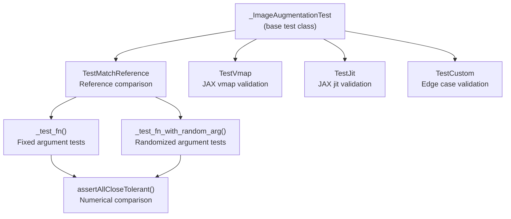
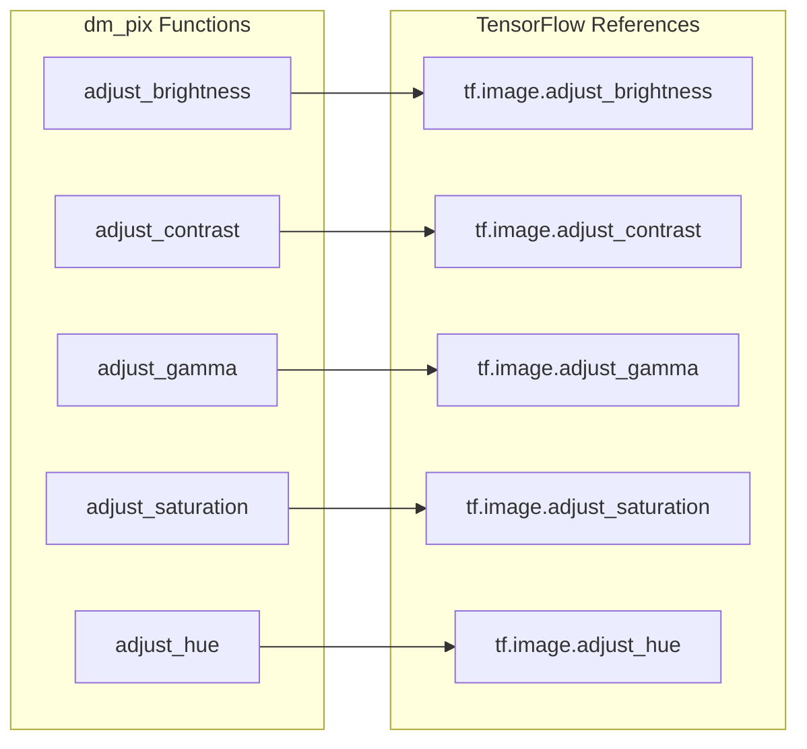
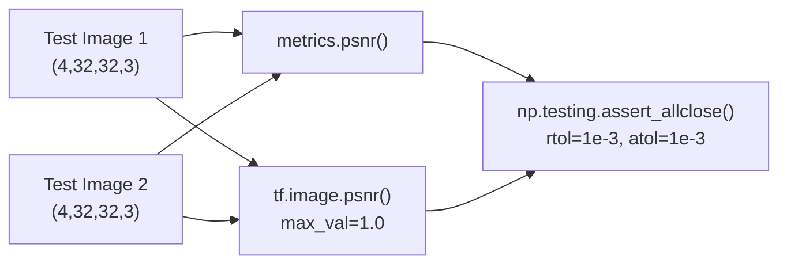
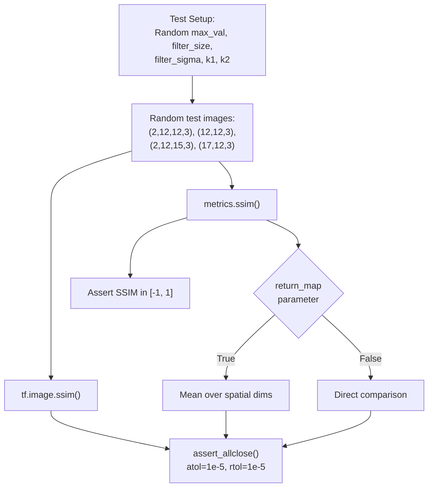
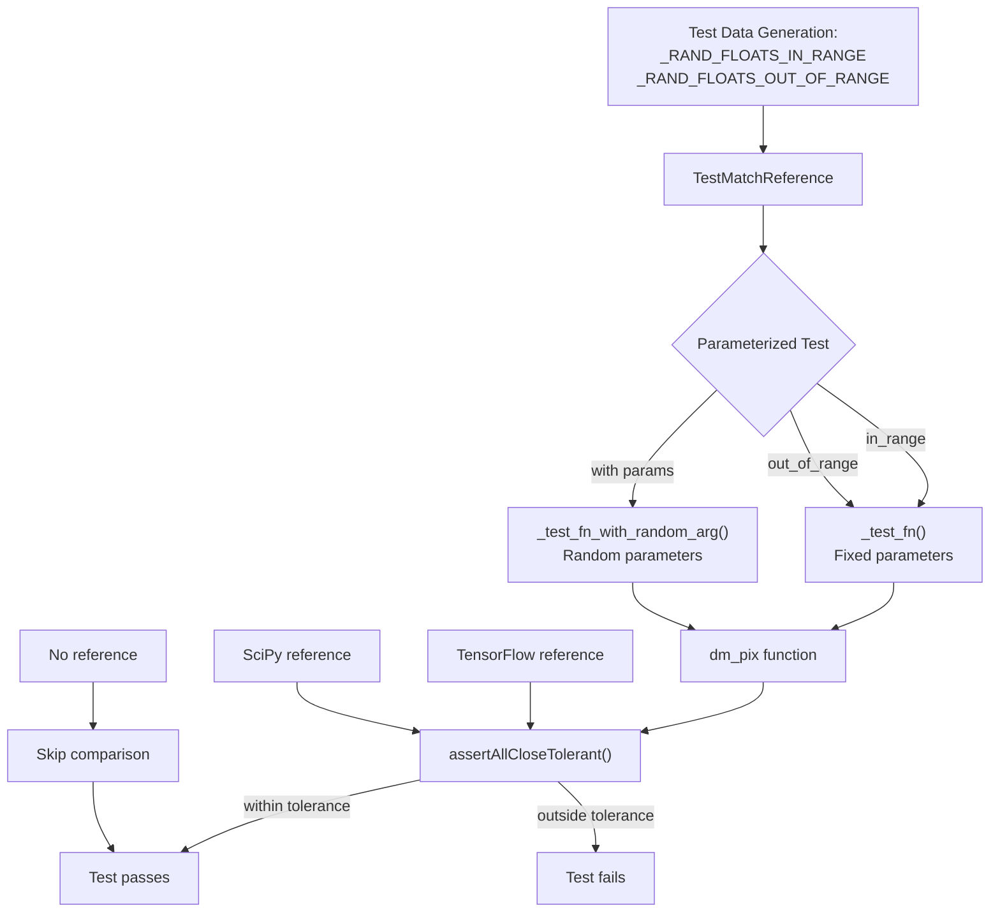

<!-- source: DeepWiki mcp.deepwiki.com · repo google-deepmind/dm_pix · page 7.2 Reference Implementation Validation · fetched 2026-10-26 -->

# Reference Implementation Validation

<details>
<summary>Relevant source files</summary>

The following files were used as context for generating this wiki page:

- [dm_pix/_src/augment_test.py](dm_pix/_src/augment_test.py)
- [dm_pix/_src/metrics_test.py](dm_pix/_src/metrics_test.py)

</details>


## Purpose and Scope

This document describes how dm_pix validates the correctness of its implementations by comparing outputs against established reference implementations from TensorFlow and SciPy. Reference validation is one of three validation strategies employed in the testing infrastructure. For information about the broader testing framework, see [Test Architecture](#7.1). For practical instructions on running tests, see [Running Tests](#7.3).

The reference validation strategy ensures that dm_pix functions produce numerically equivalent results to widely-used, battle-tested libraries when given the same inputs and parameters. This is critical for users migrating from TensorFlow to JAX-based workflows, as it guarantees functional parity.

---

## Reference Libraries Used

dm_pix validates against two primary reference implementations:

| Library | Usage | Functions Validated |
|---------|-------|---------------------|
| **TensorFlow** | Image processing operations, quality metrics | Color adjustments, flips, rotations, crops, padding, PSNR, SSIM |
| **SciPy** | Scientific computing, geometric transforms | Affine transformations, rotation with interpolation |

The choice of reference library depends on the function category. TensorFlow serves as the primary reference for high-level image operations, while SciPy validates lower-level geometric transformations and interpolation.

Sources: [dm_pix/_src/augment_test.py:24-25](), [dm_pix/_src/metrics_test.py:21]()

---

## Validation Methodology

### Test Class Structure

Reference validation is implemented through the `TestMatchReference` class, which inherits from `_ImageAugmentationTest` and overrides validation methods to compare against reference implementations.



Sources: [dm_pix/_src/augment_test.py:35-43](), [dm_pix/_src/augment_test.py:428-454]()

### Core Validation Methods

The `TestMatchReference` class implements two primary validation patterns:

**Fixed Argument Validation** [`_test_fn`]() - Tests functions with predetermined parameters:

```
For each test image:
  1. Apply dm_pix function
  2. Apply reference function with same parameters
  3. Compare outputs with tolerance-aware assertion
```

**Randomized Argument Validation** [`_test_fn_with_random_arg`]() - Tests functions across a parameter range:

```
For each test image:
  1. Generate random argument in specified range
  2. Apply dm_pix function with argument
  3. Apply reference function with same argument
  4. Compare outputs with tolerance-aware assertion
```

Sources: [dm_pix/_src/augment_test.py:430-454]()

---

## Augmentation Function Validation

### Color Adjustment Functions

The following color adjustment functions are validated against TensorFlow's `tf.image` module:



Each function is tested with:
- **In-range images**: Pixel values in [0, 1]
- **Out-of-range images**: Pixel values in [-0.5, 1.5]
- **Random argument ranges**: Function-specific parameter bounds

**Known Limitations**:

The saturation adjustment test includes a workaround for a TensorFlow rounding error when green and blue channels have very close values. The test perturbs inputs slightly to avoid triggering this edge case.

Sources: [dm_pix/_src/augment_test.py:53-66](), [dm_pix/_src/augment_test.py:69-81](), [dm_pix/_src/augment_test.py:84-96](), [dm_pix/_src/augment_test.py:99-124](), [dm_pix/_src/augment_test.py:127-141]()

### Geometric Transformation Functions

Geometric transformations are validated against both TensorFlow and SciPy:

| dm_pix Function | Reference Implementation | Notes |
|-----------------|-------------------------|-------|
| `flip_left_right` | `tf.image.flip_left_right` | Direct comparison |
| `flip_up_down` | `tf.image.flip_up_down` | Direct comparison |
| `rot90` | `tf.image.rot90` | Tested with k=1,2,3 |
| `affine_transform` | `scipy.ndimage.affine_transform` | Multiple matrix format tests |
| `rotate` | `scipy.ndimage.rotate` | Angle conversion (radians→degrees) |
| `center_crop` | `tf.keras.layers.CenterCrop` | Uses Keras layer as reference |
| `pad_to_size` | `tf.image.resize_with_crop_or_pad` | TF function used as proxy |
| `resize_with_crop_or_pad` | `tf.image.resize_with_crop_or_pad` | Direct comparison |

**Affine Transform Test Coverage**:

The `affine_transform` function is tested with multiple matrix format variations to ensure compatibility with SciPy's interface:

- `(ndim, ndim)` matrix without offset
- `(ndim, ndim)` matrix with separate offset vector
- `(ndim+1, ndim+1)` homogeneous transformation matrix
- `(ndim, ndim+1)` matrix with embedded translation
- `(ndim,)` diagonal scaling matrix

Sources: [dm_pix/_src/augment_test.py:162-190](), [dm_pix/_src/augment_test.py:194-268](), [dm_pix/_src/augment_test.py:269-302](), [dm_pix/_src/augment_test.py:363-378](), [dm_pix/_src/augment_test.py:384-426]()

---

## Metrics Function Validation

### PSNR Validation

The Peak Signal-to-Noise Ratio (PSNR) metric is validated against `tf.image.psnr`:



The test validates:
- Numerical agreement within tolerance (rtol=1e-3, atol=1e-3)
- Proper handling of `ignore_nans` parameter
- Consistency across JAX transformations via `chex.all_variants`

Sources: [dm_pix/_src/metrics_test.py:43-61]()

### SSIM Validation

The Structural Similarity Index Measure (SSIM) is validated against `tf.image.ssim` with extensive parameter randomization:

**Randomized Test Parameters**:
- `max_val`: [0.1, 3.0]
- `filter_size`: [1, 10] (integer)
- `filter_sigma`: [0.1, 10.0]
- `k1`: [0.001, 0.1]
- `k2`: [0.001, 0.1]

**Test Coverage**:
1. **Golden value tests**: Match TensorFlow outputs across random parameters
2. **Lower bound test**: Verify SSIM=-1 for perfectly negatively correlated images
3. **Gradient stability test**: Ensure finite gradients on flat regions
4. **NaN handling test**: Validate `ignore_nans` parameter



Sources: [dm_pix/_src/metrics_test.py:86-206]()

---

## Tolerance Configuration

### Platform-Specific Tolerances

The `assertAllCloseTolerant` method adjusts numerical comparison tolerances based on the execution platform:

| Platform | Relative Tolerance | Absolute Tolerance | Reason |
|----------|-------------------|-------------------|--------|
| TPU | 1e-2 | 1e-2 | Lower precision arithmetic |
| CPU/GPU | 1e-4 | 1e-4 | Higher precision available |

```python
def assertAllCloseTolerant(self, x, y):
    # Increase tolerance on TPU due to lower precision.
    tol = 1e-2 if jax.local_devices()[0].platform == "tpu" else 1e-4
    np.testing.assert_allclose(x, y, rtol=tol, atol=tol)
    self.assertEqual(x.dtype, y.dtype)
```

The method also validates dtype consistency to catch unintended type promotions or demotions.

Sources: [dm_pix/_src/augment_test.py:45-49]()

---

## Functions Without Reference Implementations

Several dm_pix functions do not have equivalent reference implementations and are therefore validated only through custom tests and JAX transformation tests:

### Augmentation Functions

| Function | Reason for No Reference |
|----------|-------------------------|
| `solarize` | No standard implementation in TensorFlow/SciPy |
| `gaussian_blur` | Parameter differences from standard implementations |
| `random_crop` | Deterministic crop behavior not in TensorFlow |
| `elastic_deformation` | PRNG differences between NumPy and JAX prevent comparison |
| `random_*` variants | Stochastic wrappers unique to dm_pix design |

**Elastic Deformation Special Case**:

The `elastic_deformation` function cannot be validated against reference implementations because the displacement field generation uses JAX's PRNG, which produces different random numbers than NumPy (used by reference implementations). The test validates that the function executes without error but cannot compare outputs.

Sources: [dm_pix/_src/augment_test.py:305-311](), [dm_pix/_src/augment_test.py:314-318](), [dm_pix/_src/augment_test.py:321-325](), [dm_pix/_src/augment_test.py:328-357]()

### Metrics Functions

| Function | Reason for No Reference |
|----------|-------------------------|
| `simse` | Unique scale-invariant metric, no standard implementation |
| `mae`, `mse`, `rmse` | Trivial implementations, validated through property tests |

The `simse` (Scale-Invariant Mean Squared Error) test validates mathematical properties instead of comparing to a reference:

```
simse(img, img * 2.0) → 0  (scale invariance property)
```

Sources: [dm_pix/_src/metrics_test.py:64-69]()

---

## Validation Flow Architecture

The complete reference validation flow integrates multiple components:



Sources: [dm_pix/_src/augment_test.py:35-454](), [dm_pix/_src/metrics_test.py:24-206]()

---

