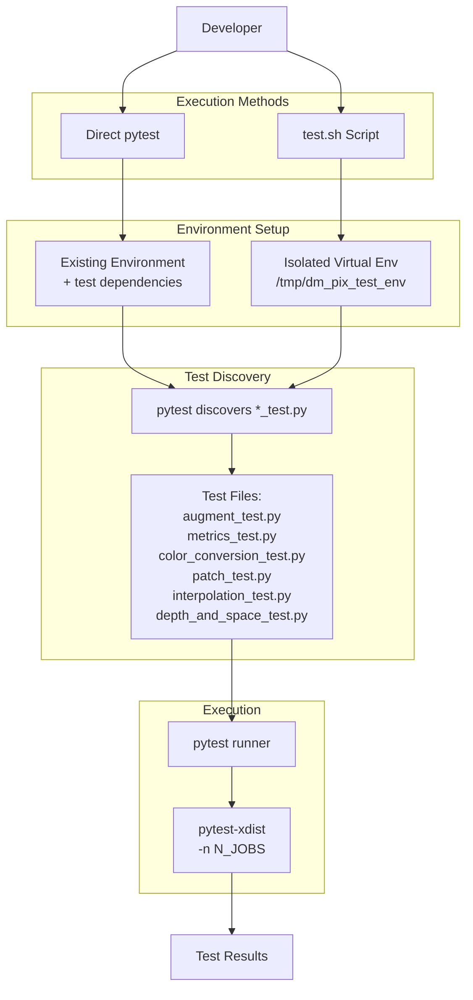
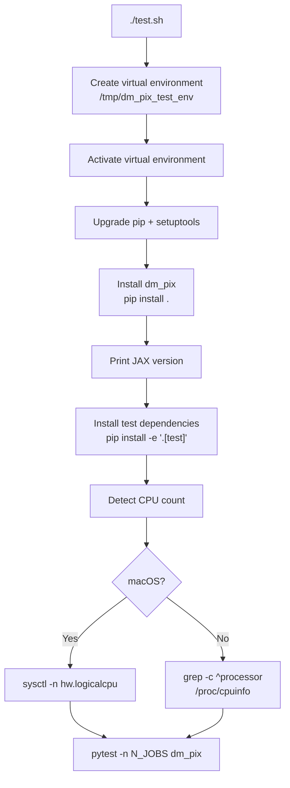
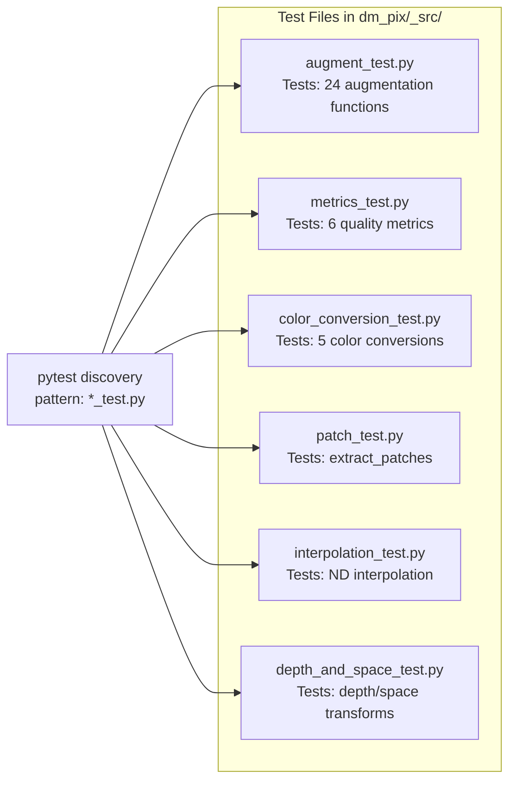
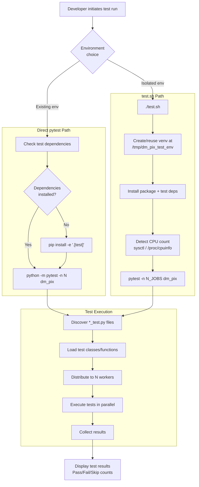

<!-- source: DeepWiki mcp.deepwiki.com · repo google-deepmind/dm_pix · page 7.3 Running Tests · fetched 2026-10-26 -->

# Running Tests

<details>
<summary>Relevant source files</summary>

The following files were used as context for generating this wiki page:

- [README.md](README.md)
- [dm_pix/images/pix_logo.png](dm_pix/images/pix_logo.png)
- [test.sh](test.sh)

</details>


## Purpose and Scope

This document provides practical guidance for executing the dm_pix test suite. It covers the available test execution methods, configuration options, and parallel testing strategies. For information about the test architecture and validation strategies, see [Test Architecture](#7.1). For details on reference implementation validation, see [Reference Implementation Validation](#7.2).

## Test Execution Overview

The dm_pix project provides two primary methods for running tests: direct pytest execution for developers with an existing environment, and the `test.sh` script for isolated virtual environment testing. Both methods execute the same pytest-based test suite but differ in their environment setup approach.



**Test Execution Flow**

Sources: [README.md:103-122](), [test.sh:1-46]()

## Direct pytest Execution

For developers with an existing dm_pix installation, tests can be run directly using pytest after installing test dependencies.

### Installing Test Dependencies

The test dependencies are defined as an optional dependency group in the project configuration. Install them using:

```bash
pip install -e ".[test]"
```

This installs pytest, pytest-xdist for parallel execution, and other testing utilities like chex and parameterized.

### Running All Tests

Execute the full test suite from the repository root:

```bash
python -m pytest dm_pix
```

This command discovers all test files (those with `_test.py` suffix) in the `dm_pix` directory and executes them sequentially.

### Parallel Test Execution

To leverage multiple CPU cores and reduce test execution time, use pytest-xdist:

```bash
python -m pytest -n <NUMCPUS> dm_pix
```

Replace `<NUMCPUS>` with the number of parallel workers. Using `-n auto` automatically detects available CPU cores:

```bash
python -m pytest -n auto dm_pix
```

### Running Specific Test Files

Target individual test modules by specifying the file path:

```bash
python -m pytest dm_pix/_src/augment_test.py
python -m pytest dm_pix/_src/metrics_test.py
python -m pytest dm_pix/_src/color_conversion_test.py
```

### Running Specific Test Functions

Execute individual test functions or classes using the `::` syntax:

```bash
python -m pytest dm_pix/_src/augment_test.py::AdjustBrightnessTest
python -m pytest dm_pix/_src/metrics_test.py::MaeTest::test_constant_values
```

Sources: [README.md:109-115]()

## Using the test.sh Script

The `test.sh` script provides a self-contained test execution environment with automatic dependency installation and cleanup.

### Script Behavior

The script performs the following operations:



**test.sh Execution Flow**

### Running the Script

Execute the script from the repository root:

```bash
./test.sh
```

The script creates a virtual environment at `/tmp/dm_pix_test_env`. This directory persists after execution to speed up subsequent runs, as noted in the script output:

> "Creating virtual environment under /tmp/dm_pix_test_env. You might want to remove this when you no longer need it."

### Platform-Specific CPU Detection

The script automatically detects the number of available CPU cores using platform-specific commands:

| Platform | Command | Implementation |
|----------|---------|----------------|
| macOS | `sysctl -n hw.logicalcpu` | [test.sh:39]() |
| Linux | `grep -c ^processor /proc/cpuinfo` | [test.sh:41]() |

The detected CPU count is stored in the `N_JOBS` variable and used for parallel pytest execution.

### Virtual Environment Location

The virtual environment is created at a fixed location: `/tmp/dm_pix_test_env` as defined in [test.sh:18](). To remove this environment and start fresh:

```bash
rm -rf /tmp/dm_pix_test_env
./test.sh
```

Sources: [test.sh:1-46]()

## Test Discovery and Organization

pytest automatically discovers test files using naming conventions and directory structure.

### Test File Naming Convention

All test files follow the `*_test.py` pattern. The dm_pix test suite includes:



**Test File Discovery Pattern**

### Test Class and Function Naming

Within test files, pytest discovers:
- Test classes with names starting with `Test` (e.g., `TestAdjustBrightness`)
- Test functions with names starting with `test_` (e.g., `test_constant_values`)
- Test methods within test classes starting with `test_`

### Test Directory Structure

Tests are located in `dm_pix/_src/` alongside the source modules they test:

```
dm_pix/
├── _src/
│   ├── augment.py
│   ├── augment_test.py
│   ├── metrics.py
│   ├── metrics_test.py
│   ├── color_conversion.py
│   ├── color_conversion_test.py
│   └── ...
└── __init__.py
```

This co-location pattern keeps tests close to the code they validate.

Sources: [README.md:105-107](), [test.sh:45]()

## Pytest Configuration and Options

The test suite supports various pytest command-line options for customizing test execution behavior.

### Common Pytest Options

| Option | Description | Example |
|--------|-------------|---------|
| `-v` or `--verbose` | Increase test output verbosity | `pytest -v dm_pix` |
| `-s` | Disable output capturing (show print statements) | `pytest -s dm_pix` |
| `-x` or `--exitfirst` | Stop after first failure | `pytest -x dm_pix` |
| `--lf` or `--last-failed` | Rerun only tests that failed in the last run | `pytest --lf dm_pix` |
| `--ff` or `--failed-first` | Run failed tests first, then others | `pytest --ff dm_pix` |
| `-k EXPRESSION` | Run tests matching the expression | `pytest -k brightness dm_pix` |
| `-m MARKEXPR` | Run tests with specific markers | `pytest -m "not slow" dm_pix` |
| `--collect-only` | Show which tests would be executed | `pytest --collect-only dm_pix` |

### Example Usage Patterns

Run verbose tests with parallel execution:
```bash
python -m pytest -v -n auto dm_pix
```

Run only brightness-related tests:
```bash
python -m pytest -k brightness dm_pix
```

Show test collection without running:
```bash
python -m pytest --collect-only dm_pix
```

Run with output capturing disabled (useful for debugging):
```bash
python -m pytest -s dm_pix/_src/augment_test.py::TestAdjustBrightness
```

Sources: [README.md:114](), [test.sh:45]()

## Test Execution Workflow

The complete test execution process integrates environment setup, dependency installation, and parallel test running.



**Complete Test Execution Workflow**

Sources: [README.md:103-122](), [test.sh:1-46]()

## Parallel Execution Details

The test suite uses pytest-xdist for parallel test execution, significantly reducing total runtime on multi-core systems.

### How pytest-xdist Works

When running with `-n` flag, pytest-xdist:

1. **Discovers all tests** in the specified scope
2. **Creates N worker processes** where N is the specified number of cores
3. **Distributes tests** across workers using a scheduling algorithm
4. **Collects results** from all workers
5. **Aggregates output** into a single test report

### CPU Count Detection in test.sh

The script automatically determines optimal parallelism:

```bash
# CPU count on macos or linux
if [ "$(uname)" == "Darwin" ]; then
  N_JOBS=$(sysctl -n hw.logicalcpu)
else
  N_JOBS=$(grep -c ^processor /proc/cpuinfo)
fi
```

This ensures tests use all available logical CPU cores without manual configuration.

### Parallel Execution Considerations

| Aspect | Behavior |
|--------|----------|
| **Test isolation** | Each worker runs in a separate process with independent state |
| **Output capture** | pytest-xdist handles output from multiple workers |
| **Random seeds** | Tests using JAX PRNGs must manage keys properly for reproducibility |
| **Test order** | Tests may execute in different order across runs |
| **Resource contention** | Tests should not depend on shared global state |

Sources: [test.sh:37-45](), [README.md:114]()

## Troubleshooting

Common issues and solutions when running the dm_pix test suite.

### JAX Installation Issues

**Problem**: Tests fail with JAX import errors or CUDA compatibility issues.

**Solution**: Ensure JAX is installed correctly for your system. The dm_pix package does not automatically install JAX due to platform-specific requirements. Follow the [JAX installation instructions](https://github.com/jax-ml/jax#installation) for your platform before running tests.

### Test Dependencies Missing

**Problem**: `ModuleNotFoundError` for pytest, chex, or parameterized.

**Solution**: Install test dependencies:
```bash
pip install -e ".[test]"
```

### Virtual Environment Permission Issues

**Problem**: Cannot create virtual environment at `/tmp/dm_pix_test_env`.

**Solution**: Ensure write permissions to `/tmp` or modify [test.sh:18]() to use a different directory:
```bash
readonly VENV_DIR=~/dm_pix_test_env
```

### Memory Issues with Parallel Execution

**Problem**: Tests fail with out-of-memory errors during parallel execution.

**Solution**: Reduce the number of parallel workers:
```bash
python -m pytest -n 2 dm_pix  # Use only 2 workers
```

### Test Failures Due to Floating Point Precision

**Problem**: Tests fail with small numerical differences.

**Solution**: This may indicate platform-specific floating point behavior. Tests use `chex.assert_trees_all_close` with appropriate tolerance. If failures persist, verify JAX version compatibility:
```bash
python -c 'import jax; print(jax.__version__)'
```

The test.sh script prints the JAX version at [test.sh:32]() for debugging purposes.

Sources: [test.sh:32](), [README.md:23-30]()

## Integration with CI/CD

The test execution methods described here are used by the continuous integration pipeline. The CI workflow runs tests automatically on every push and pull request. For details on the CI configuration and automated testing, see [Continuous Integration Workflow](#8.1).

The test suite's compatibility with parallel execution and isolated environments makes it suitable for both local development and automated CI/CD pipelines.

Sources: [README.md:103-122](), [test.sh:1-46]()

---

