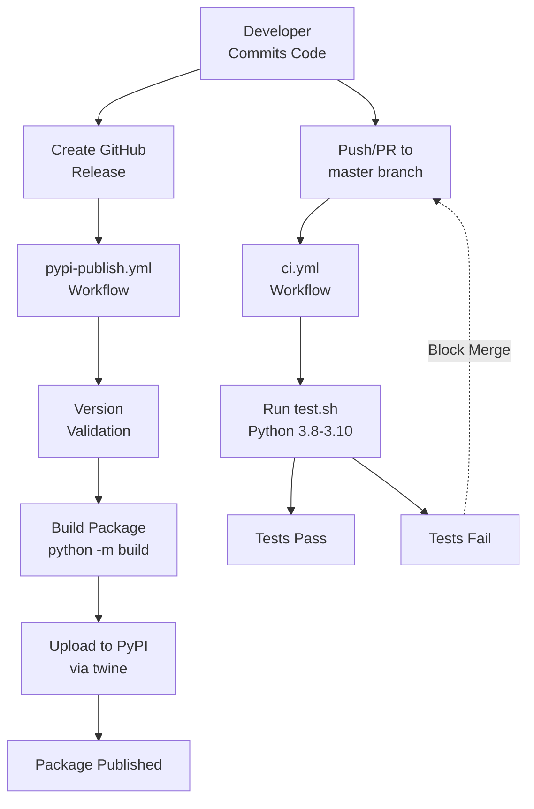
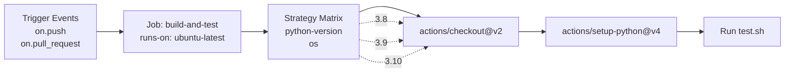
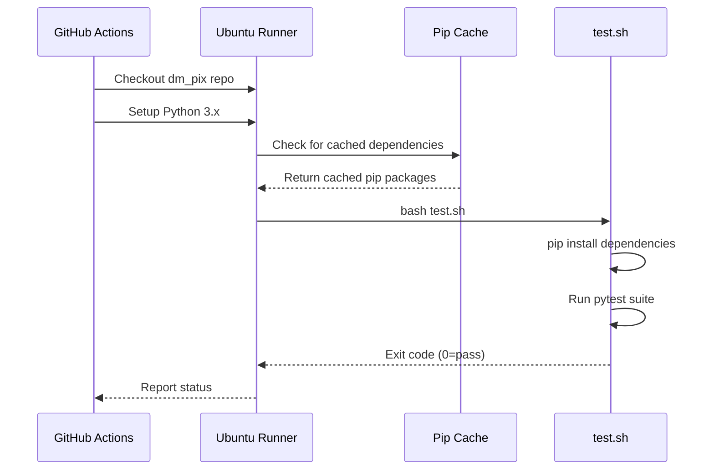
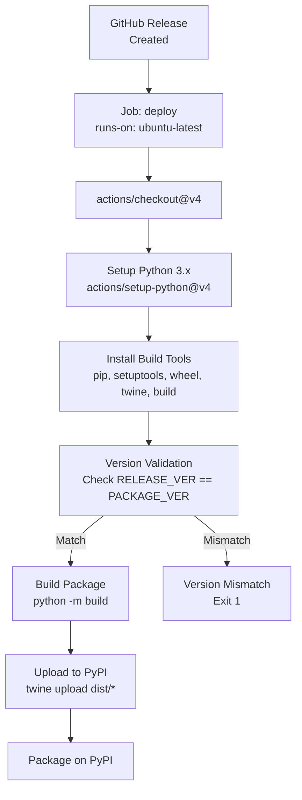
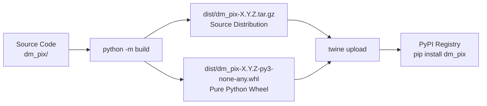
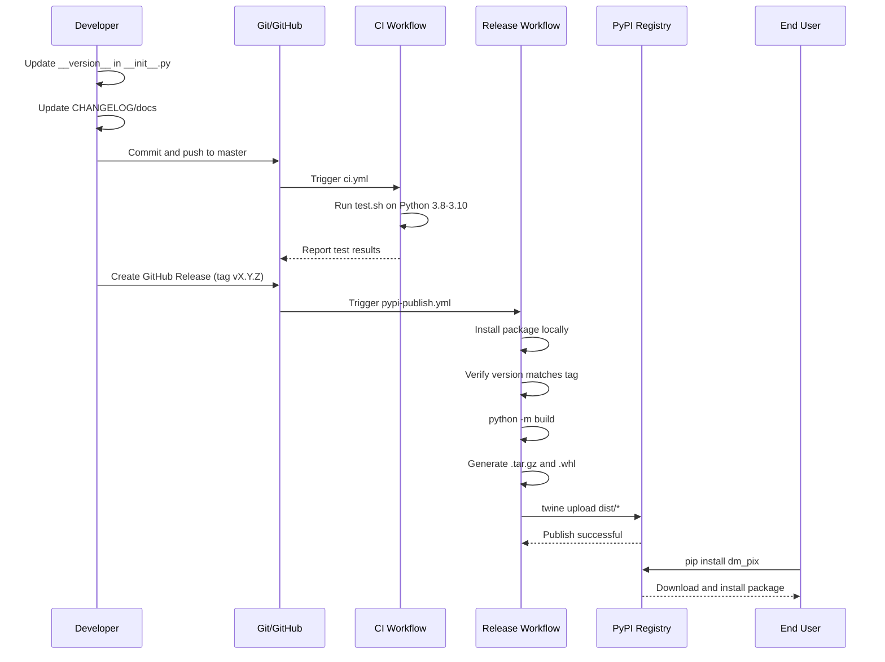

<!-- source: DeepWiki mcp.deepwiki.com · repo google-deepmind/dm_pix · page 8 CI/CD and Release Process · fetched 2026-10-26 -->

# CI/CD and Release Process

<details>
<summary>Relevant source files</summary>

The following files were used as context for generating this wiki page:

- [.github/workflows/ci.yml](.github/workflows/ci.yml)
- [.github/workflows/pypi-publish.yml](.github/workflows/pypi-publish.yml)
- [pyproject.toml](pyproject.toml)

</details>


## Purpose and Scope

This document describes the continuous integration (CI), automated testing, and PyPI release workflows for the dm_pix project. It covers the two primary GitHub Actions workflows ([.github/workflows/ci.yml]()) and [.github/workflows/pypi-publish.yml]()), build system configuration ([pyproject.toml]()), and the automated processes that ensure code quality and package distribution.

For information about the actual test execution and validation strategies, see [Testing and Quality Assurance](#7). For details about building and hosting documentation, see [Documentation System](#9).

**Sources:** [.github/workflows/ci.yml:1-29](), [.github/workflows/pypi-publish.yml:1-36](), [pyproject.toml:1-65]()

## Overview

The dm_pix project employs two distinct automated workflows:

1. **Continuous Integration** (`ci.yml`) - Validates code on every push and pull request
2. **PyPI Publishing** (`pypi-publish.yml`) - Distributes releases to the Python Package Index



**Workflow Trigger Summary**

| Workflow | Trigger | Branches | Python Versions | Purpose |
|----------|---------|----------|-----------------|---------|
| `ci.yml` | push, pull_request | master | 3.8, 3.9, 3.10 | Validate code quality |
| `pypi-publish.yml` | release (created) | any | 3.x | Publish to PyPI |

**Sources:** [.github/workflows/ci.yml:3-7](), [.github/workflows/pypi-publish.yml:3-5](), [.github/workflows/ci.yml:16-17]()

## Continuous Integration Workflow

The CI workflow defined in `.github/workflows/ci.yml` runs automated tests on every push to master and on all pull requests targeting master.

### Workflow Configuration



The workflow uses a matrix strategy to test across multiple Python versions:

| Configuration | Value |
|---------------|-------|
| Job Name | `build-and-test` |
| Operating System | `ubuntu-latest` |
| Python Versions | 3.8, 3.9, 3.10 |
| Test Script | `test.sh` |
| Pip Cache | Enabled via `pyproject.toml` |

**Sources:** [.github/workflows/ci.yml:10-18](), [.github/workflows/ci.yml:21-28]()

### Execution Steps

The workflow executes three primary steps:

1. **Checkout Repository** - Uses `actions/checkout@v2` to clone the repository at the current commit ([.github/workflows/ci.yml:20]())

2. **Setup Python Environment** - Uses `actions/setup-python@v4` with:
   - Matrix-specified Python version ([.github/workflows/ci.yml:22-23]())
   - Pip caching enabled ([.github/workflows/ci.yml:24]())
   - Cache key derived from `pyproject.toml` ([.github/workflows/ci.yml:25]())

3. **Run Tests** - Executes `test.sh` which installs dependencies and runs the test suite ([.github/workflows/ci.yml:26-28]())



**Sources:** [.github/workflows/ci.yml:19-28]()

### Dependency Caching

The workflow leverages GitHub Actions' pip caching mechanism to speed up builds:

- Cache key: Hash of `pyproject.toml` contents
- Cached items: Pip packages installed from `pyproject.toml` dependencies
- Cache hit: Skips pip download, only installs from cache
- Cache miss: Downloads packages, stores in cache for future runs

This optimization reduces typical CI run time by avoiding repeated downloads of JAX, chex, and other dependencies.

**Sources:** [.github/workflows/ci.yml:24-25]()

## PyPI Publishing Workflow

The PyPI publishing workflow defined in `.github/workflows/pypi-publish.yml` automates package distribution to the Python Package Index when a GitHub release is created.

### Workflow Configuration



**Sources:** [.github/workflows/pypi-publish.yml:1-36]()

### Version Validation

A critical safety check validates that the GitHub release tag matches the package version before publishing:

```bash
# Extract release tag from GitHub ref
RELEASE_VER=${GITHUB_REF#refs/*/}

# Extract version from installed package
PACKAGE_VER="v`python -c 'import dm_pix; print(dm_pix.__version__)'`"

# Compare and fail if mismatch
if [ $RELEASE_VER != $PACKAGE_VER ]
then
  echo "package ver. ($PACKAGE_VER) != release ver. ($RELEASE_VER)"; exit 1
fi
```

This prevents accidental publication of packages with incorrect version tags, which could cause confusion for users and break dependency resolution.

**Example Scenarios:**

| Release Tag | Package Version | Result |
|-------------|-----------------|--------|
| `v1.2.3` | `v1.2.3` | ✓ Proceed to build |
| `v1.2.3` | `v1.2.2` | ✗ Fail with error |
| `v1.2.3` | `v1.3.0` | ✗ Fail with error |

**Sources:** [.github/workflows/pypi-publish.yml:20-28]()

### Build and Upload Process

After version validation, the workflow performs two steps:

1. **Build Distribution** - Uses `python -m build` to create source distribution (`.tar.gz`) and wheel (`.whl`) files
2. **Upload to PyPI** - Uses `twine upload dist/*` with credentials from GitHub Secrets

The build step creates both distribution formats:
- **Source Distribution**: Contains source code, installable on any platform
- **Wheel**: Pre-built distribution, faster installation



**Sources:** [.github/workflows/pypi-publish.yml:29-35]()

### Authentication

The workflow uses two GitHub Secrets for PyPI authentication:

- `PYPI_USERNAME` - PyPI account username
- `PYPI_PASSWORD` - PyPI account password or API token

These secrets are injected as environment variables (`TWINE_USERNAME`, `TWINE_PASSWORD`) during the `twine upload` step, allowing secure authentication without exposing credentials in logs.

**Sources:** [.github/workflows/pypi-publish.yml:30-32]()

## Package Configuration

The `pyproject.toml` file defines build system configuration, project metadata, and dependency specifications using the [flit](https://flit.pypa.io/) build backend.

### Build System

```toml
[build-system]
requires = ["flit_core >=3.2,<4"]
build-backend = "flit_core.buildapi"
```

dm_pix uses **flit_core** as its build backend, which:
- Reads version from `dm_pix/__init__.py` (`__version__` variable)
- Generates distribution packages without requiring `setup.py`
- Supports pure Python wheels (no compiled extensions)

**Sources:** [pyproject.toml:1-3]()

### Project Metadata

```mermaid
graph TB
    subgraph "Project Metadata"
        NAME["name: dm_pix"]
        VERSION["version: dynamic<br/>from __init__.py"]
        DESC["description: PIX is an image<br/>processing library in JAX"]
        README["readme: README.md"]
        LICENSE["license: LICENSE file"]
        PYTHON["requires-python: >=3.8"]
    end
    
    subgraph "Classifiers"
        STATUS["Development Status: Beta"]
        AUDIENCE["Intended Audience:<br/>Developers, Education, Research"]
        LICENSE_C["License: Apache 2.0"]
        LANG["Programming Language:<br/>Python 3"]
        TOPICS["Topics: AI, Image Processing,<br/>Mathematics, Libraries"]
    end
    
    NAME --> PYPI_PAGE["PyPI Package Page"]
    VERSION --> PYPI_PAGE
    DESC --> PYPI_PAGE
    README --> PYPI_PAGE
    
    STATUS --> PYPI_PAGE
    AUDIENCE --> PYPI_PAGE
    LICENSE_C --> PYPI_PAGE
    LANG --> PYPI_PAGE
    TOPICS --> PYPI_PAGE
```



Key metadata fields:

| Field | Value | Purpose |
|-------|-------|---------|
| `name` | `dm_pix` | Package name for pip install |
| `version` | Dynamic from source | Read from `__version__` |
| `description` | Brief one-liner | Displayed on PyPI |
| `readme` | `README.md` | Long description on PyPI |
| `requires-python` | `>=3.8` | Minimum Python version |
| `license` | `LICENSE` file | Apache 2.0 license |

**Sources:** [pyproject.toml:5-28]()

### Dependency Groups

dm_pix defines dependencies in four categories:

#### Core Dependencies

```toml
dependencies = [
    "chex>=0.0.6",
]
```

Only **chex** is listed as a hard dependency. JAX and jaxlib are intentionally commented out ([pyproject.toml:31-32]()) to allow users flexibility in choosing JAX versions and backends (CPU, GPU, TPU).

**Sources:** [pyproject.toml:29-33]()

#### Optional Dependencies

The package defines four optional dependency groups:

1. **extras** - JAX runtime dependencies ([pyproject.toml:36-39]())
   ```toml
   extras = [
       "jax>=0.2.17",
       "jaxlib>=0.1.69",
   ]
   ```
   Install with: `pip install dm_pix[extras]`

2. **test** - Testing framework dependencies ([pyproject.toml:40-44]())
   ```toml
   test = [
       "scipy",
       "tensorflow",
       "pytest-xdist",
   ]
   ```
   - `scipy` and `tensorflow`: Reference implementations for validation
   - `pytest-xdist`: Parallel test execution
   
   Install with: `pip install dm_pix[test]`

3. **docs** - Documentation build dependencies ([pyproject.toml:45-57]())
   ```toml
   docs = [
       "sphinx>=6.0.0",
       "sphinx_rtd_theme",
       "sphinxcontrib-katex",
       "sphinxcontrib-bibtex",
       "sphinx-autodoc-typehints",
       "IPython",
       "ipykernel",
       "pandoc",
       "myst_nb",
       "docutils",
       "matplotlib",
   ]
   ```
   Required for building Sphinx documentation. See [Documentation System](#9) for details.
   
   Install with: `pip install dm_pix[docs]`

4. **examples** - Example notebook dependencies ([pyproject.toml:58-60]())
   ```toml
   examples = [
       "Pillow",
   ]
   ```
   Required for loading/displaying images in example notebooks.
   
   Install with: `pip install dm_pix[examples]`

**Dependency Installation Matrix:**

| Use Case | Command | Includes |
|----------|---------|----------|
| Basic usage | `pip install dm_pix` | chex only |
| With JAX | `pip install dm_pix[extras]` | + jax, jaxlib |
| Development | `pip install dm_pix[test]` | + scipy, tensorflow, pytest-xdist |
| Documentation | `pip install dm_pix[docs]` | + sphinx, themes, extensions |
| Examples | `pip install dm_pix[examples]` | + Pillow |
| All features | `pip install dm_pix[extras,test,docs,examples]` | All dependencies |

**Sources:** [pyproject.toml:35-60]()

### Package Exclusions

```toml
[tool.setuptools.packages.find]
include=["dm_pix/py.typed"]
exclude = ["*_test.py", "examples"]
```

The build configuration excludes:
- Test files (`*_test.py`) - Not needed in distributed package
- Example notebooks (`examples/`) - Available in GitHub repository only

The `py.typed` marker file is included to indicate the package supports type checking (PEP 561).

**Sources:** [pyproject.toml:62-64]()

## Release Workflow Summary

The complete release process involves both manual and automated steps:



**Manual Steps:**
1. Update version in `dm_pix/__init__.py`
2. Commit and push changes
3. Create GitHub Release with tag matching version

**Automated Steps:**
1. CI workflow validates code on push
2. Release workflow validates version on release creation
3. Release workflow builds and uploads to PyPI

**Sources:** [.github/workflows/ci.yml:1-29](), [.github/workflows/pypi-publish.yml:1-36](), [pyproject.toml:1-65]()

## Related Workflows

This page covers CI/CD automation. For related topics:

- **Test Execution**: See [Running Tests](#7.3) for details on `test.sh` execution
- **Test Architecture**: See [Test Architecture](#7.1) for pytest and chex integration
- **Documentation Build**: See [ReadTheDocs Build](#9.2) for doc generation pipeline

---

