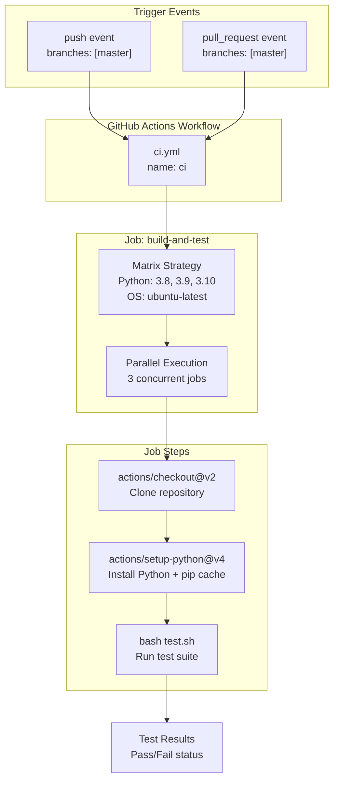
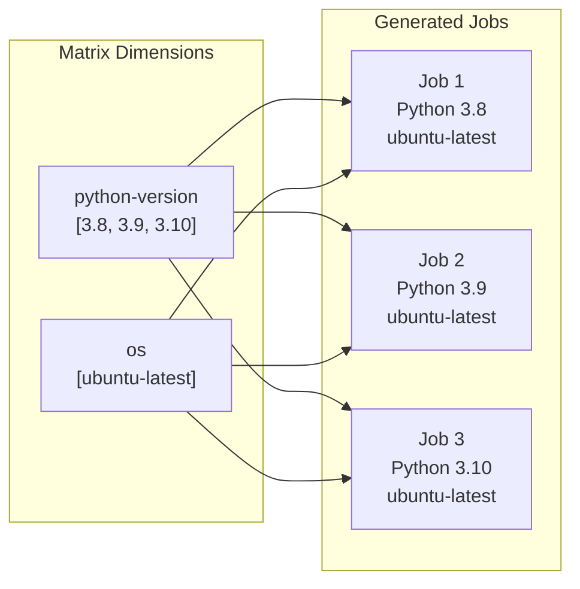
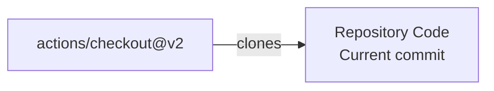
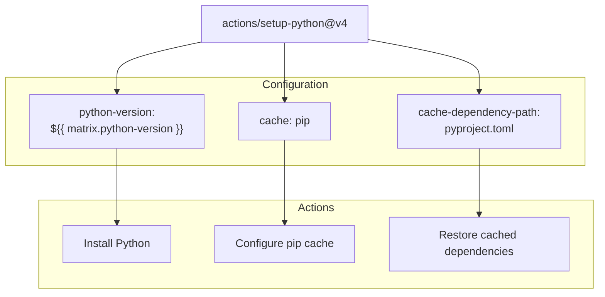
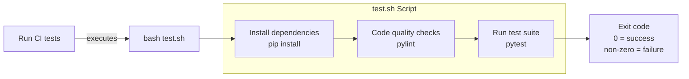
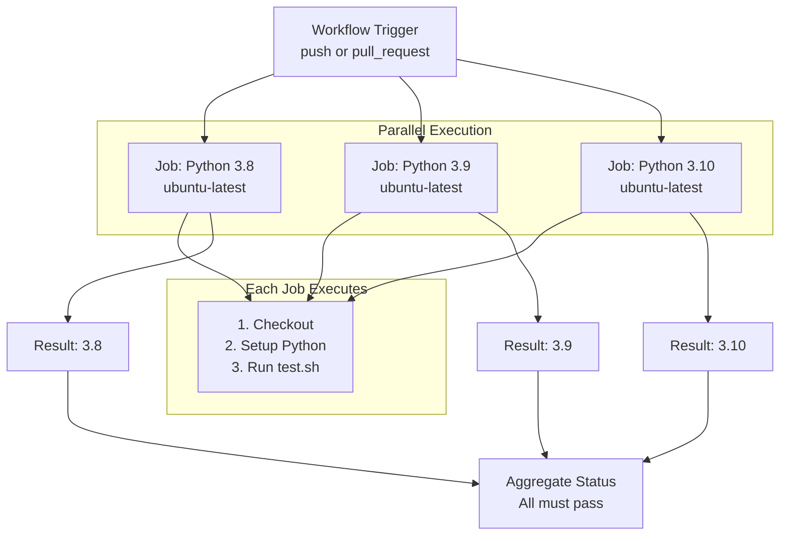
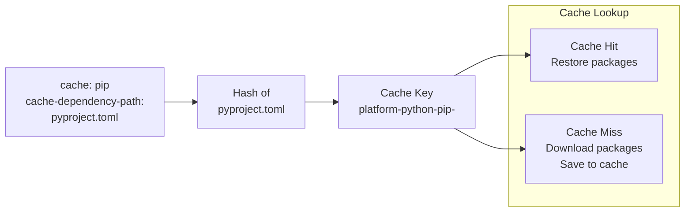
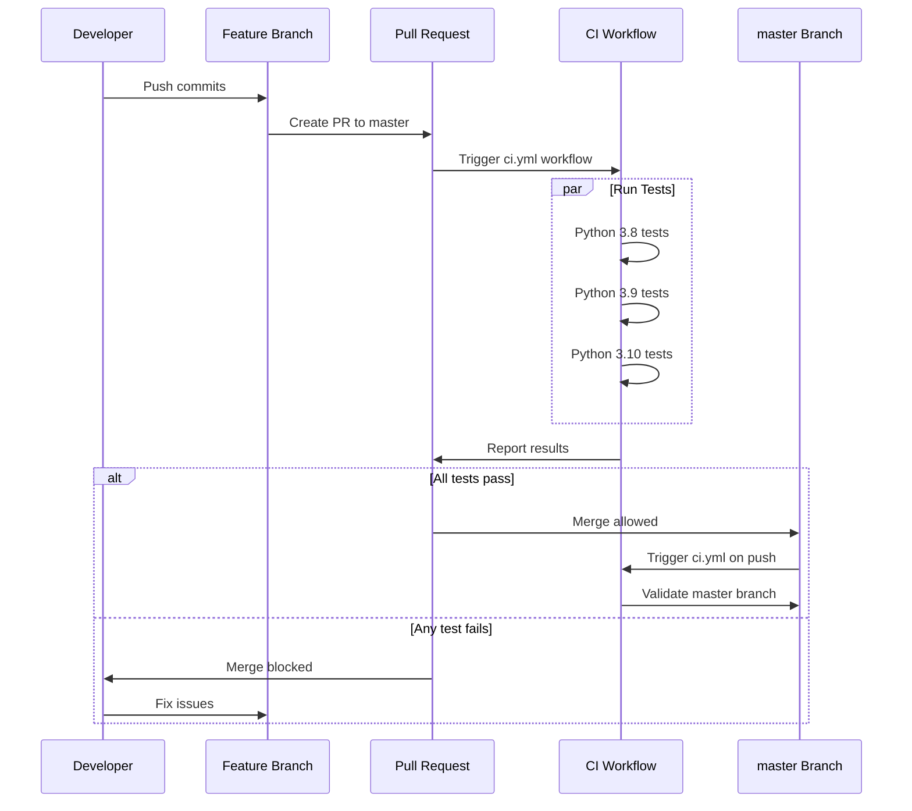

<!-- source: DeepWiki mcp.deepwiki.com · repo google-deepmind/dm_pix · page 8.1 Continuous Integration Workflow · fetched 2026-10-26 -->

# Continuous Integration Workflow

<details>
<summary>Relevant source files</summary>

The following files were used as context for generating this wiki page:

- [.github/workflows/ci.yml](.github/workflows/ci.yml)
- [.github/workflows/pypi-publish.yml](.github/workflows/pypi-publish.yml)

</details>


## Purpose and Scope

This document describes the continuous integration (CI) pipeline defined in `.github/workflows/ci.yml` that automatically validates code quality on every push and pull request to the master branch. The CI workflow tests the dm_pix codebase across multiple Python versions to ensure compatibility.

For information about the PyPI release workflow that publishes packages on GitHub releases, see [PyPI Publishing Workflow](#8.2). For details on the test suite executed by the CI pipeline, see [Testing and Quality Assurance](#7).

**Sources:** [.github/workflows/ci.yml:1-29]()

---

## Workflow Triggers

The CI workflow is configured to run automatically on two types of GitHub events:

| Event Type | Branch | Description |
|------------|--------|-------------|
| `push` | `master` | Runs when commits are pushed directly to master |
| `pull_request` | `master` | Runs when PRs target the master branch |

This configuration ensures that all code changes are validated before and after integration into the main branch.

**Sources:** [.github/workflows/ci.yml:3-7]()

---

## Workflow Architecture

The following diagram shows the high-level structure of the CI workflow:

### CI Workflow Execution Flow



**Sources:** [.github/workflows/ci.yml:1-29]()

---

## Matrix Testing Strategy

The CI workflow employs a **matrix strategy** to test the codebase across multiple Python versions simultaneously. This ensures broad compatibility and catches version-specific issues early.

### Matrix Configuration



Each job is named using the pattern: `"Python ${{ matrix.python-version }} on ${{ matrix.os }}"`, producing descriptive job names like "Python 3.8 on ubuntu-latest" in the GitHub Actions UI.

The matrix configuration is defined in [.github/workflows/ci.yml:14-17]():

| Parameter | Values | Purpose |
|-----------|--------|---------|
| `python-version` | `["3.8", "3.9", "3.10"]` | Tests against Python 3.8, 3.9, and 3.10 |
| `os` | `[ubuntu-latest]` | Runs all tests on Ubuntu (latest stable) |

**Sources:** [.github/workflows/ci.yml:10-17]()

---

## Workflow Steps

The `build-and-test` job executes three sequential steps for each matrix combination:

### Step 1: Code Checkout



Uses the official `actions/checkout@v2` action to clone the repository at the specific commit that triggered the workflow.

**Sources:** [.github/workflows/ci.yml:20]()

---

### Step 2: Python Environment Setup



This step uses `actions/setup-python@v4` with three key configuration options:

1. **`python-version`** [.github/workflows/ci.yml:23](): Installs the Python version from the matrix (3.8, 3.9, or 3.10)
2. **`cache: "pip"`** [.github/workflows/ci.yml:24](): Enables automatic caching of pip packages to speed up subsequent runs
3. **`cache-dependency-path: "pyproject.toml"`** [.github/workflows/ci.yml:25](): Uses `pyproject.toml` as the cache key, invalidating the cache when dependencies change

The pip cache mechanism significantly reduces workflow execution time by reusing downloaded packages across runs with unchanged dependencies.

**Sources:** [.github/workflows/ci.yml:21-25]()

---

### Step 3: Test Execution



The final step invokes the test script using `bash test.sh` [.github/workflows/ci.yml:27](). The workflow explicitly specifies `shell: bash` [.github/workflows/ci.yml:28]() to ensure consistent shell behavior across different runner environments.

The `test.sh` script (covered in detail in [Running Tests](#7.3)) performs:
1. Dependency installation
2. Code quality checks using pylint
3. Full test suite execution using pytest

If any step in `test.sh` fails (returns non-zero exit code), the workflow step fails, and the entire CI job is marked as failed.

**Sources:** [.github/workflows/ci.yml:26-28]()

---

## Detailed Step Execution

The following table summarizes the complete execution sequence for each matrix job:

| Step | Action | Input | Output | Failure Impact |
|------|--------|-------|--------|----------------|
| 1 | Checkout | Commit SHA | Repository files | Workflow fails |
| 2 | Setup Python | Matrix Python version, pyproject.toml | Python environment, cached pip packages | Workflow fails |
| 3 | Run tests | test.sh script | Test results, exit code | Workflow fails if exit code ≠ 0 |

**Sources:** [.github/workflows/ci.yml:19-28]()

---

## Workflow Execution Model

The CI workflow executes jobs in parallel, utilizing GitHub Actions' concurrent execution capabilities:

### Parallel Job Execution



All three jobs execute concurrently. The workflow only succeeds if all matrix jobs pass. If any job fails, the entire workflow is marked as failed, preventing merge for pull requests configured with branch protection rules.

**Sources:** [.github/workflows/ci.yml:10-28]()

---

## Dependency Caching Strategy

The workflow implements pip caching to optimize execution time:

### Cache Key Generation



The caching mechanism:
1. **Generates a cache key** based on the runner OS, Python version, and hash of `pyproject.toml` [.github/workflows/ci.yml:24-25]()
2. **Restores cached packages** if a matching cache key exists, skipping downloads
3. **Downloads and caches packages** if no cache hit occurs, saving time on subsequent runs
4. **Invalidates cache** automatically when `pyproject.toml` changes (indicating new or updated dependencies)

This approach provides significant performance improvements for workflows with stable dependencies while ensuring fresh packages when dependencies change.

**Sources:** [.github/workflows/ci.yml:24-25]()

---

## Integration with Development Workflow

The CI workflow integrates with the standard GitHub development workflow:



**Workflow Integration Points:**

1. **Pull Request Validation**: CI runs automatically when PRs are opened or updated [.github/workflows/ci.yml:6-7]()
2. **Status Checks**: GitHub displays CI results in the PR interface, blocking merge if tests fail (when branch protection is enabled)
3. **Master Branch Verification**: CI runs again on push to master [.github/workflows/ci.yml:4-5](), providing a safety net if PRs are force-merged
4. **Fast Feedback**: Parallel execution across Python versions provides results in minimal time

**Sources:** [.github/workflows/ci.yml:3-7]()

---

## Runner Environment

Each matrix job executes on a GitHub-hosted runner with the following characteristics:

| Property | Value | Specification |
|----------|-------|---------------|
| Operating System | `ubuntu-latest` | Currently Ubuntu 22.04 LTS |
| Python Versions | `3.8`, `3.9`, `3.10` | Installed by `actions/setup-python@v4` |
| Architecture | x86_64 | Standard GitHub runner architecture |
| Shell | `bash` | Explicitly specified for test execution |

The `ubuntu-latest` designation automatically updates to new Ubuntu LTS versions as GitHub Actions updates its runner images, ensuring tests run on supported platforms.

**Sources:** [.github/workflows/ci.yml:12-17, 28]()

---

## Workflow Naming and Identification

The workflow is identified in GitHub's UI and API using:

- **Workflow name**: `ci` [.github/workflows/ci.yml:1]() - Appears in the Actions tab and status badges
- **Job name**: `"Python ${{ matrix.python-version }} on ${{ matrix.os }}"` [.github/workflows/ci.yml:11]() - Dynamically generated per matrix combination
- **Job ID**: `build-and-test` [.github/workflows/ci.yml:10]() - Internal identifier for referencing the job

These naming conventions provide clear identification in GitHub's interface and facilitate troubleshooting when specific matrix combinations fail.

**Sources:** [.github/workflows/ci.yml:1, 10-11]()

---

## File Reference Summary

The complete CI workflow is defined in a single configuration file:

```
.github/workflows/ci.yml
├── Workflow metadata (lines 1-7)
│   ├── name: ci
│   └── Trigger conditions (push, pull_request on master)
├── Job: build-and-test (lines 10-17)
│   ├── Job name template
│   ├── Runner specification
│   └── Matrix strategy
└── Steps (lines 19-28)
    ├── actions/checkout@v2
    ├── actions/setup-python@v4 (with caching)
    └── bash test.sh
```

**Sources:** [.github/workflows/ci.yml:1-29]()

---

