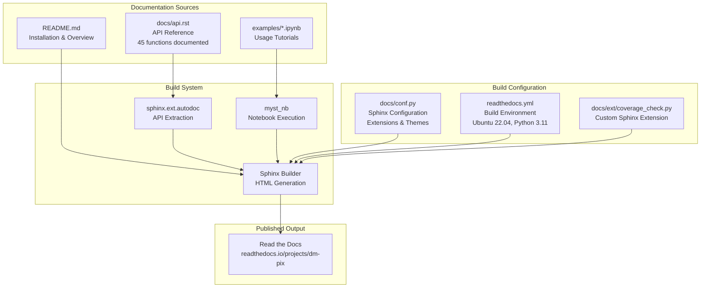
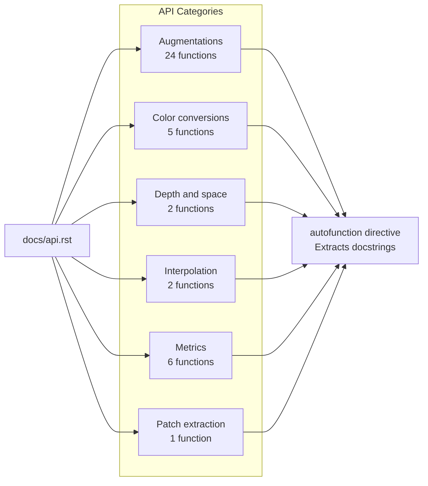
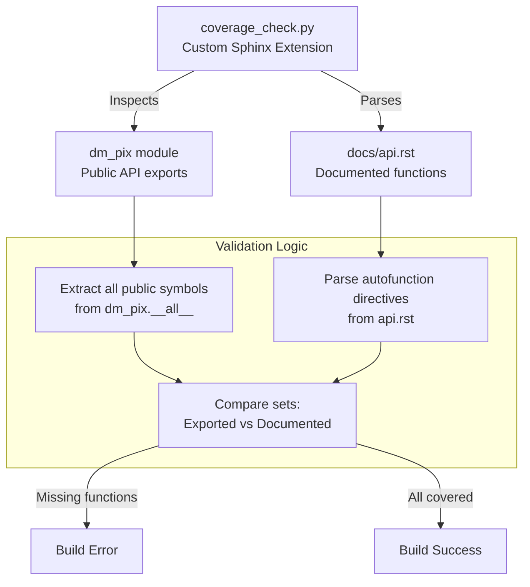
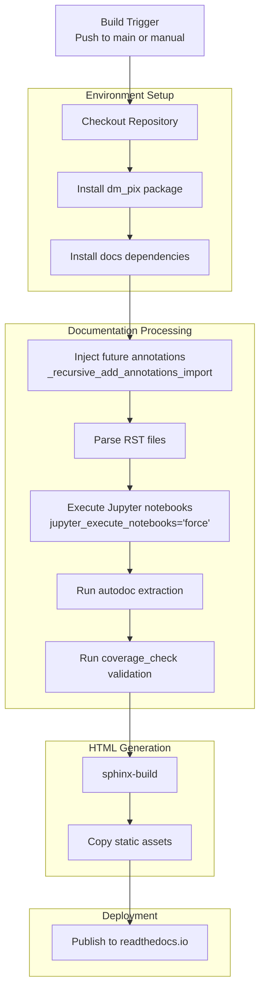

<!-- source: DeepWiki mcp.deepwiki.com · repo google-deepmind/dm_pix · page 9 Documentation System · fetched 2026-10-26 -->

# Documentation System

<details>
<summary>Relevant source files</summary>

The following files were used as context for generating this wiki page:

- [docs/api.rst](docs/api.rst)
- [docs/conf.py](docs/conf.py)
- [readthedocs.yml](readthedocs.yml)

</details>


## Purpose and Scope

This document describes the documentation infrastructure for dm_pix, covering how documentation is authored, built, and published. The system uses Sphinx as the documentation generator and ReadTheDocs for hosting. It includes automated API reference generation, Jupyter notebook integration, and a custom coverage checking mechanism to ensure completeness.

For detailed Sphinx configuration options, see [Sphinx Configuration](#9.1). For ReadTheDocs build environment details, see [ReadTheDocs Build](#9.2). For API documentation organization and coverage validation, see [API Documentation Structure](#9.3).

## Documentation Architecture

The documentation system consists of three primary content sources that are processed by Sphinx and published to ReadTheDocs.



**Sources:** [docs/conf.py:1-198](), [docs/api.rst:1-289](), [readthedocs.yml:1-24]()

## Documentation Sources and Content Types

The documentation system processes three distinct content types:

| Content Type | Source Files | Purpose | Processing |
|--------------|--------------|---------|------------|
| Narrative Documentation | `README.md` | Installation, overview, examples | Direct inclusion |
| API Reference | `docs/api.rst` | Function signatures, docstrings | `sphinx.ext.autodoc` |
| Tutorials | `examples/*.ipynb` | Interactive usage examples | `myst_nb` execution |

### API Reference Structure

The `docs/api.rst` file organizes all 45 public API functions into six logical sections:



**Sources:** [docs/api.rst:1-289]()

Each function is documented using Sphinx's `autofunction` directive, which extracts the function's signature and docstring from the source code. For example:

- Lines 1-32: Augmentations summary and function list
- Lines 33-36: `adjust_brightness` documentation block
- Lines 155-190: Color conversions section with 5 functions
- Lines 233-275: Metrics section with 6 functions

**Sources:** [docs/api.rst:1-32](), [docs/api.rst:33-36](), [docs/api.rst:155-190](), [docs/api.rst:233-275]()

## Sphinx Configuration Components

The Sphinx configuration in `docs/conf.py` orchestrates multiple extensions and custom behaviors:

```mermaid
graph TB
    CONF["docs/conf.py"]
    
    subgraph Core["Core Extensions"]
        AUTODOC["sphinx.ext.autodoc<br/>API documentation"]
        AUTOSUMMARY["sphinx.ext.autosummary<br/>Summary tables"]
        NAPOLEON["sphinx.ext.napoleon<br/>Google/NumPy docstrings"]
    end
    
    subgraph Code["Code Integration"]
        LINKCODE["sphinx.ext.linkcode<br/>GitHub source links"]
        INTERSPHINX["sphinx.ext.intersphinx<br/>Cross-project links"]
        TYPEHINTS["sphinx_autodoc_typehints<br/>Type annotation support"]
    end
    
    subgraph Special["Special Features"]
        MYSTNB["myst_nb<br/>Jupyter notebook execution"]
        KATEX["sphinxcontrib.katex<br/>Math rendering"]
        COV["coverage_check<br/>API completeness validation"]
    end
    
    subgraph Theme["Presentation"]
        RTD_THEME["sphinx_rtd_theme<br/>Read the Docs theme"]
    end
    
    CONF --> AUTODOC
    CONF --> AUTOSUMMARY
    CONF --> NAPOLEON
    CONF --> LINKCODE
    CONF --> INTERSPHINX
    CONF --> TYPEHINTS
    CONF --> MYSTNB
    CONF --> KATEX
    CONF --> COV
    CONF --> RTD_THEME
```



**Sources:** [docs/conf.py:87-101]()

### Key Configuration Features

| Feature | Implementation | Purpose |
|---------|----------------|---------|
| Type hint filtering | Lines 64-67 | Removes `None` annotations to avoid Sphinx errors in Python 3.7-3.8 |
| Future annotations injection | Lines 34-62 | Adds `from __future__ import annotations` to all source files on ReadTheDocs |
| GitHub source linking | Lines 157-188 | `linkcode_resolve()` function generates URLs to source code |
| Notebook execution | Lines 137-138 | Forces execution of Jupyter notebooks during build |
| Intersphinx mapping | Lines 193-195 | Links to JAX documentation |

**Sources:** [docs/conf.py:64-67](), [docs/conf.py:34-62](), [docs/conf.py:157-188](), [docs/conf.py:137-138](), [docs/conf.py:193-195]()

### Custom Type Hint Filtering

The configuration includes a workaround for Python 3.7/3.8 compatibility at lines 64-67:

```python
filter_nones = lambda x: dict((k, v) for k, v in x.items() if v is not None)
typing.get_type_hints = lambda obj, *unused: filter_nones(obj.__annotations__)
```

This filters out `None` type annotations that cause `AssertionError: Invalid annotation [...] None is not a class` in older Python versions.

**Sources:** [docs/conf.py:64-67]()

### GitHub Source Code Linking

The `linkcode_resolve()` function (lines 157-188) generates GitHub URLs for each documented API element. It:

1. Resolves the module containing the object
2. Unwraps decorators to find the actual source
3. Determines the source file and line numbers
4. Constructs a GitHub URL with line number anchors

Format: `https://github.com/deepmind/dm_pix/tree/master/dm_pix/{file}#L{start}#L{end}`

**Sources:** [docs/conf.py:157-188]()

## ReadTheDocs Build Environment

The `readthedocs.yml` file specifies the build environment:

| Setting | Value | Purpose |
|---------|-------|---------|
| Operating System | Ubuntu 22.04 | Build environment OS |
| Python Version | 3.11 | Python interpreter version |
| Builder | `html` | Output format |
| Configuration | `docs/conf.py` | Sphinx config file path |
| Fail on Warning | `false` | Continue build on warnings |

### Installation Steps

The build process installs dependencies in two stages:

1. **Base installation** (lines 18-19): Installs the `dm_pix` package from the repository root
2. **Documentation dependencies** (lines 20-23): Installs extras specified in `[docs]` group from `pyproject.toml`

**Sources:** [readthedocs.yml:6-24](), [readthedocs.yml:18-19](), [readthedocs.yml:20-23]()

## Coverage Checking Mechanism

The `coverage_check` custom extension ensures all public API functions are documented in `docs/api.rst`. This extension is loaded at line 99 of `docs/conf.py`.



**Sources:** [docs/conf.py:99]()

## Build Pipeline Flow

The complete documentation build process follows this sequence:



**Sources:** [readthedocs.yml:1-24](), [docs/conf.py:61-62](), [docs/conf.py:137-138]()

### Future Annotations Injection

When building on ReadTheDocs (detected via `READTHEDOCS` environment variable), the configuration automatically modifies all Python source files to add `from __future__ import annotations` at the beginning. This is implemented by:

1. `_add_annotations_import()` function (lines 34-51): Prepends the import to a single file
2. `_recursive_add_annotations_import()` function (lines 54-58): Recursively processes all `.py` files in `dm_pix/`
3. Conditional execution (lines 61-62): Only runs on ReadTheDocs environment

The import is prefixed to the first line (which must be a comment) to preserve line number accuracy for GitHub source links.

**Sources:** [docs/conf.py:34-51](), [docs/conf.py:54-58](), [docs/conf.py:61-62]()

## Documentation Categories Mapping

The API reference structure maps directly to the module organization:

| API Category | Module Source | Function Count | Lines in api.rst |
|--------------|---------------|----------------|------------------|
| Augmentations | `dm_pix._src.augment` | 24 | 1-153 |
| Color conversions | `dm_pix._src.color_conversion` | 5 | 155-191 |
| Depth and space | `dm_pix._src.depth_and_space` | 2 | 193-211 |
| Interpolation | `dm_pix._src.interpolation` | 2 | 213-231 |
| Metrics | `dm_pix._src.metrics` | 6 | 233-275 |
| Patch extraction | `dm_pix._src.patch` | 1 | 277-289 |

Each category includes:
- An `autosummary` directive listing all functions (e.g., lines 6-31 for Augmentations)
- Individual `autofunction` directives for each function with subsection headers

**Sources:** [docs/api.rst:1-153](), [docs/api.rst:155-191](), [docs/api.rst:193-211](), [docs/api.rst:213-231](), [docs/api.rst:233-275](), [docs/api.rst:277-289]()

## Autodoc Configuration

The autodoc extension is configured with specific options at lines 113-117:

| Option | Value | Effect |
|--------|-------|--------|
| `member-order` | `bysource` | Document members in source code order |
| `special-members` | `True` | Include special methods |
| `exclude-members` | `__repr__, __str__, __weakref__` | Exclude specific special methods |

This ensures consistent ordering and excludes common special methods that don't add documentation value.

**Sources:** [docs/conf.py:113-117]()

## Math Rendering Configuration

Mathematical expressions are rendered using KaTeX (configured at lines 140-152). The system:

1. Defines LaTeX macros in `latex_macros` variable (lines 143-145)
2. Converts them to KaTeX format using `katex.latex_defs_to_katex_macros()` (line 148)
3. Applies macros to HTML output (line 149)
4. Includes macros in PDF/LaTeX output (line 152)

This ensures consistent mathematical notation across HTML and PDF outputs.

**Sources:** [docs/conf.py:140-152](), [docs/conf.py:143-145](), [docs/conf.py:148-149](), [docs/conf.py:152]()

## Notebook Execution Settings

Jupyter notebooks are processed with strict execution settings:

- `jupyter_execute_notebooks = 'force'` (line 137): Always execute notebooks, even if output exists
- `execution_allow_errors = False` (line 138): Fail the build if any notebook cell raises an error

This ensures all tutorial notebooks remain functional and up-to-date with the current API.

**Sources:** [docs/conf.py:137-138]()

---

