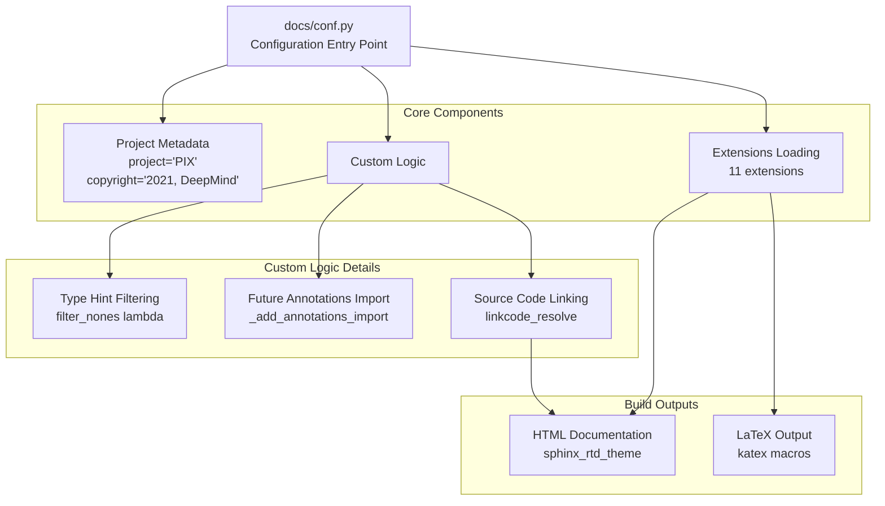
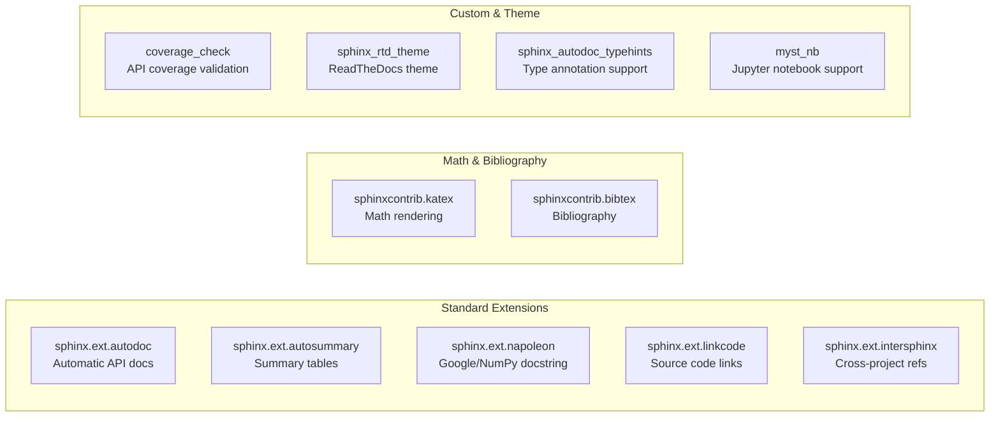
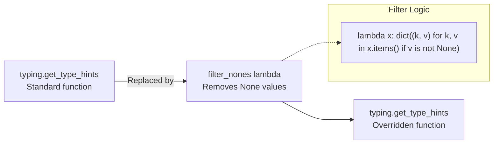
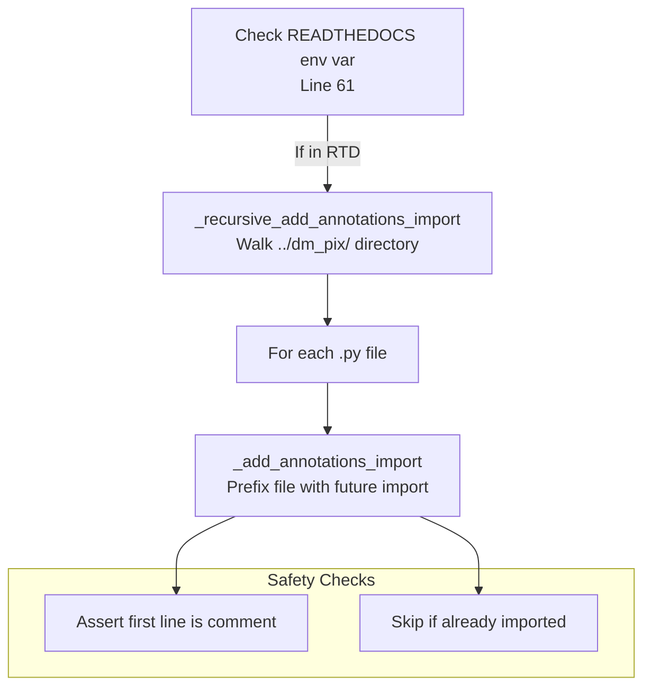
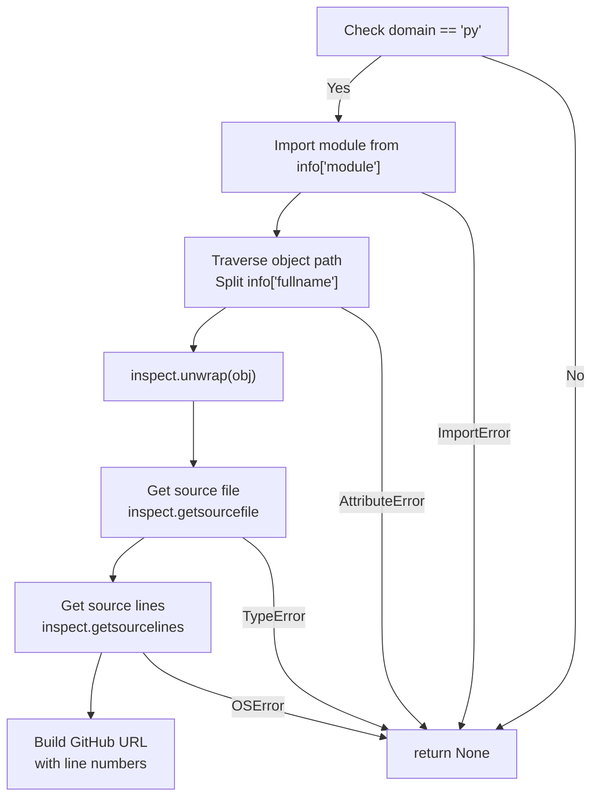
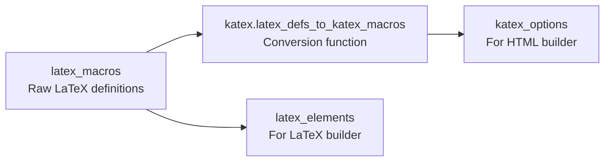
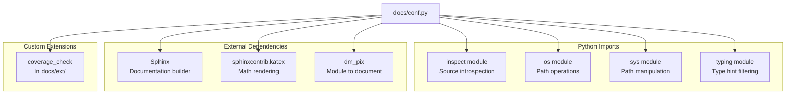

<!-- source: DeepWiki mcp.deepwiki.com · repo google-deepmind/dm_pix · page 9.1 Sphinx Configuration · fetched 2026-10-26 -->

# Sphinx Configuration

<details>
<summary>Relevant source files</summary>

The following files were used as context for generating this wiki page:

- [docs/conf.py](docs/conf.py)

</details>


This document details the Sphinx configuration for dm_pix documentation, including project metadata, extensions, custom type hint filtering, source code linking, and ReadTheDocs integration. For information about the ReadTheDocs build environment, see [ReadTheDocs Build](#9.2). For API documentation organization and coverage checking, see [API Documentation Structure](#9.3).

## Configuration Overview

The Sphinx documentation builder is configured through [docs/conf.py:1-198](), which serves as the central configuration point for all documentation generation. The configuration handles project metadata, extension loading, custom type hint processing, source code linking to GitHub, and special ReadTheDocs environment handling.



**Sources:** [docs/conf.py:1-198]()

## Project Metadata

The configuration defines basic project information at [docs/conf.py:76-78]():

| Configuration | Value |
|---------------|-------|
| `project` | `'PIX'` |
| `copyright` | `'2021, DeepMind'` |
| `author` | `'PIX Contributors'` |
| `master_doc` | `'index'` |

**Sources:** [docs/conf.py:76-82]()

## Sphinx Extensions

The configuration loads 11 extensions at [docs/conf.py:87-101]() to provide comprehensive documentation capabilities:



### Extension Details

| Extension | Purpose |
|-----------|---------|
| `sphinx.ext.autodoc` | Generates API documentation from docstrings |
| `sphinx.ext.autosummary` | Creates summary tables for modules |
| `sphinx.ext.napoleon` | Parses Google-style and NumPy-style docstrings |
| `sphinx.ext.linkcode` | Links documentation to GitHub source code |
| `sphinx.ext.intersphinx` | Creates links to JAX documentation |
| `sphinxcontrib.katex` | Renders mathematical equations using KaTeX |
| `sphinxcontrib.bibtex` | Manages bibliographic references |
| `sphinx_autodoc_typehints` | Processes Python type annotations |
| `sphinx_rtd_theme` | Provides ReadTheDocs visual theme |
| `coverage_check` | Custom extension validating API documentation coverage |
| `myst_nb` | Executes and renders Jupyter notebooks (.ipynb files) |

**Sources:** [docs/conf.py:87-101]()

## Type Hint Filtering

The configuration implements custom type hint filtering at [docs/conf.py:64-67]() to resolve compatibility issues with Python 3.7 and 3.8 when Sphinx encounters `None` type annotations.



The filter prevents the error: `AssertionError: Invalid annotation [...] None is not a class.`

The implementation:
- Wraps the original `typing.get_type_hints` function
- Filters out dictionary entries where the value is `None`
- Returns a cleaned annotations dictionary without `None` types

**Sources:** [docs/conf.py:64-67]()

## Future Annotations Import

For ReadTheDocs builds, the configuration automatically injects `from __future__ import annotations` imports at [docs/conf.py:34-62](). This mechanism enables deferred evaluation of type annotations, improving compatibility.



### Implementation Details

The `_add_annotations_import` function at [docs/conf.py:34-51]():
1. Reads the file contents
2. Checks if the import is already present (prevents duplicate imports on multiple runs)
3. Asserts the first line is a comment (for safe prefixing)
4. Prefixes (not inserts) the import to the first line, preserving line numbers for accurate GitHub links

**Important:** The prefix approach maintains accurate source code locations for the `linkcode_resolve` function.

**Sources:** [docs/conf.py:34-62]()

## Source Code Linking

The `linkcode_resolve` function at [docs/conf.py:157-188]() generates GitHub URLs for Python objects in the documentation, enabling "view source" links.



### URL Format

The function generates URLs with this pattern:
```
https://github.com/deepmind/dm_pix/tree/master/dm_pix/{relative_path}#L{start}#L{end}
```

Where:
- `{relative_path}`: File path relative to `dm_pix.__file__`
- `{start}`: First line number of the object definition
- `{end}`: Last line number (`start + len(source) - 1`)

### Error Handling

The function returns `None` for:
- Non-Python domains
- Failed module imports
- Missing object attributes
- Objects without source files (e.g., built-ins)
- Objects without retrievable source lines

**Sources:** [docs/conf.py:157-188]()

## Autodoc Configuration

The `autodoc_default_options` dictionary at [docs/conf.py:113-117]() configures automatic API documentation generation:

| Option | Value | Effect |
|--------|-------|--------|
| `member-order` | `'bysource'` | Preserves source code ordering in documentation |
| `special-members` | `True` | Includes special methods (e.g., `__init__`) |
| `exclude-members` | `'__repr__, __str__, __weakref__'` | Excludes specified special methods |

This configuration ensures API documentation maintains the logical ordering from source files rather than alphabetical sorting.

**Sources:** [docs/conf.py:113-117]()

## HTML Theme Configuration

The documentation uses the ReadTheDocs theme configured at [docs/conf.py:124]():

```python
html_theme = 'sphinx_rtd_theme'
```

Additional HTML settings:
- `templates_path`: `['_templates']` - Custom template directory
- `html_static_path`: `[]` - No custom static files
- `exclude_patterns`: Excludes `_build`, `Thumbs.db`, `.DS_Store`

**Sources:** [docs/conf.py:104-129]()

## Jupyter Notebook Execution

The `myst_nb` extension configuration at [docs/conf.py:137-138]() controls notebook execution:

| Option | Value | Effect |
|--------|-------|--------|
| `jupyter_execute_notebooks` | `'force'` | Always executes notebooks during build |
| `execution_allow_errors` | `False` | Build fails if notebook execution errors occur |

This ensures example notebooks in the `examples/` directory are validated during documentation builds.

**Sources:** [docs/conf.py:137-138]()

## KaTeX and LaTeX Configuration

Mathematical equation rendering is configured through KaTeX at [docs/conf.py:143-152]():



The configuration defines a LaTeX macro:
```latex
\def \d #1{\operatorname{#1}}
```

This macro is:
- Converted to KaTeX syntax for HTML output
- Directly included in LaTeX preamble for PDF output

**Sources:** [docs/conf.py:143-152]()

## Intersphinx Mapping

The configuration enables cross-referencing to JAX documentation at [docs/conf.py:193-195]():

```python
intersphinx_mapping = {
    'jax': ('https://jax.readthedocs.io/en/latest/', None),
}
```

This allows dm_pix documentation to create hyperlinks to JAX types and functions, improving reference navigation for users.

**Sources:** [docs/conf.py:193-195]()

## Source File Types

The configuration accepts multiple source file formats at [docs/conf.py:197]():

```python
source_suffix = ['.rst', '.md', '.ipynb']
```

This enables:
- `.rst` - reStructuredText (traditional Sphinx format)
- `.md` - Markdown files
- `.ipynb` - Jupyter notebooks (processed by `myst_nb`)

**Sources:** [docs/conf.py:197]()

## System Path Configuration

The configuration modifies `sys.path` at [docs/conf.py:68-69]() to enable module imports:

```python
sys.path.insert(0, os.path.abspath('../'))
sys.path.append(os.path.abspath('ext'))
```

This adds:
1. Parent directory (`../`) - Allows importing `dm_pix` module
2. `ext/` directory - Loads custom extensions like `coverage_check`

**Sources:** [docs/conf.py:68-69]()

## Configuration Dependencies



**Sources:** [docs/conf.py:28-72]()

---

