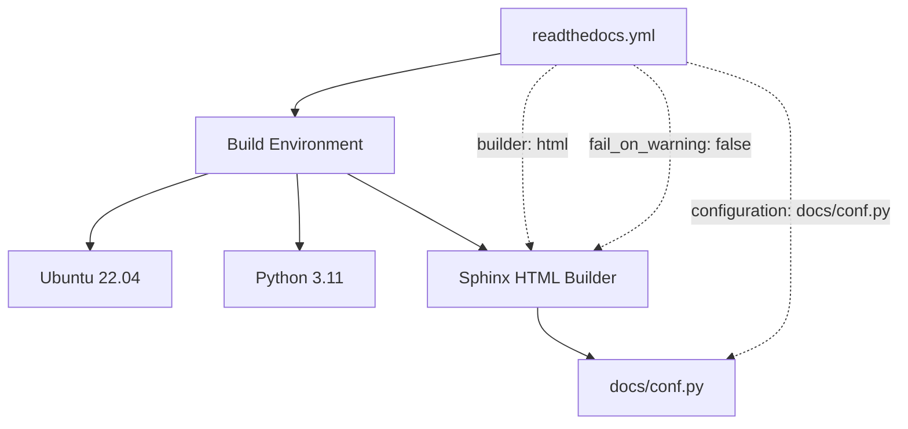
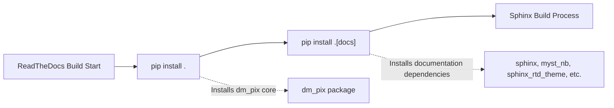
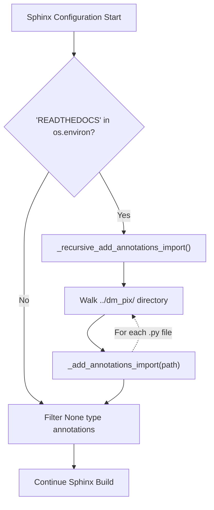
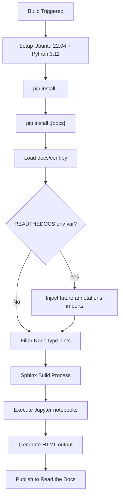

<!-- source: DeepWiki mcp.deepwiki.com · repo google-deepmind/dm_pix · page 9.2 ReadTheDocs Build · fetched 2026-10-26 -->

# ReadTheDocs Build

<details>
<summary>Relevant source files</summary>

The following files were used as context for generating this wiki page:

- [docs/conf.py](docs/conf.py)
- [readthedocs.yml](readthedocs.yml)

</details>


## Purpose and Scope

This document explains the ReadTheDocs build configuration and environment for the dm_pix documentation. It covers the build environment setup, Python package installation, and special modifications applied during the ReadTheDocs build process. For information about the Sphinx configuration that ReadTheDocs uses, see [Sphinx Configuration](#9.1). For details about the API documentation structure, see [API Documentation Structure](#9.3).

## Build Environment Configuration

The ReadTheDocs build is configured via `readthedocs.yml` in the repository root. This file defines the operating system, Python version, and build tools used to generate the documentation.



**Configuration: Build Environment Specification**

Sources: [readthedocs.yml:1-24]()

### Operating System and Python Version

The build environment is explicitly configured at [readthedocs.yml:6-9]():

| Parameter | Value | Purpose |
|-----------|-------|---------|
| `os` | `ubuntu-22.04` | Provides stable, long-term support build environment |
| `python` | `"3.11"` | Uses Python 3.11 for documentation generation |

The Python 3.11 requirement ensures access to modern Python features and type hint support, while maintaining compatibility with the Sphinx documentation toolchain.

Sources: [readthedocs.yml:6-9]()

### Sphinx Builder Configuration

The Sphinx builder is configured at [readthedocs.yml:11-14]():

| Parameter | Value | Explanation |
|-----------|-------|-------------|
| `builder` | `html` | Generates HTML documentation output |
| `configuration` | `docs/conf.py` | Points to the Sphinx configuration file |
| `fail_on_warning` | `false` | Allows build to succeed despite warnings |

The `fail_on_warning: false` setting prevents the build from failing due to documentation warnings, which is important given the dynamic nature of JAX type annotations and the custom type hint filtering applied during the build.

Sources: [readthedocs.yml:11-14]()

## Python Package Installation

The ReadTheDocs build installs the dm_pix package and its documentation dependencies in two steps:



**Configuration: Package Installation Steps**

Sources: [readthedocs.yml:16-23]()

The installation configuration at [readthedocs.yml:16-23]() specifies:

```yaml
python:
  install:
    - method: pip
      path: .
    - method: pip
      path: .
      extra_requirements:
        - docs
```

This two-step installation ensures:
1. First, the base dm_pix package is installed from the current directory
2. Second, the package is re-installed with the `docs` extra requirements group

The `docs` extra requirements include Sphinx, sphinx_rtd_theme, myst_nb, sphinxcontrib-bibtex, sphinxcontrib-katex, and other documentation-specific dependencies defined in the project's `pyproject.toml`.

Sources: [readthedocs.yml:16-23]()

## ReadTheDocs-Specific Modifications

When building on ReadTheDocs, the Sphinx configuration at [docs/conf.py:61-62]() detects the ReadTheDocs environment and applies special modifications to handle Python type annotations:



**Flow: ReadTheDocs Environment Detection and Modifications**

Sources: [docs/conf.py:61-68]()

### Future Annotations Import Injection

The `_recursive_add_annotations_import()` function at [docs/conf.py:54-58]() walks through all Python files in the `dm_pix` directory and modifies them using `_add_annotations_import()` at [docs/conf.py:34-51]().

This modification adds `from __future__ import annotations` to the beginning of each Python file. The implementation is careful to:

1. Check if the import already exists to avoid duplication ([docs/conf.py:38-41]())
2. Prefix the first line (which must be a comment) rather than inserting a newline ([docs/conf.py:46-51]())
3. Preserve accurate source code line numbers for GitHub linking

This workaround is necessary because Python 3.7 and 3.8 have issues with forward-referenced type annotations. By injecting the future import, all type annotations are treated as strings and evaluated lazily, avoiding compatibility issues.

Sources: [docs/conf.py:34-62]()

### Type Hint Filtering

At [docs/conf.py:64-67](), the configuration overrides `typing.get_type_hints()` to filter out `None` annotations:

```python
filter_nones = lambda x: dict((k, v) for k, v in x.items() if v is not None)
typing.get_type_hints = lambda obj, *unused: filter_nones(obj.__annotations__)
```

This prevents Sphinx from encountering `AssertionError: Invalid annotation [...] None is not a class` errors in Python 3.7 and 3.8. The filter removes any type annotations that have `None` as their value before Sphinx processes them.

Sources: [docs/conf.py:64-67]()

## Build Process Flow

The complete ReadTheDocs build process follows this sequence:



**Flow: Complete ReadTheDocs Build Pipeline**

Sources: [readthedocs.yml:1-24](), [docs/conf.py:61-68]()

### Notebook Execution

The build process includes notebook execution, configured at [docs/conf.py:137-138]():

| Parameter | Value | Effect |
|-----------|-------|--------|
| `jupyter_execute_notebooks` | `'force'` | Always executes notebooks during build |
| `execution_allow_errors` | `False` | Build fails if notebook execution errors |

This ensures that example notebooks in the `examples/` directory are executed and validated during every documentation build, catching any code that becomes incompatible with API changes.

Sources: [docs/conf.py:137-138]()

## Key Configuration Parameters

The following table summarizes the critical configuration parameters that control the ReadTheDocs build:

| Configuration File | Parameter | Value | Purpose |
|-------------------|-----------|-------|---------|
| `readthedocs.yml` | `version` | `2` | Uses ReadTheDocs config v2 format |
| `readthedocs.yml` | `build.os` | `ubuntu-22.04` | Build operating system |
| `readthedocs.yml` | `build.tools.python` | `"3.11"` | Python version for build |
| `readthedocs.yml` | `sphinx.builder` | `html` | Output format |
| `readthedocs.yml` | `sphinx.configuration` | `docs/conf.py` | Sphinx config file path |
| `readthedocs.yml` | `sphinx.fail_on_warning` | `false` | Continue build on warnings |
| `docs/conf.py` | Environment check | `'READTHEDOCS' in os.environ` | Detect ReadTheDocs environment |
| `docs/conf.py` | `jupyter_execute_notebooks` | `'force'` | Always execute notebooks |
| `docs/conf.py` | `execution_allow_errors` | `False` | Fail on notebook errors |

Sources: [readthedocs.yml:1-24](), [docs/conf.py:61-62](), [docs/conf.py:137-138]()

## Build Output Location

ReadTheDocs automatically publishes the generated HTML documentation to:
- **Main documentation**: https://dm-pix.readthedocs.io/
- **Version-specific docs**: https://dm-pix.readthedocs.io/en/{version}/

The build artifacts are stored in the `_build` directory during the build process, which is excluded from version control via the pattern at [docs/conf.py:109]().

Sources: [docs/conf.py:109]()

## Troubleshooting Common Build Issues

| Issue | Cause | Solution |
|-------|-------|----------|
| Type hint errors | Python 3.7/3.8 annotation incompatibility | Handled automatically by future annotations injection |
| `None is not a class` error | Sphinx processing None annotations | Handled automatically by type hint filtering |
| Notebook execution failure | Code incompatible with current API | Fix the notebook code or update API |
| Warning messages | Documentation completeness or formatting | Investigate warnings (build continues due to `fail_on_warning: false`) |

The automatic modifications applied when `'READTHEDOCS' in os.environ` is true handle most compatibility issues without manual intervention.

Sources: [docs/conf.py:61-67]()

---

