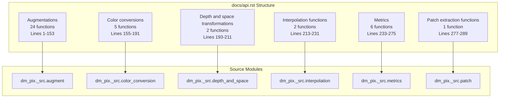
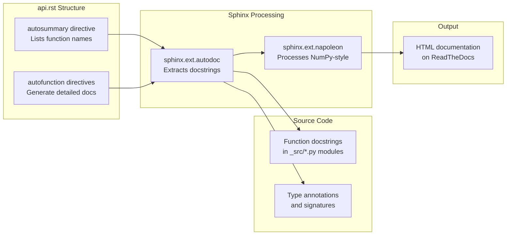
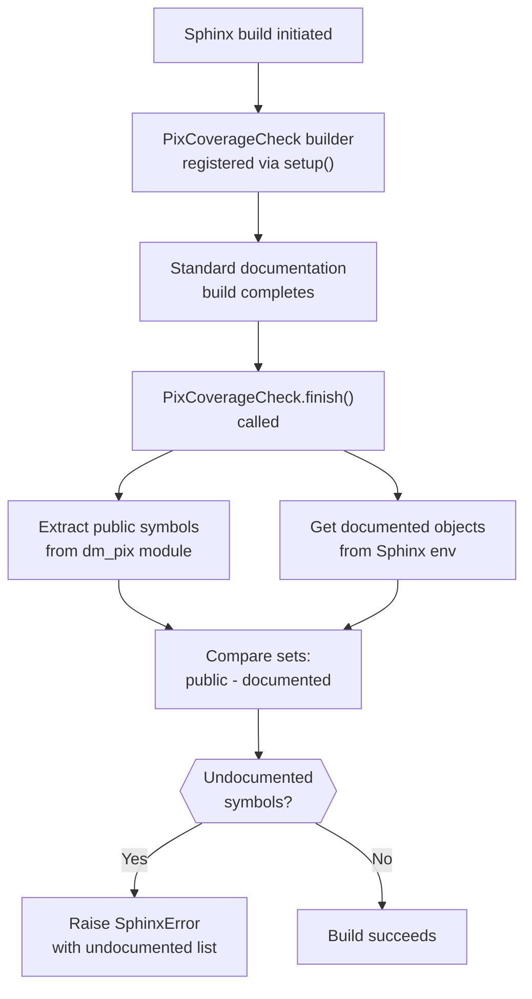
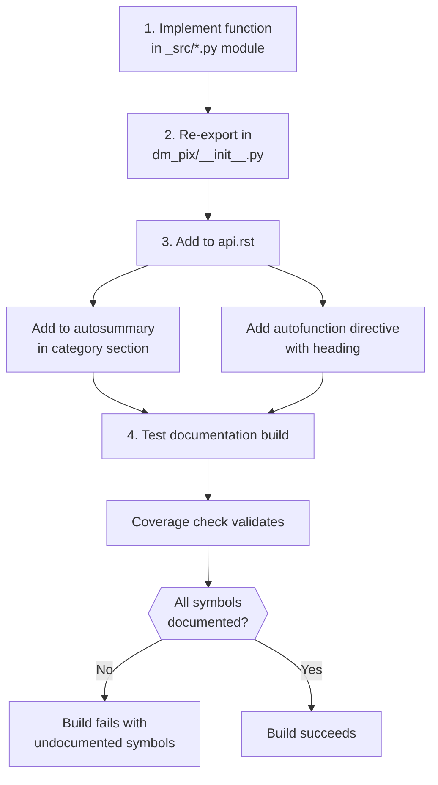

<!-- source: DeepWiki mcp.deepwiki.com · repo google-deepmind/dm_pix · page 9.3 API Documentation Structure · fetched 2026-10-26 -->

# API Documentation Structure

<details>
<summary>Relevant source files</summary>

The following files were used as context for generating this wiki page:

- [docs/Makefile](docs/Makefile)
- [docs/api.rst](docs/api.rst)
- [docs/ext/coverage_check.py](docs/ext/coverage_check.py)
- [docs/index.rst](docs/index.rst)

</details>


## Purpose and Scope

This document describes the organization of dm_pix API documentation in [docs/api.rst](), the custom coverage validation mechanism in [docs/ext/coverage_check.py](), and how these components ensure complete and well-structured documentation. For Sphinx configuration details, see [Sphinx Configuration](#9.1). For the ReadTheDocs build environment, see [ReadTheDocs Build](#9.2).

## Overview

The API documentation structure follows a two-tier organization: first, functions are grouped into logical categories with summary listings using Sphinx `autosummary` directives, then each function receives detailed documentation via `autofunction` directives. A custom Sphinx builder validates that every public symbol in the `dm_pix` module is documented, preventing incomplete API coverage.

## Documentation Categories

The [docs/api.rst:1-289]() file organizes 40 public functions into six distinct categories that mirror the module structure described in [Public API Organization](#1.1).

### Category Structure



**Sources:** [docs/api.rst:1-289]()

### Function Count by Category

| Category | Function Count | Lines in api.rst |
|----------|---------------|------------------|
| Augmentations | 24 | 1-153 |
| Color conversions | 5 | 155-191 |
| Depth and space transformations | 2 | 193-211 |
| Interpolation functions | 2 | 213-231 |
| Metrics | 6 | 233-275 |
| Patch extraction functions | 1 | 277-289 |
| **Total** | **40** | **289 lines** |

**Sources:** [docs/api.rst:1-289]()

## Two-Tier Documentation Pattern

Each category in [docs/api.rst]() follows a consistent two-tier pattern: a summary section followed by detailed documentation for each function.

### Tier 1: Summary Listing

Each category begins with a Sphinx `autosummary` directive that lists all functions in that category. For example, the Augmentations section starts with [docs/api.rst:1-31]():

```rst
Augmentations
=============

.. currentmodule:: dm_pix

.. autosummary::

    adjust_brightness
    adjust_contrast
    adjust_gamma
    ...
```

The `currentmodule` directive sets the module context to `dm_pix`, and the `autosummary` lists function names without full module paths.

**Sources:** [docs/api.rst:1-31]()

### Tier 2: Detailed Function Documentation

Following the summary, each function receives a dedicated section with its own heading and `autofunction` directive. For example [docs/api.rst:33-36]():

```rst
adjust_brightness
~~~~~~~~~~~~~~~~~

.. autofunction:: adjust_brightness
```

The `autofunction` directive instructs Sphinx to extract the function's docstring, signature, and type annotations from the source code and render them as formatted documentation.

**Sources:** [docs/api.rst:33-36]()

### Documentation Generation Flow



**Sources:** [docs/api.rst:1-289](), [docs/conf.py]() (referenced from context)

## Coverage Validation Mechanism

The [docs/ext/coverage_check.py]() module implements a custom Sphinx builder that validates complete API documentation coverage.

### PixCoverageCheck Builder

The `PixCoverageCheck` class [docs/ext/coverage_check.py:25-52]() extends `sphinx.builders.Builder` to implement a custom validation builder:

```python
class PixCoverageCheck(builders.Builder):
  """Builder that checks all public symbols are included."""

  name = "coverage_check"
```

The builder's `finish()` method performs the validation after the documentation build completes.

**Sources:** [docs/ext/coverage_check.py:25-28]()

### Validation Algorithm

The coverage check operates in three steps:

1. **Extract Public Symbols**: Get all public symbols from the `dm_pix` module using `test_utils.get_public_symbols()` [docs/ext/coverage_check.py:38-42]():

```python
def dm_pix_public_symbols() -> Set[str]:
  symbols = set()
  for symbol_name, _ in test_utils.get_public_symbols(pix):
    symbols.add("dm_pix." + symbol_name)
  return symbols
```

2. **Get Documented Objects**: Retrieve all documented Python objects from Sphinx's environment [docs/ext/coverage_check.py:44]():

```python
documented_objects = frozenset(self.env.domaindata["py"]["objects"])
```

3. **Compare Sets**: Calculate the difference to find undocumented symbols [docs/ext/coverage_check.py:45-51]():

```python
undocumented_objects = dm_pix_public_symbols() - documented_objects
if undocumented_objects:
  undocumented_objects = tuple(sorted(undocumented_objects))
  raise errors.SphinxError(
      "All public symbols must be included in our documentation, did you "
      "forget to add an entry to `api.rst`?\n"
      f"Undocumented symbols: {undocumented_objects}.")
```

**Sources:** [docs/ext/coverage_check.py:36-51]()

### Coverage Check Workflow



**Sources:** [docs/ext/coverage_check.py:25-56]()

### Builder Registration

The extension registers itself with Sphinx through the `setup()` function [docs/ext/coverage_check.py:54-56]():

```python
def setup(app: application.Sphinx) -> Mapping[str, Any]:
  app.add_builder(PixCoverageCheck)
  return dict(version=pix.__version__, parallel_read_safe=True)
```

This function is called when Sphinx loads the extension, specified in the Sphinx configuration's `extensions` list.

**Sources:** [docs/ext/coverage_check.py:54-56]()

## Integration with Documentation Build

The API documentation integrates with the broader documentation system through several connection points.

### Documentation Entry Point

The main documentation index at [docs/index.rst:38-42]() references the API documentation:

```rst
.. toctree::
   :caption: API Documentation
   :maxdepth: 2

   api
```

This creates a table of contents entry that includes [docs/api.rst]() in the generated documentation site.

**Sources:** [docs/index.rst:38-42]()

### Module Mapping

The documentation structure maps directly to the public API exposed by [dm_pix/\_\_init\_\_.py](). Each documented function in [docs/api.rst]() corresponds to a symbol re-exported by the facade pattern:

| api.rst Section | Module Source | Re-exported in \_\_init\_\_.py |
|----------------|---------------|-------------------------------|
| Augmentations | `dm_pix._src.augment` | ✓ |
| Color conversions | `dm_pix._src.color_conversion` | ✓ |
| Depth and space transformations | `dm_pix._src.depth_and_space` | ✓ |
| Interpolation functions | `dm_pix._src.interpolation` | ✓ |
| Metrics | `dm_pix._src.metrics` | ✓ |
| Patch extraction functions | `dm_pix._src.patch` | ✓ |

**Sources:** [docs/api.rst:1-289]()

## Documentation Maintenance Process

Adding a new function to dm_pix requires updates in three locations to maintain documentation coverage:



**Sources:** [docs/ext/coverage_check.py:45-51](), [docs/api.rst:1-289]()

### Step-by-Step Documentation Addition

1. **Implement Function**: Create the function in the appropriate module under `dm_pix/_src/`

2. **Export to Public API**: Add the function to [dm_pix/\_\_init\_\_.py]() re-exports

3. **Add Summary Entry**: Locate the appropriate category section in [docs/api.rst]() and add the function name to the `autosummary` list

4. **Add Detailed Section**: Add a new subsection with the function name as heading and an `autofunction` directive

5. **Validate Coverage**: Run the documentation build with the `coverage_check` builder enabled. The build will fail if any public symbol lacks documentation

**Sources:** [docs/ext/coverage_check.py:46-51](), [docs/api.rst:1-289]()

## Category Organization Rationale

The six-category organization aligns with functional groupings that users can understand:

- **Augmentations**: Image transformation operations for data augmentation pipelines
- **Color conversions**: Color space transformation utilities
- **Depth and space transformations**: Channel/spatial dimension rearrangement
- **Interpolation functions**: Low-level interpolation primitives used by augmentation
- **Metrics**: Image quality and similarity evaluation
- **Patch extraction functions**: Specialized extraction operations

This organization differs from the module structure by purpose rather than implementation. For example, geometric augmentations and color adjustments are in the same "Augmentations" category despite having different implementation dependencies.

**Sources:** [docs/api.rst:1-289]()

## Sphinx Autodoc Integration

The API documentation relies on Sphinx autodoc extensions configured in [docs/conf.py](). Key directives used:

- `currentmodule`: Sets the module context to `dm_pix` [docs/api.rst:4]()
- `autosummary`: Generates summary tables of functions [docs/api.rst:6]()
- `autofunction`: Extracts and formats individual function documentation [docs/api.rst:36]()

These directives work with the following Sphinx extensions:
- `sphinx.ext.autodoc`: Automatic documentation from docstrings
- `sphinx.ext.autosummary`: Summary table generation
- `sphinx.ext.napoleon`: NumPy-style docstring parsing

**Sources:** [docs/api.rst:4-36]()

---

