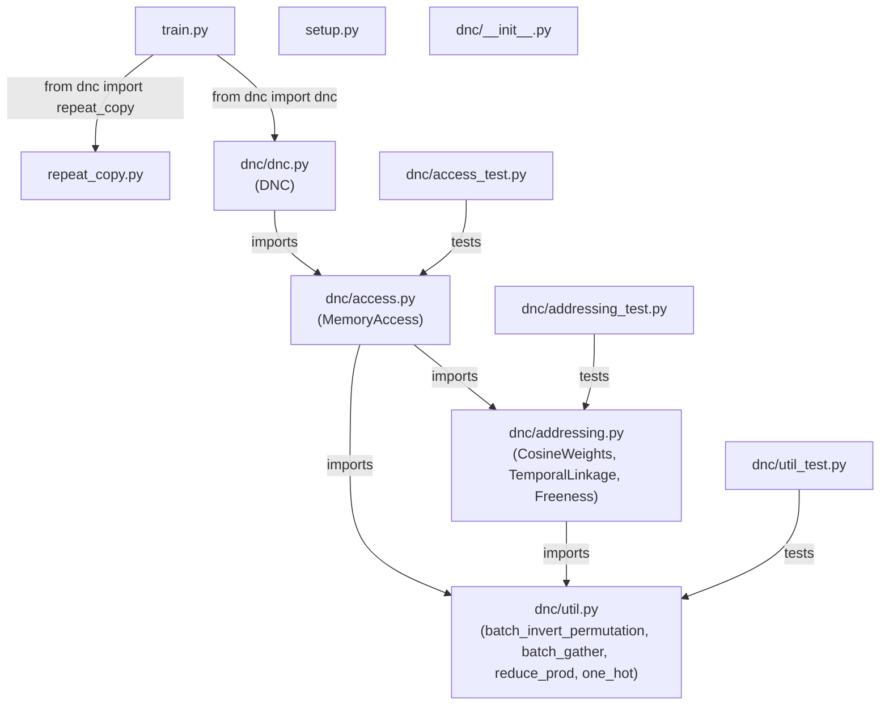
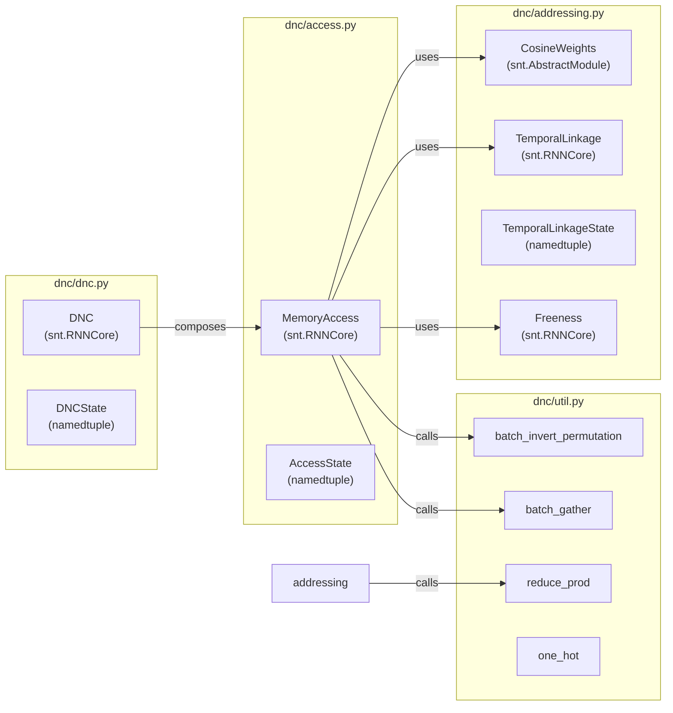

<!-- source: DeepWiki mcp.deepwiki.com · repo google-deepmind/dnc · page 1.1 Repository Structure · fetched 2026-10-26 -->

# Repository Structure

<details>
<summary>Relevant source files</summary>

The following files were used as context for generating this wiki page:

- [README.md](README.md)
- [dnc/__init__.py](dnc/__init__.py)
- [setup.py](setup.py)
- [train.py](train.py)

</details>


This page describes the physical layout of the repository and the role of each file. It is a navigation aid for readers who are new to the codebase. For deeper coverage of what each module *does*, see the pages linked in each section below.

---

## Top-Level Layout

The repository is divided into two logical areas: a small set of top-level files that form the training entrypoint and package metadata, and the `dnc/` directory that contains the core library implementation.

**Directory tree:**

```
dnc-repo/
├── train.py
├── repeat_copy.py
├── setup.py
├── README.md
└── dnc/
    ├── __init__.py
    ├── dnc.py
    ├── access.py
    ├── addressing.py
    ├── util.py
    ├── access_test.py
    ├── addressing_test.py
    └── util_test.py
```

Sources: [train.py:1-168](), [setup.py:1-12](), [dnc/__init__.py:1-1]()

---

## File Reference Table

| File | Location | Role |
|---|---|---|
| `train.py` | root | Training entrypoint; defines `run_model`, `train`, and `main` |
| `repeat_copy.py` | root | Defines the `RepeatCopy` task used for training and evaluation |
| `setup.py` | root | Package metadata for `pip` installation |
| `README.md` | root | Human-readable project introduction and usage instructions |
| `dnc/__init__.py` | `dnc/` | Empty file; marks `dnc` as an importable Python package |
| `dnc/dnc.py` | `dnc/` | Defines `DNC`, the top-level `snt.RNNCore` wrapping controller and memory |
| `dnc/access.py` | `dnc/` | Defines `MemoryAccess`, the `snt.RNNCore` that manages memory reads/writes |
| `dnc/addressing.py` | `dnc/` | Defines `CosineWeights`, `TemporalLinkage`, and `Freeness` addressing mechanisms |
| `dnc/util.py` | `dnc/` | Shared utility functions: `batch_invert_permutation`, `batch_gather`, `reduce_prod`, `one_hot` |
| `dnc/access_test.py` | `dnc/` | Tests for `MemoryAccess` |
| `dnc/addressing_test.py` | `dnc/` | Tests for all three addressing modules |
| `dnc/util_test.py` | `dnc/` | Tests for utility functions |

Sources: [train.py:1-30](), [setup.py:1-12](), [dnc/__init__.py:1-1]()

---

## Module Dependency Diagram

The following diagram maps each file to the modules it imports, showing which parts of the codebase depend on which others.

**Figure: File-level import dependencies**



Sources: [train.py:24-25](), [dnc/__init__.py:1-1]()

---

## Top-Level Files

### `train.py`

The primary executable script. Running it starts the full training loop on the `RepeatCopy` task. It:

- Imports `dnc.DNC` and `repeat_copy.RepeatCopy`
- Defines all configuration flags via `tf.flags` (model size, optimizer settings, task parameters)
- Constructs the DNC model via `run_model` [train.py:69-91]()
- Runs the training loop via `train` [train.py:94-158]()
- Uses `tf.nn.dynamic_rnn` to unroll the model over the input sequence

For full documentation of the training pipeline, see [Training the DNC](#2). For flag reference, see [Training Configuration](#2.2).

Sources: [train.py:15-167]()

### `repeat_copy.py`

Defines `RepeatCopy`, the synthetic task used to exercise the DNC. It generates batches of binary sequences and targets, and provides a `cost` method and a `to_human_readable` visualization method. It is imported by `train.py` at [train.py:25]().

For full documentation of this task, see [The RepeatCopy Task](#2.1).

### `setup.py`

Standard `setuptools` configuration for the `dnc` package [setup.py:1-12](). Registers the package name as `dnc`, version `0.0.2`, under the Apache 2.0 license. Used to install the package via `pip install .`.

For setup and contribution instructions, see [Development Setup](#5).

---

## The `dnc/` Package

The `dnc/` directory is a Python package (made importable by the empty `dnc/__init__.py`). It contains the full DNC implementation split across four modules.

**Figure: Class-to-file mapping within the `dnc/` package**



Sources: [train.py:69-91](), [dnc/__init__.py:1-1]()

### `dnc/dnc.py`

Defines the `DNC` class and `DNCState` namedtuple. `DNC` is the top-level `snt.RNNCore` that a caller interacts with directly. It wraps an LSTM controller (`snt.LSTM`) and a `MemoryAccess` module, producing a single recurrent unit. For full documentation, see [DNC Core](#3.1).

### `dnc/access.py`

Defines `MemoryAccess` and `AccessState`. `MemoryAccess` manages all read and write operations against the external memory matrix. It uses the three addressing mechanisms from `addressing.py` and helper functions from `util.py`. For full documentation, see [Memory Access Module](#3.2).

### `dnc/addressing.py`

Defines three `snt` modules responsible for computing attention weights over memory:

- `CosineWeights` — content-based lookup
- `TemporalLinkage` — write-order tracking (with `TemporalLinkageState`)
- `Freeness` — usage-based allocation

For full documentation, see [Memory Addressing](#3.3).

### `dnc/util.py`

Defines four utility functions used internally by `access.py` and `addressing.py`:

- `batch_invert_permutation` — batched permutation inversion
- `batch_gather` — batched indexed gather
- `reduce_prod` — cumprod-based product reduction
- `one_hot` — static NumPy one-hot vector construction

For full documentation, see [Utility Functions](#3.4).

---

## Test Files

All tests live inside the `dnc/` package directory alongside the source they test. There is no separate `tests/` directory.

| Test File | Targets | Key Techniques |
|---|---|---|
| `dnc/addressing_test.py` | `CosineWeights`, `TemporalLinkage`, `Freeness` | Shape assertions, numerical value bounds, gradient checks |
| `dnc/access_test.py` | `MemoryAccess` | `tf.nn.dynamic_rnn` integration, numerical gradient checks |
| `dnc/util_test.py` | `batch_invert_permutation`, `batch_gather` | Random permutation correctness, fixed known-answer arrays |

For full documentation of the test suite, see [Testing](#4).

---

