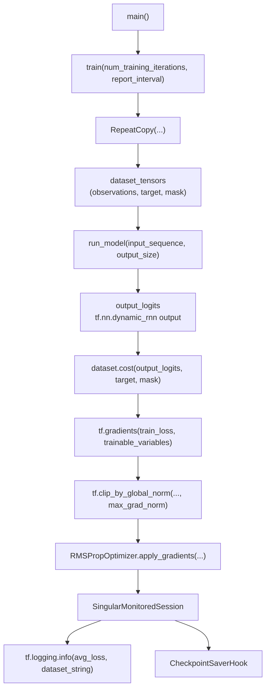
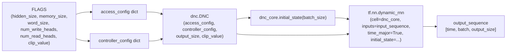
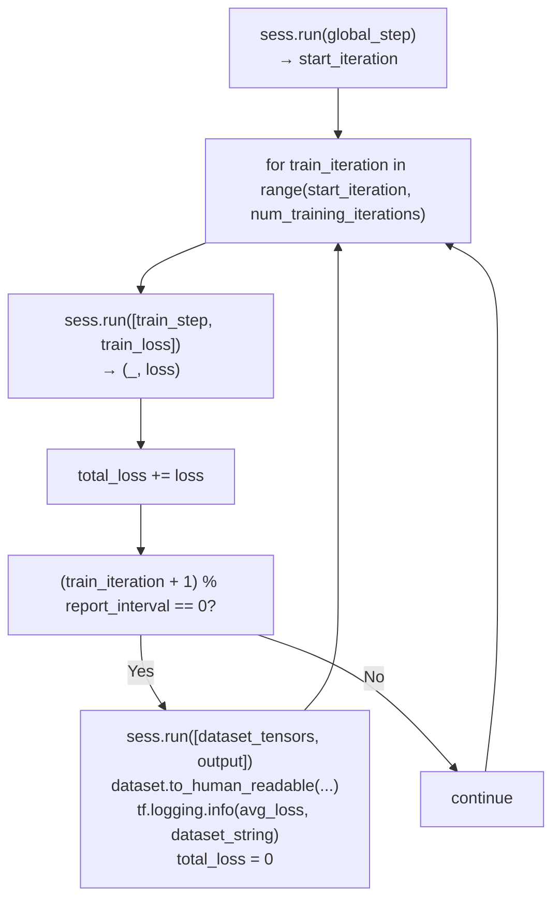

<!-- source: DeepWiki mcp.deepwiki.com · repo google-deepmind/dnc · page 2 Training the DNC · fetched 2026-10-26 -->

# Training the DNC

<details>
<summary>Relevant source files</summary>

The following files were used as context for generating this wiki page:

- [train.py](train.py)

</details>


This page covers the full training pipeline implemented in `train.py`: how the DNC model is constructed and run, how loss is computed and backpropagated, how gradients are clipped and applied, and how the training loop manages checkpointing and periodic reporting.

For details on the task used for training, see [The RepeatCopy Task](#2.1). For configuration flags, see [Training Configuration](#2.2). For the DNC model itself, see [Core Architecture](#3).

---

## Overview

`train.py` is the single entry point for training the DNC. It wires together the `RepeatCopy` dataset, the `DNC` model, and the TensorFlow training machinery into a complete supervised learning loop.

**Training Pipeline Diagram**



Sources: [train.py:94-168]()

---

## Model Construction: `run_model`

The `run_model` function [train.py:69-91]() builds the TensorFlow graph for a single forward pass over an entire input sequence. It does not execute computation itself — it defines the graph nodes.

**Steps:**

1. **Assemble `access_config`** — a dict containing `memory_size`, `word_size`, `num_reads`, and `num_writes`, drawn from FLAGS.
2. **Assemble `controller_config`** — a dict containing `hidden_size` for the LSTM controller.
3. **Instantiate `dnc.DNC`** with the above configs plus `output_size` and `clip_value`.
4. **Compute `initial_state`** via `dnc_core.initial_state(FLAGS.batch_size)`.
5. **Run `tf.nn.dynamic_rnn`** with `time_major=True`, which unrolls the DNC across the entire sequence dimension and returns `output_sequence`.



Sources: [train.py:69-91]()

The `output_size` passed to `DNC` is `dataset.target_size`, which is determined by the `RepeatCopy` task configuration.

---

## Loss Computation

After `run_model` returns `output_logits`, the `train` function [train.py:94-158]() computes a masked sigmoid cross-entropy loss:

```
train_loss = dataset.cost(output_logits, dataset_tensors.target, dataset_tensors.mask)
```

The `mask` tensor is also used separately to produce a rounded binary `output` for visualization:

```
output = tf.round(tf.expand_dims(dataset_tensors.mask, -1) * tf.sigmoid(output_logits))
```

This `output` is only evaluated during reporting intervals and is passed to `dataset.to_human_readable(...)` for display. It is not used in the loss or gradient computation.

Sources: [train.py:102-108]()

---

## Gradient Clipping and Optimizer

Gradients are computed and clipped in two steps [train.py:111-126]():

| Step | Code construct | Purpose |
|---|---|---|
| Compute raw gradients | `tf.gradients(train_loss, trainable_variables)` | Differentiate loss w.r.t. all trainable parameters |
| Clip by global norm | `tf.clip_by_global_norm(grads, max_grad_norm)` | Cap the global L2 norm of the gradient vector at `max_grad_norm` (default: 50) |
| Apply gradients | `optimizer.apply_gradients(zip(grads, trainable_variables), global_step=global_step)` | Update parameters using RMSProp |

The optimizer is `tf.train.RMSPropOptimizer` configured with `learning_rate` (default: `1e-4`) and `epsilon` (default: `1e-10`).

A `global_step` variable [train.py:115-121]() is registered in both `GLOBAL_VARIABLES` and `GLOBAL_STEP` collections. It is incremented automatically by `apply_gradients` and is used to resume training from a checkpoint.

Sources: [train.py:111-126]()

---

## Checkpointing

Checkpoint behavior is conditional on the `checkpoint_interval` flag [train.py:130-138]():

- If `checkpoint_interval > 0`: a `tf.train.CheckpointSaverHook` is attached to the session. It saves to `checkpoint_dir` every `checkpoint_interval` steps.
- If `checkpoint_interval <= 0` (default: `-1`): no periodic saving hook is attached.

Regardless of the hook, `SingularMonitoredSession` is always given `checkpoint_dir`. On startup, it will restore from the latest checkpoint in that directory if one exists, allowing training to resume automatically.

| Flag | Default | Effect |
|---|---|---|
| `checkpoint_dir` | `/tmp/tf/dnc` | Directory to write/read checkpoints |
| `checkpoint_interval` | `-1` | Steps between saves; `-1` disables periodic saving |

Sources: [train.py:63-66](), [train.py:128-142]()

---

## Training Loop

The training loop [train.py:141-158]() runs inside a `tf.train.SingularMonitoredSession` context:



**Key behaviors:**

- `start_iteration` is read from `global_step` at session start, so a restored checkpoint resumes from where it left off.
- Each iteration executes `train_step` (weight update) and reads back `train_loss` in a single `sess.run` call for efficiency.
- Every `report_interval` iterations (default: 100), `total_loss / report_interval` is logged as the average loss and the accumulated total is reset to zero.
- The `to_human_readable` output is also logged at each report, showing the raw input/output pattern for visual inspection.

Sources: [train.py:141-158]()

---

## Entry Point

`main` [train.py:161-163]() sets log verbosity to `INFO` level and calls `train(FLAGS.num_training_iterations, FLAGS.report_interval)`. `tf.app.run()` [train.py:167]() handles flag parsing before calling `main`.

To start training with defaults:

```
python train.py
```

To override flags:

```
python train.py --hidden_size=128 --memory_size=32 --num_training_iterations=200000
```

Sources: [train.py:161-167]()

---

## Summary: Key Symbols

| Symbol | Type | File | Role |
|---|---|---|---|
| `run_model` | function | `train.py` | Builds DNC graph; calls `tf.nn.dynamic_rnn` |
| `train` | function | `train.py` | Full training loop: loss, gradients, optimizer, session |
| `main` | function | `train.py` | Entry point; sets log verbosity |
| `dnc.DNC` | class | `dnc/dnc.py` | The RNNCore passed to `dynamic_rnn` |
| `repeat_copy.RepeatCopy` | class | `repeat_copy.py` | Generates `dataset_tensors`; computes `cost` |
| `tf.nn.dynamic_rnn` | TF op | — | Unrolls `DNC` over the time dimension |
| `tf.clip_by_global_norm` | TF op | — | Gradient clipping |
| `tf.train.RMSPropOptimizer` | TF class | — | Parameter update rule |
| `SingularMonitoredSession` | TF class | — | Managed session with checkpoint restore |
| `CheckpointSaverHook` | TF class | — | Periodic checkpoint saves |

---

