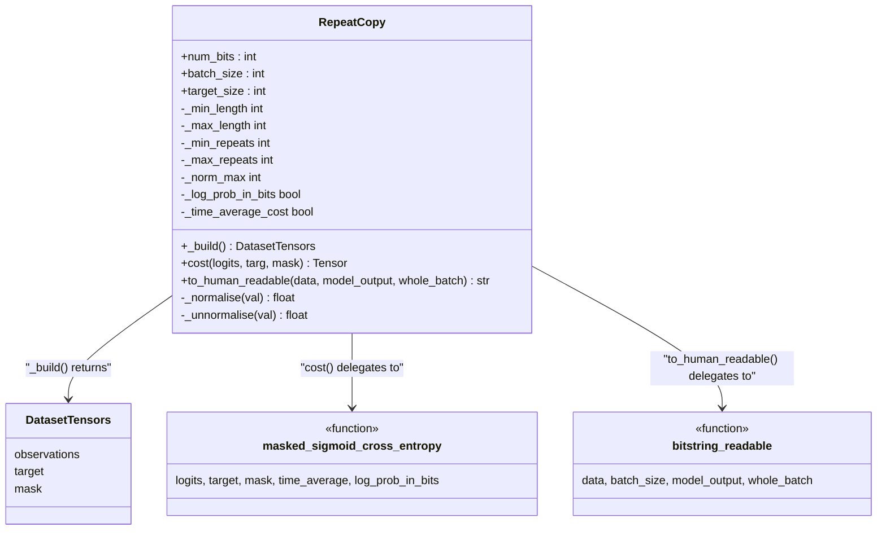
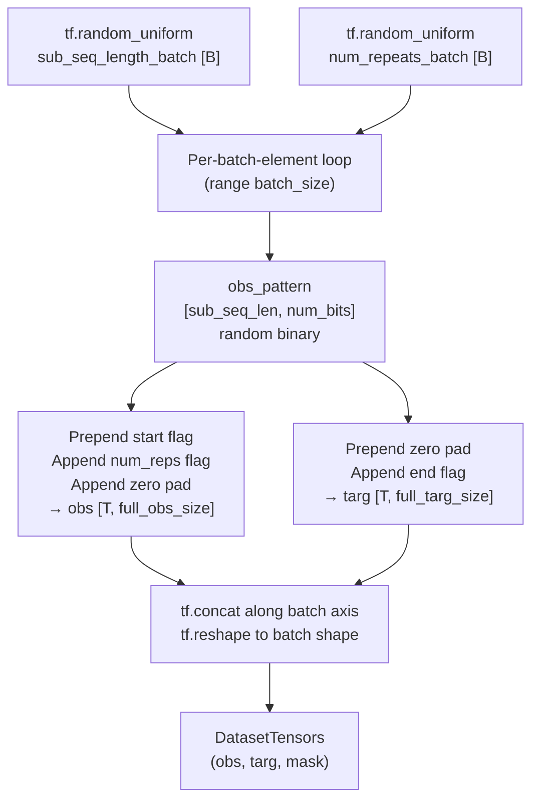
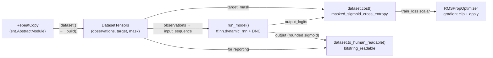

<!-- source: DeepWiki mcp.deepwiki.com · repo google-deepmind/dnc · page 2.1 The RepeatCopy Task · fetched 2026-10-26 -->

# The RepeatCopy Task

<details>
<summary>Relevant source files</summary>

The following files were used as context for generating this wiki page:

- [dnc/repeat_copy.py](dnc/repeat_copy.py)
- [train.py](train.py)

</details>


This page documents the `RepeatCopy` synthetic task defined in `dnc/repeat_copy.py`. It covers the task definition, data format, cost function, and visualization utilities. For how the training loop consumes this task, see [Training the DNC](#2). For the flags that configure task parameters, see [Training Configuration](#2.2).

---

## Overview

The RepeatCopy task is a standard benchmark for sequence memory. Given a random binary pattern of length `L`, the model must reproduce that pattern `R` times in a row, where both `L` and `R` are drawn uniformly at random within configurable bounds.

The task is implemented as a `snt.AbstractModule` that, when called, returns a `DatasetTensors` namedtuple containing TensorFlow tensors for a full batch of episodes. Each episode is a complete sequence: an observation phase followed by an output phase.

---

## Sequence Structure

The diagram below maps the abstract sequence regions to their concrete tensor contents.

**Diagram: Sequence Layout for a Single Batch Element**

```mermaid
gantt
    title "Time axis: observation phase then target phase"
    dateFormat  X
    axisFormat  t=%s

    section "obs (T x num_bits+2)"
    "start-marker flag (1 at t=0)" : 0, 1
    "random binary pattern [L steps]" : 1, 4
    "num-repeats flag (normalised R)" : 4, 5
    "zero padding" : 5, 10

    section "targ (T x num_bits+1)"
    "zero padding" : 0, 5
    "pattern repeated R times" : 5, 9
    "end-marker flag" : 9, 10

    section "mask (T)"
    "0 (ignored)" : 0, 5
    "1 (penalised)" : 5, 10
```



*Sources: [dnc/repeat_copy.py:115-173]()*

---

## DatasetTensors

`DatasetTensors` is a `collections.namedtuple` with three fields, all time-major (first axis is time, second is batch index):

| Field | Shape | dtype | Description |
|---|---|---|---|
| `observations` | `[T, B, num_bits + 2]` | `float32` | Input sequence fed to the DNC at each time step |
| `target` | `[T, B, num_bits + 1]` | `float32` | Expected output at each time step |
| `mask` | `[T, B]` | `float32` | `1` during the output phase, `0` during the input phase |

`T` (total sequence length) is padded to the maximum across the batch. `B` is `batch_size`.

*Sources: [dnc/repeat_copy.py:25-26]()*

---

## Observation Channels

The trailing dimension of `observations` has `num_bits + 2` channels:

| Channel indices | Contents |
|---|---|
| `0 … num_bits-1` | Binary pattern bits (0.0 or 1.0) |
| `num_bits` (`start_end_flag_idx`) | Start-marker: `1.0` at `t=0`, `0.0` elsewhere |
| `num_bits + 1` (`num_repeats_channel_idx`) | Normalised repeat count: `num_reps / norm_max` at the step immediately after the pattern, `0.0` elsewhere |

The trailing dimension of `target` has `num_bits + 1` channels:

| Channel indices | Contents |
|---|---|
| `0 … num_bits-1` | Pattern bits to reproduce |
| `num_bits` | End-marker: `1.0` at the last step of the output phase |

*Sources: [dnc/repeat_copy.py:261-327]()*

---

## RepeatCopy Class

`RepeatCopy` extends `snt.AbstractModule`. Its constructor parameters control all stochastic aspects of the generated sequences.

**Diagram: RepeatCopy class relationships**



*Sources: [dnc/repeat_copy.py:115-392]()*

### Constructor Parameters

| Parameter | Default | Description |
|---|---|---|
| `num_bits` | `6` | Width of each binary vector in the pattern |
| `batch_size` | `1` | Number of independent episodes per batch |
| `min_length` | `1` | Minimum pattern length `L` |
| `max_length` | `1` | Maximum pattern length `L` |
| `min_repeats` | `1` | Minimum repeat count `R` |
| `max_repeats` | `2` | Maximum repeat count `R` |
| `norm_max` | `10` | Denominator for normalising the repeat-count channel |
| `log_prob_in_bits` | `False` | Report loss in bits (nats by default) |
| `time_average_cost` | `False` | Divide per-element cost by unmasked time steps before reduction |

*Sources: [dnc/repeat_copy.py:176-222]()*

### `target_size` Property

`target_size` returns `num_bits + 1`. This value is passed directly to `run_model` in `train.py` as the DNC's output dimensionality.

*Sources: [dnc/repeat_copy.py:244-246](), [train.py:102]()*

---

## Data Generation: `_build`

When the module is called (e.g., `dataset()`), `_build` is executed and adds ops to the TF graph.

**Diagram: `_build` data flow**



Key computed values:
- `total_length_batch[i] = sub_seq_len[i] * (num_reps[i] + 1) + 3`
- `max_length_batch = tf.reduce_max(total_length_batch)` — the padded sequence length `T`
- `residual_length_batch[i] = max_length_batch - total_length_batch[i]` — trailing zeros added for batch alignment

The mask is constructed per element as:
- `mask_off = tf.zeros([sub_seq_len + 2])` — covers the start flag, pattern, and num-repeats flag
- `mask_on = tf.ones([sub_seq_len * num_reps + 1])` — covers the repeated output plus the end flag

*Sources: [dnc/repeat_copy.py:252-377]()*

---

## Cost Function

### `RepeatCopy.cost`

`cost(logits, targ, mask)` delegates to `masked_sigmoid_cross_entropy` with the instance's `time_average_cost` and `log_prob_in_bits` settings.

*Sources: [dnc/repeat_copy.py:379-385]()*

### `masked_sigmoid_cross_entropy`

This is a standalone module-level function. It computes the mean per-batch-element binary cross-entropy over the masked (output-phase) time steps.

**Step-by-step reduction:**

```
xent            = sigmoid_cross_entropy_with_logits(labels=target, logits=logits)
                  shape: [T, B, num_bits+1]

loss_time_batch = reduce_sum(xent, axis=2)
                  shape: [T, B]   (sum over bit channels)

loss_batch      = reduce_sum(loss_time_batch * mask, axis=0)
                  shape: [B]      (sum over time, masked)

(if time_average)
  loss_batch   /= reduce_sum(mask, axis=0)   (normalise by unmasked length)

loss            = reduce_sum(loss_batch) / batch_size
                  scalar

(if log_prob_in_bits)
  loss         /= log(2.)
```

The mask zeros out all time steps in the observation phase, so the model is never penalised for its outputs while reading the input.

*Sources: [dnc/repeat_copy.py:29-66]()*

### Usage in `train.py`

```
train_loss = dataset.cost(output_logits, dataset_tensors.target, dataset_tensors.mask)
```

`output_logits` are the raw DNC outputs (pre-sigmoid), and `train_loss` is the scalar that flows into gradient computation.

*Sources: [train.py:107-108]()*

---

## Visualisation

### `to_human_readable`

`RepeatCopy.to_human_readable(data, model_output=None, whole_batch=False)` unnormalises the repeat-count channel before delegating to `bitstring_readable`.

```python
# Reversal of _normalise: multiply last obs channel by norm_max
unnormalised_num_reps_flag = self._unnormalise(obs[:,:,-1:]).round()
```

*Sources: [dnc/repeat_copy.py:387-392]()*

### `bitstring_readable`

`bitstring_readable(data, batch_size, model_output=None, whole_batch=False)` produces a human-readable string. Each channel (bit dimension) across time is printed as a row. Each cell is formatted as:

- `-` for value `0`
- The integer value (e.g., `1`, `3`) for nonzero values

The output groups up to three sections per batch element:

| Section | Always present? | Source |
|---|---|---|
| `Observations` | Yes | `data.observations[:, batch_index, :]` |
| `Targets` | Yes | `data.target[:, batch_index, :]` |
| `Model Output` | Only if `model_output` provided | `model_output[:, batch_index, :]` |

By default only the first batch element is shown (`whole_batch=False`).

In `train.py`, model output is constructed before calling `to_human_readable`:

```python
output = tf.round(
    tf.expand_dims(dataset_tensors.mask, -1) * tf.sigmoid(output_logits))
```

This applies sigmoid to produce probabilities, rounds to 0/1, and zeros out the observation phase via the mask — making the printed output directly comparable to `target`.

*Sources: [dnc/repeat_copy.py:69-112](), [train.py:103-157]()*

---

## Integration with the Training Loop

**Diagram: RepeatCopy in the training pipeline**



*Sources: [train.py:94-158]()*

---

