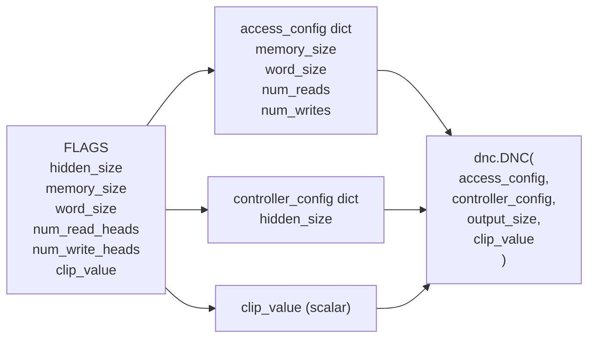
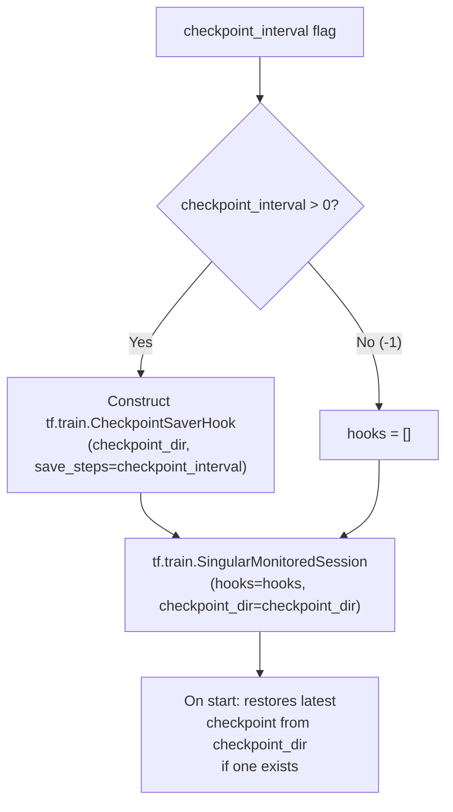

<!-- source: DeepWiki mcp.deepwiki.com · repo google-deepmind/dnc · page 2.2 Training Configuration · fetched 2026-10-26 -->

# Training Configuration

<details>
<summary>Relevant source files</summary>

The following files were used as context for generating this wiki page:

- [train.py](train.py)

</details>


This page is a reference for all `tf.flags` defined in [train.py](), which control every configurable aspect of a training run. Flags are grouped into four categories: model parameters, optimizer parameters, task parameters, and training options.

For a description of how these flags are used together during the training loop, see [Training the DNC](#2). For details on the RepeatCopy task that the task-parameter flags configure, see [The RepeatCopy Task](#2.1).

---

## How Flags Are Consumed

The diagram below shows which function or constructor each flag group feeds into.

**Flag-to-Component Wiring**

```mermaid
graph TD
    subgraph "Model Parameters"
        hidden_size["hidden_size"]
        memory_size["memory_size"]
        word_size["word_size"]
        num_write_heads["num_write_heads"]
        num_read_heads["num_read_heads"]
        clip_value["clip_value"]
    end

    subgraph "Optimizer Parameters"
        max_grad_norm["max_grad_norm"]
        learning_rate["learning_rate"]
        optimizer_epsilon["optimizer_epsilon"]
    end

    subgraph "Task Parameters"
        batch_size["batch_size"]
        num_bits["num_bits"]
        min_length["min_length"]
        max_length["max_length"]
        min_repeats["min_repeats"]
        max_repeats["max_repeats"]
    end

    subgraph "Training Options"
        num_training_iterations["num_training_iterations"]
        report_interval["report_interval"]
        checkpoint_dir["checkpoint_dir"]
        checkpoint_interval["checkpoint_interval"]
    end

    hidden_size --> run_model["run_model()\naccess_config / controller_config"]
    memory_size --> run_model
    word_size --> run_model
    num_write_heads --> run_model
    num_read_heads --> run_model
    clip_value --> run_model

    run_model --> DNC["dnc.DNC(access_config,\ncontroller_config,\noutput_size, clip_value)"]

    learning_rate --> RMSProp["tf.train.RMSPropOptimizer"]
    optimizer_epsilon --> RMSProp
    max_grad_norm --> clip_by_global_norm["tf.clip_by_global_norm"]

    batch_size --> RepeatCopy["repeat_copy.RepeatCopy(...)"]
    num_bits --> RepeatCopy
    min_length --> RepeatCopy
    max_length --> RepeatCopy
    min_repeats --> RepeatCopy
    max_repeats --> RepeatCopy

    num_training_iterations --> train_fn["train()"]
    report_interval --> train_fn
    checkpoint_dir --> SingularMonitoredSession["tf.train.SingularMonitoredSession"]
    checkpoint_interval --> CheckpointSaverHook["tf.train.CheckpointSaverHook"]
```



Sources: [train.py:29-66](), [train.py:69-91](), [train.py:94-158]()

---

## Model Parameters

These flags are assembled into `access_config` and `controller_config` dictionaries inside `run_model()`, which are then passed directly to the `dnc.DNC` constructor.

[train.py:29-36]()

| Flag | Type | Default | Description |
|---|---|---|---|
| `hidden_size` | `int` | `64` | Number of units in the LSTM controller's hidden layer. Maps to `controller_config["hidden_size"]`. |
| `memory_size` | `int` | `16` | Number of addressable memory slots. Maps to `access_config["memory_size"]`. |
| `word_size` | `int` | `16` | Width (in floats) of each memory slot. Maps to `access_config["word_size"]`. |
| `num_write_heads` | `int` | `1` | Number of write heads used by `MemoryAccess`. Maps to `access_config["num_writes"]`. |
| `num_read_heads` | `int` | `4` | Number of read heads used by `MemoryAccess`. Maps to `access_config["num_reads"]`. |
| `clip_value` | `int` | `20` | Absolute value ceiling applied to the controller output and DNC output via `tf.clip_by_value`. |

**How `run_model` assembles these flags:**



Sources: [train.py:72-83]()

---

## Optimizer Parameters

These flags control the RMSProp optimizer and gradient clipping applied in `train()`.

[train.py:38-42]()

| Flag | Type | Default | Description |
|---|---|---|---|
| `max_grad_norm` | `float` | `50.0` | Global norm limit passed to `tf.clip_by_global_norm`. Gradients are rescaled if the global norm exceeds this value. |
| `learning_rate` | `float` | `1e-4` | Step size passed to `tf.train.RMSPropOptimizer`. |
| `optimizer_epsilon` | `float` | `1e-10` | Numerical stability term (`epsilon`) passed to `tf.train.RMSPropOptimizer`. Prevents division by zero in the RMS denominator. |

The optimizer is constructed and applied at [train.py:111-126]():

```
grads, _ = tf.clip_by_global_norm(tf.gradients(train_loss, trainable_variables), FLAGS.max_grad_norm)
optimizer = tf.train.RMSPropOptimizer(FLAGS.learning_rate, epsilon=FLAGS.optimizer_epsilon)
train_step = optimizer.apply_gradients(zip(grads, trainable_variables), global_step=global_step)
```

---

## Task Parameters

These flags are passed as constructor arguments to `repeat_copy.RepeatCopy` inside `train()`. They define the difficulty and shape of the synthetic task.

[train.py:44-56]()

| Flag | Type | Default | Description |
|---|---|---|---|
| `batch_size` | `int` | `16` | Number of independent sequences processed per training step. |
| `num_bits` | `int` | `4` | Width of each binary observation vector (i.e., the number of bit channels per timestep). |
| `min_length` | `int` | `1` | Minimum number of vectors in the pattern to copy. |
| `max_length` | `int` | `2` | Maximum number of vectors in the pattern to copy. |
| `min_repeats` | `int` | `1` | Minimum number of times the pattern must be reproduced. |
| `max_repeats` | `int` | `2` | Maximum number of times the pattern must be reproduced. |

`RepeatCopy` samples `length` uniformly from `[min_length, max_length]` and `repeats` from `[min_repeats, max_repeats]` for each batch. The total sequence length therefore varies per batch. See [The RepeatCopy Task](#2.1) for a full description of the task structure.

---

## Training Options

These flags control the training loop lifecycle, console reporting, and checkpointing.

[train.py:58-66]()

| Flag | Type | Default | Description |
|---|---|---|---|
| `num_training_iterations` | `int` | `100000` | Total number of gradient steps to run. Passed directly to `train()` as `num_training_iterations`. |
| `report_interval` | `int` | `100` | How frequently (in steps) to log average loss and a human-readable task sample. Passed to `train()` as `report_interval`. |
| `checkpoint_dir` | `string` | `"/tmp/tf/dnc"` | Directory for saving and restoring checkpoints. Used by both `tf.train.SingularMonitoredSession` (for restore-on-start) and `tf.train.CheckpointSaverHook` (for periodic saves). |
| `checkpoint_interval` | `int` | `-1` | How frequently (in steps) to save a checkpoint. A value of `-1` disables periodic checkpointing; only the session-level checkpoint behaviour of `SingularMonitoredSession` applies. |

**Checkpoint behaviour logic:**



Sources: [train.py:129-142]()

When a prior checkpoint exists in `checkpoint_dir`, `SingularMonitoredSession` restores from it automatically, and the training loop reads `global_step` to resume from the correct iteration [train.py:144-147]().

---

## Quick Reference Summary

| Category | Flag | Default |
|---|---|---|
| **Model** | `hidden_size` | `64` |
| **Model** | `memory_size` | `16` |
| **Model** | `word_size` | `16` |
| **Model** | `num_write_heads` | `1` |
| **Model** | `num_read_heads` | `4` |
| **Model** | `clip_value` | `20` |
| **Optimizer** | `max_grad_norm` | `50.0` |
| **Optimizer** | `learning_rate` | `1e-4` |
| **Optimizer** | `optimizer_epsilon` | `1e-10` |
| **Task** | `batch_size` | `16` |
| **Task** | `num_bits` | `4` |
| **Task** | `min_length` | `1` |
| **Task** | `max_length` | `2` |
| **Task** | `min_repeats` | `1` |
| **Task** | `max_repeats` | `2` |
| **Training** | `num_training_iterations` | `100000` |
| **Training** | `report_interval` | `100` |
| **Training** | `checkpoint_dir` | `"/tmp/tf/dnc"` |
| **Training** | `checkpoint_interval` | `-1` |

Sources: [train.py:29-66]()

---

