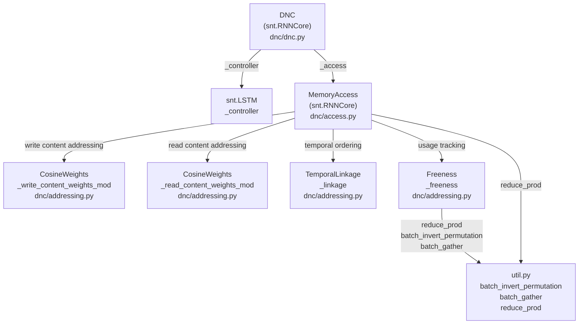
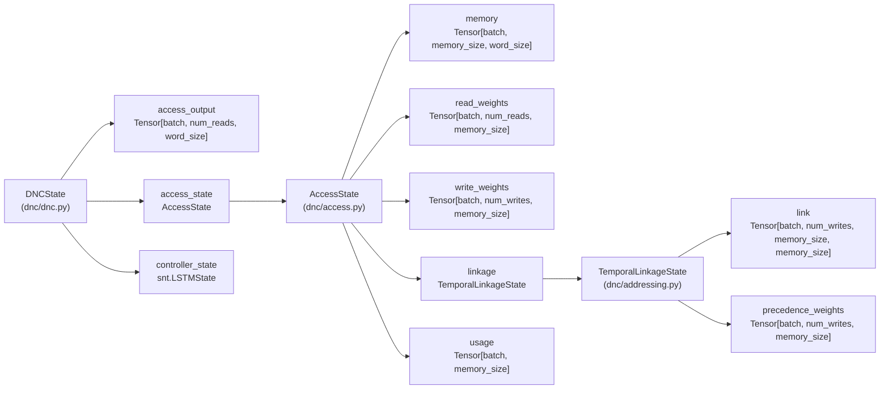
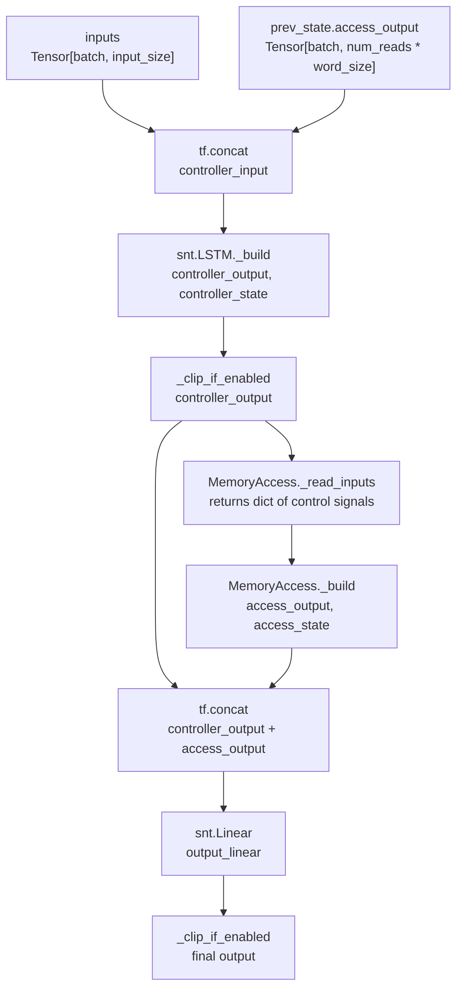
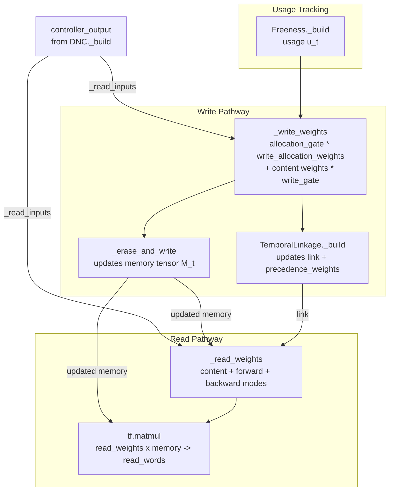

<!-- source: DeepWiki mcp.deepwiki.com · repo google-deepmind/dnc · page 3 Core Architecture · fetched 2026-10-26 -->

# Core Architecture

Relevant source files

The following files were used as context for generating this wiki page:

- [README.md](README.md)
- [dnc/access.py](dnc/access.py)
- [dnc/addressing.py](dnc/addressing.py)
- [dnc/dnc.py](dnc/dnc.py)
- [dnc/util.py](dnc/util.py)

This page provides a mid-level architectural overview of the `dnc/` package. It describes how the four modules — `dnc.py`, `access.py`, `addressing.py`, and `util.py` — compose into a complete Differentiable Neural Computer, and serves as a navigational entry point for the detailed sub-pages covering each module.

For the training pipeline that drives the DNC, see [Training the DNC](#2). For the task used to benchmark it, see [The RepeatCopy Task](#2.1).

---

## Module Overview

The `dnc/` package is organized into four files with a clear layered dependency structure:

| File | Primary Export(s) | Role |
|------|-------------------|------|
| `dnc/dnc.py` | `DNC`, `DNCState` | Top-level `snt.RNNCore`; composes the LSTM controller and `MemoryAccess` |
| `dnc/access.py` | `MemoryAccess`, `AccessState` | Manages reading from and writing to the external memory matrix |
| `dnc/addressing.py` | `CosineWeights`, `TemporalLinkage`, `Freeness`, `TemporalLinkageState` | Three addressing sub-modules used by `MemoryAccess` |
| `dnc/util.py` | `batch_invert_permutation`, `batch_gather`, `reduce_prod`, `one_hot` | Tensor utility functions used by `access.py` and `addressing.py` |

Sources: [dnc/dnc.py:1-143](), [dnc/access.py:1-319](), [dnc/addressing.py:1-411](), [dnc/util.py:1-73]()

---

## Component Hierarchy

**Diagram: Class composition hierarchy of the DNC**

Sources: [dnc/dnc.py:63-76](), [dnc/access.py:105-111](), [dnc/addressing.py:376-405]()

---

## State Namedtuples

The DNC is a stateful RNN. Three nested namedtuples fully describe the system state at each timestep.

**Diagram: State namedtuple nesting**

Sources: [dnc/dnc.py:32-33](), [dnc/access.py:28-29](), [dnc/addressing.py:30-31]()

---

## Forward Pass Data Flow

Each call to `DNC._build` processes one timestep. The following describes the sequence of operations:

**Diagram: Data flow through a single DNC timestep**

Sources: [dnc/dnc.py:84-127](), [dnc/access.py:113-158]()

---

## Memory Access: Write and Read Pathways

Within `MemoryAccess._build`, the write and read operations follow distinct pathways that interact through the shared memory matrix.

**Diagram: Write and read pathways in MemoryAccess._build**

Sources: [dnc/access.py:126-158](), [dnc/access.py:220-303]()

---

## Addressing Sub-Modules

`MemoryAccess` delegates three distinct responsibilities to sub-modules in `dnc/addressing.py`:

| Class | Base Class | State | Responsibility |
|-------|-----------|-------|----------------|
| `CosineWeights` | `snt.AbstractModule` | Stateless | Content-based lookup via cosine similarity between a key vector and each memory row |
| `TemporalLinkage` | `snt.RNNCore` | `TemporalLinkageState` (`link`, `precedence_weights`) | Maintains a directed graph of write-order transitions; produces forward/backward read weights via `directional_read_weights` |
| `Freeness` | `snt.RNNCore` | `Tensor[batch, memory_size]` | Tracks slot usage (0–1); provides free slots for allocation writes via `write_allocation_weights` |

Two `CosineWeights` instances are created: one for write heads (`_write_content_weights_mod`) and one for read heads (`_read_content_weights_mod`), each with matching `num_heads` and `word_size`.

Sources: [dnc/access.py:105-111](), [dnc/addressing.py:58-106](), [dnc/addressing.py:108-249](), [dnc/addressing.py:252-410]()

---

## Control Signals Produced by `_read_inputs`

`MemoryAccess._read_inputs` applies a set of linear projections to the controller output to produce all control signals needed for a single memory step. The table below maps each signal to its shape and consumer:

| Signal key | Shape | Consumer |
|-----------|-------|----------|
| `write_vectors` | `[batch, num_writes, word_size]` | `_erase_and_write` |
| `erase_vectors` | `[batch, num_writes, word_size]` | `_erase_and_write` |
| `free_gate` | `[batch, num_reads]` | `Freeness._build` |
| `allocation_gate` | `[batch, num_writes]` | `_write_weights` |
| `write_gate` | `[batch, num_writes]` | `_write_weights` |
| `read_mode` | `[batch, num_reads, 1 + 2*num_writes]` | `_read_weights` |
| `write_content_keys` | `[batch, num_writes, word_size]` | `CosineWeights` (write) |
| `write_content_strengths` | `[batch, num_writes]` | `CosineWeights` (write) |
| `read_content_keys` | `[batch, num_reads, word_size]` | `CosineWeights` (read) |
| `read_content_strengths` | `[batch, num_reads]` | `CosineWeights` (read) |

Sources: [dnc/access.py:160-218]()

---

## Utility Layer

`dnc/util.py` provides low-level tensor operations used internally by `MemoryAccess` and `Freeness`:

| Function | Used by | Purpose |
|----------|---------|---------|
| `batch_invert_permutation` | `Freeness._allocation` | Inverts a sort permutation for each batch element to unsort the allocation weights |
| `batch_gather` | `Freeness._allocation` | Per-row indexed lookup on a 2-D batch tensor |
| `reduce_prod` | `Freeness._usage_after_write`, `_usage_after_read`, `_erase_and_write` | Efficient product-over-axis using `tf.cumprod` to avoid slow CPU gradient computation |
| `one_hot` | Tests | Constructs a static NumPy one-hot vector |

Sources: [dnc/util.py:25-73](), [dnc/addressing.py:354-405](), [dnc/access.py:52-63]()

---

## Sub-pages

Detailed documentation for each layer is covered in the following pages:

- **[DNC Core](#3.1)** — The `DNC` class, `DNCState`, the LSTM controller, output projection, and `clip_value` behavior.
- **[Memory Access Module](#3.2)** — The `MemoryAccess` class, `AccessState`, the write and read pathways in detail.
- **[Memory Addressing](#3.3)** — `CosineWeights`, `TemporalLinkage`, `Freeness`, and `TemporalLinkageState`.
- **[Utility Functions](#3.4)** — All functions in `dnc/util.py` and their precise behavior.

---

