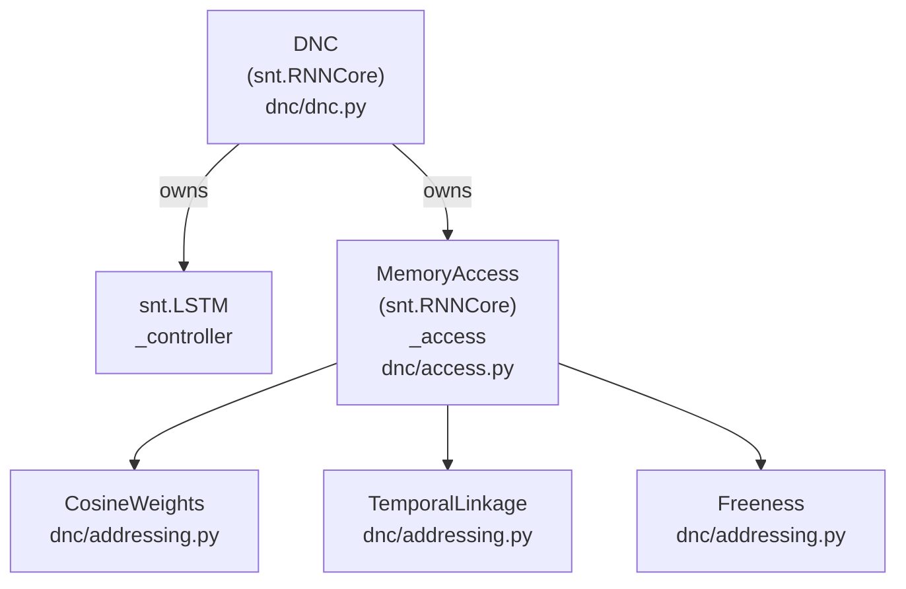
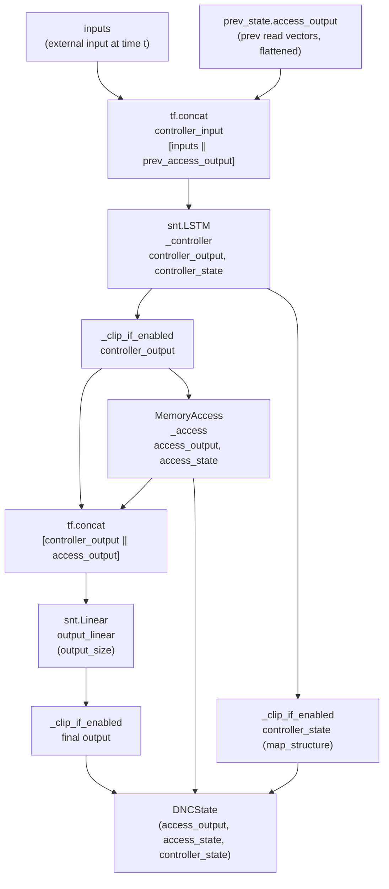

<!-- source: DeepWiki mcp.deepwiki.com · repo google-deepmind/dnc · page 3.1 DNC Core · fetched 2026-10-26 -->

# DNC Core

<details>
<summary>Relevant source files</summary>

The following files were used as context for generating this wiki page:

- [dnc/dnc.py](dnc/dnc.py)
- [train.py](train.py)

</details>


This page documents the `DNC` class in [dnc/dnc.py](), which is the top-level recurrent module that composes the LSTM controller and the memory access system into a single differentiable unit. It covers the `DNCState` namedtuple, constructor parameters, the `_build` forward pass, output projection, value clipping, and state initialization.

For details on the memory access layer that `DNC` delegates to, see the [Memory Access Module](#3.2). For how `DNC` is instantiated and run during training, see [Training the DNC](#2).

---

## Role and Position in the Architecture

`DNC` sits at the top of the module hierarchy. It is the object passed to `tf.nn.dynamic_rnn` in `train.py` and is responsible for orchestrating every step of the recurrent computation.

**Component hierarchy diagram**



Sources: [dnc/dnc.py:36-143](), [train.py:69-91]()

---

## `DNCState` Namedtuple

[dnc/dnc.py:32-33]()

```
DNCState = collections.namedtuple('DNCState',
    ('access_output', 'access_state', 'controller_state'))
```

| Field | Type | Description |
|---|---|---|
| `access_output` | `Tensor [batch, num_reads * word_size]` | Flattened read vectors from the previous memory access step |
| `access_state` | `AccessState` namedtuple | Full internal state of the `MemoryAccess` module (memory, read/write weights, linkage, usage) |
| `controller_state` | LSTM state tuple | Hidden and cell state of the LSTM controller |

`DNCState` is both the type returned by `initial_state` and the `prev_state` argument received by `_build` on every step.

Sources: [dnc/dnc.py:32-33](), [dnc/dnc.py:72-76]()

---

## Constructor

[dnc/dnc.py:42-76]()

```python
DNC(access_config, controller_config, output_size, clip_value=None, name='dnc')
```

| Parameter | Type | Description |
|---|---|---|
| `access_config` | `dict` | Keyword arguments forwarded to `MemoryAccess` (`memory_size`, `word_size`, `num_reads`, `num_writes`) |
| `controller_config` | `dict` | Keyword arguments forwarded to `snt.LSTM` (typically `hidden_size`) |
| `output_size` | `int` | Dimensionality of the final output vector produced at each time step |
| `clip_value` | `float` or `None` | If set, clips outputs to `[-clip_value, clip_value]`; `None` disables clipping |
| `name` | `str` | Sonnet module name, defaults to `'dnc'` |

During construction, both sub-modules are instantiated inside `self._enter_variable_scope()` so their variables are scoped under the DNC:

- `self._controller = snt.LSTM(**controller_config)` [dnc/dnc.py:65]()
- `self._access = access.MemoryAccess(**access_config)` [dnc/dnc.py:66]()

`self._access_output_size` is computed as `np.prod(self._access.output_size.as_list())`, giving the flat size of the concatenated read vectors [dnc/dnc.py:68]().

In `train.py`, the DNC is constructed as:

```python
dnc_core = dnc.DNC(access_config, controller_config, output_size, clip_value)
```

where `access_config` carries `memory_size`, `word_size`, `num_reads`, `num_writes`, and `controller_config` carries `hidden_size` [train.py:72-83]().

Sources: [dnc/dnc.py:42-76](), [train.py:72-84]()

---

## `_build` — Forward Pass

[dnc/dnc.py:84-127]()

This is the method Sonnet calls on each time step (via `__call__`). It implements one full recurrent step of the DNC.

**Forward pass dataflow diagram**



Sources: [dnc/dnc.py:84-127]()

### Step-by-step breakdown

**1. Unpack previous state**

```
prev_access_output    = prev_state.access_output
prev_access_state     = prev_state.access_state
prev_controller_state = prev_state.controller_state
```

[dnc/dnc.py:101-103]()

**2. Build controller input**

The current external `inputs` and the previous memory read vectors (`prev_access_output`) are flattened and concatenated along axis 1:

```
controller_input = tf.concat(
    [batch_flatten(inputs), batch_flatten(prev_access_output)], 1)
```

[dnc/dnc.py:105-107]()

This gives the LSTM visibility into both the current task input and what was last read from memory.

**3. Run the LSTM controller**

```
controller_output, controller_state = self._controller(
    controller_input, prev_controller_state)
```

[dnc/dnc.py:109-110]()

**4. Clip controller output and state (optional)**

`_clip_if_enabled` applies `tf.clip_by_value(x, -clip_value, clip_value)` if `clip_value > 0`. It is applied to `controller_output` directly, and to every tensor in `controller_state` via `tf.contrib.framework.nest.map_structure`:

[dnc/dnc.py:78-82](), [dnc/dnc.py:112-113]()

**5. Run memory access**

The (clipped) `controller_output` is passed to `MemoryAccess`, which produces read vectors and updates internal memory state:

```
access_output, access_state = self._access(
    controller_output, prev_access_state)
```

[dnc/dnc.py:115-116]()

**6. Produce final output**

The controller output and the new memory read vectors are concatenated, then passed through a learned linear projection to `output_size` dimensions, and finally clipped:

```
output = tf.concat([controller_output, batch_flatten(access_output)], 1)
output = snt.Linear(output_size=..., name='output_linear')(output)
output = self._clip_if_enabled(output)
```

[dnc/dnc.py:118-122]()

The `snt.Linear` layer named `output_linear` is the only learned projection in `dnc.py` itself; its variables are created on the first call.

**7. Return output and next state**

```
return output, DNCState(
    access_output=access_output,
    access_state=access_state,
    controller_state=controller_state)
```

[dnc/dnc.py:124-127]()

Note that `access_output` stored in the returned `DNCState` is the **unflattened** read tensor, while it is flattened when used as controller input on the next step.

---

## Value Clipping

`_clip_if_enabled` is a small guard method:

[dnc/dnc.py:78-82]()

```
def _clip_if_enabled(self, x):
    if self._clip_value > 0:
        return tf.clip_by_value(x, -self._clip_value, self._clip_value)
    else:
        return x
```

It is applied at **three** points in the forward pass:

| Application point | Target |
|---|---|
| After LSTM step | `controller_output` scalar tensor |
| After LSTM step | Every tensor inside `controller_state` (via `map_structure`) |
| After output projection | Final `output` tensor |

In the default training setup, `clip_value` is `20` [train.py:35-36]().

Sources: [dnc/dnc.py:78-82](), [dnc/dnc.py:112-122](), [train.py:35-36]()

---

## `initial_state`

[dnc/dnc.py:129-134]()

```python
def initial_state(self, batch_size, dtype=tf.float32):
    return DNCState(
        controller_state=self._controller.initial_state(batch_size, dtype),
        access_state=self._access.initial_state(batch_size, dtype),
        access_output=tf.zeros(
            [batch_size] + self._access.output_size.as_list(), dtype))
```

| Field initialized | Source |
|---|---|
| `controller_state` | `snt.LSTM.initial_state` (zeros for hidden and cell) |
| `access_state` | `MemoryAccess.initial_state` (zeros for memory, weights, linkage, usage) |
| `access_output` | `tf.zeros` shaped `[batch_size, num_reads, word_size]` |

In `train.py` this is called before `tf.nn.dynamic_rnn`:

```python
initial_state = dnc_core.initial_state(FLAGS.batch_size)
output_sequence, _ = tf.nn.dynamic_rnn(
    cell=dnc_core,
    inputs=input_sequence,
    time_major=True,
    initial_state=initial_state)
```

[train.py:84-89]()

---

## `state_size` and `output_size` Properties

[dnc/dnc.py:136-142]()

These properties are required by the `snt.RNNCore` interface and allow Sonnet / TensorFlow to reason about state and output shapes without running the graph.

| Property | Returns |
|---|---|
| `state_size` | `DNCState(access_output_size, access.state_size, controller.state_size)` |
| `output_size` | `tf.TensorShape([output_size])` |

Sources: [dnc/dnc.py:136-142](), [dnc/dnc.py:72-76]()

---

## Tensor Shape Summary

Assuming `batch_size=B`, `hidden_size=H`, `num_reads=R`, `word_size=W`, `output_size=O`:

| Tensor | Shape |
|---|---|
| `inputs` (external) | `[B, input_dim]` |
| `prev_access_output` (flattened) | `[B, R*W]` |
| `controller_input` | `[B, input_dim + R*W]` |
| `controller_output` | `[B, H]` |
| `access_output` | `[B, R, W]` |
| `concat([controller_output, flat(access_output)])` | `[B, H + R*W]` |
| final `output` (after `output_linear`) | `[B, O]` |

Sources: [dnc/dnc.py:84-127]()

---

