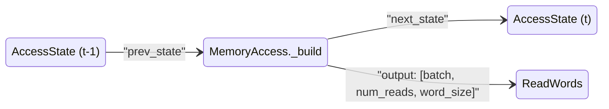
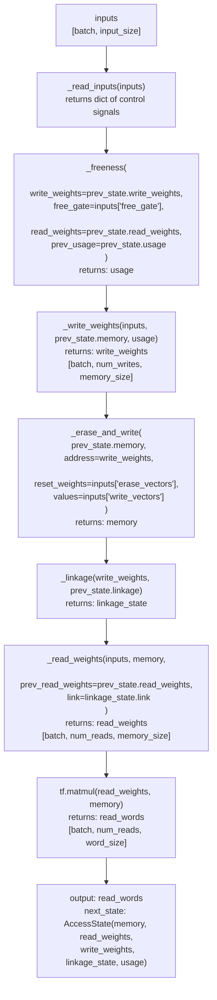
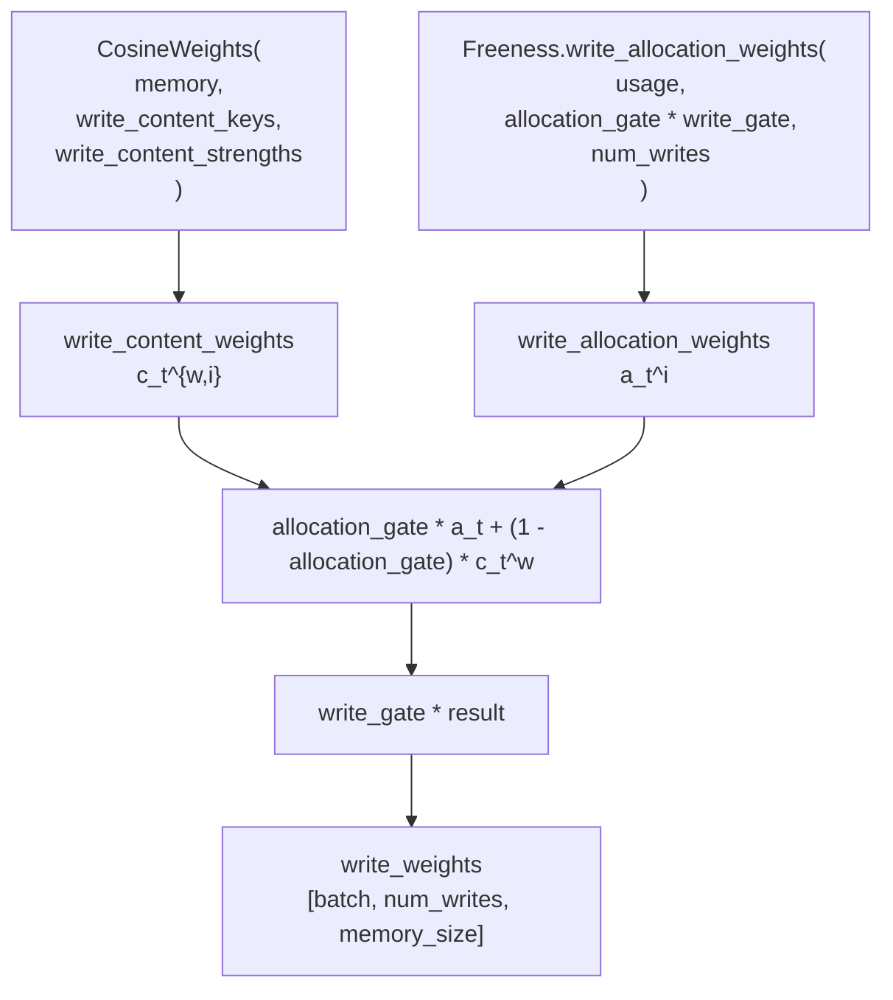
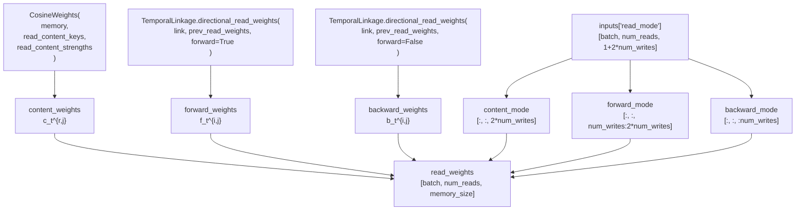
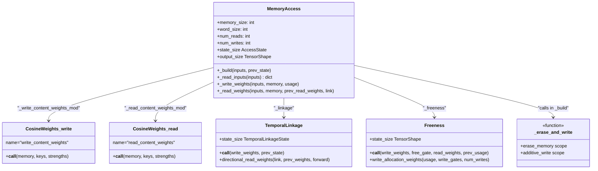
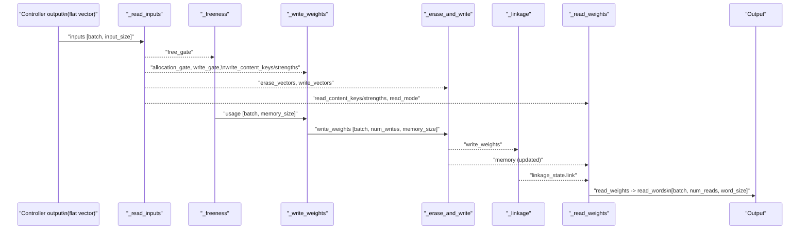

<!-- source: DeepWiki mcp.deepwiki.com · repo google-deepmind/dnc · page 3.2 Memory Access Module · fetched 2026-10-26 -->

# Memory Access Module

<details>
<summary>Relevant source files</summary>

The following files were used as context for generating this wiki page:

- [dnc/access.py](dnc/access.py)
- [dnc/access_test.py](dnc/access_test.py)

</details>


This page documents `MemoryAccess` in [dnc/access.py](), which is the external memory interface of the DNC. It sits between the LSTM controller (described in [DNC Core](#3.1)) and the low-level addressing primitives (described in [Memory Addressing](#3.3)). Its responsibilities are: parsing the controller's flat output vector into structured control signals, performing writes to memory, and performing reads from memory. It does not define cosine similarity, temporal link tracking, or usage tracking directly — those are delegated to sub-modules in `addressing.py`.

---

## Overview

`MemoryAccess` is a `snt.RNNCore`. At each time step it receives a flat input vector from the controller and a previous `AccessState`, then produces a tensor of read words and an updated `AccessState`.

**State diagram of `MemoryAccess`**



Sources: [dnc/access.py:113-158]()

---

## AccessState

[dnc/access.py:28-29]()

`AccessState` is a `collections.namedtuple` with five fields. It is both the state carried between time steps and the initial state returned by `snt.RNNCore.initial_state`.

| Field | Shape | Description |
|---|---|---|
| `memory` | `[batch, memory_size, word_size]` | The memory matrix M |
| `read_weights` | `[batch, num_reads, memory_size]` | Previous read weight distributions |
| `write_weights` | `[batch, num_writes, memory_size]` | Previous write weight distributions |
| `linkage` | `TemporalLinkageState` | Link matrix + precedence weights (see [Memory Addressing](#3.3)) |
| `usage` | `[batch, memory_size]` | Per-location usage scalars (see [Memory Addressing](#3.3)) |

The `state_size` property returns an `AccessState` filled with `tf.TensorShape` objects, and `output_size` returns `tf.TensorShape([num_reads, word_size])`.

Sources: [dnc/access.py:28-29](), [dnc/access.py:305-318]()

---

## Constructor Parameters

`MemoryAccess.__init__` instantiates all sub-modules and stores the four hyper-parameters:

| Parameter | Default | Paper symbol | Meaning |
|---|---|---|---|
| `memory_size` | 128 | N | Number of memory slots |
| `word_size` | 20 | W | Width of each memory slot |
| `num_reads` | 1 | R | Number of read heads |
| `num_writes` | 1 | — | Number of write heads |

Two `CosineWeights` instances are created (one per read, one per write), plus one `TemporalLinkage` and one `Freeness` instance.

Sources: [dnc/access.py:84-111]()

---

## Forward Pass (`_build`)

The `_build` method executes each time step in four ordered stages:

**Forward Pass Flow**



Sources: [dnc/access.py:113-158]()

---

## Parsing Inputs (`_read_inputs`)

[dnc/access.py:160-218]()

The controller emits a single flat vector. `_read_inputs` applies separate learned linear projections to produce each named control signal. All projections operate on the same `inputs` tensor via closures over a local `_linear` helper that reshapes the flat output into `[batch, first_dim, second_dim]`.

**Control signals produced by `_read_inputs`**

| Key in result dict | Shape | Activation | Description |
|---|---|---|---|
| `write_vectors` | `[batch, num_writes, word_size]` | none | Values to write to memory (v_t^i) |
| `erase_vectors` | `[batch, num_writes, word_size]` | sigmoid | Erase gate per write head (e_t^i) |
| `free_gate` | `[batch, num_reads]` | sigmoid | Fraction of read memory to free (f_t^j) |
| `allocation_gate` | `[batch, num_writes]` | sigmoid | Interpolation toward allocation addressing (g_t^{a,i}) |
| `write_gate` | `[batch, num_writes]` | sigmoid | Overall write amount gating (g_t^{w,i}) |
| `read_mode` | `[batch, num_reads, 1+2*num_writes]` | softmax | Mode mixing weights (π_t^j) |
| `write_content_keys` | `[batch, num_writes, word_size]` | none | Keys for write content addressing |
| `write_content_strengths` | `[batch, num_writes]` | none | Strengths for write content addressing |
| `read_content_keys` | `[batch, num_reads, word_size]` | none | Keys for read content addressing |
| `read_content_strengths` | `[batch, num_reads]` | none | Strengths for read content addressing |

The `read_mode` vector has `1 + 2 * num_writes` entries per read head. The softmax ensures the three mode categories sum to 1 and are non-negative, constituting a valid probability distribution.

Sources: [dnc/access.py:160-218]()

---

## Write Pathway

### Write Weights (`_write_weights`)

[dnc/access.py:220-257]()

Write weights blend two sources — content-based addressing and allocation-based addressing — then gate the result:

```
w_t^{w,i} = g_t^{w,i} * ( g_t^{a,i} * a_t^i  +  (1 - g_t^{a,i}) * c_t^{w,i} )
```

- `c_t^{w,i}` — content weights from `CosineWeights` (`_write_content_weights_mod`)
- `a_t^i` — allocation weights from `Freeness.write_allocation_weights`
- `g_t^{a,i}` — `allocation_gate` interpolates between the two
- `g_t^{w,i}` — `write_gate` scales the final weight

When `allocation_gate == 1` the write head targets unused memory; when `allocation_gate == 0` it targets content-matched locations. The `write_gate` can suppress the write entirely.

**Write weight computation graph**



Sources: [dnc/access.py:220-257]()

### Erase and Write (`_erase_and_write`)

[dnc/access.py:32-63]()

Once write weights are computed, the memory update is a two-step operation:

**Erase step:**
```
M_t'(i) = M_{t-1}(i) * (1 - w_t(i) * e_t)
```
All write heads contribute a multiplicative erase, combined via `reduce_prod` across the `num_writes` axis. This ensures that multiple write heads each get to erase independently.

**Add step:**
```
M_t(i) = M_t'(i) + w_t(i) * a_t
```
The write vectors are added to the erased memory via `tf.matmul(address, values, adjoint_a=True)`, which accumulates contributions from all write heads at once.

| Argument | Shape |
|---|---|
| `memory` | `[batch, memory_size, word_size]` |
| `address` (write_weights) | `[batch, num_writes, memory_size]` |
| `reset_weights` (erase_vectors) | `[batch, num_writes, word_size]` |
| `values` (write_vectors) | `[batch, num_writes, word_size]` |

Sources: [dnc/access.py:32-63]()

---

## Read Pathway

### Read Weights (`_read_weights`)

[dnc/access.py:259-303]()

Each read head combines three addressing modes whose mixing proportions come from `inputs['read_mode']`:

| `read_mode` slice | Mode | Source |
|---|---|---|
| `[:, :, :num_writes]` | backward | `TemporalLinkage.directional_read_weights(forward=False)` |
| `[:, :, num_writes:2*num_writes]` | forward | `TemporalLinkage.directional_read_weights(forward=True)` |
| `[:, :, 2*num_writes]` | content | `CosineWeights` (`_read_content_weights_mod`) |

The final read weight for each head is:

```
w_t^{r,j} = π_content * c_t^{r,j}
           + Σ_i π_forward_i  * f_t^{i,j}
           + Σ_i π_backward_i * b_t^{i,j}
```

**Read weight computation graph**



Sources: [dnc/access.py:259-303]()

---

## Sub-module Composition Summary

**Component ownership within `MemoryAccess`**



Sources: [dnc/access.py:84-111](), [dnc/access.py:113-158]()

---

## Data Flow Through a Single Time Step



Sources: [dnc/access.py:113-158]()

---

## Key Tensor Shapes Reference

| Tensor | Shape |
|---|---|
| `inputs` to `_build` | `[batch, input_size]` |
| `memory` | `[batch, memory_size, word_size]` |
| `write_weights` | `[batch, num_writes, memory_size]` |
| `read_weights` | `[batch, num_reads, memory_size]` |
| `usage` | `[batch, memory_size]` |
| `linkage.link` | `[batch, num_writes, memory_size, memory_size]` |
| `linkage.precedence_weights` | `[batch, num_writes, memory_size]` |
| `read_mode` | `[batch, num_reads, 1 + 2*num_writes]` |
| `read_words` (output) | `[batch, num_reads, word_size]` |

Sources: [dnc/access.py:305-318](), [dnc/access.py:259-303]()

---

## Testing

The test file [dnc/access_test.py]() exercises `MemoryAccess` with `BATCH_SIZE=2`, `MEMORY_SIZE=20`, `WORD_SIZE=6`, `NUM_READS=2`, `NUM_WRITES=3`, `TIME_STEPS=4`, `INPUT_SIZE=10`.

| Test | What it checks |
|---|---|
| `testBuildAndTrain` | Full `dynamic_rnn` forward + backward pass completes; gradient descent step runs without error |
| `testValidReadMode` | `read_mode` output sums to 1 per read head and is non-negative |
| `testWriteWeights` | With `allocation_gate=1` and a single free slot, write weights concentrate on that slot |
| `testReadWeights` | With content mode active and a matching key, read weights concentrate on the correct memory row |
| `testGradients` | Numerical gradient check over `inputs`, `memory`, `read_weights`, `linkage.precedence_weights`, `linkage.link`; error < 0.1 |

For a full breakdown of each test case see [Memory Access Tests](#4.2).

Sources: [dnc/access_test.py:37-159]()

---

