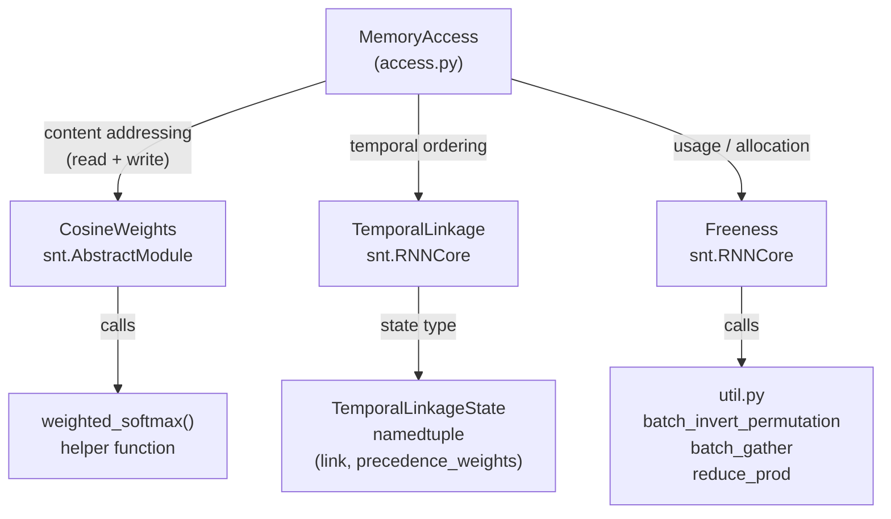
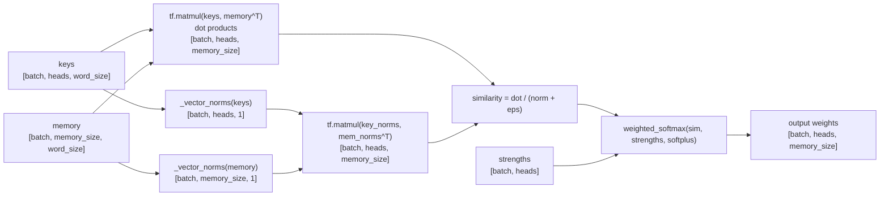
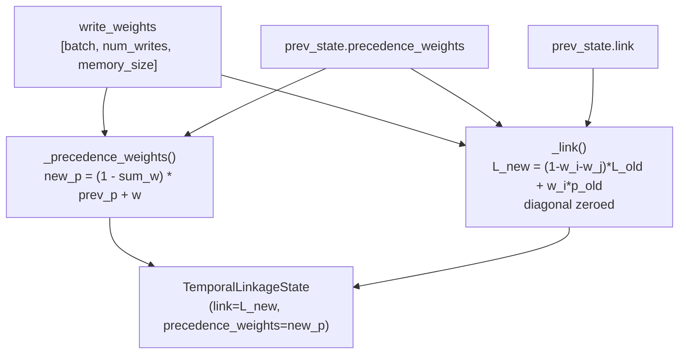
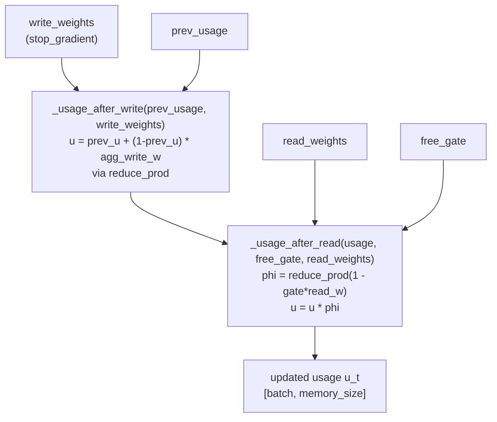
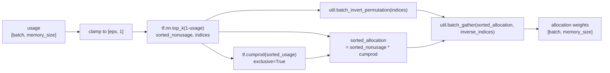

<!-- source: DeepWiki mcp.deepwiki.com · repo google-deepmind/dnc · page 3.3 Memory Addressing · fetched 2026-10-26 -->

# Memory Addressing

<details>
<summary>Relevant source files</summary>

The following files were used as context for generating this wiki page:

- [dnc/addressing.py](dnc/addressing.py)
- [dnc/addressing_test.py](dnc/addressing_test.py)

</details>


This page documents the three memory addressing mechanisms implemented in [dnc/addressing.py](), which are consumed by `MemoryAccess` (see [Memory Access Module](#3.2)) to compute read and write weights at each time step. The three mechanisms are:

- **`CosineWeights`** — content-based lookup
- **`TemporalLinkage`** — write-order tracking for sequential reads
- **`Freeness`** — usage tracking for allocation-based writes

A shared helper, `weighted_softmax`, supports content-based addressing. A module-level constant `_EPSILON = 1e-6` is used throughout to prevent numerical instability from zero-norm vectors or zero usage values.

---

## Module Overview

**Figure: addressing.py component map**



Sources: [dnc/addressing.py:1-411]()

---

## `weighted_softmax`

[dnc/addressing.py:39-55]()

```
weighted_softmax(activations, strengths, strengths_op)
```

This is a free function (not a module) used by `CosineWeights` and indirectly by the content addressing path.

| Argument | Shape | Description |
|---|---|---|
| `activations` | `[batch, num_heads, memory_size]` | Raw similarity scores |
| `strengths` | `[batch, num_heads]` | Per-head sharpening strengths |
| `strengths_op` | callable | Applied to `strengths` before multiplication (default: `tf.nn.softplus`) |

**What it does:** Multiplies `activations` element-wise by `strengths_op(strengths)` (broadcast over memory dimension), then applies `tf.nn.softmax` over the last axis via `snt.BatchApply`. When `strengths` is all-ones and `strengths_op` is `tf.identity`, the result is identical to a plain softmax.

Sources: [dnc/addressing.py:39-55](), [dnc/addressing_test.py:34-58]()

---

## `CosineWeights`

[dnc/addressing.py:58-105]()

`CosineWeights` is a `snt.AbstractModule` that implements content-based addressing. Given a set of query keys and the current memory matrix, it returns a probability distribution over memory locations for each head.

### Constructor

```
CosineWeights(num_heads, word_size, strength_op=tf.nn.softplus, name='cosine_weights')
```

| Parameter | Description |
|---|---|
| `num_heads` | Number of read or write heads |
| `word_size` | Dimensionality of each memory word |
| `strength_op` | Transform applied to strengths (default `tf.nn.softplus`) |

### Forward pass: `_build`

[dnc/addressing.py:83-105]()

| Input | Shape | Description |
|---|---|---|
| `memory` | `[batch, memory_size, word_size]` | Current memory matrix |
| `keys` | `[batch, num_heads, word_size]` | Query vectors |
| `strengths` | `[batch, num_heads]` | Sharpening factors |

**Output:** `[batch, num_heads, memory_size]` — attention weights over memory.

**Figure: CosineWeights computation graph**



The helper `_vector_norms` [dnc/addressing.py:34-36]() computes `sqrt(sum(m^2, axis=2) + _EPSILON)` to avoid division by zero even when a memory slot or key vector is all zeros.

Sources: [dnc/addressing.py:34-105](), [dnc/addressing_test.py:61-150]()

---

## `TemporalLinkage`

[dnc/addressing.py:108-249]()

`TemporalLinkage` is a `snt.RNNCore` that maintains a directed graph over memory slots encoding the order in which they were written. This enables "forward" and "backward" reads that follow the write sequence.

### State: `TemporalLinkageState`

[dnc/addressing.py:30-31]()

```python
TemporalLinkageState = collections.namedtuple('TemporalLinkageState',
                                              ('link', 'precedence_weights'))
```

| Field | Shape | Description |
|---|---|---|
| `link` | `[batch, num_writes, memory_size, memory_size]` | Adjacency matrices — `link[b, w, i, j]` is the probability that slot `j` was written just before slot `i` by write head `w` |
| `precedence_weights` | `[batch, num_writes, memory_size]` | Smoothed write weights representing where each head last wrote |

### Constructor

```
TemporalLinkage(memory_size, num_writes, name='temporal_linkage')
```

### Forward pass: `_build`

[dnc/addressing.py:133-153]()

Takes `write_weights [batch, num_writes, memory_size]` and `prev_state: TemporalLinkageState`. Returns an updated `TemporalLinkageState`.

Internally calls two private methods:

#### `_precedence_weights`

[dnc/addressing.py:220-240]()

Updates the precedence weights — a running "where did I last write" signal:

```
new_p = (1 - sum(w)) * prev_p + w
```

- If `sum(w) ≈ 0` (no writing), precedence is unchanged.
- If `sum(w) ≈ 1` (full writing), precedence is replaced by `w`.

#### `_link`

[dnc/addressing.py:183-218]()

Updates the link matrix using the formula:

```
L_t[i, j] = (1 - w_i - w_j) * L_{t-1}[i, j]  +  w_i * p_{t-1}[j]
```

where `w` is the current write weight and `p` is the previous precedence weight. The diagonal is forced to zero by `tf.matrix_set_diag` to prevent self-loops.

**Figure: Temporal Linkage state update**



### `directional_read_weights`

[dnc/addressing.py:155-181]()

Computes forward or backward read addresses by multiplying previous read weights against the link matrix.

```
directional_read_weights(link, prev_read_weights, forward: bool)
```

| Argument | Shape |
|---|---|
| `link` | `[batch, num_writes, memory_size, memory_size]` |
| `prev_read_weights` | `[batch, num_reads, memory_size]` |

**Output:** `[batch, num_reads, num_writes, memory_size]`

- **Forward (`forward=True`):** `result = prev_read_weights @ link` — follows edges forward in write order.
- **Backward (`forward=False`):** `result = prev_read_weights @ link^T` — follows edges backward.

The implementation tiles `prev_read_weights` across write heads [dnc/addressing.py:177-178](), performs a batched matmul, then transposes to put reads before writes.

Sources: [dnc/addressing.py:108-249](), [dnc/addressing_test.py:153-277]()

---

## `Freeness`

[dnc/addressing.py:252-410]()

`Freeness` is a `snt.RNNCore` whose state is a single tensor of shape `[batch, memory_size]` with values in `[0, 1]` representing how "used" each memory slot is.

### Constructor

```
Freeness(memory_size, name='freeness')
```

### Forward pass: `_build`

[dnc/addressing.py:279-305]()

Updates usage given the previous time step's read and write weights.

| Input | Shape | Description |
|---|---|---|
| `write_weights` | `[batch, num_writes, memory_size]` | Previous write addresses |
| `free_gate` | `[batch, num_reads]` | Per-head gate — how much of a read location can be freed |
| `read_weights` | `[batch, num_reads, memory_size]` | Previous read addresses |
| `prev_usage` | `[batch, memory_size]` | Usage `u_{t-1}` |

**Output:** `[batch, memory_size]` — updated usage `u_t`.

Note: `write_weights` is wrapped in `tf.stop_gradient` [dnc/addressing.py:302]() so usage does not backpropagate through the write weights in this path.

**Figure: Freeness._build computation**



#### `_usage_after_write`

[dnc/addressing.py:342-355]()

Aggregates multiple write heads using `util.reduce_prod`:

```
agg_write_w = 1 - prod_over_heads(1 - write_weights[head])
new_usage = prev_usage + (1 - prev_usage) * agg_write_w
```

Usage increases toward 1 at written locations.

#### `_usage_after_read`

[dnc/addressing.py:357-374]()

Decreases usage at read locations when `free_gate` is high:

```
phi = prod_over_reads(1 - free_gate[head] * read_weights[head])
new_usage = prev_usage * phi
```

### `write_allocation_weights`

[dnc/addressing.py:307-340]()

Finds free memory locations to write to. For multiple write heads, usage is updated iteratively so each head sees diminishing returns from an already-claimed slot.

```
write_allocation_weights(usage, write_gates, num_writes)
```

| Argument | Shape | Description |
|---|---|---|
| `usage` | `[batch, memory_size]` | Current memory usage |
| `write_gates` | `[batch, num_writes]` | How much each head commits to writing |
| `num_writes` | int | Number of write heads |

**Output:** `[batch, num_writes, memory_size]`

The loop [dnc/addressing.py:334-337]() updates `usage` after each head:

```
usage += (1 - usage) * write_gates[:, i, :] * allocation_weights[i]
```

This ensures write head `i+1` cannot claim the same slot that write head `i` just claimed.

### `_allocation`

[dnc/addressing.py:376-405]()

Computes the allocation weight for a single write head from current `usage`.

The allocation formula assigns weight inversely proportional to usage: the least-used slot receives the highest allocation weight. Mathematically it corresponds to `a_t[φ_t[j]]` from the DNC paper, where `φ_t` is a permutation that sorts usage in ascending order.

**Implementation steps:**

1. Clamp usage: `usage = _EPSILON + (1 - _EPSILON) * usage`
2. Sort `1 - usage` descending via `tf.nn.top_k` to get `sorted_nonusage` and sort `indices`
3. Compute `sorted_usage = 1 - sorted_nonusage`
4. `prod_sorted_usage = cumprod(sorted_usage, exclusive=True)` — product of all more-used slots
5. `sorted_allocation = sorted_nonusage * prod_sorted_usage`
6. Unsort via `util.batch_invert_permutation(indices)` and `util.batch_gather`

**Figure: _allocation data flow**



Sources: [dnc/addressing.py:252-410](), [dnc/addressing_test.py:280-421]()

---

## Tensor Shape Summary

| Tensor | Shape | Produced by |
|---|---|---|
| Content weights (read/write) | `[batch, num_heads, memory_size]` | `CosineWeights._build` |
| Directional read weights | `[batch, num_reads, num_writes, memory_size]` | `TemporalLinkage.directional_read_weights` |
| Linkage matrix `link` | `[batch, num_writes, memory_size, memory_size]` | `TemporalLinkage._build` |
| Precedence weights | `[batch, num_writes, memory_size]` | `TemporalLinkage._build` |
| Usage | `[batch, memory_size]` | `Freeness._build` |
| Allocation weights | `[batch, num_writes, memory_size]` | `Freeness.write_allocation_weights` |

---

## Numerical Stability

| Concern | Mitigation |
|---|---|
| Zero-norm key or memory vector in cosine similarity | `_vector_norms` adds `_EPSILON` under the square root; `_EPSILON` added to denominator in `CosineWeights._build` |
| Zero usage in `_allocation` cumprod | Usage clamped to `[_EPSILON, 1]` before cumprod |
| Gradient through write weights in `Freeness` | `tf.stop_gradient(write_weights)` in `Freeness._build` |

Sources: [dnc/addressing.py:27-28](), [dnc/addressing.py:34-36](), [dnc/addressing.py:103](), [dnc/addressing.py:302](), [dnc/addressing.py:393]()

---

