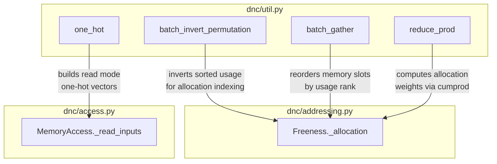
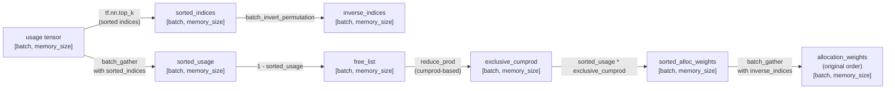

<!-- source: DeepWiki mcp.deepwiki.com · repo google-deepmind/dnc · page 3.4 Utility Functions · fetched 2026-10-26 -->

# Utility Functions

<details>
<summary>Relevant source files</summary>

The following files were used as context for generating this wiki page:

- [dnc/util.py](dnc/util.py)
- [dnc/util_test.py](dnc/util_test.py)

</details>


This page documents the four helper functions in [dnc/util.py](), which provide low-level tensor manipulation primitives used throughout the DNC memory system. These functions exist primarily to work around limitations of TensorFlow's built-in ops (e.g., lack of batched permutation inversion, poor CPU gradient performance for `tf.reduce_prod`). For details about how the modules that consume these utilities work, see [Memory Access Module](#3.2) and [Memory Addressing](#3.3).

---

## Overview

`dnc/util.py` exports four functions:

| Function | Type | Purpose |
|---|---|---|
| `batch_invert_permutation` | TF op | Invert a batch of permutation vectors |
| `batch_gather` | TF op | Gather per-row indexed values from a 2D tensor |
| `reduce_prod` | TF op | Compute a product along an axis with efficient gradients |
| `one_hot` | NumPy | Build a static one-hot vector |

**Call sites in the broader codebase:**

| Utility | Called from |
|---|---|
| `batch_invert_permutation` | `dnc/addressing.py` — `Freeness._allocation` |
| `batch_gather` | `dnc/addressing.py` — `Freeness._allocation` |
| `reduce_prod` | `dnc/addressing.py` — `Freeness._allocation` |
| `one_hot` | `dnc/access.py` — `MemoryAccess._read_inputs` |

Sources: [dnc/util.py:1-73](), [dnc/addressing.py](), [dnc/access.py]()

---

## Function Reference

### `batch_invert_permutation`

[dnc/util.py:25-39]()

**Signature:** `batch_invert_permutation(permutations) -> Tensor`

TensorFlow's `tf.invert_permutation` operates only on a 1D vector. `batch_invert_permutation` extends it to work over a 2D batch of shape `[batch_size, length]`.

**Strategy — global index offsetting:**

Rather than looping over the batch dimension, the function lifts all permutation rows into a single flat integer space by adding a row-dependent offset to each element. It then calls `tf.invert_permutation` once on the resulting flat vector, and subtracts the offsets back out.

**Step-by-step breakdown:**

| Step | Operation | Effect |
|---|---|---|
| 1 | Cast to `tf.float32` | Allows arithmetic |
| 2 | Compute `rg`: range `[0, N·L, L]` | One offset per row (multiples of `L`) |
| 3 | Tile `rg` to shape `[N, L]` | Match permutation shape |
| 4 | `perm = perm + rg` | Each row's indices are shifted into a unique integer range |
| 5 | Flatten to 1D | Produces a single global permutation of length `N·L` |
| 6 | `tf.invert_permutation` | Inverts the single flat permutation |
| 7 | Reshape to `[N, L]` | Restore batch dimension |
| 8 | Subtract `rg` | Remove the offsets to recover local per-row indices |

**Correctness property verified in tests:**
For every batch index `i` and position `j`:
```
permutations[i][inverse[i][j]] == j
```
Sources: [dnc/util.py:25-39](), [dnc/util_test.py:32-50]()

---

### `batch_gather`

[dnc/util.py:42-52]()

**Signature:** `batch_gather(values, indices) -> Tensor`

Applies a per-row index lookup over a 2D tensor, equivalent to `values[i][indices[i][j]]` for each `i, j`. TensorFlow's `tf.gather` does not natively handle per-row index vectors, so this function constructs the required coordinate pairs for `tf.gather_nd`.

**Strategy — coordinate-pair construction:**

Each lookup becomes a `(row, col)` pair, where the row coordinate is derived from `tf.range(batch_size)` and the column coordinate is taken directly from `indices`.

**Step-by-step breakdown:**

| Step | Operation | Effect |
|---|---|---|
| 1 | `idx = expand_dims(indices, -1)` | Shape `[N, L, 1]` — column coords |
| 2 | `rg = range(N)` tiled to `[N, L, 1]` | Row coords |
| 3 | `gidx = concat([rg, idx], -1)` | Shape `[N, L, 2]` — (row, col) pairs |
| 4 | `tf.gather_nd(values, gidx)` | Lookup each coordinate pair |

**Example (from tests):**

```
values  = [[3, 1, 4, 1],
           [5, 9, 2, 6],
           [5, 3, 5, 7]]
indices = [[1, 2, 0, 3],
           [3, 0, 1, 2],
           [0, 2, 1, 3]]
result  = [[1, 4, 3, 1],
           [6, 5, 9, 2],
           [5, 5, 3, 7]]
```

Sources: [dnc/util.py:42-52](), [dnc/util_test.py:53-62]()

---

### `reduce_prod`

[dnc/util.py:61-72]()

**Signature:** `reduce_prod(x, axis, name=None) -> Tensor`

Computes the product of elements along `axis`. The built-in `tf.reduce_prod` has poor gradient computation performance on CPU. This function uses `tf.cumprod` with `reverse=True` as a workaround, then extracts the first element of the cumulative product (which equals the total product).

**Why `tf.cumprod` is faster for gradients:**

`tf.cumprod`'s gradient is implemented efficiently via prefix products, whereas `tf.reduce_prod`'s gradient requires dividing out individual elements, which is numerically problematic and slow on CPU.

**Mechanism:**

1. `cp = tf.cumprod(x, axis, reverse=True)` — The first element along the reversed cumulative product axis equals the product of all elements.
2. Construct index pairs `[i, 0]` for each row `i` using `tf.range` and `tf.zeros`.
3. `tf.gather_nd(cp, indices)` extracts the first element from each row, which is the total product.

Sources: [dnc/util.py:61-72]()

---

### `one_hot`

[dnc/util.py:55-58]()

**Signature:** `one_hot(length, index) -> np.ndarray`

Returns a NumPy array of shape `[length]` filled with zeros, with a `1.0` at position `index`. This is a static (graph-construction-time) utility; it does not produce a TensorFlow op.

**Used in:** `dnc/access.py` — `MemoryAccess._read_inputs`, where it constructs fixed one-hot vectors that identify the three read modes (`content`, `forward`, `backward`) as part of the mode interpolation logic.

Sources: [dnc/util.py:55-58](), [dnc/access.py]()

---

## Dependency Map

The diagram below shows how the four utility functions flow from `dnc/util.py` into their call sites.

**Diagram: util.py functions and their consumers**



Sources: [dnc/util.py:1-73](), [dnc/addressing.py](), [dnc/access.py]()

---

## Internal Operation Flow

The three TF utility functions (`batch_invert_permutation`, `batch_gather`, `reduce_prod`) are all used together inside `Freeness._allocation` to compute write allocation weights. The diagram below shows the data flow through each of these utilities in that context.

**Diagram: Data flow through util functions in `Freeness._allocation`**



Sources: [dnc/addressing.py](), [dnc/util.py:25-72]()

---

## Summary Table

| Function | Input shape | Output shape | TF or NumPy | Key op used |
|---|---|---|---|---|
| `batch_invert_permutation` | `[N, L]` int | `[N, L]` int | TensorFlow | `tf.invert_permutation` on flattened input |
| `batch_gather` | `values [N, L]`, `indices [N, L]` | `[N, L]` | TensorFlow | `tf.gather_nd` with constructed coordinate pairs |
| `reduce_prod` | `[N, L]` float | `[N]` float | TensorFlow | `tf.cumprod(reverse=True)` + `tf.gather_nd` |
| `one_hot` | `length` int, `index` int | `[length]` float | NumPy | `np.zeros` + index assignment |

Sources: [dnc/util.py:25-72]()

---

