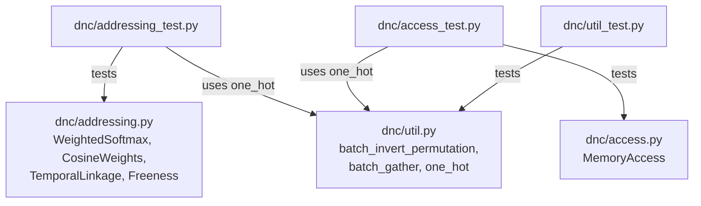
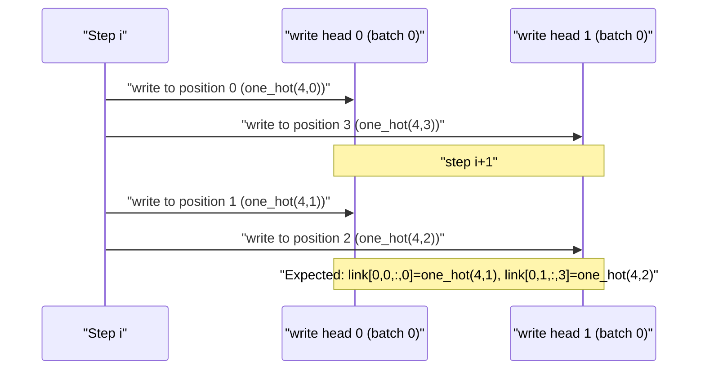
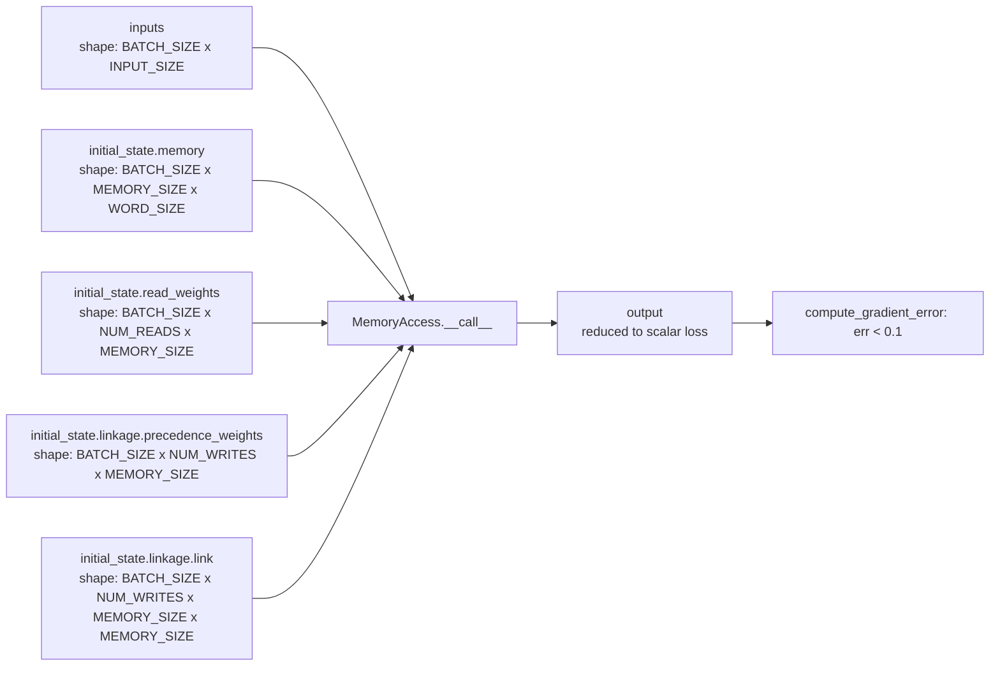
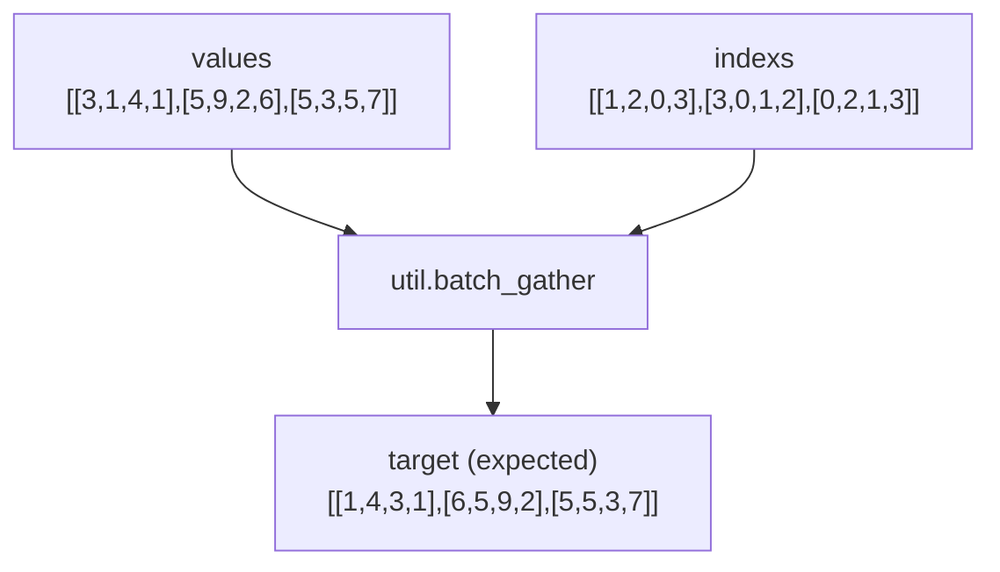

<!-- source: DeepWiki mcp.deepwiki.com · repo google-deepmind/dnc · page 4 Testing · fetched 2026-10-26 -->

# Testing

<details>
<summary>Relevant source files</summary>

The following files were used as context for generating this wiki page:

- [dnc/access_test.py](dnc/access_test.py)
- [dnc/addressing_test.py](dnc/addressing_test.py)
- [dnc/util_test.py](dnc/util_test.py)

</details>


This page describes the structure and philosophy of the DNC test suite. It covers which modules are tested, what files contain those tests, and how to execute them. For implementation details about each tested module, see [Core Architecture](#3), [Memory Addressing](#3.3), and [Utility Functions](#3.4).

---

## Test Suite Overview

The test suite consists of three files, each targeting a distinct layer of the `dnc/` package:

| Test File | Tested Module | Test Class(es) |
|---|---|---|
| `dnc/addressing_test.py` | `dnc/addressing.py` | `WeightedSoftmaxTest`, `CosineWeightsTest`, `TemporalLinkageTest`, `FreenessTest` |
| `dnc/access_test.py` | `dnc/access.py` | `MemoryAccessTest` |
| `dnc/util_test.py` | `dnc/util.py` | `BatchInvertPermutation`, `BatchGather` |

All test classes extend `tf.test.TestCase` and are run via `tf.test.main()`.

**Testing philosophy.** The test suite uses three primary verification strategies:

- **Shape assertions** — confirm that output tensors have the expected rank and dimensions.
- **Value bound assertions** — confirm that outputs satisfy mathematical constraints (e.g., weights in `[0, 1]`, rows summing to at most 1).
- **Numerical gradient checks** — use `tf.test.compute_gradient_error` to verify that analytical gradients match finite-difference approximations to within a tolerance.

---

## Running the Tests

Each test file is self-contained and can be run directly:

```
python -m dnc.addressing_test
python -m dnc.access_test
python -m dnc.util_test
```

Alternatively, use any test runner compatible with `tf.test.TestCase` (e.g., `pytest` or `python -m unittest discover`).

---

## Test File Map

**Test file to module dependency diagram:**



Sources: [dnc/addressing_test.py:1-32](), [dnc/access_test.py:1-36](), [dnc/util_test.py:1-29]()

---

## `dnc/addressing_test.py`

Tests for all three addressing mechanisms defined in `dnc/addressing.py`.

### `WeightedSoftmaxTest`

[dnc/addressing_test.py:34-58]()

| Test | Method | What it checks |
|---|---|---|
| `testValues` | `weighted_softmax` | With all-ones weights and `tf.identity` as the strength function, output must equal a standard `tf.nn.softmax` applied across the memory dimension. |

### `CosineWeightsTest`

[dnc/addressing_test.py:61-150]()

| Test | Method | What it checks |
|---|---|---|
| `testShape` | `CosineWeights.__call__` | Output shape is `[batch_size, num_heads, memory_size]`. |
| `testValues` | `CosineWeights.__call__` | Manually computes cosine similarity for each (batch, head, memory) triple and checks result matches the module output within `atol=1e-4`. |
| `testDivideByZero` | `CosineWeights.__call__` + `tf.gradients` | Memory rows containing all zeros do not produce `NaN` in outputs or in gradients with respect to `mem`, `keys`, or `strengths`. |

### `TemporalLinkageTest`

[dnc/addressing_test.py:153-277]()

| Test | Method | What it checks |
|---|---|---|
| `testModule` | `TemporalLinkage.__call__`, `directional_read_weights` | Link matrix values in `[0, 1]`; zero diagonal; row/column sums ≤ 1. After a controlled write sequence (0→1 in head 0, 3→2 in head 1), verifies the exact transition is recorded. Then verifies `directional_read_weights` (forward/backward) returns the correct next/previous location. |
| `testPrecedenceWeights` | `TemporalLinkage._precedence_weights` | Precedence weights stay in `[0, 1]`. When a head does zero writing, precedence is unchanged. When a head does full writing (weights sum to 1), new precedence equals the write weights. |

**Diagram — Controlled write sequence used in `testModule`:**



Sources: [dnc/addressing_test.py:153-241]()

### `FreenessTest`

[dnc/addressing_test.py:280-421]()

| Test | Method | What it checks |
|---|---|---|
| `testModule` | `Freeness.__call__` | All usage values in `[0, 1]`. A full write at a location drives its usage to 1. A full free (free_gate=1 + full read weight) drives usage to 0. |
| `testWriteAllocationWeights` | `Freeness.write_allocation_weights` | All weights in `[0, 1]`; weights sum to ~1 per write head. When a write gate is 0, the usage does not change, so two adjacent gate-off heads get identical allocation. When usage has a near-zero entry, the corresponding head is allocated there. |
| `testWriteAllocationWeightsGradient` | `Freeness.write_allocation_weights` | `tf.test.compute_gradient_error` across `usage` and `write_gates` inputs; error < 0.01. |
| `testAllocation` | `Freeness._allocation` | `argmin(usage)` == `argmax(allocation)` and `argmax(usage)` == `argmin(allocation)`; allocation sums to ~1. |
| `testAllocationGradient` | `Freeness._allocation` | `tf.test.compute_gradient_error` on `usage`; error < 0.01. |

Sources: [dnc/addressing_test.py:280-421]()

---

## `dnc/access_test.py`

Tests the `MemoryAccess` RNNCore defined in `dnc/access.py`.

**Module-level constants used across all tests:**

```
BATCH_SIZE = 2
MEMORY_SIZE = 20
WORD_SIZE = 6
NUM_READS = 2
NUM_WRITES = 3
TIME_STEPS = 4
INPUT_SIZE = 10
```

[dnc/access_test.py:28-34]()

All tests share a `setUp` that constructs a `MemoryAccess` instance and calls `initial_state(BATCH_SIZE)`.

[dnc/access_test.py:39-42]()

### Test Cases

| Test | Key assertion |
|---|---|
| `testBuildAndTrain` | Runs `rnn.dynamic_rnn` over `TIME_STEPS`, computes MSE loss against random targets, runs one `GradientDescentOptimizer` step without error. |
| `testValidReadMode` | `_read_inputs` output's `read_mode` field sums to 1 per read head (valid probability distribution) and is non-negative. |
| `testWriteWeights` | With allocation gate = 1 and position 3 having zero usage, `_write_weights` output for head 0 in batch 0 approximates `one_hot(MEMORY_SIZE, 3)`. All write weights sum to the write gate values. |
| `testReadWeights` | With read key = `memory[0, 3]`, high strength (100.0), and content mode selected via `one_hot`, `_read_weights` output for batch 0, head 0 approximates `one_hot(MEMORY_SIZE, 3)`. |
| `testGradients` | `tf.test.compute_gradient_error` across `inputs`, `memory`, `read_weights`, `linkage.precedence_weights`, and `linkage.link`; error < 0.1. |

Sources: [dnc/access_test.py:44-159]()

**Diagram — `testGradients` inputs under numerical check:**



Sources: [dnc/access_test.py:145-159]()

---

## `dnc/util_test.py`

Tests the two batched tensor-manipulation functions in `dnc/util.py`.

| Test Class | Test Method | What it checks |
|---|---|---|
| `BatchInvertPermutation` | `test` | For a random batch of permutations `P`, verifies `P[i][inverse[i][j]] == j` for all `i`, `j`. Uses `batch_size=5`, `length=7`. |
| `BatchGather` | `test` | Given a fixed 3×4 `values` array and a 3×4 `indexs` array, verifies that `batch_gather` returns the expected `target` array (per-row indexed selection). |

Sources: [dnc/util_test.py:32-62]()

**Diagram — `BatchGather` test data:**



Sources: [dnc/util_test.py:53-62]()

---

## Summary of Gradient Checks

Numerical gradient verification appears in three test cases. The table below summarises the check parameters:

| Test | Function | Inputs checked | Tolerance |
|---|---|---|---|
| `FreenessTest.testWriteAllocationWeightsGradient` | `Freeness.write_allocation_weights` | `usage`, `write_gates` | < 0.01 |
| `FreenessTest.testAllocationGradient` | `Freeness._allocation` | `usage` | < 0.01 |
| `MemoryAccessTest.testGradients` | `MemoryAccess.__call__` | `inputs`, `memory`, `read_weights`, `linkage.precedence_weights`, `linkage.link` | < 0.1 |

All use `tf.test.compute_gradient_error` with `delta=1e-5`.

Sources: [dnc/addressing_test.py:373-421](), [dnc/access_test.py:145-159]()

---

