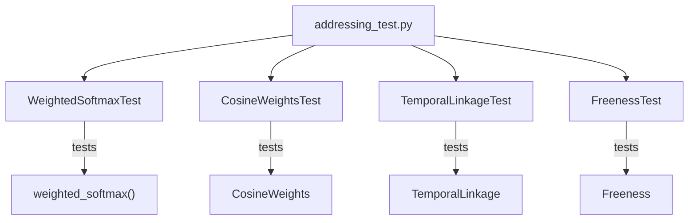
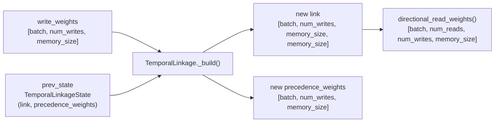
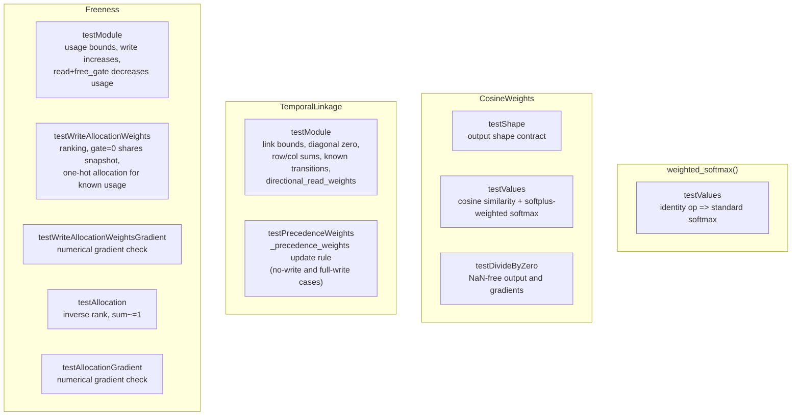

<!-- source: DeepWiki mcp.deepwiki.com · repo google-deepmind/dnc · page 4.1 Addressing Tests · fetched 2026-10-26 -->

# Addressing Tests

<details>
<summary>Relevant source files</summary>

The following files were used as context for generating this wiki page:

- [dnc/addressing.py](dnc/addressing.py)
- [dnc/addressing_test.py](dnc/addressing_test.py)

</details>


This page documents the test suite in [dnc/addressing_test.py]() covering the three memory addressing mechanisms and the `weighted_softmax` helper defined in `dnc/addressing.py`. The tests validate numerical correctness, shape contracts, value bounds, and gradient computability for all addressing components.

For documentation of the addressing implementations under test, see [Memory Addressing](#3.3). For tests covering the higher-level memory access module that uses these components, see [Memory Access Tests](#4.2).

---

## Overview

The test file contains four test classes, each targeting a distinct component:

| Test Class | Component Under Test | Key Concerns |
|---|---|---|
| `WeightedSoftmaxTest` | `weighted_softmax` | Equivalence to standard softmax |
| `CosineWeightsTest` | `CosineWeights` | Output shape, similarity correctness, divide-by-zero safety |
| `TemporalLinkageTest` | `TemporalLinkage` | Link matrix bounds, directional read weights, precedence weights |
| `FreenessTest` | `Freeness` | Usage bounds, write/read effects, allocation correctness, gradients |

**Structure diagram:**



Sources: [dnc/addressing_test.py:34-422]()

---

## `WeightedSoftmaxTest`

**Class:** `WeightedSoftmaxTest` [dnc/addressing_test.py:34-58]()

### `testValues`

**Purpose:** Verifies that `weighted_softmax` with uniform strength weights (all ones) and the identity as the strength operation produces results equivalent to a standard `tf.nn.softmax`.

**Setup:**

| Parameter | Value |
|---|---|
| `batch_size` | 5 |
| `num_heads` | 3 |
| `memory_size` | 7 |

**Approach:** Feeds random activations and an all-ones weights tensor to `addressing.weighted_softmax(activations, weights, tf.identity)`. Compares the output against `snt.BatchApply(tf.nn.softmax)(activations)` using `assertAllClose`.

When strengths are all 1 and the strength op is `tf.identity`, the multiplication is a no-op, so the two paths must produce identical results. This confirms that `weighted_softmax` degrades correctly to plain softmax in the trivial case.

Sources: [dnc/addressing_test.py:36-58]()

---

## `CosineWeightsTest`

**Class:** `CosineWeightsTest` [dnc/addressing_test.py:61-150]()

### `testShape`

**Purpose:** Confirms that `CosineWeights._build` returns a tensor of shape `[batch_size, num_heads, memory_size]`.

**Setup:**

| Parameter | Value |
|---|---|
| `batch_size` | 5 |
| `num_heads` | 3 |
| `memory_size` | 7 |
| `word_size` | 2 |

Constructs `CosineWeights(num_heads, word_size)` and calls it with placeholder tensors. Checks `weights.get_shape().is_compatible_with([batch_size, num_heads, memory_size])`.

Sources: [dnc/addressing_test.py:63-75]()

### `testValues`

**Purpose:** Validates that the module computes the correct cosine similarity and applies `softplus`-weighted softmax.

**Setup:**

| Parameter | Value |
|---|---|
| `batch_size` | 5 |
| `num_heads` | 4 |
| `memory_size` | 10 |
| `word_size` | 2 |

Several memory rows and key vectors are set to known values:

| Slot | Memory vector | Head | Key vector |
|---|---|---|---|
| `mem[0, 0]` | `[1, 2]` | `keys[0, 0]` | `[5, 6]` |
| `mem[0, 1]` | `[3, 4]` | `keys[0, 1]` | `[1, 2]` |
| `mem[0, 2]` | `[5, 6]` | `keys[0, 2]` | `[5, 6]` |
| — | — | `keys[0, 3]` | `[3, 4]` |

The test then manually replicates the expected computation in NumPy for every `(batch, head, memory)` triple:

```
similarity[m] = dot(key, mem[m]) / (norm(key) * norm(mem[m]))
output = softmax(similarity * softplus(strength))
```

Results are compared with `assertAllClose(atol=1e-4, rtol=1e-4)`.

Sources: [dnc/addressing_test.py:77-123]()

### `testDivideByZero`

**Purpose:** Ensures numerical stability when memory rows are zero vectors (which would cause a divide-by-zero in raw cosine similarity).

**Construction:** Memory is a concat of a single all-ones row followed by `memory_size - 1` all-zero rows. Keys and strengths are random normals.

**Assertions:** Runs the module and computes gradients with respect to `mem`, `keys`, and `strengths`. Checks that neither the output nor any gradient contains `NaN` values using `np.isnan`.

This is the primary test that the `_EPSILON` guard in `_vector_norms` is effective [dnc/addressing.py:35-36]().

Sources: [dnc/addressing_test.py:125-150]()

---

## `TemporalLinkageTest`

**Class:** `TemporalLinkageTest` [dnc/addressing_test.py:153-277]()

### `testModule`

**Purpose:** End-to-end test that runs the `TemporalLinkage` module for multiple steps, then checks link matrix properties and directional read weights.

**Setup:**

| Parameter | Value |
|---|---|
| `batch_size` | 7 |
| `memory_size` | 4 |
| `num_reads` | 11 |
| `num_writes` | 5 |

**Simulation:** Runs 5 steps feeding random write weights. In the last two steps, specific one-hot write sequences are imposed to create known transitions:

| Step | Write head | Write position | Effect |
|---|---|---|---|
| `num_steps - 2` | Head 0 (batch 0) | Position 0 | Sets up `0 → 1` link |
| `num_steps - 2` | Head 1 (batch 0) | Position 3 | Sets up `3 → 2` link |
| `num_steps - 1` | Head 0 (batch 0) | Position 1 | Completes `0 → 1` transition |
| `num_steps - 1` | Head 1 (batch 0) | Position 2 | Completes `3 → 2` transition |

**Link matrix assertions:**

| Assertion | Check |
|---|---|
| Value bounds | `link.min() >= 0`, `link.max() <= 1` |
| Zero diagonal | `link[:, :, i, i] == 0` for all `i` |
| Row sums | `link.sum(axis=2).max() <= 1` |
| Column sums | `link.sum(axis=3).max() <= 1` |
| Known transition (head 0) | `link[0, 0, :, 0] == one_hot(memory_size, 1)` |
| Known transition (head 1) | `link[0, 1, :, 3] == one_hot(memory_size, 2)` |

**Directional read weight assertions:**

After the run, `directional_read_weights` is called with `prev_read_weights` containing two known one-hot reads:

| Read head | Start position | Direction | Expected result |
|---|---|---|---|
| Read 5 (write 0) | Position 0 | Forward | `one_hot(memory_size, 1)` |
| Read 6 (write 1) | Position 2 | Backward | `one_hot(memory_size, 3)` |

The forward direction follows `L[write, from, to]`; the backward direction follows `L^T`.

Sources: [dnc/addressing_test.py:155-241]()

### `testPrecedenceWeights`

**Purpose:** Tests `TemporalLinkage._precedence_weights` in isolation, verifying its update rule under two extreme conditions.

**Setup:**

| Parameter | Value |
|---|---|
| `batch_size` | 7 |
| `memory_size` | 3 |
| `num_writes` | 5 |

Write weights and precedence weights are normalized to sum to ≤ 1 per write head.

**Special cases tested:**

| Condition | Setup | Expected |
|---|---|---|
| No writing | `write_weights[0, 1, :] = 0` | Precedence unchanged: `new[0,1,:] ≈ prev[0,1,:]` |
| Full writing | `write_weights[1, 2, :] /= sum` (sums to 1) | Precedence fully replaced: `new[1,2,:] ≈ write_weights[1,2,:]` |

**Bounds assertion:** All returned precedence weights are in `[0, 1]`.

Sources: [dnc/addressing_test.py:243-277]()

**State flow for `TemporalLinkage`:**



Sources: [dnc/addressing_test.py:153-277](), [dnc/addressing.py:133-181]()

---

## `FreenessTest`

**Class:** `FreenessTest` [dnc/addressing_test.py:280-421]()

### `testModule`

**Purpose:** Validates that the `Freeness` module correctly increases usage on writes and decreases it on reads when a free gate is open.

**Setup:**

| Parameter | Value |
|---|---|
| `batch_size` | 5 |
| `memory_size` | 11 |
| `num_reads` | 3 |
| `num_writes` | 7 |

**Special sentinel values set before running:**

| Location | Value | Expected outcome |
|---|---|---|
| `prev_write_weights[1, 2, 3] = 1` | Full write at batch 1, head 2, position 3 | `usage[1][3] == 1` |
| `prev_read_weights[2, 0, 4] = 1` | Full read at batch 2, head 0, position 4 | — |
| `free_gate[2, 0] = 1` | Full free for batch 2, read head 0 | `usage[2][4] == 0` |
| `prev_read_weights[1, :, 3] = 0` | No read at batch 1, position 3 | (Used to isolate write effect) |

**Assertions:**

- All usage values are in `[0, 1]`.
- A full write at position 3 pushes `usage[1][3]` to exactly 1.
- A full read + full free gate at position 4 pushes `usage[2][4]` to exactly 0.

Sources: [dnc/addressing_test.py:282-319]()

### `testWriteAllocationWeights`

**Purpose:** Tests that `Freeness.write_allocation_weights` assigns allocation weights correctly relative to memory usage ranking, and that turning off a write gate does not advance the simulated usage counter.

**Setup:**

| Parameter | Value |
|---|---|
| `batch_size` | 7 |
| `memory_size` | 23 |
| `num_writes` | 5 |

**Gate configurations (batch 0):**

| Head | Gate | Effect |
|---|---|---|
| 0 | 1 | Full effect; advances simulated usage |
| 1 | 0 | No write; simulated usage unchanged |
| 2 | 1 | Full effect; advances simulated usage |
| 3 | 0 | No write; simulated usage unchanged |
| 4 | (random) | Uses same snapshot as head 3 |

Because heads 1 and 3 do not write, their allocation is computed from the same usage snapshot as the head before them (0 and 2 respectively). This means:
- `weights[0, 1, :] == weights[0, 2, :]`
- `weights[0, 3, :] == weights[0, 4, :]`
- `weights[0, 0, :]` and `weights[0, 1, :]` differ (head 0 wrote, so head 2 sees updated usage)

**Batch 1 precision check:**

| Setting | Value |
|---|---|
| `usage[1][4] = 0` | Most free location |
| `usage[1][3] = 1e-4` | Second most free location |
| `write_gates[1, 0] = 1`, `write_gates[1, 1] = 1` | Both heads fully on |

Asserts `weights[1][0] ≈ one_hot(memory_size, 4)` and `weights[1][1] ≈ one_hot(memory_size, 3)` within tolerance `atol=1e-3`.

**Bounds assertions:** All weights in `[0, 1]`; each row sums to approximately 1 (`atol=1e-3`).

Sources: [dnc/addressing_test.py:321-371]()

### `testWriteAllocationWeightsGradient`

**Purpose:** Confirms that `write_allocation_weights` is differentiable by running a numerical gradient check via `tf.test.compute_gradient_error`.

**Setup:**

| Parameter | Value |
|---|---|
| `batch_size` | 7 |
| `memory_size` | 5 |
| `num_writes` | 3 |
| `delta` | `1e-5` |
| `error threshold` | `0.01` |

Inputs are `usage` and `write_gates`. The numerical gradient error must be less than 1%.

Sources: [dnc/addressing_test.py:373-390]()

### `testAllocation`

**Purpose:** Tests `Freeness._allocation` directly, confirming that the allocation is inversely ranked relative to usage.

**Setup:**

| Parameter | Value |
|---|---|
| `batch_size` | 7 |
| `memory_size` | 13 |

**Assertions:**

| Assertion | Description |
|---|---|
| `argmin(usage) == argmax(allocation)` | Least-used location gets the highest allocation weight |
| `argmax(usage) == argmin(allocation)` | Most-used location gets the lowest allocation weight |
| `sum(allocation) ≈ 1` | Allocation weights sum to approximately 1 (tolerance 0.01) |

Sources: [dnc/addressing_test.py:392-406]()

### `testAllocationGradient`

**Purpose:** Confirms that `Freeness._allocation` is differentiable by running a numerical gradient check.

**Setup:**

| Parameter | Value |
|---|---|
| `batch_size` | 1 |
| `memory_size` | 5 |
| `delta` | `1e-5` |
| `error threshold` | `0.01` |

Sources: [dnc/addressing_test.py:408-421]()

---

## Test Coverage Summary



Sources: [dnc/addressing_test.py:34-421]()

---

## Running the Tests

The test file uses `tf.test.TestCase` throughout and can be run directly:

```
python -m pytest dnc/addressing_test.py
```

or via the TensorFlow test runner:

```
python dnc/addressing_test.py
```

The entry point at the bottom of the file [dnc/addressing_test.py:424-425]() invokes `tf.test.main()`.

Sources: [dnc/addressing_test.py:424-425]()

---

