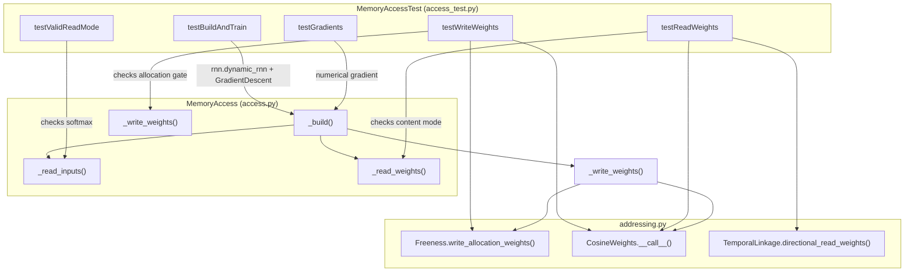
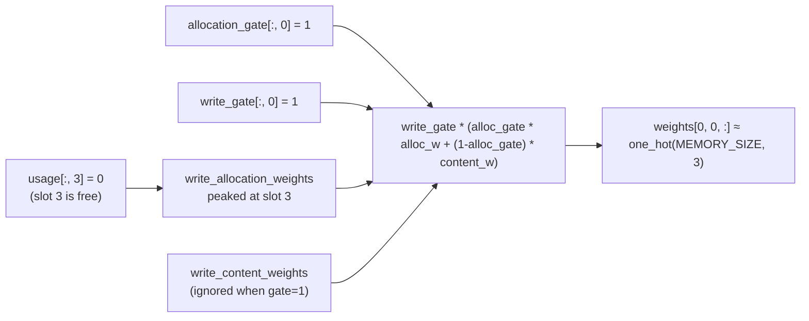
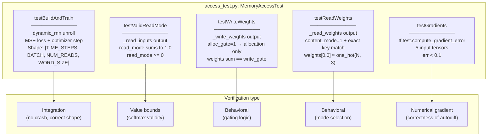

<!-- source: DeepWiki mcp.deepwiki.com · repo google-deepmind/dnc · page 4.2 Memory Access Tests · fetched 2026-10-26 -->

# Memory Access Tests

<details>
<summary>Relevant source files</summary>

The following files were used as context for generating this wiki page:

- [dnc/access.py](dnc/access.py)
- [dnc/access_test.py](dnc/access_test.py)

</details>


This page documents the test suite for the `MemoryAccess` module, located in [dnc/access_test.py:1-163](). The tests verify the integration, behavioral correctness, and gradient flow of the `MemoryAccess` class defined in `dnc/access.py`. For background on what `MemoryAccess` does and how its internals work, see the Memory Access Module page ([3.2](#3.2)). For tests covering the lower-level addressing primitives (`CosineWeights`, `TemporalLinkage`, `Freeness`), see the Addressing Tests page ([4.1](#4.1)).

---

## Test Configuration

All tests in the `MemoryAccessTest` class are parameterized by a fixed set of module constants defined at the top of the file.

| Constant | Value | Meaning |
|---|---|---|
| `BATCH_SIZE` | 2 | Number of parallel sequences |
| `MEMORY_SIZE` | 20 | Number of memory slots (N) |
| `WORD_SIZE` | 6 | Width of each memory slot (W) |
| `NUM_READS` | 2 | Number of read heads (R) |
| `NUM_WRITES` | 3 | Number of write heads |
| `TIME_STEPS` | 4 | Sequence length for RNN unroll |
| `INPUT_SIZE` | 10 | Dimension of controller input |

[dnc/access_test.py:28-34]()

The `setUp` method constructs a shared `MemoryAccess` instance and its zero initial state before each test:

- `self.module` = `access.MemoryAccess(MEMORY_SIZE, WORD_SIZE, NUM_READS, NUM_WRITES)`
- `self.initial_state` = `self.module.initial_state(BATCH_SIZE)` → an `AccessState` namedtuple

[dnc/access_test.py:39-42]()

Sources: [dnc/access_test.py:28-42]()

---

## Test Case Overview

**Test structure diagram — mapping test methods to the code paths they exercise:**



Sources: [dnc/access_test.py:44-159]()

---

## `testBuildAndTrain`

**Purpose:** Verifies that `MemoryAccess` can be unrolled over time using `tf.nn.dynamic_rnn`, produce output of the correct shape, compute a loss, and take a gradient descent step without error.

**Procedure:**

1. Create a random input tensor of shape `[TIME_STEPS, BATCH_SIZE, INPUT_SIZE]`.
2. Run `rnn.dynamic_rnn` with `time_major=True`, using `self.module` as the RNN cell and `self.initial_state` as the initial state.
3. Compute a mean-squared-error loss against a random `targets` array of shape `[TIME_STEPS, BATCH_SIZE, NUM_READS, WORD_SIZE]`.
4. Create a `GradientDescentOptimizer(1).minimize(loss)` train op.
5. Run `init` and `train_op` inside a test session — the test passes if no exceptions are raised.

**What it checks:** End-to-end integration. The output tensor has shape `[TIME_STEPS, BATCH_SIZE, NUM_READS, WORD_SIZE]`, which is `[4, 2, 2, 6]` under these constants. A full gradient-descent step confirms that gradients propagate through the entire `MemoryAccess` forward pass.

[dnc/access_test.py:44-60]()

Sources: [dnc/access_test.py:44-60]()

---

## `testValidReadMode`

**Purpose:** Verifies that the `read_mode` control signal produced by `_read_inputs` is a valid probability distribution over the `1 + 2 * NUM_WRITES` read modes for each read head.

**Procedure:**

1. Call `self.module._read_inputs(tf.random_normal([BATCH_SIZE, INPUT_SIZE]))`.
2. Evaluate the result in a session.
3. Assert that `inputs['read_mode'].sum(2)` equals `np.ones([BATCH_SIZE, NUM_READS])` — i.e., each read head's mode vector sums to 1.0.
4. Assert that `inputs['read_mode'].min() >= 0` — all probabilities are non-negative.

**What it checks:** The `read_mode` values are produced by `snt.BatchApply(tf.nn.softmax)` applied over the last axis (dimension `1 + 2 * NUM_WRITES = 7` under these constants). This test confirms that the softmax normalization is applied correctly and outputs a valid discrete distribution.

[dnc/access_test.py:62-75]()

The shape of `read_mode`:

| Dimension | Size | Meaning |
|---|---|---|
| axis 0 | `BATCH_SIZE` (2) | Batch |
| axis 1 | `NUM_READS` (2) | Read head index |
| axis 2 | `1 + 2*NUM_WRITES` (7) | Mode: backward(×3), forward(×3), content(×1) |

Sources: [dnc/access_test.py:62-75](), [dnc/access.py:193-196]()

---

## `testWriteWeights`

**Purpose:** Verifies that `_write_weights` correctly gates between allocation-based and content-based write addressing.

**Procedure:**

1. Construct random `memory` (`[BATCH_SIZE, MEMORY_SIZE, WORD_SIZE]`) and `usage` (`[BATCH_SIZE, MEMORY_SIZE]`) numpy arrays.
2. Set `usage[:, 3] = 0` — slot 3 is entirely free for both batch items.
3. Set `allocation_gate[:, 0] = 1` and `write_gate[:, 0] = 1` — write head 0 is fully gated toward allocation, fully open.
4. Call `self.module._write_weights(inputs, memory, usage)` and evaluate.

**Assertions:**

| Assertion | Expression | Expected |
|---|---|---|
| Write weights sum to gate value | `np.sum(weights, axis=2)` | `write_gate` (within `atol=5e-2`) |
| Write head 0, batch 0, fully allocates to slot 3 | `weights[0, 0, :]` | `util.one_hot(MEMORY_SIZE, 3)` (within `atol=1e-3`) |

**What it checks:** When `allocation_gate=1` and `write_gate=1`, the formula in `_write_weights` reduces to:

```
w = 1 * (1 * write_allocation_weights + 0 * write_content_weights)
```

So the write weights must equal the allocation weights. Since slot 3 is the only fully free location, all allocation weight concentrates there.

[dnc/access_test.py:77-111]()

**Write weight composition diagram:**



Sources: [dnc/access_test.py:77-111](), [dnc/access.py:220-257]()

---

## `testReadWeights`

**Purpose:** Verifies that `_read_weights` correctly selects memory locations based on content-based lookup when the read mode is set to pure content addressing.

**Procedure:**

1. Construct random `memory`, `prev_read_weights`, and `link` arrays.
2. Set `read_content_keys[0, 0] = memory[0, 3]` — batch 0, read head 0 queries the exact content of slot 3.
3. Set `read_content_strengths = 100.0` — a high sharpening strength forces a peaked softmax.
4. Set `read_mode[0, 0, :] = util.one_hot(1 + 2 * NUM_WRITES, 2 * NUM_WRITES)` — batch 0, read head 0 selects pure content mode (index `2 * NUM_WRITES` is the content slot).
5. Call `self.module._read_weights(inputs, memory, prev_read_weights, link)` and evaluate.

**Assertion:** `read_weights[0, 0, :]` should be approximately `util.one_hot(MEMORY_SIZE, 3)` (within `atol=1e-3`).

**What it checks:** When `read_mode` places all weight on content mode, the read weight is dominated by `CosineWeights`. With an exact key match and high strength, cosine similarity peaks at slot 3.

[dnc/access_test.py:113-143]()

**Read mode layout for `NUM_WRITES = 3`:**

| Index | Meaning |
|---|---|
| 0, 1, 2 | Backward mode (one per write head) |
| 3, 4, 5 | Forward mode (one per write head) |
| 6 | Content mode |

Index `2 * NUM_WRITES = 6` = content mode. `util.one_hot(7, 6)` puts all weight there.

Sources: [dnc/access_test.py:113-143](), [dnc/access.py:259-303](), [dnc/access.py:293-301]()

---

## `testGradients`

**Purpose:** Numerically validates that gradients flow correctly through a single `MemoryAccess` forward step with respect to all primary input tensors.

**Procedure:**

1. Create a constant `inputs` tensor of shape `[BATCH_SIZE, INPUT_SIZE]`.
2. Call `self.module(inputs, self.initial_state)` to get `output`.
3. Set `loss = tf.reduce_sum(output)`.
4. Call `tf.test.compute_gradient_error` comparing analytical and numerical Jacobians for each tensor in `tensors_to_check`.
5. Assert `err < 0.1`.

**Tensors checked:**

| Tensor | Shape | Description |
|---|---|---|
| `inputs` | `[BATCH_SIZE, INPUT_SIZE]` | Controller input |
| `self.initial_state.memory` | `[BATCH_SIZE, MEMORY_SIZE, WORD_SIZE]` | Initial memory contents |
| `self.initial_state.read_weights` | `[BATCH_SIZE, NUM_READS, MEMORY_SIZE]` | Prior read attention |
| `self.initial_state.linkage.precedence_weights` | `[BATCH_SIZE, NUM_WRITES, MEMORY_SIZE]` | Temporal precedence |
| `self.initial_state.linkage.link` | `[BATCH_SIZE, NUM_WRITES, MEMORY_SIZE, MEMORY_SIZE]` | Temporal link matrix |

[dnc/access_test.py:145-159]()

**What it checks:** `tf.test.compute_gradient_error` computes finite-difference numerical Jacobians and compares them to TensorFlow's automatic differentiation output. An error below 0.1 confirms that the gradient graph through all of `_read_inputs`, `_erase_and_write`, `_write_weights`, `_read_weights`, `TemporalLinkage`, and `Freeness` is numerically sound.

Note that `self.initial_state.usage` is not in the list because `Freeness` state is initialized to zeros and may have zero-gradient paths through `tf.cumprod` at the boundary.

Sources: [dnc/access_test.py:145-159]()

---

## Summary of Test Coverage



| Test | Method Under Test | Check Type | Key Assertion |
|---|---|---|---|
| `testBuildAndTrain` | `_build` via `dynamic_rnn` | Integration | No errors, gradient step completes |
| `testValidReadMode` | `_read_inputs` | Value bounds | `read_mode.sum(axis=2) == 1`, `read_mode >= 0` |
| `testWriteWeights` | `_write_weights` | Behavioral | `weights[0,0] ≈ one_hot(N, 3)` when `alloc_gate=1` |
| `testReadWeights` | `_read_weights` | Behavioral | `weights[0,0] ≈ one_hot(N, 3)` when `content_mode=1` |
| `testGradients` | `_build` (single step) | Numerical gradient | `compute_gradient_error < 0.1` |

Sources: [dnc/access_test.py:44-159]()

---

