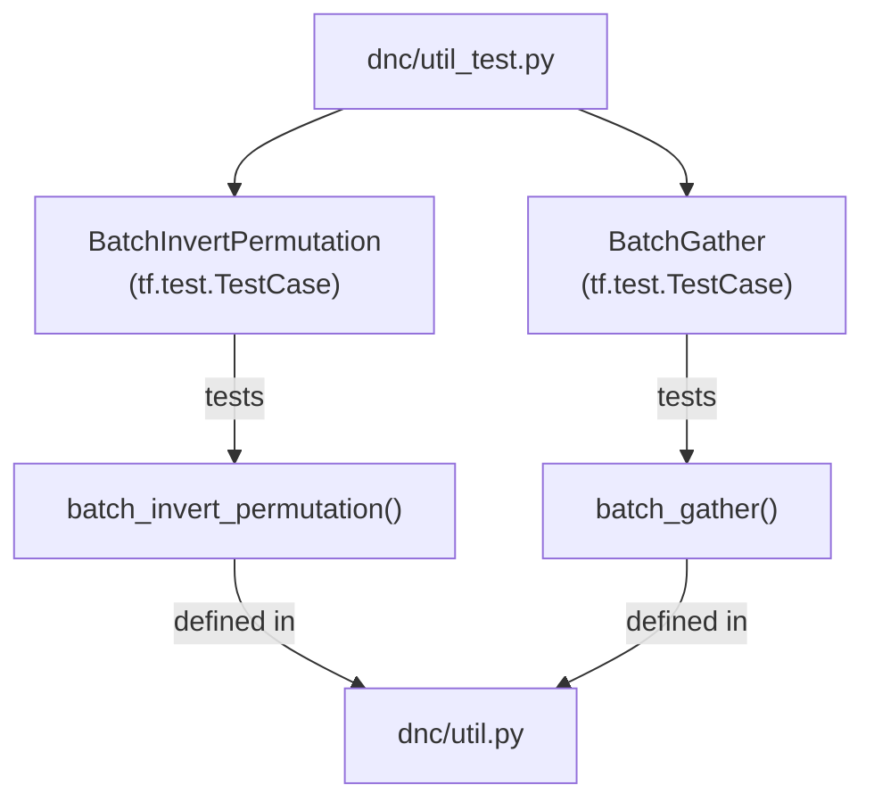
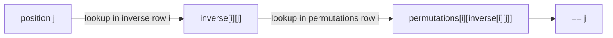
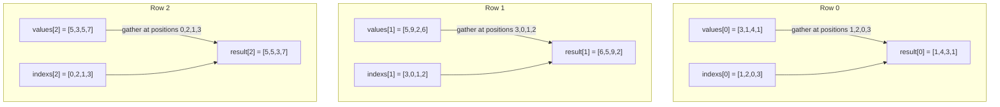

<!-- source: DeepWiki mcp.deepwiki.com · repo google-deepmind/dnc · page 4.3 Utility Tests · fetched 2026-10-26 -->

# Utility Tests

<details>
<summary>Relevant source files</summary>

The following files were used as context for generating this wiki page:

- [dnc/util.py](dnc/util.py)
- [dnc/util_test.py](dnc/util_test.py)

</details>


This page documents the test suite in [dnc/util_test.py](), which verifies the correctness of the helper functions defined in `dnc/util.py`. The two test classes cover `batch_invert_permutation` and `batch_gather`. For a description of what these functions do and how they are used within the broader DNC system, see the Utility Functions page ([3.4](#3.4)). For tests of higher-level modules that rely on these utilities, see Memory Access Tests ([4.2](#4.2)) and Addressing Tests ([4.1](#4.1)).

---

## Test File Structure

The file defines two test classes, each containing a single `test` method:

| Test Class | Utility Under Test | Key Assertion |
|---|---|---|
| `BatchInvertPermutation` | `util.batch_invert_permutation` | `permutations[i][inverse[i][j]] == j` for all `i`, `j` |
| `BatchGather` | `util.batch_gather` | Per-row indexed lookup matches a known expected array |

Both classes extend `tf.test.TestCase` and run inside a `self.test_session()` context to evaluate TensorFlow ops.

**Diagram: Test Class Relationships**



Sources: [dnc/util_test.py:32-66](), [dnc/util.py:25-52]()

---

## `BatchInvertPermutation`

**Class:** `BatchInvertPermutation` [dnc/util_test.py:32-50]()

### What is tested

`batch_invert_permutation` is a batched version of TensorFlow's `tf.invert_permutation`. It takes a 2D integer tensor of shape `[batch_size, length]`, where each row is a permutation of `[0, length)`, and returns a tensor of the same shape where each row is the inverse permutation of the corresponding input row.

### Test setup

[dnc/util_test.py:37-46]()

- `batch_size = 5`, `length = 7`
- A `[5, 7]` NumPy array `permutations` is filled with randomly generated permutations using `np.random.permutation(length)`, one per row.
- The array is passed as a `tf.constant` of dtype `tf.int32` to `util.batch_invert_permutation`.
- The result is evaluated inside `self.test_session()`.

### Assertion logic

[dnc/util_test.py:48-50]()

For every batch index `i` and every position `j` in the length dimension:

```
permutations[i][inverse[i][j]] == j
```

This is the defining property of an inverse permutation: applying the original permutation at the index given by the inverse yields the identity. The test iterates all `5 × 7 = 35` index pairs explicitly.

**Diagram: Inverse Permutation Property**



Sources: [dnc/util_test.py:34-50]()

---

## `BatchGather`

**Class:** `BatchGather` [dnc/util_test.py:53-62]()

### What is tested

`batch_gather` is a batched version of `tf.gather` that applies per-row index lookups. Given a `values` tensor and an `indices` tensor of the same shape `[batch, width]`, it returns a tensor where `result[i][k] = values[i][indices[i][k]]`.

### Test setup

[dnc/util_test.py:56-62]()

The test uses small fixed arrays to allow exact manual verification:

| Variable | Shape | Values |
|---|---|---|
| `values` | `[3, 4]` | `[[3,1,4,1],[5,9,2,6],[5,3,5,7]]` |
| `indexs` | `[3, 4]` | `[[1,2,0,3],[3,0,1,2],[0,2,1,3]]` |
| `target` | `[3, 4]` | `[[1,4,3,1],[6,5,9,2],[5,5,3,7]]` |

The `target` array encodes the expected result of applying each row of `indexs` as a gather index into the corresponding row of `values`.

### Assertion logic

[dnc/util_test.py:59-62]()

`util.batch_gather` is called with `tf.constant(values)` and `tf.constant(indexs)`. The result is evaluated and compared to `target` using `self.assertAllEqual`.

**Diagram: Per-Row Gather Operation**



Sources: [dnc/util_test.py:53-62]()

---

## Running the Tests

The test file can be run directly as a Python script:

```
python -m pytest dnc/util_test.py
```

or via the built-in runner:

```
python dnc/util_test.py
```

The `if __name__ == '__main__': tf.test.main()` guard at [dnc/util_test.py:65-66]() delegates to TensorFlow's test runner.

---

## Coverage Summary

| Utility Function | Tested | Test Strategy |
|---|---|---|
| `batch_invert_permutation` | ✅ | Random batch of permutations; exhaustive index verification |
| `batch_gather` | ✅ | Fixed known-answer array; `assertAllEqual` |
| `reduce_prod` | ❌ | Not tested in `util_test.py` |
| `one_hot` | ❌ | Not tested in `util_test.py` |

`reduce_prod` and `one_hot` do not have dedicated unit tests in `util_test.py`. `reduce_prod` is exercised indirectly through the `Freeness` module tests in [dnc/addressing_test.py]() (see [4.1](#4.1)).

Sources: [dnc/util_test.py:32-66](), [dnc/util.py:25-72]()

---

