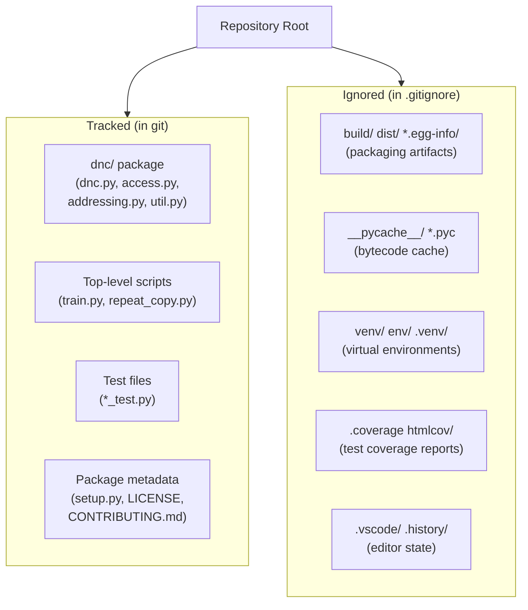
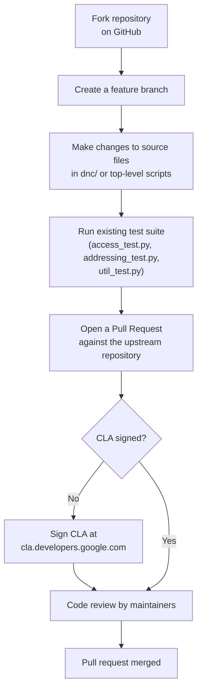

<!-- source: DeepWiki mcp.deepwiki.com · repo google-deepmind/dnc · page 5 Development Setup · fetched 2026-10-26 -->

# Development Setup

<details>
<summary>Relevant source files</summary>

The following files were used as context for generating this wiki page:

- [.gitignore](.gitignore)
- [CONTRIBUTING.md](CONTRIBUTING.md)
- [LICENSE](LICENSE)
- [setup.py](setup.py)

</details>


This page covers everything needed to install the `dnc` package, understand its license terms, and contribute changes back to the project. For information about the training pipeline and model architecture, see the [Core Architecture](#3) and [Training the DNC](#2) pages.

---

## Installation

The package is distributed as a standard Python package. The entry point for installation is [setup.py:1-12]().

### Package Metadata

| Field | Value |
|---|---|
| Package name | `dnc` |
| Version | `0.0.2` |
| License | Apache Software License 2.0 |
| Author | DeepMind |
| Python packages included | `['dnc']` |
| Keywords | `tensorflow`, `differentiable neural computer`, `sonnet`, `dm-sonnet` |

The `packages=['dnc']` entry in [setup.py:8]() means only the `dnc/` subdirectory is installed as a library. The top-level files (`train.py`, `repeat_copy.py`) are not installed as part of the package — they are scripts intended to be run directly from the repository root.

### Install Steps

To install the package in the current Python environment:

```
python setup.py install
```

To install in editable/development mode (so local edits take effect immediately without reinstalling):

```
pip install -e .
```

### Runtime Dependencies

The `setup.py` does not declare explicit `install_requires` entries. You must install the following dependencies manually before using the package:

| Dependency | Used by |
|---|---|
| TensorFlow | All modules |
| DeepMind Sonnet (`dm-sonnet`) | `dnc.py`, `access.py`, `addressing.py` |
| NumPy | `util.py`, test files |

Sources: [setup.py:1-12]()

---

## Repository Layout and Ignored Artifacts

The `.gitignore` file [.gitignore:1-103]() reflects a standard Python project layout. The following artifact categories are excluded from version control:

**Diagram: Repository File Categories**



Sources: [.gitignore:1-103]()

---

## License

The repository is released under the **Apache License, Version 2.0** [LICENSE:1-203]().

### Key Terms Summary

| Term | What it means in practice |
|---|---|
| Grant of Copyright | You may reproduce, modify, and distribute the work in Source or Object form. |
| Grant of Patent | Contributors grant a royalty-free patent license for their contributions. |
| Redistribution | Derivative works must carry the original license, notices, and a statement of changes. |
| No Trademark Grant | The license does not permit use of DeepMind's trade names or marks. |
| Warranty Disclaimer | The work is provided "AS IS" with no warranties of any kind. |
| Liability Limitation | Contributors are not liable for any damages arising from use. |
| Contributions | Any contribution submitted for inclusion is automatically under Apache 2.0 terms unless otherwise stated. |

The `license='Apache Software License 2.0'` field in [setup.py:7]() declares this license in the package metadata.

Sources: [LICENSE:1-203](), [setup.py:7]()

---

## Contributing

Contribution guidelines are described in [CONTRIBUTING.md:1-25]().

### Contributor License Agreement (CLA)

Before a pull request can be merged, the contributor (or their employer) must sign a **Google Contributor License Agreement**. This is a one-time requirement per Google open-source project. The CLA grants Google permission to use and redistribute your contribution while you retain copyright ownership.

- If you have already signed a CLA for another Google project, you do not need to sign again.
- CLA status can be checked and a new CLA can be signed at `https://cla.developers.google.com/`.

### Pull Request Workflow

All submissions — including those from project members — require a code review via GitHub pull request. The process is:

**Diagram: Contribution Workflow**



Sources: [CONTRIBUTING.md:1-25]()

---

## Development Checklist

The following summarises the complete setup process for a new contributor:

| Step | Action | Reference |
|---|---|---|
| 1 | Clone the repository | — |
| 2 | Create and activate a Python virtual environment | [.gitignore:84-87]() |
| 3 | Install TensorFlow and `dm-sonnet` | Runtime dependencies |
| 4 | Run `pip install -e .` to install the `dnc` package | [setup.py:1-12]() |
| 5 | Run the test suite to verify the environment | See [Testing](#4) |
| 6 | Sign the Google CLA (one-time) | [CONTRIBUTING.md:7-15]() |
| 7 | Make changes and open a pull request | [CONTRIBUTING.md:18-24]() |

Sources: [setup.py:1-12](), [CONTRIBUTING.md:1-25](), [.gitignore:1-103]()