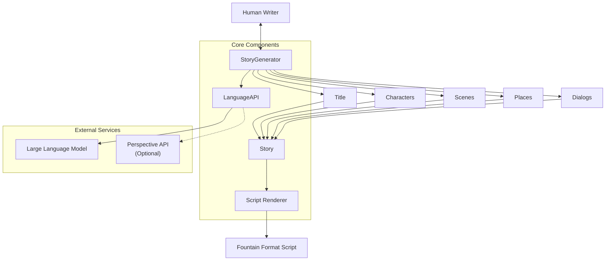
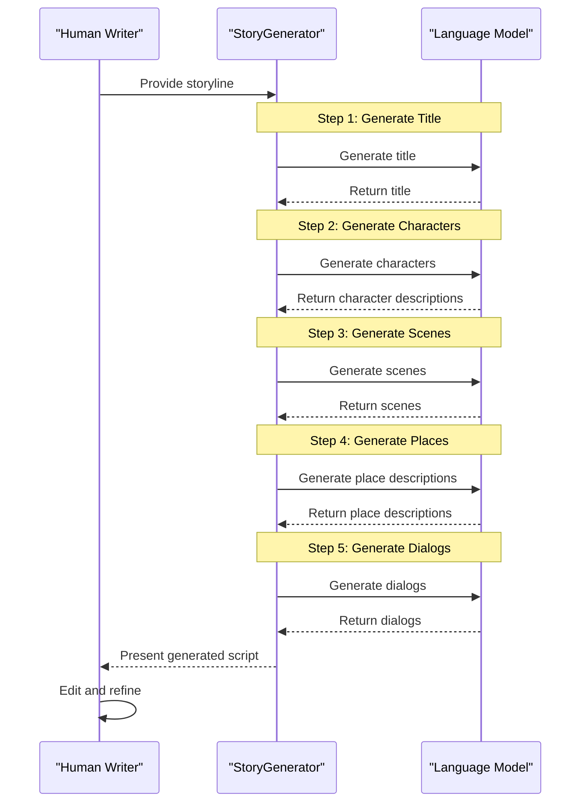
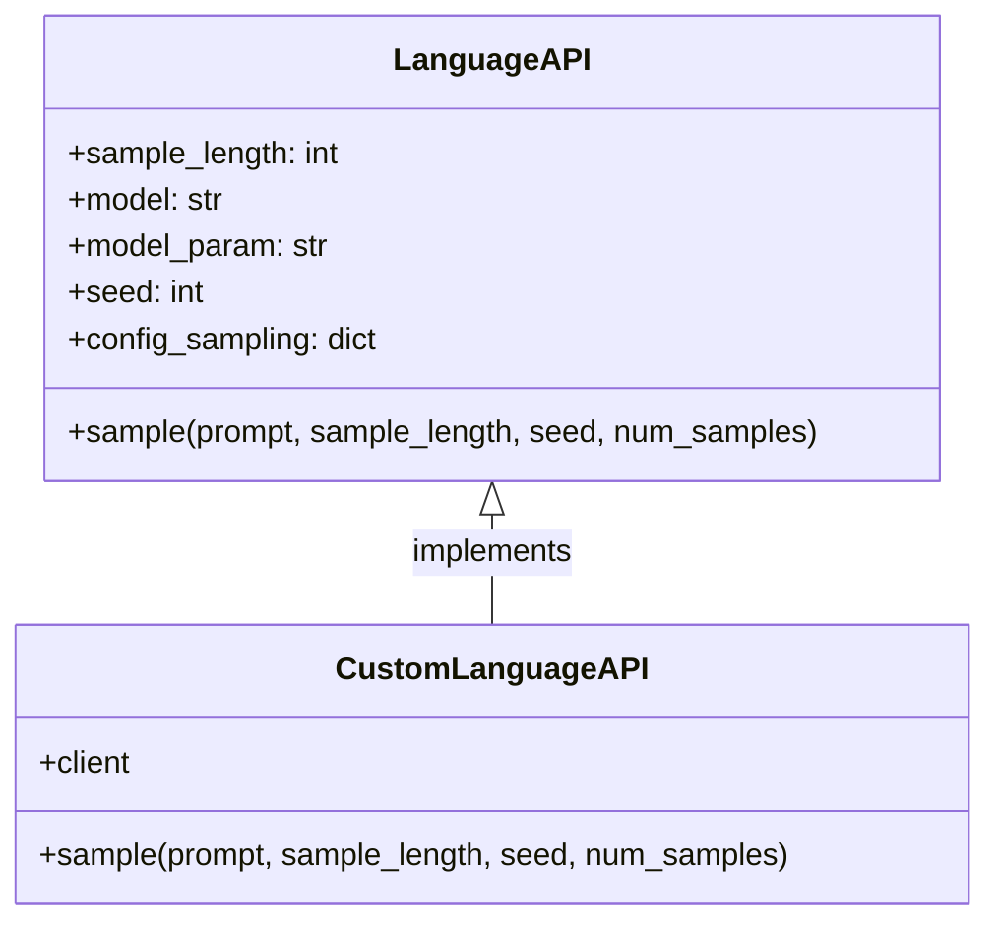

<!-- source: DeepWiki mcp.deepwiki.com · repo google-deepmind/dramatron · page 1 Overview · fetched 2026-10-26 -->

# Overview

Relevant source files

The following files were used as context for generating this wiki page:

- [README.md](README.md)
- [colab/dramatron.ipynb](colab/dramatron.ipynb)
- [docs/details.html](docs/details.html)
- [docs/index.html](docs/index.html)
- [dramatron-animation.gif](dramatron-animation.gif)

This document provides a comprehensive introduction to Dramatron, a script co-writing tool that leverages large language models to assist humans in creating theatre scripts and screenplays. It explains the system's purpose, architecture, and key components that enable hierarchical script generation. For detailed information about the system's architecture, see [System Architecture](#2), and for usage instructions, refer to the [User Guide](#3).

Sources: [README.md:1-27](), [docs/details.html:30-38]()

## What is Dramatron?

Dramatron is a co-creative system designed to work alongside human authors in writing scripts for theatre and film. It uses pre-trained large language models to generate coherent text through a hierarchical approach, ensuring consistency across the entire script. Starting from a user-provided storyline (logline), Dramatron progressively generates various script elements, including title, character descriptions, plot points, location descriptions, and dialogue.

The system is explicitly designed as a co-writing tool rather than an autonomous script generator. It provides human authors with material for compilation, editing, and rewriting, serving as a source of inspiration and exploration for writers.

Sources: [README.md:11-20](), [docs/details.html:30-38](), [colab/dramatron.ipynb:41-59]()

### System Purpose

**Key Objectives:**
- Assist human writers in creating scripts through collaborative generation
- Maintain long-range consistency through hierarchical generation
- Provide creative inspiration for story development
- Support exploration of narrative alternatives

**Design Philosophy:**
- Co-writing rather than autonomous generation
- Hierarchical structure to ensure coherence
- Interactive generation allowing human intervention
- Integration with various language models through a standardized API

Sources: [README.md:11-27](), [docs/details.html:30-96]()

## System Architecture Overview

Dramatron follows a hierarchical generation approach where each layer builds upon previous elements to ensure consistency throughout the script.

**Dramatron System Architecture**

The system centers around the `StoryGenerator` class which orchestrates the script generation process, interfacing with language models through the `LanguageAPI` abstraction. The generated content is stored in a `Story` object and rendered into a screenplay in Fountain format.

Sources: [colab/dramatron.ipynb:174-862](), [README.md:11-15]()

## Hierarchical Generation Process

Dramatron's key innovation is its hierarchical approach to script generation, which ensures consistency from high-level concepts down to specific dialogue.

**Hierarchical Generation Workflow**

The process begins with a user-provided storyline and progresses through five main steps:
1. **Title Generation**: Creates a compelling title based on the storyline
2. **Character Generation**: Develops character descriptions
3. **Scene Generation**: Outlines the sequence of scenes with plot points
4. **Place Generation**: Creates detailed descriptions of script locations
5. **Dialog Generation**: Crafts character dialog for each scene

At each step, the human writer can review, edit, or regenerate content as needed, maintaining creative control throughout the process.

Sources: [colab/dramatron.ipynb:637-891](), [README.md:12]()

## Core Components

Dramatron consists of several key components that work together to facilitate script generation:

### Data Structures

The system uses specialized classes to represent different elements of a script:

| Class | Purpose | Key Attributes |
|-------|---------|----------------|
| `Story` | Contains all script elements | storyline, title, characters, places, scenes, dialogs |
| `Title` | Represents the script title | title text |
| `Characters` | Collection of characters | character_descriptions (Dict[name, description]) |
| `Scene` | Individual scene details | place, plot_element, beat |
| `Scenes` | Collection of scenes | scenes (List[Scene]) |
| `Place` | Location description | name, description |

Sources: [colab/dramatron.ipynb:217-406]()

### Language Model Interface

Dramatron is designed to work with various large language models through a standardized interface:

**Language API Class Diagram**

The `LanguageAPI` is an abstract class that defines the interface for interacting with language models. Users must implement a custom version (like `CustomLanguageAPI`) to connect with their preferred language model provider.

Sources: [colab/dramatron.ipynb:554-622](), [README.md:8-9]()

### Generation Functions

Dramatron uses specialized functions for generating each component of the script:

| Function | Purpose | Input | Output |
|----------|---------|-------|--------|
| `generate_title` | Creates script title | storyline | Title object |
| `generate_characters` | Creates character roster | storyline | Characters object |
| `generate_scenes` | Plans scene sequence | storyline, characters | Scenes object |
| `generate_place_descriptions` | Describes locations | storyline, scenes | Dict of Place objects |
| `generate_dialog` | Creates character dialog | storyline, scenes, characters, places | Dialog text |

Sources: [colab/dramatron.ipynb:637-891]()

## Implementation Details

Dramatron is implemented as a Python Colab notebook, making it accessible and interoperable with various language model providers. The implementation includes tools for detecting and mitigating common issues in language model generation:

1. **Loop Detection**: Identifies and prevents repetitive text generation
2. **Content Filtering**: Optional integration with Perspective API for content moderation
3. **Hierarchical Structure**: Ensures consistency between script elements
4. **Interactive Generation**: Allows human intervention at each generation step

The system outputs scripts in Fountain format, a plain text markup language designed for screenplays that is widely used in the industry.

Sources: [colab/dramatron.ipynb:174-406](), [colab/dramatron.ipynb:637-891](), [README.md:22-23]()

## Use Cases and Limitations

Dramatron is designed for specific use cases and has recognized limitations:

**Intended Use Cases:**
- Co-writing and exploring story ideas
- "World building" and narrative exploration
- Creative idea generation
- Exploring alternative stories by changing characters or plot elements

**Limitations:**
- Not designed for autonomous script generation
- Hierarchical top-down approach may not match all writing styles
- May reflect biases or stereotypes from training data
- Potential for generating content with similarities to training texts

Sources: [README.md:18-26](), [docs/details.html:30-96]()

## Conclusion

Dramatron represents an approach to human-AI collaboration in creative writing, specifically for scripts and screenplays. By leveraging the strengths of large language models within a structured hierarchical framework, it provides a tool for writers to explore narrative possibilities and accelerate their creative process. As a co-writing system, it's designed to augment rather than replace human creativity, offering inspiration and alternatives while leaving creative control in the hands of the writer.

Sources: [README.md:11-27](), [docs/details.html:80-96]()

---

