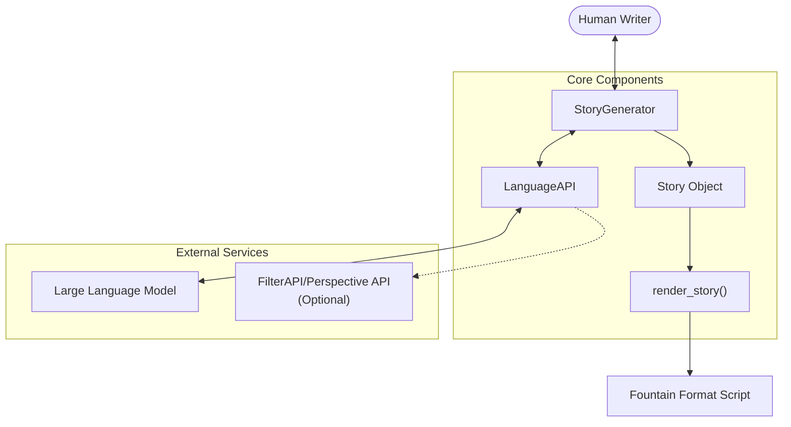
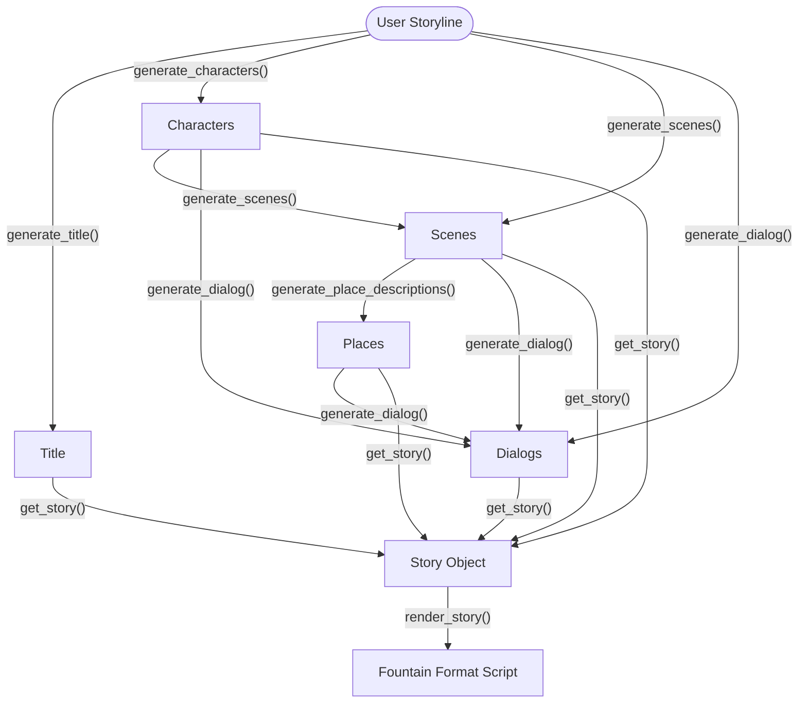
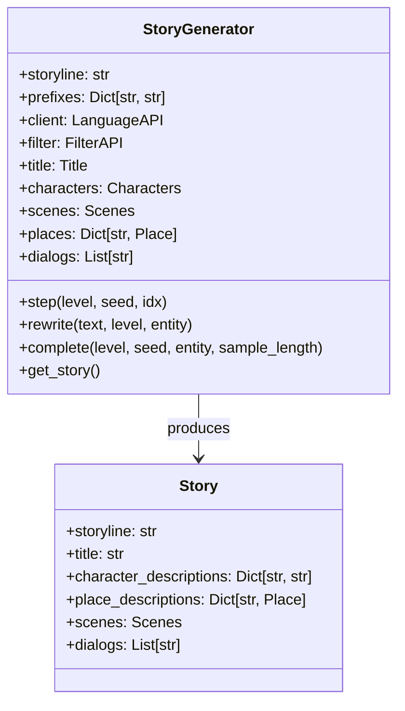
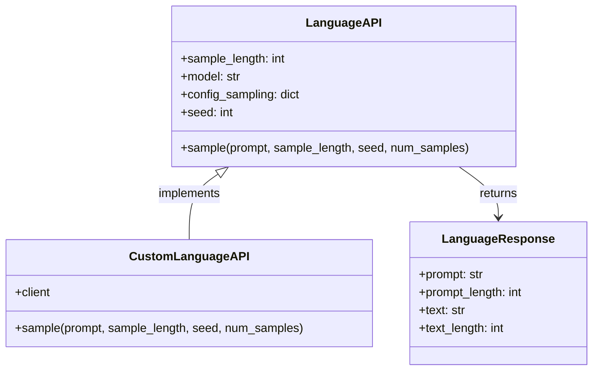
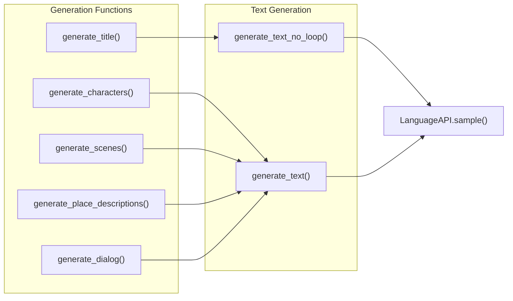
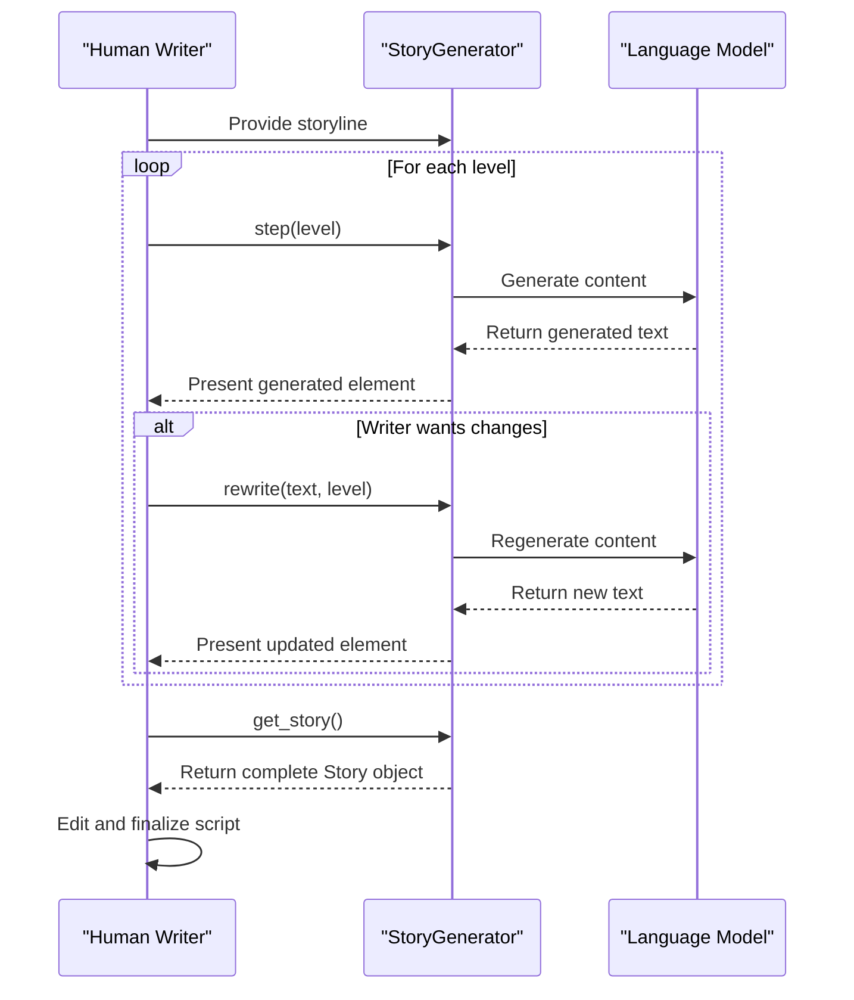

<!-- source: DeepWiki mcp.deepwiki.com · repo google-deepmind/dramatron · page 2 System Architecture · fetched 2026-10-26 -->

# System Architecture

Relevant source files

The following files were used as context for generating this wiki page:

- [README.md](README.md)
- [colab/dramatron.ipynb](colab/dramatron.ipynb)
- [docs/details.html](docs/details.html)
- [dramatron-animation.gif](dramatron-animation.gif)

This document provides a comprehensive overview of Dramatron's system architecture, focusing on the core components, their relationships, and the hierarchical generation process. For specific usage instructions, please refer to the [User Guide](#3).

## Purpose and Scope

The Dramatron system is designed as a co-writing tool that leverages large language models (LLMs) to generate theatrical scripts and screenplays. Its architecture facilitates a hierarchical generation approach to maintain consistency across the entire script, while enabling collaborative interaction between human writers and the system. This document explains the technical design and implementation of the system components.

Sources: [colab/dramatron.ipynb:41-59](), [README.md:12-25]()

## System Overview

Dramatron follows a hierarchical generation approach to create consistent scripts. The system is built around a central orchestrator (`StoryGenerator`) that coordinates the generation process through an abstraction layer (`LanguageAPI`) to interact with language models. The generated content is structured into typed data objects which are ultimately rendered into a screenplay in Fountain format.

Sources: [colab/dramatron.ipynb:983-1057](), [colab/dramatron.ipynb:561-622](), [colab/dramatron.ipynb:437-499]()

## Hierarchical Generation Process

The hierarchical generation approach ensures that each element of the script builds upon previously generated content, maintaining consistency throughout the script.

Each step in the generation process:
1. Takes inputs from previous stages
2. Constructs a specialized prompt
3. Calls the language model via the LanguageAPI
4. Parses the generated text into appropriate data structures

The StoryGenerator orchestrates this process, allowing the user to intervene at each step to guide the generation.

Sources: [colab/dramatron.ipynb:724-902](), [colab/dramatron.ipynb:1178-1218]()

## Core Components

### StoryGenerator Class

The StoryGenerator class serves as the central orchestrator in Dramatron. It manages the state of the script generation process and provides methods for stepping through the generation process, rewriting elements, and obtaining the final story.

Sources: [colab/dramatron.ipynb:983-1057](), [colab/dramatron.ipynb:1178-1218](), [colab/dramatron.ipynb:386-406]()

### LanguageAPI Interface

The LanguageAPI class provides an abstraction layer for interacting with language models. It defines a common interface that can be implemented by different language model providers.

The LanguageAPI abstraction allows Dramatron to be model-agnostic, enabling users to plug in different language models by implementing the required sample method.

Sources: [colab/dramatron.ipynb:561-622](), [colab/dramatron.ipynb:554-559]()

### Script Data Structures

Dramatron uses a set of structured data types to represent the elements of a script. These are implemented as NamedTuples for type safety and clarity.

| Data Structure | Purpose | Key Properties |
|----------------|---------|----------------|
| Title | Script title | title: str |
| Character | Individual character | name: str, description: str |
| Characters | Collection of characters | character_descriptions: Dict[str, str] |
| Scene | Individual scene | place: str, plot_element: str, beat: str |
| Scenes | Collection of scenes | scenes: List[Scene] |
| Place | Location description | name: str, description: str |
| Story | Complete script | storyline, title, character_descriptions, place_descriptions, scenes, dialogs |

These data structures include methods for serialization (to_string) and deserialization (from_string) to facilitate conversion between text and structured objects.

Sources: [colab/dramatron.ipynb:217-406]()

### Generation Functions

Dramatron includes specialized functions for generating each element of a script:

Each generation function:
1. Constructs a prompt using predefined templates and existing content
2. Calls `generate_text()` or `generate_text_no_loop()` to obtain text from the language model
3. Parses the generated text into the appropriate data structure
4. Returns the parsed object and the prompt used

The functions handle issues like repetition detection and content filtering to ensure quality output.

Sources: [colab/dramatron.ipynb:637-719](), [colab/dramatron.ipynb:724-902]()

### Rendering Function

The `render_story()` function transforms a Story object into a Fountain format script suitable for screenplay writing. It:

1. Formats the title and metadata
2. Lists character descriptions
3. Details each scene with location, characters, and dialog
4. Applies appropriate formatting according to the Fountain syntax

Sources: [colab/dramatron.ipynb:437-499]()

## User Interaction Flow

Dramatron is designed for collaborative use with a human writer, following this interaction flow:

This interaction model supports the co-writing process, allowing the human writer to guide the generation while leveraging the capabilities of the language model.

Sources: [colab/dramatron.ipynb:1178-1302](), [docs/details.html:30-51]()

## Implementation Environment

Dramatron is implemented in Python and runs within a Google Colab notebook environment. This implementation choice provides:

1. Accessibility - users can run Dramatron without local installation
2. Integration with language model APIs
3. Interactive interface for the co-writing process

The system is designed to be "unplugged" from any specific language model, requiring users to implement the LanguageAPI interface to connect with their preferred model.

Sources: [README.md:7-8](), [colab/dramatron.ipynb:1-67]()

## Limitations and Considerations

The Dramatron architecture has several inherent limitations:

1. **Hierarchical Generation** - The top-down approach may not align with all writing processes
2. **Prompt Engineering** - The quality of generated content depends on carefully designed prompts
3. **Content Safety** - Generated content may reproduce biases or contain inappropriate material
4. **Potential Plagiarism** - Language models may reproduce content from their training data

Dramatron includes optional integration with the Perspective API for content moderation and provides mechanisms for rewriting to address these limitations.

Sources: [README.md:17-23](), [docs/details.html:52-77]()

## Technology Stack

Dramatron's architecture is built on these key technologies:

| Component | Technologies |
|-----------|--------------|
| Core Implementation | Python, Named Tuples, Type Annotations |
| Runtime Environment | Google Colab Notebook |
| Language Model Integration | Custom API abstraction layer |
| Output Format | Fountain screenplay format |
| Optional Moderation | Perspective API |

The system is designed to be modular, allowing components to be replaced or extended as needed.

Sources: [colab/dramatron.ipynb:97-126](), [colab/dramatron.ipynb:561-622]()

---

