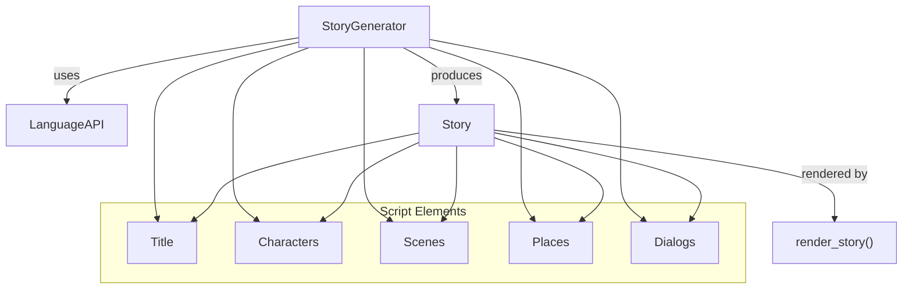
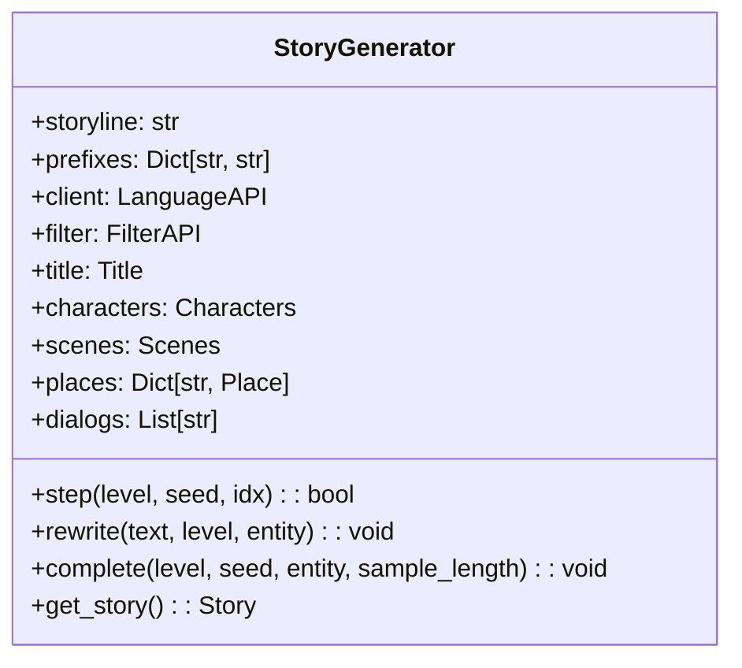
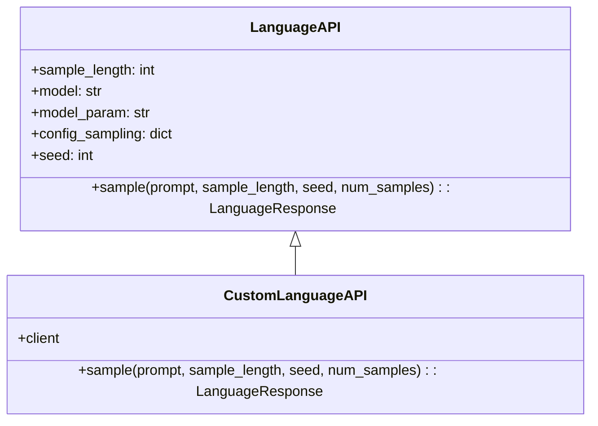
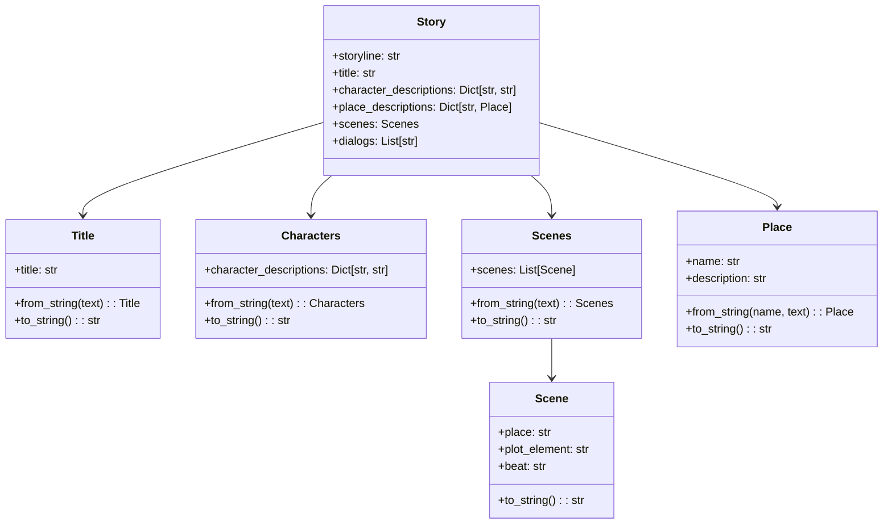
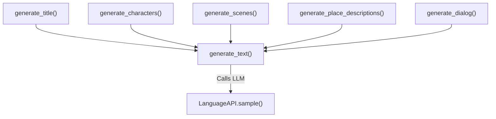
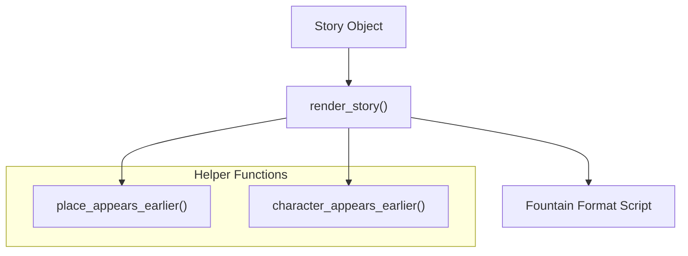
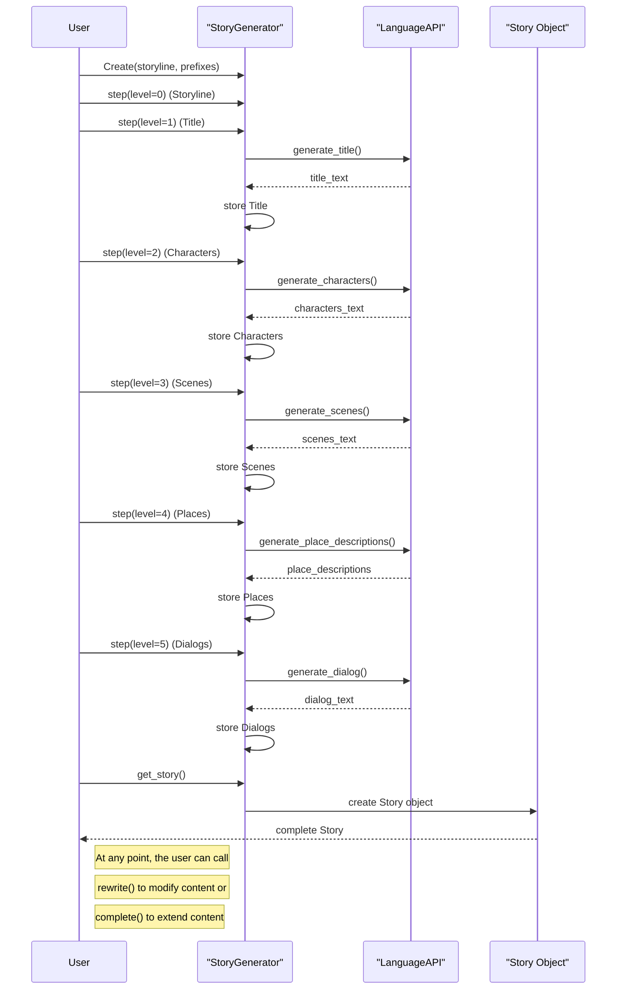

<!-- source: DeepWiki mcp.deepwiki.com · repo google-deepmind/dramatron · page 2.1 Core Components · fetched 2026-10-26 -->

# Core Components

Relevant source files

The following files were used as context for generating this wiki page:

- [README.md](README.md)
- [colab/dramatron.ipynb](colab/dramatron.ipynb)
- [dramatron-animation.gif](dramatron-animation.gif)

This document details the primary classes and modules that make up the Dramatron system, a co-writing tool for theatre scripts and screenplays. It focuses on the core architecture components and how they interact. For information about the hierarchical generation process, see [Hierarchical Generation Process](#2.2). For details about the data structures used, see [Data Structures](#2.3).

## Overview

Dramatron's architecture centers around several key components that work together to generate coherent script content. The system uses a hierarchical approach to maintain consistency across the generated elements, from title to dialog.

Sources: [colab/dramatron.ipynb:983-1363](), [colab/dramatron.ipynb:386-406](), [colab/dramatron.ipynb:437-499]()

## Key Classes

### StoryGenerator

The `StoryGenerator` class is the central orchestrator of the script generation process. It manages the step-by-step generation of all script elements, from title to dialogs, and stores both the generated content and the prompts used.

Key methods:
- `step()`: Advances the generation process to the next level
- `rewrite()`: Allows manual rewriting of any generated element
- `complete()`: Continues generation from existing content
- `get_story()`: Returns the complete Story object

Sources: [colab/dramatron.ipynb:983-1363]()

### LanguageAPI

The `LanguageAPI` is an abstract interface for interacting with large language models. It provides a unified sampling mechanism regardless of the underlying model implementation.

The implementation requires a concrete subclass that implements the `sample()` method to connect with a specific language model service.

Sources: [colab/dramatron.ipynb:562-623]()

### Script Elements

The core data structures that represent different parts of a script:

| Class | Description | Key Properties |
|-------|-------------|----------------|
| `Title` | Represents the script title | `title: str` |
| `Character` | Individual character | `name: str`, `description: str` |
| `Characters` | Collection of characters | `character_descriptions: Dict[str, str]` |
| `Scene` | Individual scene | `place: str`, `plot_element: str`, `beat: str` |
| `Scenes` | Collection of scenes | `scenes: List[Scene]` |
| `Place` | Location where scenes occur | `name: str`, `description: str` |
| `Story` | Complete story object | Contains all script elements |

Each class includes methods for parsing text into structured data (`from_string()`) and serializing back to text (`to_string()`).

Sources: [colab/dramatron.ipynb:217-406]()

Sources: [colab/dramatron.ipynb:217-406]()

## Generation Functions

Dramatron uses specialized generation functions for each element of the script. Each function follows a similar pattern: take input context, construct a prompt, call the language model, and parse the response.

| Function | Purpose | Input | Output |
|----------|---------|-------|--------|
| `generate_text()` | Base text generation function | Prompt, client, parameters | Generated text |
| `generate_title()` | Generate script title | Storyline | Title object |
| `generate_characters()` | Generate characters | Storyline | Characters object |
| `generate_scenes()` | Generate scene sequence | Storyline, characters | Scenes object |
| `generate_place_descriptions()` | Generate place descriptions | Storyline, scenes | Dict of Place objects |
| `generate_dialog()` | Generate scene dialog | Storyline, scenes, characters, places | Dialog text |

Sources: [colab/dramatron.ipynb:637-902]()

## Rendering Functions

The final script is rendered in Fountain format using the `render_story()` function, which combines all generated elements into a properly formatted screenplay.

The rendering process:
1. Outputs title and metadata
2. Lists characters and their descriptions
3. Summarizes scenes
4. For each scene:
   - Outputs the scene heading
   - Includes place description (if first appearance)
   - Includes character descriptions (if first appearance)
   - Outputs the dialog

Sources: [colab/dramatron.ipynb:437-519]()

## Execution Flow

The complete generation process in Dramatron follows this sequence:

Sources: [colab/dramatron.ipynb:983-1226]()

## User Intervention

An important aspect of Dramatron is the ability for users to intervene in the generation process. The `StoryGenerator` class provides methods for human intervention:

- `rewrite(text, level, entity)`: Allows replacing generated content with user-written text
- `complete(level, seed, entity, sample_length)`: Continues generation from existing content

The system keeps track of all user interventions in an `interventions` dictionary, with timestamps as keys.

Sources: [colab/dramatron.ipynb:1227-1362]()

---

