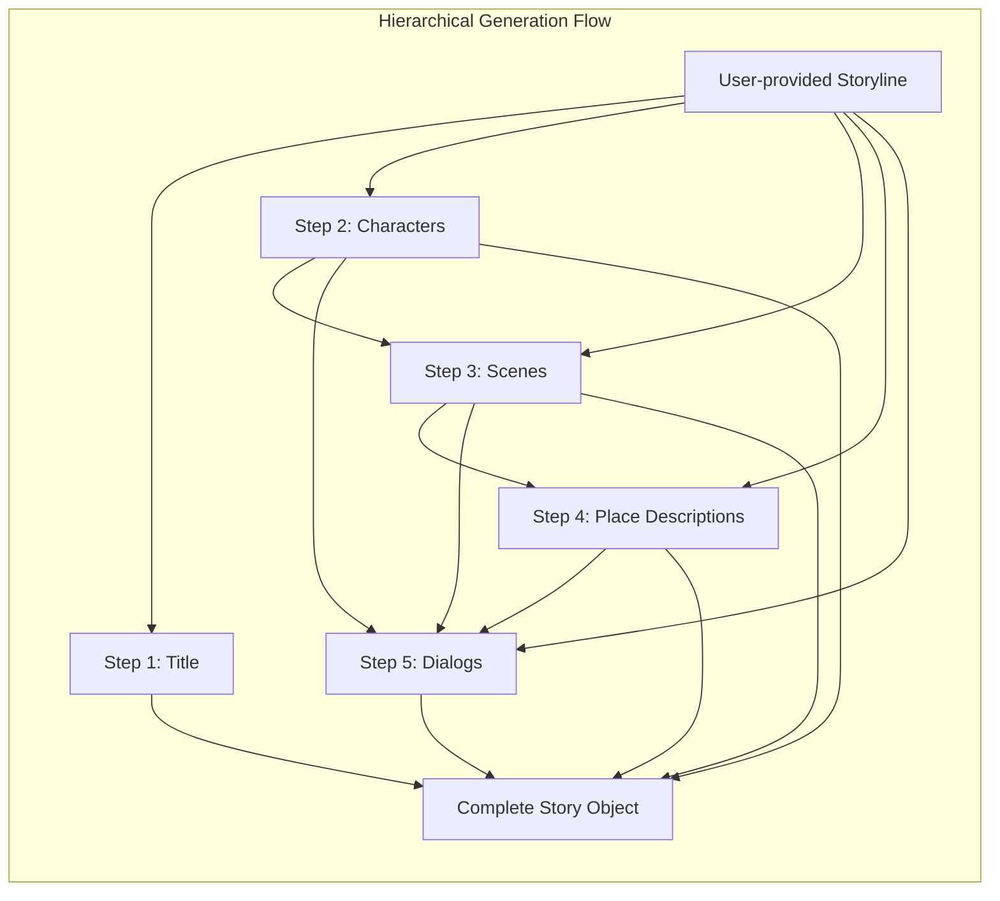
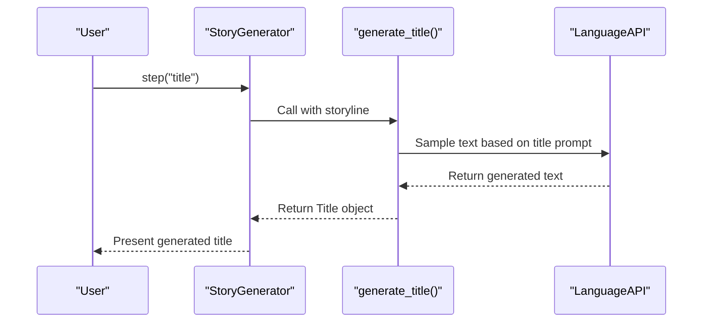
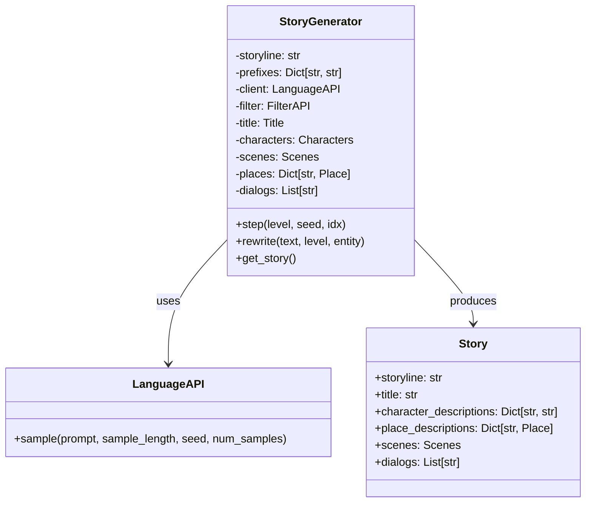
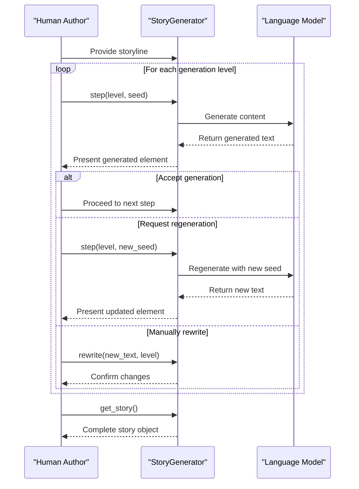

<!-- source: DeepWiki mcp.deepwiki.com · repo google-deepmind/dramatron · page 2.2 Hierarchical Generation Process · fetched 2026-10-26 -->

# Hierarchical Generation Process

Relevant source files

The following files were used as context for generating this wiki page:

- [README.md](README.md)
- [colab/dramatron.ipynb](colab/dramatron.ipynb)
- [docs/details.html](docs/details.html)
- [dramatron-animation.gif](dramatron-animation.gif)

## Purpose and Scope

This document explains Dramatron's hierarchical generation process, which is the core methodology used to create cohesive, long-form dramatic scripts. The hierarchical approach ensures consistency across generated content by creating elements in a specific sequence, with each new element building upon previous ones. This page focuses on the technical implementation of this generation process, including the workflow, data flow, and code structure.

For information about the data structures used to store the generated content, see [Data Structures](#2.3).

Sources: [README.md:12-13](), [docs/details.html:31-38]()

## Hierarchical Generation Overview

Dramatron uses a top-down approach to script generation, beginning with a high-level storyline and progressively adding more detailed elements. This hierarchical process helps maintain consistency throughout the generated script by ensuring that later elements (like dialog) are informed by earlier elements (like character descriptions).

This hierarchical approach creates a dependency structure where each generation step relies on previously generated content. For example, dialog generation requires knowledge of characters, scenes, and place descriptions.

Sources: [colab/dramatron.ipynb:982-1040](), [docs/details.html:32-37]()

## Generation Workflow Steps

Let's explore each step in the hierarchical generation process:

### 1. Storyline (Starting Point)

The process begins with a user-provided storyline, which is a brief summary of the overall plot. This serves as the foundation for all subsequent generations.

- **Input**: A text string provided by the human co-writer
- **Processing**: Formatted to ensure proper ending punctuation
- **Output**: Used as a base for all future generation steps

In the code, the storyline is set in the `StoryGenerator._set_storyline` method and stored as `self._storyline`.

Sources: [colab/dramatron.ipynb:1027-1038]()

### 2. Title Generation

The first generated element is the title, which is created based on the storyline.

- **Input**: Storyline, generation prompt
- **Function**: `generate_title()`
- **Output**: A `Title` object containing the generated title

Sources: [colab/dramatron.ipynb:721-739]()

### 3. Character Generation

Next, characters are generated based on the storyline.

- **Input**: Storyline, generation prompt
- **Function**: `generate_characters()`
- **Output**: A `Characters` object containing multiple `Character` objects with names and descriptions

The character generation creates a set of characters that will appear in the script, each with a name and description that aligns with the storyline.

Sources: [colab/dramatron.ipynb:742-763]()

### 4. Scene Generation

With the storyline and characters defined, the system generates scenes.

- **Input**: Storyline, character descriptions, generation prompt
- **Function**: `generate_scenes()`
- **Output**: A `Scenes` object containing multiple `Scene` objects with place, plot element, and beat

Each scene includes a place where it occurs, a plot element (e.g., beginning, middle, conclusion), and a beat (a specific dramatic event).

Sources: [colab/dramatron.ipynb:766-789]()

### 5. Place Description Generation

For each unique place mentioned in the scenes, detailed descriptions are generated.

- **Input**: Storyline, scenes, generation prompt
- **Function**: `generate_place_descriptions()`
- **Output**: A dictionary mapping place names to `Place` objects containing descriptions

These descriptions help establish the physical setting for each scene in the script.

Sources: [colab/dramatron.ipynb:792-823]()

### 6. Dialog Generation

Finally, dialog is generated for each scene based on all previous elements.

- **Input**: Storyline, scenes, character descriptions, place descriptions, generation prompt
- **Function**: `generate_dialog()`
- **Output**: Dialog text for the scene

The dialog generation takes into account the characters present in the scene, the setting, and the dramatic beat to create appropriate conversation.

Sources: [colab/dramatron.ipynb:851-902]()

## Technical Implementation

The hierarchical generation process is primarily implemented in the `StoryGenerator` class, which coordinates all generation steps and manages their inputs and outputs.

The `StoryGenerator` class maintains state for all generated elements and exposes methods to:
- Progress through generation steps (`step()`)
- Allow for human intervention and rewrites (`rewrite()`)
- Package all generated content into a final `Story` object (`get_story()`)

Each generation function (`generate_title()`, `generate_characters()`, etc.) follows a similar pattern:
1. Construct a prompt based on previous elements
2. Call the language model through the `LanguageAPI`
3. Parse the generated text into the appropriate data structure
4. Return both the structured data and the prompt used for generation

Sources: [colab/dramatron.ipynb:982-1039](), [colab/dramatron.ipynb:721-902]()

## Data Flow Between Generation Steps

The following diagram illustrates how data flows between the different stages of the hierarchical generation process:

```mermaid
flowchart TD
    subgraph "Data Flow in Hierarchical Generation"
        Storyline["Storyline (User Input)"] 
        
        subgraph "Step 1: Title Generation"
            TitleIn["Input: Storyline"]
            TitleFunc["Function: generate_title()"]
            TitleOut["Output: Title object"]
            
            TitleIn --> TitleFunc --> TitleOut
        end
        
        subgraph "Step 2: Character Generation"
            CharIn["Input: Storyline"]
            CharFunc["Function: generate_characters()"]
            CharOut["Output: Characters object"]
            
            CharIn --> CharFunc --> CharOut
        end
        
        subgraph "Step 3: Scene Generation"
            SceneIn["Input: Storyline + Characters"]
            SceneFunc["Function: generate_scenes()"]
            SceneOut["Output: Scenes object"]
            
            SceneIn --> SceneFunc --> SceneOut
        end
        
        subgraph "Step 4: Place Generation"
            PlaceIn["Input: Storyline + Scenes"]
            PlaceFunc["Function: generate_place_descriptions()"]
            PlaceOut["Output: Dict[str, Place]"]
            
            PlaceIn --> PlaceFunc --> PlaceOut
        end
        
        subgraph "Step 5: Dialog Generation"
            DialogIn["Input: Storyline + Characters + Scenes + Places"]
            DialogFunc["Function: generate_dialog()"]
            DialogOut["Output: Dialog text"]
            
            DialogIn --> DialogFunc --> DialogOut
        end
        
        Storyline --> TitleIn
        Storyline --> CharIn
        Storyline --> SceneIn
        CharOut --> SceneIn
        Storyline --> PlaceIn
        SceneOut --> PlaceIn
        Storyline --> DialogIn
        CharOut --> DialogIn
        SceneOut --> DialogIn
        PlaceOut --> DialogIn
        
        TitleOut & CharOut & SceneOut & PlaceOut & DialogOut --> StoryObj["Complete Story Object"]
    end
```

This diagram shows how each step in the generation process depends on and builds upon previous steps, creating a cohesive narrative structure.

Sources: [colab/dramatron.ipynb:721-902]()

## User Interaction Model

Dramatron's hierarchical generation is designed for human-AI collaboration. At each step in the process, the human co-writer can:

1. Review the generated content
2. Accept it as is
3. Request a regeneration with the same parameters
4. Rewrite or modify the content directly
5. Proceed to the next generation step

This interaction model is implemented in the `StoryGenerator.step()` and `StoryGenerator.rewrite()` methods, which allow for progression through the hierarchy and intervention at any stage.

This collaborative workflow ensures that the human author maintains creative control while leveraging the language model's capabilities to generate coherent and consistent content.

Sources: [colab/dramatron.ipynb:982-1040](), [docs/details.html:32-37](), [README.md:12-23]()

## Benefits and Limitations

### Benefits of Hierarchical Generation

1. **Consistency**: By generating elements in sequence and using previous elements as context, the hierarchical approach helps maintain consistency throughout the script.

2. **Structured Narrative**: The process naturally enforces a traditional narrative structure with defined characters, settings, and plot points.

3. **Controllable Generation**: The step-by-step process allows for targeted human intervention at each stage, rather than having to regenerate an entire script.

### Limitations

1. **Fixed Creative Process**: As noted in the documentation, "Dramatron's top-down hierarchical story generation structure does not correspond to every writer's writing process."

2. **Sequential Dependency**: Errors or weaknesses in early steps propagate to later steps, potentially amplifying issues.

3. **Formulaic Output**: The structured approach can lead to formulaic writing that follows conventional patterns too rigidly.

These limitations emphasize why Dramatron is designed specifically as a co-writing tool rather than an autonomous script generator.

Sources: [docs/details.html:56-64](), [README.md:21-22](), [docs/details.html:82-89]()

---

