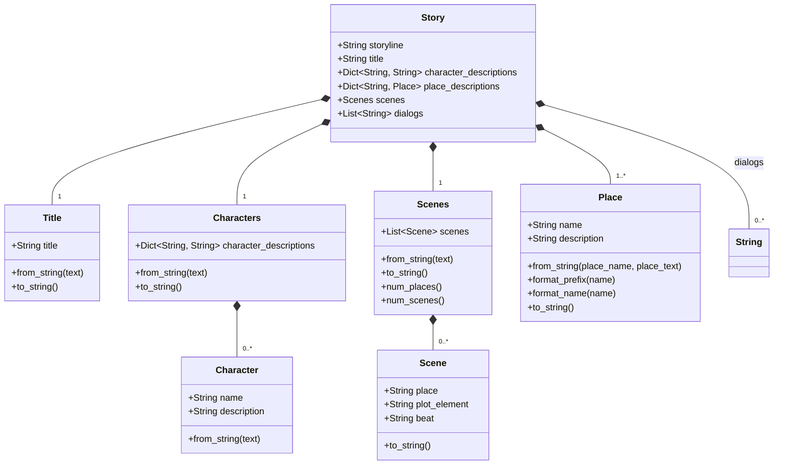
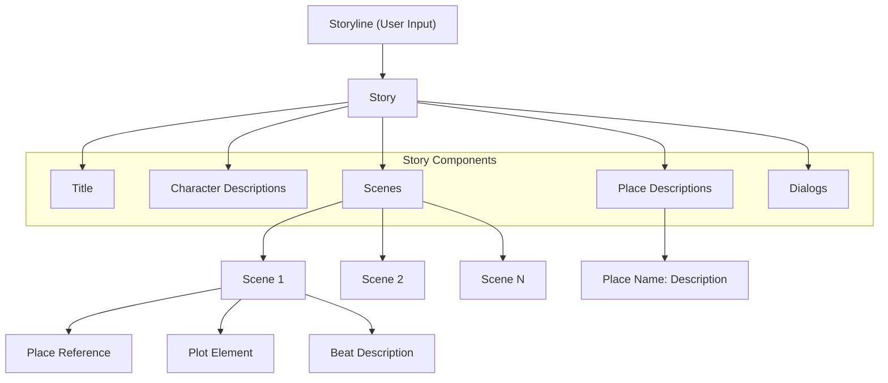
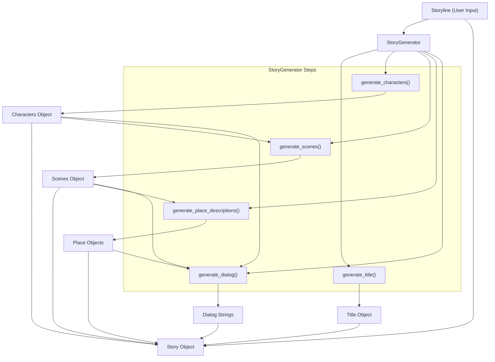
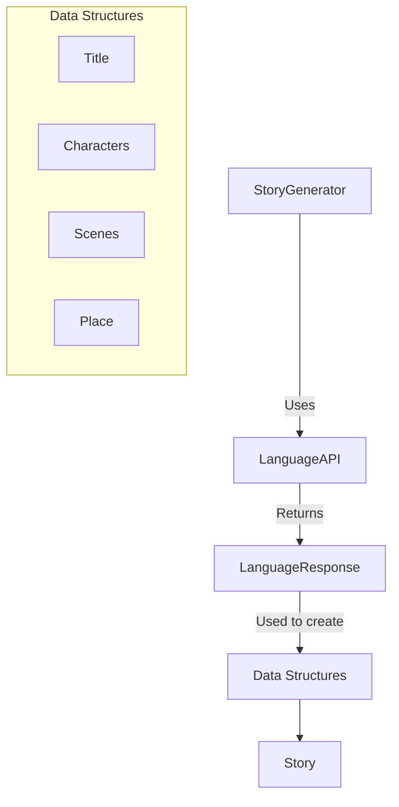

<!-- source: DeepWiki mcp.deepwiki.com · repo google-deepmind/dramatron · page 2.3 Data Structures · fetched 2026-10-26 -->

# Data Structures

<details>
<summary>Relevant source files</summary>

The following files were used as context for generating this wiki page:

- [README.md](README.md)
- [colab/dramatron.ipynb](colab/dramatron.ipynb)
- [dramatron-animation.gif](dramatron-animation.gif)

</details>


This page documents the core data structures used in Dramatron, the script co-writing system that leverages large language models to generate theatre scripts and screenplays. These data structures implement the hierarchical generation approach that ensures long-range consistency throughout the generated script.

For information about how these data structures are used in the generation process, see [Hierarchical Generation Process](#2.2). For the API reference that manipulates these data structures, see [StoryGenerator Class](#4.1).

## Key Data Structures Overview

Dramatron uses several specialized classes to represent different components of a script. These classes are organized in a hierarchical structure that mirrors the script generation process.



Sources: [colab/dramatron.ipynb:217-405]()

## Story Class

The `Story` class is the central data structure that holds all components of a generated script. It serves as the container for the title, characters, scenes, places, and dialogs, providing a cohesive representation of the entire script.



Sources: [colab/dramatron.ipynb:386-405](), [colab/dramatron.ipynb:1214-1225]()

The `Story` class is defined as a `NamedTuple` with the following attributes:

| Attribute | Type | Description |
|-----------|------|-------------|
| storyline | str | A single sentence summary of the whole plot |
| title | str | The title of the script |
| character_descriptions | Dict[str, str] | Map from character names to full descriptions |
| place_descriptions | Dict[str, Place] | Map from place names to full descriptions |
| scenes | Scenes | Collection of scenes in the script |
| dialogs | List[str] | List of dialogs, one for each scene |

The `Story` object is created by the `StoryGenerator.get_story()` method after all the hierarchical generation steps have completed.

Sources: [colab/dramatron.ipynb:386-405](), [colab/dramatron.ipynb:1214-1225]()

## Component Data Structures

### Title

The `Title` class is a simple wrapper around a string representing the script's title.

```python
class Title(NamedTuple):
    """Title class."""
    title: str
```

It provides methods for serialization and deserialization:
- `from_string(text)`: Creates a Title object from generated text
- `to_string()`: Converts the Title object to a formatted string

Sources: [colab/dramatron.ipynb:217-231]()

### Character and Characters

Characters in Dramatron are represented by two related classes:

1. `Character`: Represents an individual character with a name and description
2. `Characters`: A collection of character descriptions

```python
class Character(NamedTuple):
    """Character class."""
    name: str  # Name of the character
    description: str  # A single sentence describing the character
```

```python
class Characters(NamedTuple):
    """Characters class, containing main characters and their descriptions."""
    character_descriptions: Dict[str, str]  # A dictionary of character descriptions
```

The `Characters` class provides methods to parse generated text and extract individual characters, as well as to serialize the collection back to text.

Sources: [colab/dramatron.ipynb:238-292]()

### Scene and Scenes

Scenes are represented by two key classes:

1. `Scene`: An individual scene with place, plot element, and beat description
2. `Scenes`: A collection of Scene objects

```python
class Scene(NamedTuple):
    """Scene class."""
    place: str  # The name of the place where the scene unfolds
    plot_element: str  # Name of the plot element (e.g., Beginning, Middle, Conclusion)
    beat: str  # A short description of action/story/dramatic event occurring in the scene
```

```python
class Scenes(NamedTuple):
    """Scenes class."""
    scenes: List[Scene]  # A list of scenes
```

The `Scenes` class provides methods for parsing generated text into structured scenes and serializing the collection back to text. It also offers utility methods like `num_places()` and `num_scenes()`.

Sources: [colab/dramatron.ipynb:295-348]()

### Place

The `Place` class represents a location where scenes occur:

```python
class Place(NamedTuple):
    """Place class."""
    name: str  # Place name
    description: str  # Place description
```

It provides methods for formatting place names, parsing place descriptions from generated text, and serializing place information.

Sources: [colab/dramatron.ipynb:351-379]()

## Data Flow and Processing

The data structures in Dramatron work together to support the hierarchical generation process. The following diagram illustrates how data flows through these structures during script generation:



Sources: [colab/dramatron.ipynb:637-902](), [colab/dramatron.ipynb:1077-1225]()

## Text Extraction and Processing

Dramatron includes utility functions to extract data from generated text and process it into structured objects:

### extract_elements Function

A key utility function used by many data structure classes is `extract_elements()`, which parses text based on start and end markers:

```python
def extract_elements(text: str, begin: str, end: str) -> List[str]:
    """Extracts elements from a text string given string and ending markers."""
```

This function is used extensively by the data structure classes to parse generated text into structured data.

Sources: [colab/dramatron.ipynb:408-421]()

## Markers and Elements

Dramatron uses a series of markers and element identifiers to structure the generated text and to parse it back into data structures. These markers are defined as constants in the code:

| Marker | Purpose |
|--------|---------|
| END_MARKER | Marks the end of a generation section |
| STOP_MARKER | Marks the end of an individual element |
| CHARACTER_MARKER | Identifies character information |
| DESCRIPTION_MARKER | Identifies description text |
| SCENES_MARKER | Identifies scene information |
| DIALOG_MARKER | Identifies dialog text |
| TITLE_ELEMENT | Labels title sections |
| CHARACTERS_ELEMENT | Labels character sections |
| PLACE_ELEMENT | Labels place sections |
| PLOT_ELEMENT | Labels plot element sections |
| BEAT_ELEMENT | Labels beat sections |

These markers are used both during generation (to structure prompts) and during parsing (to extract structured information from generated text).

Sources: [colab/dramatron.ipynb:180-210]()

## Serialization and Rendering

Each data structure in Dramatron provides methods to serialize itself to text, which is particularly important for two purposes:

1. Creating prompts for the next generation step by incorporating previously generated content
2. Rendering the final script in a readable format

The `render_story()` function takes a `Story` object and transforms it into a properly formatted screenplay in the Fountain format:

```python
def render_story(story: Story) -> str:
    """Render the story in fountain format."""
```

This function provides the final output of the generation process, producing a complete script that incorporates all the elements stored in the Story object.

Sources: [colab/dramatron.ipynb:436-519]()

## Relationship to Language API

The data structures interact with the language model through the `LanguageAPI` class, which provides an abstraction layer for generating text:



The `LanguageResponse` class encapsulates the prompts sent to the language model and the generated responses:

```python
class LanguageResponse(NamedTuple):
    prompt: str
    prompt_length: int
    text: str
    text_length: int
```

This structure bridges the gap between the raw language model API and the structured data needed for script generation.

Sources: [colab/dramatron.ipynb:554-558](), [colab/dramatron.ipynb:561-622]()

## Using Data Structures in Custom Applications

When developing custom applications with Dramatron, you'll primarily interact with these data structures through the `StoryGenerator` class, which manages the creation and modification of all script components.

The typical workflow includes:

1. Creating a `StoryGenerator` with an initial storyline
2. Stepping through the generation levels to create title, characters, scenes, etc.
3. Retrieving the final `Story` object using `get_story()`
4. Rendering the story to a formatted script

This structure allows for interactive use, where human writers can provide input and modify generated content at each step of the process.

Sources: [colab/dramatron.ipynb:983-1363]()

---

