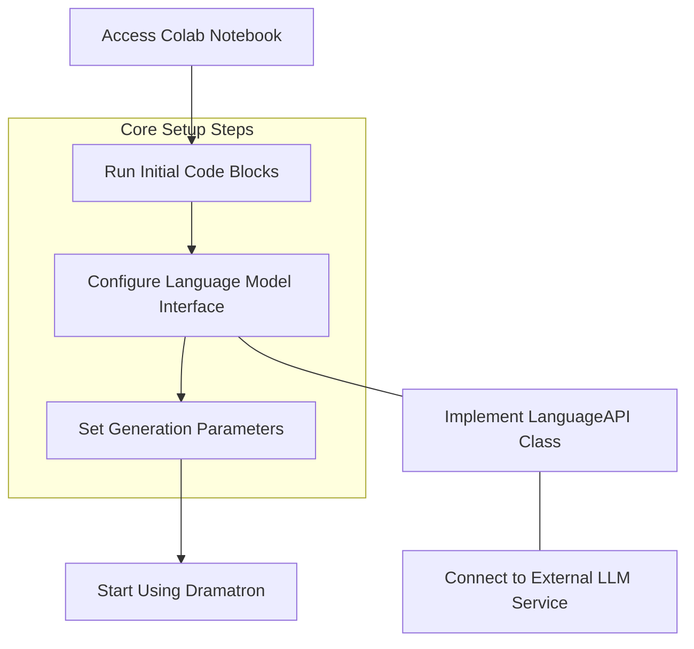
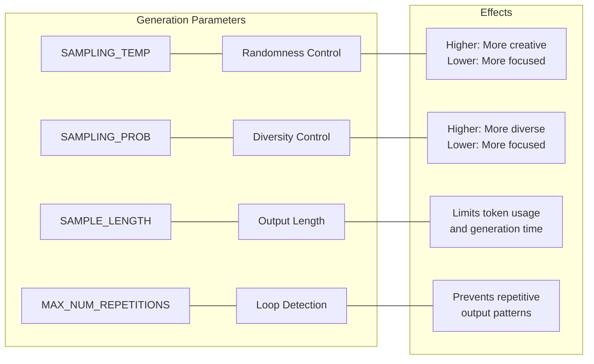
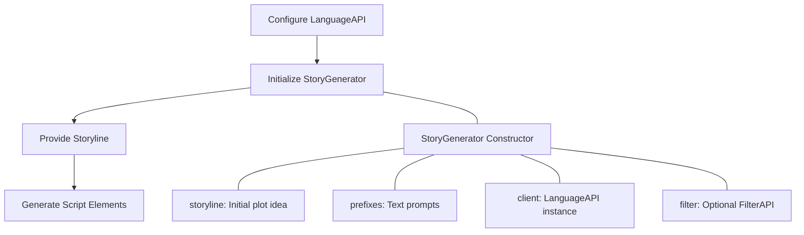

<!-- source: DeepWiki mcp.deepwiki.com · repo google-deepmind/dramatron · page 3.1 Setting Up Dramatron · fetched 2026-10-26 -->

# Setting Up Dramatron

<details>
<summary>Relevant source files</summary>

The following files were used as context for generating this wiki page:

- [README.md](README.md)
- [colab/dramatron.ipynb](colab/dramatron.ipynb)
- [dramatron-animation.gif](dramatron-animation.gif)

</details>


This guide explains how to set up Dramatron, a hierarchical script co-writing system that leverages large language models (LLMs) to generate theatre scripts and screenplays. This page focuses specifically on the technical setup process, including configuring the language model connection and adjusting generation parameters. For information about using Dramatron after setup, see [Co-Writing Workflow](#3.2).

## Overview of Setup Requirements

Dramatron runs as a Google Colab notebook and requires connection to a large language model to function. The system is provided "unplugged," meaning you need to implement specific interfaces to connect it to your preferred language model.



Sources: [colab/dramatron.ipynb:1-32](), [README.md:5-9]()

## Accessing the Colab Notebook

Dramatron is implemented as a Colab notebook, which provides an interactive Python environment in your browser.

1. Open the notebook directly via this link: [https://colab.research.google.com/github/deepmind/dramatron/blob/main/colab/dramatron.ipynb](https://colab.research.google.com/github/deepmind/dramatron/blob/main/colab/dramatron.ipynb)
2. Alternatively, visit the GitHub repository, navigate to `colab/dramatron.ipynb`, and click "Open in Colab"
3. Make sure you're signed in to a Google account
4. Click "Connect" in the top-right corner to start the Python runtime

Sources: [README.md:5-9](), [colab/dramatron.ipynb:12-20]()

## Running Initial Setup

The notebook is divided into code blocks that need to be executed sequentially. Start with the basic setup:

1. Run the "License" block to display license information and verify the notebook is working
2. Run the "Imports" block to load required Python libraries
3. Run the "Dramatron hyperparameters" block to set initial generation parameters
4. Run the "Dramatron code" block to load the system's core functionality

Each block can be executed by clicking the play button next to it, or by using Shift+Enter.

Sources: [colab/dramatron.ipynb:12-20](), [colab/dramatron.ipynb:63-75]()

## Configuring the Language Model Interface

The most critical setup step is implementing the `LanguageAPI` interface to connect Dramatron to a language model. Dramatron uses an abstraction layer that allows it to work with various LLM providers.

### Understanding the LanguageAPI Class

The `LanguageAPI` class defines the interface between Dramatron and the language model. You need to implement two key methods:

```mermaid
classDiagram
    class "LanguageAPI" {
        +__init__(sample_length, model, etc.)
        +sample(prompt, sample_length, seed, num_samples)
        +default_sample_length
        +model
        +seed
    }
    
    class "CustomLanguageAPI" {
        +client
        +__init__(client_config)
        +sample(prompt, sample_length, seed, num_samples)
    }
    
    "LanguageAPI" <|-- "CustomLanguageAPI" : implements
    "CustomLanguageAPI" --> "External LLM" : connects to
    "StoryGenerator" --> "LanguageAPI" : uses
```

The abstract `LanguageAPI` class is defined in [colab/dramatron.ipynb:561-622]() and contains:

1. `__init__` method: Initialize the language model connection with parameters like sample length, model name, and sampling configuration
2. `sample` method: The core method that sends prompts to the language model and returns generations

You need to create a custom implementation of this class that connects to your preferred language model provider.

Sources: [colab/dramatron.ipynb:561-622](), [README.md:8-9]()

### Example: Setting Up Google Gemini

The notebook includes instructions for connecting to Google's Gemini API:

1. Run the "Google Gemini only: Install dependencies" block to install the required client library
2. Create an account with Google AI Studio (https://makersuite.google.com/app/apikey)
3. Generate an API key
4. Enter your API key in the appropriate field in the notebook
5. Implement the `CustomLanguageAPI` class to use the Gemini API

Below is a simplified example of what the implementation might look like (you'll need to adapt this based on the specific Gemini API client):

```python
import google.generativeai as genai

class GeminiLanguageAPI(LanguageAPI):
    def __init__(self, api_key, sample_length=512, model="gemini-pro", **kwargs):
        super().__init__(sample_length=sample_length, model=model, **kwargs)
        genai.configure(api_key=api_key)
        self._client = genai.GenerativeModel(model_name=model)
        
    def sample(self, prompt, sample_length=None, seed=None, num_samples=1):
        if sample_length is None:
            sample_length = self.default_sample_length
            
        responses = []
        for _ in range(num_samples):
            generation = self._client.generate_content(
                prompt,
                generation_config={
                    "max_output_tokens": sample_length,
                    "temperature": SAMPLING_TEMP,
                    "top_p": SAMPLING_PROB,
                    "seed": seed
                }
            )
            
            responses.append(LanguageResponse(
                prompt=prompt,
                prompt_length=len(prompt),
                text=generation.text,
                text_length=len(generation.text)
            ))
            
        return responses
```

Sources: [colab/dramatron.ipynb:75-87](), [colab/dramatron.ipynb:19-20]()

### Connecting to Other LLM Providers

You can implement the `LanguageAPI` for other providers by following a similar pattern:

1. Install the appropriate client library for your LLM provider
2. Create a custom class that inherits from `LanguageAPI`
3. Implement the `__init__` method to establish the connection
4. Implement the `sample` method to send prompts and retrieve responses

The implementation details will vary based on the API of your chosen provider.

## Configuring Generation Parameters

Dramatron uses several parameters to control the text generation process. These are set in the "Dramatron hyperparameters" code block:

| Parameter | Default | Description |
|-----------|---------|-------------|
| `DEFAULT_SEED` | 1 | Seed for reproducible generation |
| `SAMPLING_PROB` | 0.95 | Top-p probability for sampling |
| `SAMPLING_TEMP` | 1.0 | Temperature for controlling randomness |
| `SAMPLE_LENGTH_TITLE` | 64 | Max token length for title generation |
| `SAMPLE_LENGTH_PLACE` | 128 | Max token length for place descriptions |
| `SAMPLE_LENGTH` | 511 | Max token length for other generations |
| `MAX_PARAGRAPH_LENGTH` | 1024 | Max length during repeated sampling |
| `MAX_NUM_REPETITIONS` | 3 | Loop detection threshold |

These parameters can be adjusted based on your needs and the capabilities of your language model. Higher temperature values (closer to 1.0) produce more creative but potentially less coherent text, while lower values produce more predictable output.



Sources: [colab/dramatron.ipynb:138-162]()

## Optional: Setting Up Content Moderation

Dramatron can optionally use the Perspective API for content moderation to filter out potentially inappropriate generations.

To enable content moderation:

1. Obtain a Perspective API key from Google Cloud
2. Implement the `FilterAPI` class to connect to the Perspective API
3. Pass your `FilterAPI` implementation to the `StoryGenerator` constructor

The `FilterAPI` class is defined in [colab/dramatron.ipynb:625-632]() and requires implementing a `validate` method that checks generated text against content policies.

Sources: [colab/dramatron.ipynb:625-632](), [README.md:23]()

## Initializing Dramatron

Once you've implemented the language model interface and configured the parameters, you can initialize the `StoryGenerator` class, which is the main entry point for using Dramatron:



The `StoryGenerator` is defined in [colab/dramatron.ipynb:983-1363]() and takes the following parameters:

1. `storyline`: The initial plot idea provided by the user
2. `prefixes`: A dictionary of text prompts used for different generation stages
3. `client`: An instance of your `LanguageAPI` implementation
4. `filter`: An optional instance of your `FilterAPI` implementation
5. Various other parameters controlling generation behavior

After initializing the `StoryGenerator`, you can start the co-writing process by stepping through different levels of script generation (title, characters, scenes, etc.).

Sources: [colab/dramatron.ipynb:983-1363]()

## Troubleshooting Common Setup Issues

### API Connection Problems

If you encounter issues connecting to your language model API:

1. Verify that your API key is correct and has the necessary permissions
2. Check if the model name you're using is available through your provider
3. Ensure that your implementation properly handles rate limiting and errors

### Generation Quality Issues

If the generated content isn't meeting expectations:

1. Adjust the temperature and top-p parameters to control randomness and diversity
2. Try different models if available through your provider
3. Experiment with the sample length parameters to get more detailed generations

### Performance Considerations

Dramatron makes multiple API calls to generate a complete script. Be aware of:

1. API usage costs from your provider
2. Generation time, which increases with the sample length
3. Token limits of your chosen model

If you encounter "out of memory" errors in Colab, try:
1. Disconnecting and reconnecting to reset the runtime
2. Using a runtime with more memory (if available)
3. Reducing the maximum generation lengths

Sources: [colab/dramatron.ipynb:545-560](), [colab/dramatron.ipynb:138-162]()

By following this setup guide, you should be able to configure Dramatron with your preferred language model and start the co-writing process. For information on how to use Dramatron after setup, see [Co-Writing Workflow](#3.2).

---

