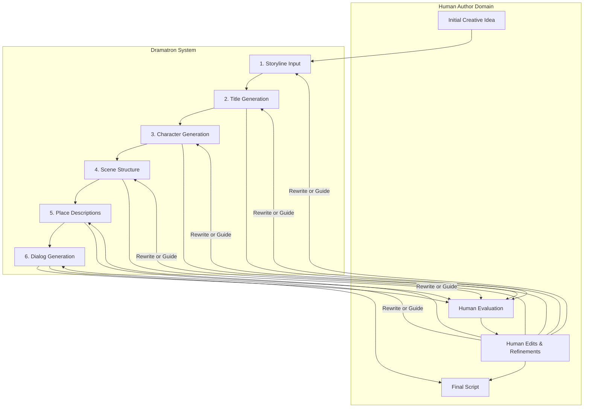
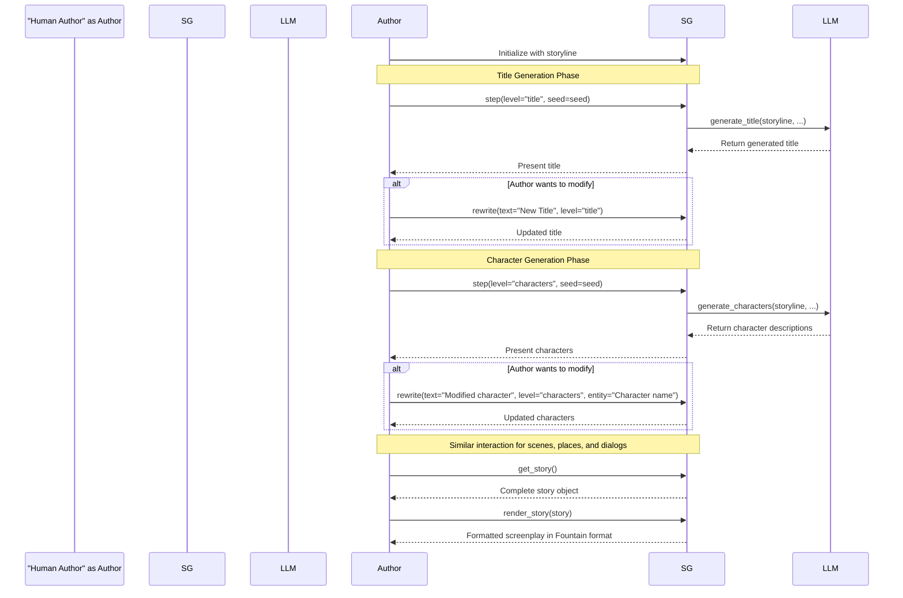

<!-- source: DeepWiki mcp.deepwiki.com · repo google-deepmind/dramatron · page 3.2 Co-Writing Workflow · fetched 2026-10-26 -->

# Co-Writing Workflow

<details>
<summary>Relevant source files</summary>

The following files were used as context for generating this wiki page:

- [README.md](README.md)
- [colab/dramatron.ipynb](colab/dramatron.ipynb)
- [docs/details.html](docs/details.html)
- [dramatron-animation.gif](dramatron-animation.gif)

</details>


This page documents the intended workflow for collaborating with Dramatron to co-write theatre scripts and screenplays. It explains the interactive process between the human author and the system, including how to guide and intervene in the generation process at various stages. For technical details about the underlying API and implementation, see [API Reference](#4).

## Overview of the Co-Writing Process

Dramatron is designed as a co-creative system where large language models work alongside human authors to generate theatrical scripts and screenplays. Rather than replacing the human creative process, Dramatron serves as a tool that provides suggestions and draft content that authors can then edit, refine, and incorporate into their work.

The co-writing workflow follows a hierarchical generation approach, where each element builds upon previous elements to ensure consistency. The human author can intervene at any stage to guide the generation process.



Sources: [colab/dramatron.ipynb:982-1127](). [README.md:12-23]().

## Hierarchical Generation Approach

Dramatron uses a hierarchical approach to script generation, which ensures consistency across the entire script while allowing for creative intervention at each level.

```mermaid
classDiagram
    class "StoryGenerator" {
        +storyline: str
        +title: Title
        +characters: Characters
        +scenes: Scenes
        +places: Dict[str, Place]
        +dialogs: List[str]
        +step(level, seed, idx)
        +rewrite(text, level, entity)
    }
    
    class "Story" {
        +storyline: str
        +title: str
        +character_descriptions: Dict
        +place_descriptions: Dict
        +scenes: Scenes
        +dialogs: List[str]
    }
    
    "StoryGenerator" --> "Story" : produces
    
    note for "StoryGenerator" "Main orchestration class\nthat handles the co-writing\nprocess"
    note for "Story" "The complete script data\nstructure with all elements"
```

Sources: [colab/dramatron.ipynb:386-406](). [colab/dramatron.ipynb:982-1127]().

## Step-by-Step Co-Writing Process

### 1. Starting with a Storyline

The co-writing process begins with the human author providing a storyline - a concise summary of the plot. This is the creative seed from which Dramatron will generate all subsequent elements.

**How to provide a storyline:**
- Keep it concise but descriptive
- Include the main plot points and character archetypes
- Set the tone and genre you want to explore

In the code, the storyline is provided to the `StoryGenerator` constructor:

```
story_generator = StoryGenerator(
    storyline="A detective with a troubled past investigates a series of mysterious disappearances in a small coastal town.",
    prefixes=DRAMATRON_PROMPTS,
    client=language_api,
    filter=filter_api
)
```

Sources: [colab/dramatron.ipynb:1024-1038](). [colab/dramatron.ipynb:983-1005]().

### 2. Generating and Refining the Title

Once you've provided a storyline, Dramatron can generate a title that captures the essence of your story.

**Generation process:**
1. The system takes your storyline as input
2. Uses a dedicated prompt template for titles
3. Generates a title that reflects the theme and tone
4. Presents it for your review and possible refinement

**Intervention techniques:**
- You can accept the generated title
- You can request a new generation with a different seed
- You can manually rewrite the title

```python
# Example of stepping through title generation
title, title_prompt = story_generator.step(level="title", seed=DEFAULT_SEED)
# Example of rewriting the title
story_generator.rewrite(text="The Coastal Shadows", level="title")
```

Sources: [colab/dramatron.ipynb:728-739](). [colab/dramatron.ipynb:4122-4133]().

### 3. Working with Characters

Character development is a critical part of any script. Dramatron helps by generating character descriptions that you can then refine.

**Generation process:**
1. The system takes your storyline as input
2. Generates a set of characters with names and descriptions
3. Creates relationships and motivations that align with the storyline
4. Presents them for your review and possible refinement

**Intervention techniques:**
- You can accept the generated characters
- You can request new generations
- You can manually edit character descriptions
- You can add or remove characters

```python
# Example of stepping through character generation
characters, characters_prompt = story_generator.step(level="characters", seed=DEFAULT_SEED)
# Example of rewriting a character
story_generator.rewrite(text="Detective Sarah Chen: A brilliant detective with a troubled past...", level="characters", entity="Detective Sarah Chen")
```

Sources: [colab/dramatron.ipynb:741-764](). [colab/dramatron.ipynb:4135-4160]().

### 4. Developing Scene Structure

Scenes form the backbone of your script. Dramatron helps by generating scene structures that follow dramatic principles.

**Generation process:**
1. The system takes your storyline and characters as input
2. Generates a sequence of scenes with locations and plot elements
3. Creates a dramatic arc across the scenes
4. Presents them for your review and possible refinement

**Intervention techniques:**
- You can accept the generated scene structure
- You can request new generations
- You can manually edit scene descriptions
- You can add, remove, or reorder scenes

```python
# Example of stepping through scene generation
scenes, scenes_prompt = story_generator.step(level="scenes", seed=DEFAULT_SEED)
# Example of rewriting a scene
story_generator.rewrite(text="Police Station. Beginning. Detective Chen reviews the case files of the missing persons...", level="scenes", entity=0)  # entity is the scene index
```

Sources: [colab/dramatron.ipynb:766-790](). [colab/dramatron.ipynb:4162-4189]().

### 5. Creating Place Descriptions

Vivid place descriptions help bring your script to life. Dramatron generates detailed locations based on your scenes.

**Generation process:**
1. The system takes your scenes as input
2. Identifies unique locations used in the scenes
3. Generates detailed descriptions for each location
4. Presents them for your review and possible refinement

**Intervention techniques:**
- You can accept the generated place descriptions
- You can request new generations
- You can manually edit place descriptions
- You can add details or atmosphere to locations

```python
# Example of stepping through place description generation
places, places_prompts = story_generator.step(level="places", seed=DEFAULT_SEED)
# Example of rewriting a place description
story_generator.rewrite(text="A dimly lit, cluttered office with case files stacked to the ceiling...", level="places", entity="Police Station")
```

Sources: [colab/dramatron.ipynb:792-823](). [colab/dramatron.ipynb:4191-4216]().

### 6. Crafting Dialogs

Dialogs breathe life into characters and advance the plot. Dramatron generates dialog exchanges for each scene.

**Generation process:**
1. The system takes your scenes, characters, and place descriptions as input
2. Generates dialog for each scene that advances the plot element
3. Creates character-specific speech patterns based on descriptions
4. Presents them for your review and possible refinement

**Intervention techniques:**
- You can accept the generated dialogs
- You can request new generations
- You can manually edit dialogs
- You can adjust character voices or add stage directions

```python
# Example of stepping through dialog generation
dialog, dialog_prompt = story_generator.step(level="dialogs", seed=DEFAULT_SEED, idx=0)  # idx is the scene index
# Example of rewriting dialog
story_generator.rewrite(text="DETECTIVE CHEN\nThese disappearances follow a pattern...", level="dialogs", entity=0)  # entity is the scene index
```

Sources: [colab/dramatron.ipynb:851-902](). [colab/dramatron.ipynb:4218-4252]().

## Interactive Co-Writing Sequence

The following diagram illustrates the sequence of interactions between the human author and Dramatron during a typical co-writing session:



Sources: [colab/dramatron.ipynb:982-1127](). [colab/dramatron.ipynb:436-543]().

## The `StoryGenerator` Class

The `StoryGenerator` class is the central component that orchestrates the co-writing process. It manages the state of the story and provides methods for stepping through the generation process and rewriting elements.

Key methods for co-writing:

| Method | Purpose | Parameters |
|--------|---------|------------|
| `step()` | Generate the next element in the story | `level`: The generation level<br>`seed`: Random seed for generation<br>`idx`: Index (for scenes/dialogs) |
| `rewrite()` | Modify a generated element | `text`: New text content<br>`level`: Level to modify<br>`entity`: Entity identifier (character name, scene index) |
| `complete()` | Low-level completion | `level`: Generation level<br>`seed`: Random seed<br>`entity`: Entity to complete<br>`sample_length`: Length of completion |
| `get_story()` | Retrieve the complete story object | None |

Sources: [colab/dramatron.ipynb:982-1124](). [colab/dramatron.ipynb:4030-4291]().

## Rendering the Final Script

Once you've worked through all the generation steps and refined the content to your satisfaction, Dramatron can render the final script in Fountain format, a plain text markup language for screenwriting.

```python
# Get the complete story object
story = story_generator.get_story()

# Render the story in Fountain format
script = render_story(story)
```

The `render_story` function organizes all the elements in the standard screenplay format, including:
- Title and author information
- Character introductions
- Scene headings with locations
- Place descriptions (when a location first appears)
- Character descriptions (when a character first appears)
- Dialogs with character names and lines

Sources: [colab/dramatron.ipynb:436-519](). [colab/dramatron.ipynb:4300-4307]().

## Best Practices for Co-Writing with Dramatron

Based on research with professional writers who used Dramatron, here are some best practices for effective co-writing:

1. **Start with a clear storyline**: The more specific and detailed your initial storyline, the more coherent the generated elements will be.

2. **Intervene early and often**: Don't wait until the end to edit. Review and refine each element before moving to the next level of generation.

3. **Use Dramatron for ideation**: Professional writers found Dramatron most useful for exploration and idea generation rather than crafting finished scripts.

4. **Iterate on key elements**: If a generated element doesn't match your vision, use the `rewrite()` method or try a different seed.

5. **Take creative ownership**: Remember that Dramatron is a co-writing tool. The final artistic decisions should come from you, the human author.

6. **Review for consistency**: After generation, review the script for narrative consistency and character voice.

7. **Consider plagiarism checks**: As with any LLM-generated content, it's advisable to check the output for potential plagiarism.

Sources: [README.md:15-26](). [docs/details.html:80-96]().

## Limitations and Considerations

When co-writing with Dramatron, be aware of these limitations:

1. **Top-down structure**: Dramatron's hierarchical approach may not match every writer's creative process.

2. **Potential for stereotyping**: The system may reproduce biases found in its training data.

3. **Limited autonomy**: Dramatron is not designed to create complete scripts autonomously and works best with human guidance.

4. **Generic output**: Without significant human input, generated content may feel formulaic or clichéd.

5. **Fixed generation order**: The system follows a specific sequence (title → characters → scenes → places → dialogs) and doesn't allow for alternative workflows.

Sources: [README.md:18-23](). [docs/details.html:54-78]().

---

