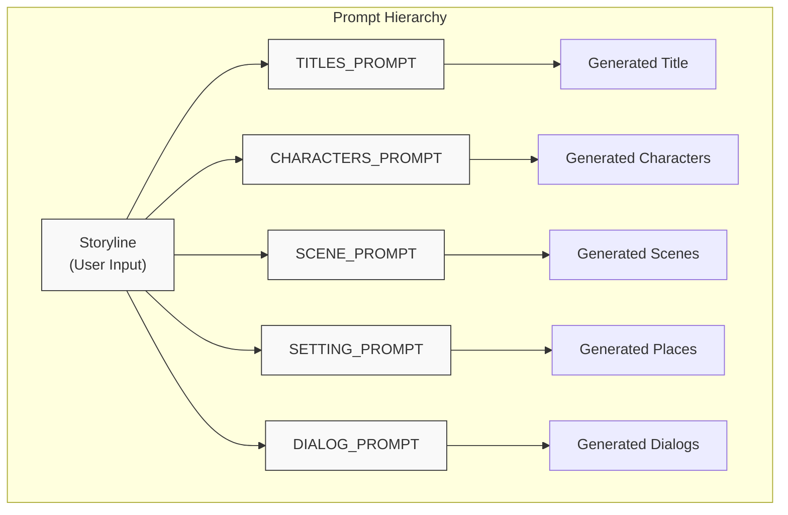
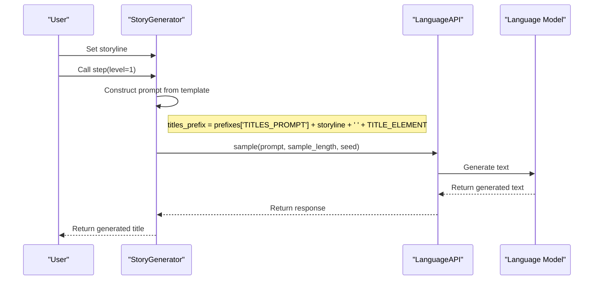
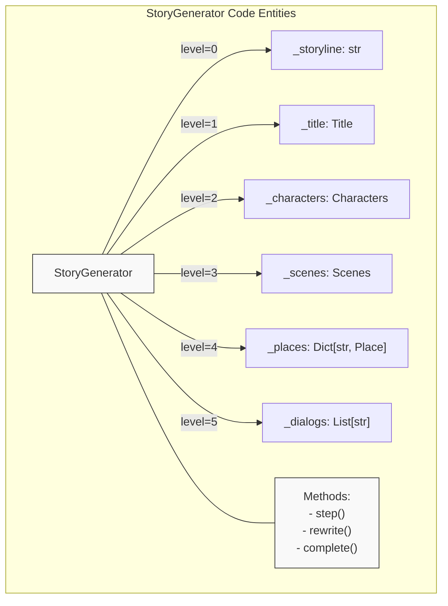

<!-- source: DeepWiki mcp.deepwiki.com · repo google-deepmind/dramatron · page 3.3 Customizing Prompts and Settings · fetched 2026-10-26 -->

# Customizing Prompts and Settings

<details>
<summary>Relevant source files</summary>

The following files were used as context for generating this wiki page:

- [README.md](README.md)
- [colab/dramatron.ipynb](colab/dramatron.ipynb)
- [dramatron-animation.gif](dramatron-animation.gif)

</details>


This page documents how to customize Dramatron's generation prompts and adjust various settings to control the output quality, style, and content. For information about the overall co-writing workflow, see [Co-Writing Workflow](#3.2). For details on setting up Dramatron with your preferred language model, see [Setting Up Dramatron](#3.1).

## Generation Parameters

Dramatron offers several parameters that control the generation process. These parameters are defined in the Colab notebook and affect the behavior of the language model during text generation.

### Core Hyperparameters

The following hyperparameters control the behavior of text generation:

| Parameter | Default | Description |
|-----------|---------|-------------|
| `DEFAULT_SEED` | 1 | Seed value for reproducible generation |
| `SAMPLING_PROB` | 0.95 | Top-p sampling probability |
| `SAMPLING_TEMP` | 1.0 | Temperature for controlling randomness |
| `SAMPLE_LENGTH_TITLE` | 64 | Maximum token length for title generation |
| `SAMPLE_LENGTH_PLACE` | 128 | Maximum token length for place descriptions |
| `SAMPLE_LENGTH` | 511 | Maximum token length for other generations |

These parameters can be adjusted in the Dramatron hyperparameters cell in the Colab notebook:

```python
#@title Dramatron hyperparameters { run: "auto" }
DEFAULT_SEED = 1  #@param {type:"integer"}
SAMPLING_PROB = 0.95  #@param {type:"slider", min:0.8, max:1.0, step:0.01}
SAMPLING_TEMP = 1.  #@param {type:"slider", min:0.8, max:1.0, step:0.01}
# ... more parameters
```

Sources: [colab/dramatron.ipynb:138-162]()

### Loop Detection and Retries

Dramatron includes parameters to handle issues like generation loops and API failures:

| Parameter | Default | Description |
|-----------|---------|-------------|
| `MAX_PARAGRAPH_LENGTH` | 1024 | Maximum paragraph length before stopping generation |
| `MAX_RETRIES` | 10 | Maximum number of retries for API calls |
| `MAX_NUM_REPETITIONS` | 3 | Maximum repetitions before detecting a loop |
| `MAX_NUM_ATTEMPTS_GET_OUT_OF_LOOP` | 3 | Maximum attempts to escape a generation loop |

Sources: [colab/dramatron.ipynb:147-161]()

## Prompt Customization

Dramatron uses a hierarchy of prompts to guide the generation process. These prompts can be customized to control the style, tone, and structure of the generated content.

### Prompt Hierarchy

The following diagram illustrates the hierarchy of prompts in Dramatron:



Sources: [colab/dramatron.ipynb:728-740](), [colab/dramatron.ipynb:752-763](), [colab/dramatron.ipynb:776-789](), [colab/dramatron.ipynb:809-823](), [colab/dramatron.ipynb:882-901]()

### Customizing Prompt Templates

The `prefixes` dictionary contains templates for each generation stage. These templates guide the language model in generating specific parts of the script. The templates can be customized to change the style, format, or creative direction of the generated content.

The `StoryGenerator` class is initialized with this `prefixes` dictionary:

```python
def __init__(
    self,
    storyline: str,
    prefixes: Dict[str, str],
    max_paragraph_length: int = 1024,
    max_paragraph_length_characters: int = (MAX_PARAGRAPH_LENGTH_CHARACTERS),
    max_paragraph_length_scenes: int = (MAX_PARAGRAPH_LENGTH_SCENES),
    num_samples: int = 1,
    client: Optional[LanguageAPI] = None,
    filter: Optional[FilterAPI] = None):
```

Sources: [colab/dramatron.ipynb:989-998]()

The following diagram shows how prompts are constructed from templates and passed to the language model:



Sources: [colab/dramatron.ipynb:728-739]()

## Generation Control Through StoryGenerator

The `StoryGenerator` class provides methods to control the generation process and customize outputs.

### Key Methods for Customization

1. **step(level, seed, idx)**: Advances to the next level of generation or regenerates a specific scene's dialog.
2. **rewrite(text, level, entity)**: Replaces generated content with custom text.
3. **complete(level, seed, entity, sample_length)**: Extends existing generated content.

Sources: [colab/dramatron.ipynb:1077-1212](), [colab/dramatron.ipynb:1227-1286](), [colab/dramatron.ipynb:1288-1362]()

### Generation Levels

Each level in the generation hierarchy can be customized individually:

| Level | Name | Description | Customization Method |
|-------|------|-------------|---------------------|
| 0 | storyline | The overall plot summary | `rewrite(text, level=0)` |
| 1 | title | Script title | `step(level=1, seed=X)` or `rewrite(text, level=1)` |
| 2 | characters | Character descriptions | `step(level=2, seed=X)` or `rewrite(text, level=2)` |
| 3 | scenes | Scene sequence | `step(level=3, seed=X)` or `rewrite(text, level=3)` |
| 4 | places | Place descriptions | `step(level=4, seed=X)` or `rewrite(text, level=4, entity=place_name)` |
| 5 | dialogs | Scene dialogs | `step(level=5, seed=X, idx=scene_idx)` or `rewrite(text, level=5, entity=scene_idx)` |

Sources: [colab/dramatron.ipynb:986-987](), [colab/dramatron.ipynb:1077-1212]()

The following diagram illustrates the relationship between these levels and the corresponding generation methods:



Sources: [colab/dramatron.ipynb:983-1014](), [colab/dramatron.ipynb:1077-1212](), [colab/dramatron.ipynb:1227-1362]()

## Customizing Language Model Integration

Dramatron uses the `LanguageAPI` class as an abstraction layer for language model integration. This can be customized to work with different language models.

### LanguageAPI Parameters

The `LanguageAPI` class accepts the following parameters for customization:

```python
def __init__(self,
             sample_length: int,
             model: Optional[str] = None,
             model_param: Optional[str] = None,
             config_sampling: Optional[dict] = None,
             seed: Optional[int] = None,
             max_retries: int = _MAX_RETRIES,
             timeout: float = _TIMEOUT):
```

Sources: [colab/dramatron.ipynb:564-572]()

The key parameters include:
- `sample_length`: Maximum length of generated text
- `model`: Name of the language model to use
- `config_sampling`: Dictionary of sampling parameters (e.g., temperature, top-p)
- `seed`: Random seed for reproducible generation

### Implementing Custom Language Model Integration

To customize the language model integration, you need to create a subclass of `LanguageAPI` and implement the `sample` method:

```python
def sample(self,
           prompt: str,
           sample_length: Optional[int] = None,
           seed: Optional[int] = None,
           num_samples: int = 1):
    """Sample model with provided prompt, optional sample_length and seed."""
    raise NotImplementedError('sample method not implemented in generic class')
```

Sources: [colab/dramatron.ipynb:616-622]()

The implementation of this method should interface with your chosen language model API and return a list of `LanguageResponse` objects.

## Customizing Text Markers and Formats

Dramatron uses a set of marker strings to structure the generated text. These markers can be customized to change the format of the generated content.

### Text Markers

| Marker | Default Value | Description |
|--------|---------------|-------------|
| `END_MARKER` | '**END**' | Marks the end of generated text |
| `STOP_MARKER` | '\n' | Marker for stopping generation |
| `CHARACTER_MARKER` | '**Character:** ' | Marker for character sections |
| `DESCRIPTION_MARKER` | '**Description:** ' | Marker for descriptions |
| `SCENES_MARKER` | '**Scenes:**' | Marker for scene sections |
| `DIALOG_MARKER` | '**Dialog:**' | Marker for dialog sections |
| `TITLE_ELEMENT` | 'Title: ' | Element for title |

Sources: [colab/dramatron.ipynb:194-210]()

### Rendering Customization

The output script is rendered using the `render_story` function, which converts the internal story representation to Fountain format. This function can be customized to change the output format or styling:

```python
def render_story(story: Story) -> str:
    """Render the story in fountain format."""
    # Lines building the output
    # ...
```

Sources: [colab/dramatron.ipynb:436-497]()

## Tracking and Managing Customizations

Dramatron keeps track of all modifications made to the story using the `interventions` dictionary in the `StoryGenerator` class.

### Intervention Tracking

Each time a modification is made through `step()`, `rewrite()`, or `complete()`, an entry is added to the `interventions` dictionary with a timestamp as the key:

```python
# Keep track of each step intervention.
timestamp = time.time()
self.interventions[timestamp] = 'STEP ' + str(level) + '\n'
```

Sources: [colab/dramatron.ipynb:1092-1093](), [colab/dramatron.ipynb:1281-1286](), [colab/dramatron.ipynb:1357-1362]()

### Diff Generation for Rewrites

When using `rewrite()` to modify content, Dramatron generates a diff to show the changes:

```python
def diff_prompt_change_str(prompt_before: str, prompt_after: str) -> str:
    """Return a text diff on prompt sets `prompt_before` and `prompt_after`."""
    # ...
```

Sources: [colab/dramatron.ipynb:905-919](), [colab/dramatron.ipynb:1229-1279]()

## Example: Customizing Character Generation

Here's an example of how to customize character generation in Dramatron:

1. Set up a custom prompt template for characters:
```python
custom_prefixes = {
    # ... other prompts ...
    "CHARACTERS_PROMPT": """Given a storyline, create a cast of complex, nuanced characters.
For each character, provide a name and a detailed description of their personality, motivations, and role in the story.

Storyline: """
    # ... other prompts ...
}
```

2. Initialize the StoryGenerator with your custom prompts:
```python
story_generator = StoryGenerator(
    storyline="A retired detective is drawn back into the world of crime solving when a series of murders matches the pattern of his most infamous unsolved case.",
    prefixes=custom_prefixes,
    client=language_api
)
```

3. Generate characters with a custom seed for variability:
```python
story_generator.step(level=2, seed=42)
```

4. Review and rewrite the generated characters if needed:
```python
# Get current characters
characters = story_generator.characters

# Rewrite a specific character
rewritten_text = """
**Character:** Detective John Marlow **Description:** A once-brilliant detective who retired after failing to solve the "Midnight Murderer" case. He's haunted by his failure and struggles with alcoholism, but still possesses keen observational skills.
"""
story_generator.rewrite(rewritten_text, level=2)
```

Sources: [colab/dramatron.ipynb:752-763](), [colab/dramatron.ipynb:983-998](), [colab/dramatron.ipynb:1077-1124](), [colab/dramatron.ipynb:1227-1249]()

## Conclusion

Customizing Dramatron's prompts and settings allows you to tailor the script generation process to your creative needs. By adjusting the prompt templates, generation parameters, and intervening at different levels of the generation hierarchy, you can guide Dramatron to produce content that aligns with your vision while still benefiting from its creative suggestions.

Remember that Dramatron is designed as a co-writing tool, not an autonomous script writer. The customization features are intended to enhance the collaborative writing process, allowing you to work alongside the system to create compelling scripts.

---

