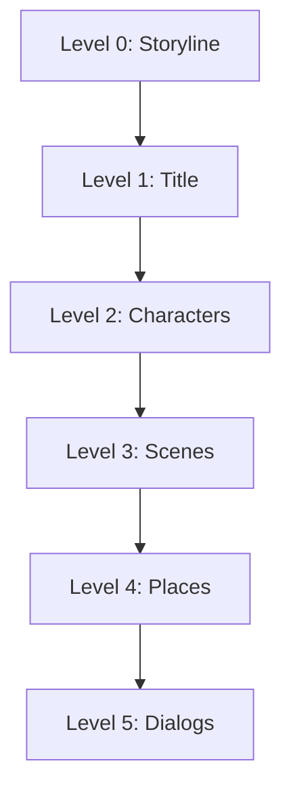
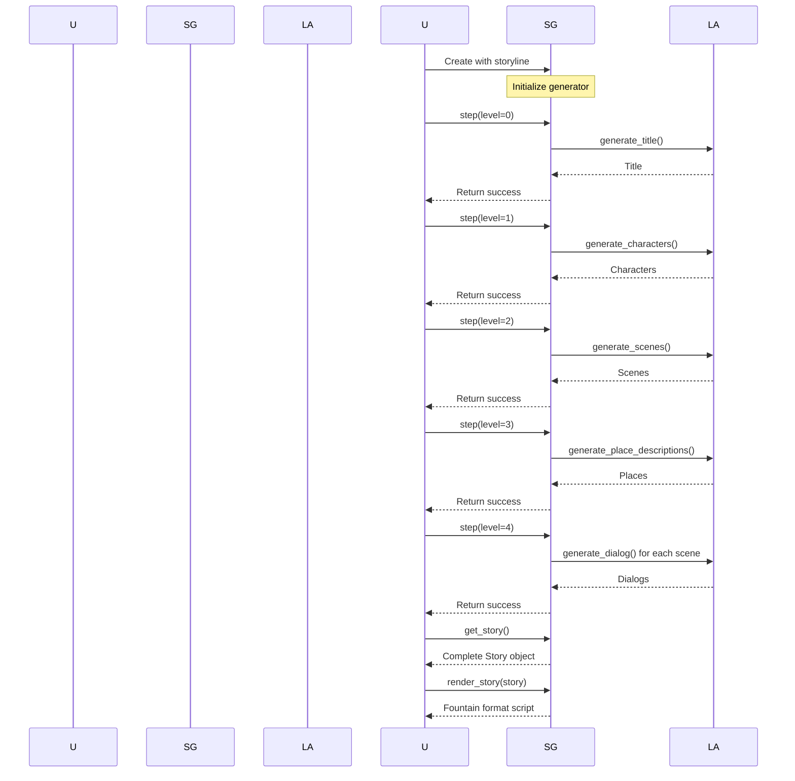
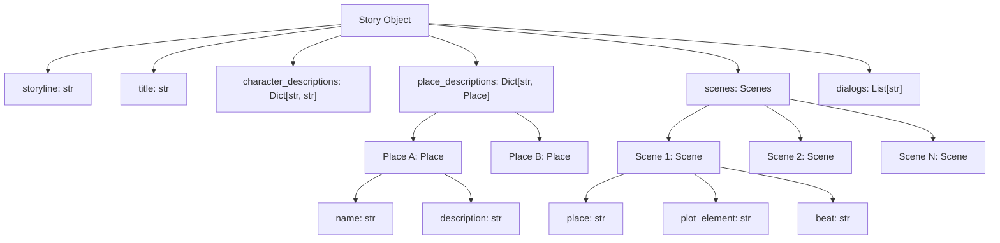

<!-- source: DeepWiki mcp.deepwiki.com · repo google-deepmind/dramatron · page 4 API Reference · fetched 2026-10-26 -->

# API Reference

<details>
<summary>Relevant source files</summary>

The following files were used as context for generating this wiki page:

- [README.md](README.md)
- [colab/dramatron.ipynb](colab/dramatron.ipynb)
- [dramatron-animation.gif](dramatron-animation.gif)

</details>


This document provides a comprehensive reference for the Dramatron API, which enables programmatic access to the script generation functionality of Dramatron. For an overview of Dramatron's concept and purpose, see [Overview](#1). For information on the general system architecture, see [System Architecture](#2).

## Core API Classes

Dramatron's API consists of several key classes that handle different aspects of the script generation process.

### StoryGenerator

The central class in Dramatron's API is `StoryGenerator`, which orchestrates the entire hierarchical script generation process. It maintains the state of the generated script and handles user interactions.

```mermaid
classDiagram
    class "StoryGenerator" {
        +storyline: str
        +prefixes: Dict[str, str]
        +client: LanguageAPI
        +filter: FilterAPI
        +title: Title
        +characters: Characters
        +scenes: Scenes
        +places: Dict[str, Place]
        +dialogs: List[str]
        +step(level, seed, idx): bool
        +rewrite(text, level, entity): void
        +complete(level, seed, entity, sample_length): void
        +get_story(): Story
    }
    
    "StoryGenerator" --> "LanguageAPI": uses
    "StoryGenerator" --> "FilterAPI": uses optionally
    "StoryGenerator" --> "Title": contains
    "StoryGenerator" --> "Characters": contains
    "StoryGenerator" --> "Scenes": contains
    "StoryGenerator" --> "Place": contains many
    "StoryGenerator" --> "Story": produces
```

Sources: [colab/dramatron.ipynb:983-1363]()

#### Key Methods

| Method | Parameters | Description |
|--------|------------|-------------|
| `__init__` | `storyline`, `prefixes`, `max_paragraph_length`, `max_paragraph_length_characters`, `max_paragraph_length_scenes`, `num_samples`, `client`, `filter` | Initializes a new story generator with the given storyline and configuration |
| `step` | `level`, `seed`, `idx` | Proceeds to the next level of hierarchical generation based on the specified level |
| `rewrite` | `text`, `level`, `entity` | Rewrites the content at the specified level with the new text |
| `complete` | `level`, `seed`, `entity`, `sample_length` | Continues generation at the specified level |
| `get_story` | - | Returns the complete story object containing all generated elements |

Sources: [colab/dramatron.ipynb:989-1225]()

#### Hierarchical Generation Levels

The `StoryGenerator` uses a hierarchical approach to generate script elements in the following sequence:



Sources: [colab/dramatron.ipynb:986-987](), [colab/dramatron.ipynb:1077-1212]()

### LanguageAPI

Abstract class that serves as the interface to large language models. Any language model integration must implement this interface.

```mermaid
classDiagram
    class "LanguageAPI" {
        +sample_length: int
        +model: str
        +model_param: str
        +default_sample_length: int
        +seed: int
        +config_sampling: dict
        +sample(prompt, sample_length, seed, num_samples): List[LanguageResponse]
    }
    
    class "LanguageResponse" {
        +prompt: str
        +prompt_length: int
        +text: str
        +text_length: int
    }
    
    class "CustomLanguageAPI" {
        +client
        +sample(prompt, sample_length, seed, num_samples): List[LanguageResponse]
    }
    
    "LanguageAPI" <|-- "CustomLanguageAPI": implements
    "LanguageAPI" ..> "LanguageResponse": returns
```

Sources: [colab/dramatron.ipynb:554-622]()

#### Key Methods

| Method | Parameters | Description |
|--------|------------|-------------|
| `__init__` | `sample_length`, `model`, `model_param`, `config_sampling`, `seed`, `max_retries`, `timeout` | Initializes a new language API with the given parameters |
| `sample` | `prompt`, `sample_length`, `seed`, `num_samples` | Generates text from the language model based on the provided prompt |

Sources: [colab/dramatron.ipynb:562-621]()

### FilterAPI

Abstract class for content filtering. Can be implemented to moderate generated content.

```mermaid
classDiagram
    class "FilterAPI" {
        +validate(text): bool
    }
```

Sources: [colab/dramatron.ipynb:625-629]()

### Data Structure Classes

Dramatron uses several specialized data classes to represent different elements of a script:

```mermaid
classDiagram
    class "Story" {
        +storyline: str
        +title: str
        +character_descriptions: Dict[str, str]
        +place_descriptions: Dict[str, Place]
        +scenes: Scenes
        +dialogs: List[str]
    }
    
    class "Title" {
        +title: str
        +from_string(text): Title
        +to_string(): str
    }
    
    class "Character" {
        +name: str
        +description: str
        +from_string(text): Character
    }
    
    class "Characters" {
        +character_descriptions: Dict[str, str]
        +from_string(text): Characters
        +to_string(): str
    }
    
    class "Scene" {
        +place: str
        +plot_element: str
        +beat: str
        +to_string(): str
    }
    
    class "Scenes" {
        +scenes: List[Scene]
        +from_string(text): Scenes
        +to_string(): str
        +num_places(): int
        +num_scenes(): int
    }
    
    class "Place" {
        +name: str
        +description: str
        +from_string(place_name, place_text): Place
        +format_prefix(name): str
        +to_string(): str
    }
    
    "Story" --> "Scenes": contains
    "Story" --> "Place": contains many
    "Scenes" --> "Scene": contains many
    "Characters" --> "Character": conceptually contains
```

Sources: [colab/dramatron.ipynb:217-406]()

## Generation Functions

Dramatron includes several specialized generation functions that produce different elements of a script:

| Function | Purpose | Parameters | Returns |
|----------|---------|------------|---------|
| `generate_text` | Core text generation function | `generation_prompt`, `client`, `filter`, `sample_length`, `max_paragraph_length`, `seed`, `num_samples`, `max_num_repetitions` | Generated text as string |
| `generate_text_no_loop` | Simplified version of `generate_text` without looping | `generation_prompt`, `client`, `filter`, `sample_length`, `max_paragraph_length`, `seed`, `num_samples` | Generated text as string |
| `generate_title` | Generates a title from a storyline | `storyline`, `prefixes`, `client`, `filter`, `seed`, `num_samples` | Title object and the prompt used |
| `generate_characters` | Generates character descriptions | `storyline`, `prefixes`, `client`, `filter`, `seed`, `max_paragraph_length`, `num_samples` | Characters object and the prompt used |
| `generate_scenes` | Generates scene sequence | `storyline`, `character_descriptions`, `prefixes`, `client`, `filter`, `seed`, `max_paragraph_length`, `num_samples` | Scenes object and the prompt used |
| `generate_place_descriptions` | Generates place descriptions | `storyline`, `scenes`, `prefixes`, `client`, `filter`, `seed`, `num_samples` | Dictionary of Place objects and list of prompts used |
| `generate_dialog` | Generates dialog for a scene | `storyline`, `scenes`, `character_descriptions`, `place_descriptions`, `prefixes`, `max_paragraph_length`, `client`, `filter`, `max_num_repetitions`, `seed`, `num_samples` | Dialog text and the prompt used |

Sources: [colab/dramatron.ipynb:637-902]()

## Utility Functions

Dramatron provides several utility functions for processing and rendering script elements:

| Function | Purpose | Parameters |
|----------|---------|------------|
| `extract_elements` | Extracts elements from text using markers | `text`, `begin`, `end` |
| `strip_remove_end` | Removes end markers from text | `text` |
| `render_story` | Renders a story as a Fountain format script | `story` |
| `render_prompts` | Renders the prompts used for generation | `prompts` |
| `place_appears_earlier` | Checks if a place appears earlier in the story | `place`, `story`, `index` |
| `character_appears_earlier` | Checks if a character appears earlier in the story | `character`, `story`, `index` |
| `detect_loop` | Detects repetition loops in generated text | `text`, `max_num_repetitions` |

Sources: [colab/dramatron.ipynb:408-546](), [colab/dramatron.ipynb:838-848]()

## Script Generation Workflow

The script generation workflow in Dramatron follows a hierarchical approach where each level builds upon previous levels:



Sources: [colab/dramatron.ipynb:1077-1225]()

## Implementing a Custom Language Model Interface

To use Dramatron with a specific language model, you need to implement the `LanguageAPI` interface:

```python
class CustomLanguageAPI(LanguageAPI):
    def __init__(self, sample_length, model, **kwargs):
        super().__init__(sample_length, model, **kwargs)
        # Initialize your specific language model client
        self._client = YourLanguageModelClient()

    def sample(self, prompt, sample_length=None, seed=None, num_samples=1):
        # Implementation specific to your language model
        # Must return a list of LanguageResponse objects
        responses = []
        for _ in range(num_samples):
            # Generate text using your language model
            generated_text = self._client.generate(prompt, max_tokens=sample_length)
            # Create a response object
            response = LanguageResponse(
                prompt=prompt,
                prompt_length=len(prompt),
                text=generated_text,
                text_length=len(generated_text)
            )
            responses.append(response)
        return responses
```

The Dramatron Colab includes examples of language model integrations that can be used as reference when implementing your own language model interface.

Sources: [colab/dramatron.ipynb:554-622]()

## Story Object Structure

The final output of the script generation process is a `Story` object with the following structure:



The `Story` object is used by the `render_story` function to generate a script in Fountain format, which is a plain text markup language for screenwriting.

Sources: [colab/dramatron.ipynb:386-405](), [colab/dramatron.ipynb:436-498]()

## Extending and Customizing Dramatron

Dramatron can be extended and customized in several ways:

1. **Custom Language Models**: Implement the `LanguageAPI` interface to use your preferred language model
2. **Content Filtering**: Implement the `FilterAPI` interface to add content moderation
3. **Prompt Templates**: Customize the prompt templates in the `prefixes` dictionary to guide the generation
4. **Generation Parameters**: Adjust generation parameters like temperature, sample length, etc.

See [Customizing Prompts and Settings](#3.3) for more details on how to customize the generation process.

Sources: [colab/dramatron.ipynb:562-621](), [colab/dramatron.ipynb:625-629]()

## Generation Parameters

Dramatron's generation behavior can be controlled through several parameters:

| Parameter | Default Value | Description |
|-----------|---------------|-------------|
| `DEFAULT_SEED` | 1 | Default seed for generation to ensure reproducibility |
| `SAMPLING_PROB` | 0.95 | Top-p sampling probability |
| `SAMPLING_TEMP` | 1.0 | Sampling temperature |
| `SAMPLE_LENGTH_TITLE` | 64 | Maximum length for title generation in tokens |
| `SAMPLE_LENGTH_PLACE` | 128 | Maximum length for place description generation in tokens |
| `SAMPLE_LENGTH` | 511 | Maximum length for other generations in tokens |
| `MAX_PARAGRAPH_LENGTH` | 1024 | Maximum length during repeated sampling in tokens |
| `MAX_NUM_REPETITIONS` | 3 | Maximum number of repetitions before resampling |

Sources: [colab/dramatron.ipynb:138-161]()

## Error Handling and Loop Detection

Dramatron includes mechanisms to handle potential issues during text generation:

1. **Loop Detection**: The `detect_loop` function identifies repetitive text patterns and triggers resampling
2. **Max Retries**: Limits the number of API call attempts for unavailable language models
3. **Timeout**: Sets a maximum waiting time for language model responses

For more details on handling generation issues, see [Handling Generation Issues](#5.1).

Sources: [colab/dramatron.ipynb:838-848](), [colab/dramatron.ipynb:550-551]()

---

