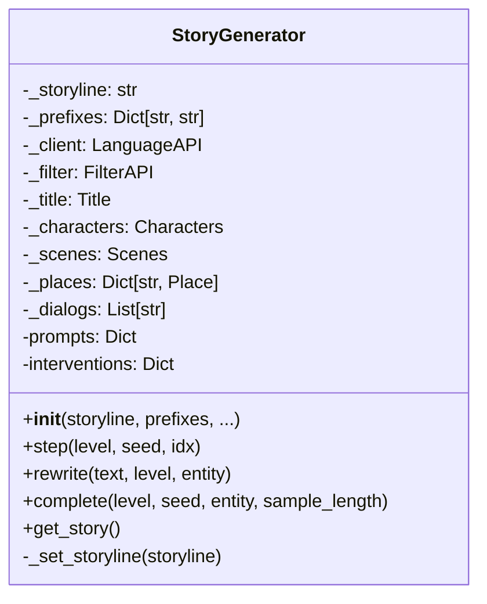
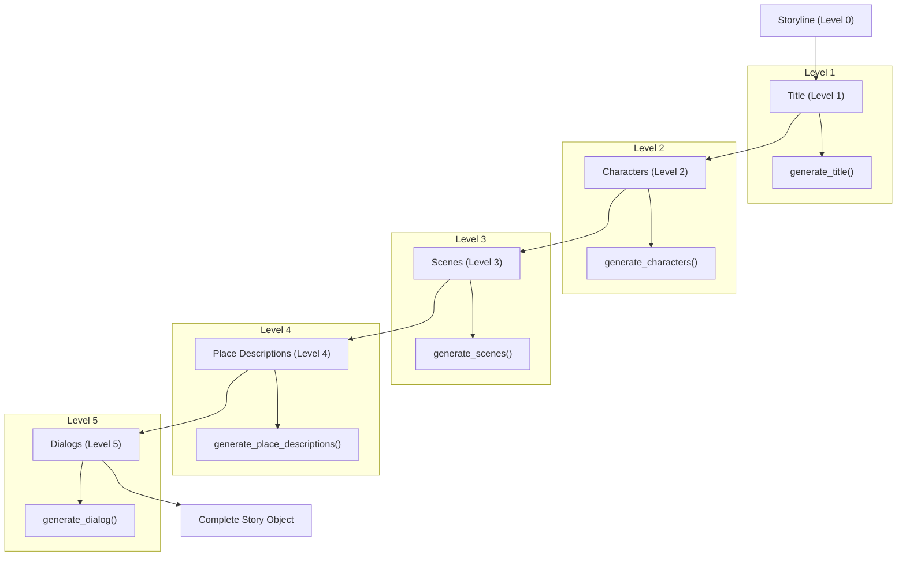
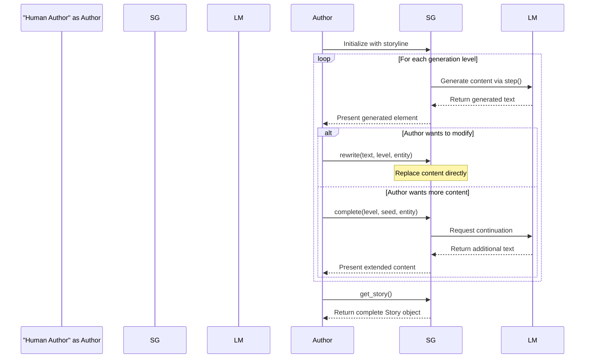
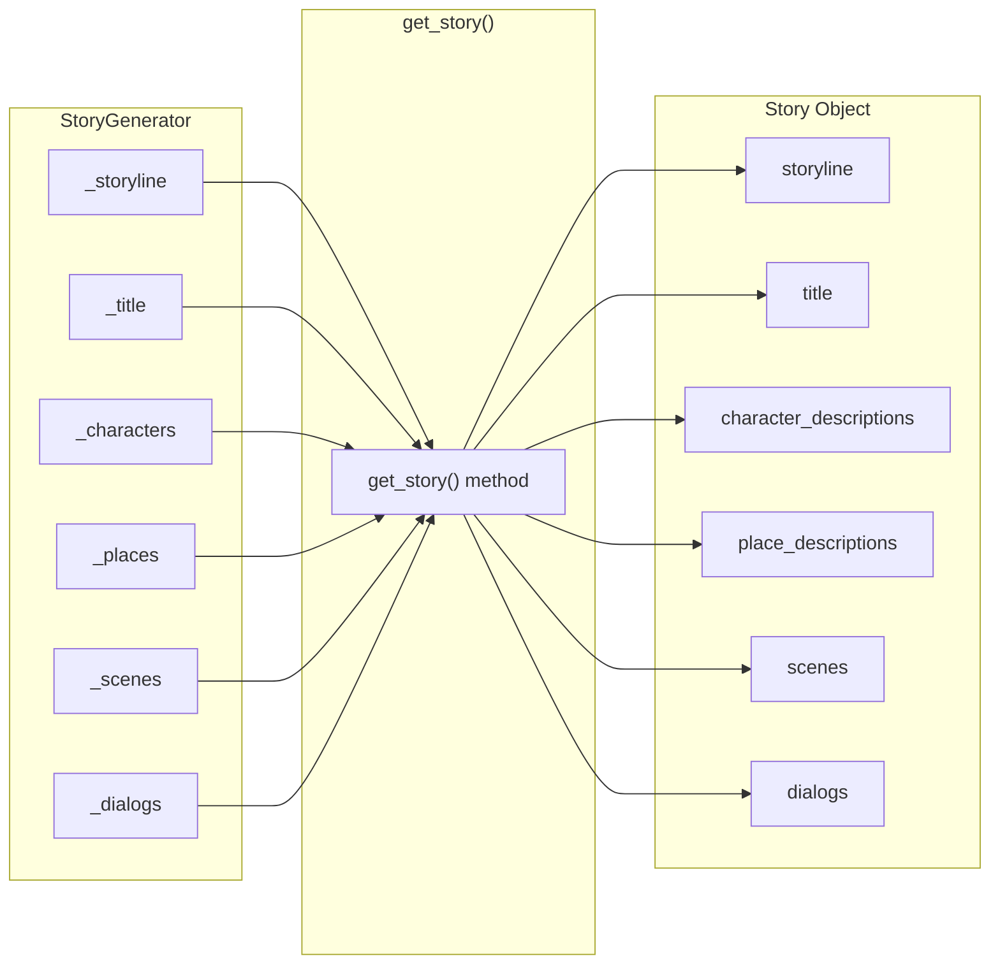

<!-- source: DeepWiki mcp.deepwiki.com · repo google-deepmind/dramatron · page 4.1 StoryGenerator Class · fetched 2026-10-26 -->

# StoryGenerator Class

<details>
<summary>Relevant source files</summary>

The following files were used as context for generating this wiki page:

- [README.md](README.md)
- [colab/dramatron.ipynb](colab/dramatron.ipynb)
- [dramatron-animation.gif](dramatron-animation.gif)

</details>


## Purpose and Overview

The StoryGenerator class is the core orchestration component of Dramatron that manages the hierarchical generation of theatre scripts and screenplays. It coordinates the step-by-step creation of script elements (title, characters, scenes, places, and dialogs) using large language models through the LanguageAPI abstraction.

For information about the overall system architecture, see [System Architecture](#2).
For details on the language model interface that StoryGenerator uses, see [LanguageAPI Interface](#4.2).

Sources: [colab/dramatron.ipynb:983-1362]()

## Class Structure and Initialization

StoryGenerator is initialized with a storyline and other configuration parameters:

```python
def __init__(self,
             storyline: str,
             prefixes: Dict[str, str],
             max_paragraph_length: int = 1024,
             max_paragraph_length_characters: int = MAX_PARAGRAPH_LENGTH_CHARACTERS,
             max_paragraph_length_scenes: int = MAX_PARAGRAPH_LENGTH_SCENES,
             num_samples: int = 1,
             client: Optional[LanguageAPI] = None,
             filter: Optional[FilterAPI] = None):
```

Key attributes include:
- `_storyline`: The central storyline that guides all generation
- `_prefixes`: Dictionary of prompt templates for different generation stages
- `_client`: LanguageAPI instance that handles text generation
- `_filter`: Optional FilterAPI instance for content moderation
- `_title`, `_characters`, `_scenes`, `_places`, `_dialogs`: Generated content
- `prompts`: Storage for generation prompts
- `interventions`: Record of user interventions in the generation process



Sources: [colab/dramatron.ipynb:989-1053]()

## Hierarchical Generation Process

The StoryGenerator implements a hierarchical, top-down approach for script generation where each element builds upon previously generated content. This process is managed by the `step()` method which handles progression through five distinct levels:



The `step()` method [colab/dramatron.ipynb:1077-1212]() takes three optional parameters:
- `level`: Which generation level to execute (defaults to current level)
- `seed`: Random seed for generation (for reproducibility)
- `idx`: For dialog generation, which scene's dialog to generate

Each level calls a specialized generation function:
1. **Level 1**: Generates title from storyline using `generate_title()`
2. **Level 2**: Generates character descriptions using `generate_characters()`
3. **Level 3**: Generates scene sequence with `generate_scenes()`
4. **Level 4**: Generates place descriptions with `generate_place_descriptions()`
5. **Level 5**: Generates dialog for each scene using `generate_dialog()`

Sources: [colab/dramatron.ipynb:1077-1212](), [colab/dramatron.ipynb:721-902]()

## User Intervention Methods

StoryGenerator supports co-writing through two key intervention methods:

### The `rewrite()` Method

```python
def rewrite(self, text, level=0, entity=None):
```

Allows complete replacement of a generated element with user-provided text:
- `text`: The new content
- `level`: Which element type to modify (0=storyline, 1=title, etc.)
- `entity`: Additional identifier (e.g., place name or scene index)

### The `complete()` Method

```python
def complete(self, level=0, seed=None, entity=None, sample_length=SAMPLE_LENGTH):
```

Continues generation from existing content:
- `level`: Which element to extend
- `seed`: Random seed for generation
- `entity`: Additional identifier
- `sample_length`: Maximum length of generated continuation

Both methods record interventions in the `interventions` dictionary with timestamps, allowing for a complete history of the co-writing process.



Sources: [colab/dramatron.ipynb:1227-1362]()

## Story Object Creation

The `get_story()` method [colab/dramatron.ipynb:1214-1225]() assembles all generated elements into a cohesive Story object:

```python
def get_story(self):
    if self._characters is not None:
        character_descriptions = get_character_descriptions(self._characters)
    else:
        character_descriptions = None
    return Story(
        storyline=self._storyline,
        title=self._title.title,
        character_descriptions=character_descriptions,
        place_descriptions=self._places,
        scenes=self._scenes,
        dialogs=self._dialogs)
```

This Story object can then be passed to the `render_story()` function to produce a formatted screenplay in Fountain format.



Sources: [colab/dramatron.ipynb:1214-1225](), [colab/dramatron.ipynb:386-406]()

## Integration with Generation Functions

StoryGenerator delegates the actual text generation to specialized helper functions. Each function follows a similar pattern:

1. Construct an appropriate prompt using `_prefixes` and previously generated content
2. Call the language model through the `_client.sample()` method
3. Parse the generated text into the appropriate data structure
4. Return both the parsed result and the prompt used (for record-keeping)

The key generation functions are:

| Function | Purpose | Called at Level |
|----------|---------|-----------------|
| `generate_title()` | Creates a title from the storyline | 1 |
| `generate_characters()` | Creates character descriptions | 2 |
| `generate_scenes()` | Creates a sequence of scenes | 3 |
| `generate_place_descriptions()` | Creates descriptions for each place | 4 |
| `generate_dialog()` | Creates dialog for each scene | 5 |

Each of these functions ultimately relies on the core text generation function `generate_text()` [colab/dramatron.ipynb:637-698](), which handles the actual interaction with the language model, including retry logic and loop detection.

Sources: [colab/dramatron.ipynb:637-902]()

## Usage Example

Here's a basic example of using StoryGenerator to create a complete script:

```python
# Initialize with a storyline and necessary components
story_generator = StoryGenerator(
    storyline="A detective investigates a mysterious disappearance in a small town.",
    prefixes=prompt_prefixes,
    client=language_api
)

# Generate title (level 1)
story_generator.step(level=1)
print(f"Generated title: {story_generator.title_str()}")

# Generate characters (level 2)
story_generator.step(level=2)

# Generate scenes (level 3)
story_generator.step(level=3)

# Generate place descriptions (level 4)
story_generator.step(level=4)

# Generate dialog for all scenes (level 5)
story_generator.step(level=5)

# Get the complete story object
story = story_generator.get_story()

# Render as a screenplay
screenplay = render_story(story)
```

For co-writing, you can intervene at any step:

```python
# Rewrite a character description after level 2
story_generator.rewrite("**Character:** Detective Smith **Description:** A grizzled veteran detective with a troubled past and a keen eye for detail.", level=2)

# Continue generating a dialog that seems incomplete (for scene index 2)
story_generator.complete(level=5, entity=2)
```

Sources: [colab/dramatron.ipynb:983-1362]()

## Conclusion

The StoryGenerator class serves as the central orchestration component in Dramatron's hierarchical script generation process. By managing the step-by-step creation of script elements while allowing for human intervention, it enables a co-writing experience where authors can collaborate with language models to create theatrical scripts and screenplays.

For more information about the co-writing workflow and best practices, see [Co-Writing Workflow](#3.2).

---

