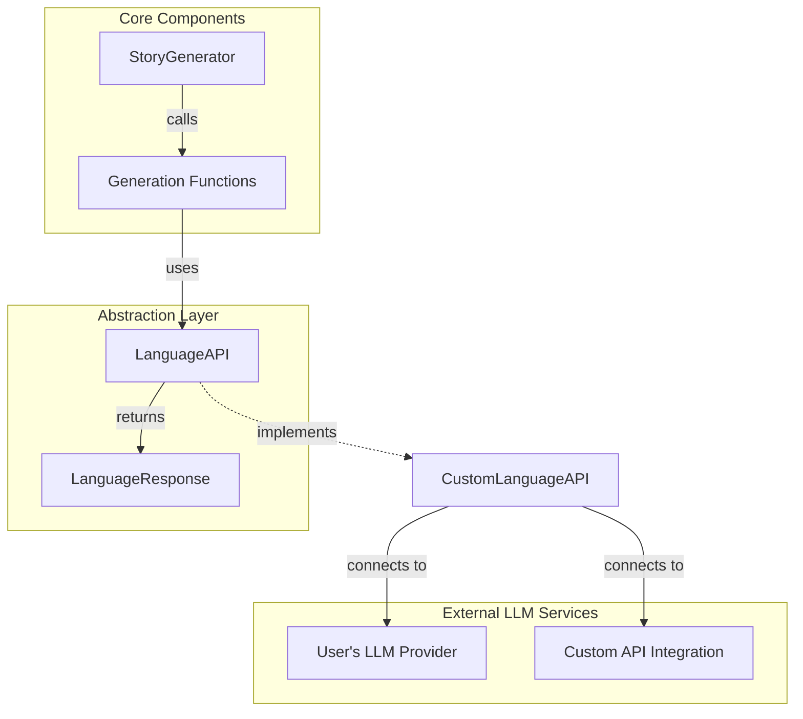
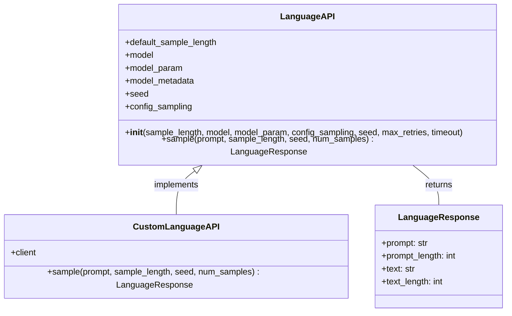
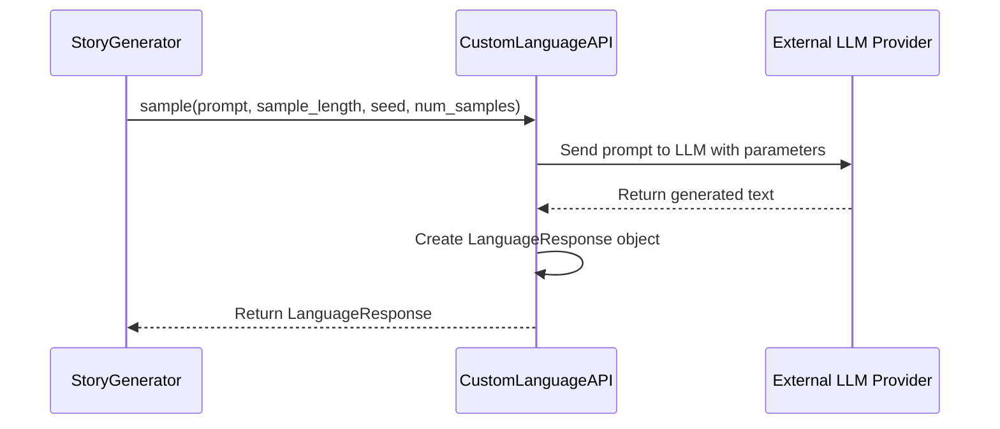
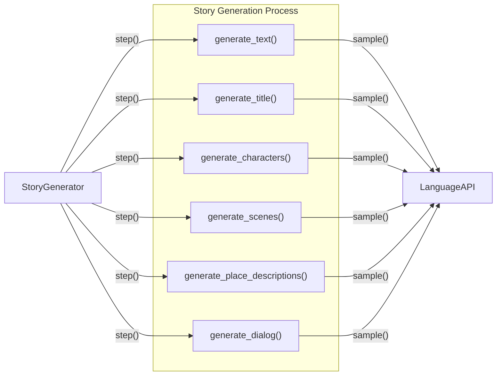

<!-- source: DeepWiki mcp.deepwiki.com · repo google-deepmind/dramatron · page 4.2 LanguageAPI Interface · fetched 2026-10-26 -->

# LanguageAPI Interface

<details>
<summary>Relevant source files</summary>

The following files were used as context for generating this wiki page:

- [README.md](README.md)
- [colab/dramatron.ipynb](colab/dramatron.ipynb)
- [dramatron-animation.gif](dramatron-animation.gif)

</details>


## Purpose and Overview

The LanguageAPI interface serves as an abstraction layer between Dramatron's story generation components and the underlying large language models (LLMs). It provides a standardized way to interact with different language model providers, allowing Dramatron to remain model-agnostic while supporting various text generation backends.

This page documents the LanguageAPI class design, implementation requirements, and how to create custom language model integrations. For information about the StoryGenerator class that uses this interface, see [StoryGenerator Class](#4.1).

Sources: [colab/dramatron.ipynb:547-622]()

## Position in System Architecture

The LanguageAPI sits at a critical junction in Dramatron's architecture, serving as the translation layer between the core generation logic and external LLM services.



Sources: [colab/dramatron.ipynb:547-622](), [colab/dramatron.ipynb:983-1364]()

## Class Definition

The LanguageAPI is defined as an abstract base class that provides a common interface for language model interactions. All concrete implementations must adhere to this interface.



### LanguageAPI Properties

| Property | Description |
|----------|-------------|
| `default_sample_length` | The default length for generated text samples |
| `model` | The model name being used |
| `model_param` | Additional model parameters |
| `model_metadata` | Metadata about the model (defaults to None) |
| `seed` | Random seed for reproducible generation |
| `config_sampling` | Configuration for sampling parameters |

Sources: [colab/dramatron.ipynb:561-622]()

## Core Methods

### `__init__` Method

The constructor for LanguageAPI takes several parameters that configure how the language model should behave:

```python
def __init__(self,
             sample_length: int,
             model: Optional[str] = None,
             model_param: Optional[str] = None,
             config_sampling: Optional[dict] = None,
             seed: Optional[int] = None,
             max_retries: int = _MAX_RETRIES,
             timeout: float = _TIMEOUT):
```

| Parameter | Description |
|-----------|-------------|
| `sample_length` | Length of text to sample from model |
| `model` | The model name to use |
| `model_param` | Additional model parameter |
| `config_sampling` | Sampling parameters (temperature, top-p, etc.) |
| `seed` | Random seed for sampling |
| `max_retries` | Maximum number of retries for API calls |
| `timeout` | Maximum timeout for API calls |

Sources: [colab/dramatron.ipynb:564-590]()

### `sample` Method

The most important method that must be implemented by any LanguageAPI subclass:

```python
def sample(self,
           prompt: str,
           sample_length: Optional[int] = None,
           seed: Optional[int] = None,
           num_samples: int = 1):
    """Sample model with provided prompt, optional sample_length and seed."""
    raise NotImplementedError('sample method not implemented in generic class')
```

This method should:
1. Send the prompt to a language model
2. Generate text based on the provided parameters
3. Return a `LanguageResponse` or list of responses containing the generated text

Sources: [colab/dramatron.ipynb:616-622]()

## LanguageResponse Type

The `LanguageResponse` is a named tuple that contains both the prompt and the generated text, along with their lengths:

```python
class LanguageResponse(NamedTuple):
  prompt: str
  prompt_length: int
  text: str
  text_length: int
```

Sources: [colab/dramatron.ipynb:554-559]()

## Implementing a Custom Language API

To use Dramatron with your preferred language model, you need to implement a custom class that inherits from `LanguageAPI` and implements the `sample` method. The README states that the Colab is provided "unplugged" without a language model interface.

Here's the pattern for implementing a custom language API:



The implementation should:
1. Handle communication with your LLM provider
2. Properly format requests according to your provider's API
3. Process responses and handle errors
4. Return the results in the expected format

Sources: [colab/dramatron.ipynb:561-622](), [README.md:7-9]()

## Usage in Story Generation

The `StoryGenerator` class uses the `LanguageAPI` to generate various elements of a script through successive calls to the language model. Here's how the components interact:



Each generation function follows a similar pattern:
1. Construct a prompt using the appropriate template
2. Call the language model via the LanguageAPI interface
3. Process and structure the generated text
4. Return the structured data

Sources: [colab/dramatron.ipynb:637-902](), [colab/dramatron.ipynb:1077-1209]()

## Example: Integration with Google's Gemini API

The repository shows preparation for integration with Google's Gemini API, which requires specific dependencies:

```python
!pip install -q -U google-generativeai
```

A complete implementation would need to:
1. Import the Google Generative AI library
2. Set up authentication with an API key
3. Create a LanguageAPI subclass that uses the Gemini client
4. Implement the sample method to call Gemini and return results

Sources: [colab/dramatron.ipynb:76-80](), [colab/dramatron.ipynb:18-20]()

## Key Parameters for Generation

When using the LanguageAPI, several hyperparameters control the text generation process:

| Parameter | Default | Description |
|-----------|---------|-------------|
| `SAMPLING_PROB` | 0.95 | Top-p probability for sampling |
| `SAMPLING_TEMP` | 1.0 | Temperature for sampling |
| `SAMPLE_LENGTH` | 511 | Default max tokens for generation |
| `SAMPLE_LENGTH_TITLE` | 64 | Max tokens for title generation |
| `SAMPLE_LENGTH_PLACE` | 128 | Max tokens for place description |
| `MAX_PARAGRAPH_LENGTH` | 1024 | Max length during sampling |
| `MAX_NUM_REPETITIONS` | 3 | Loop detection threshold |

These parameters are used when calling the LanguageAPI's sample method and affect the quality and characteristics of the generated text.

Sources: [colab/dramatron.ipynb:142-156]()

## Error Handling and Robustness

The LanguageAPI implementation should handle several scenarios for robust operation:

1. **API Unavailability**: The system has a built-in retry mechanism with `MAX_RETRIES` attempts
2. **Loop Detection**: Generation functions check for repetitive text using `detect_loop()`
3. **Content Filtering**: Optional integration with filtering APIs for content moderation

A complete implementation should properly propagate errors and provide meaningful feedback to the user.

Sources: [colab/dramatron.ipynb:637-699](), [colab/dramatron.ipynb:838-848]()

## Conclusion

The LanguageAPI interface is a critical component that enables Dramatron to work with different language model providers while maintaining a consistent interface for the core generation logic. By implementing this interface, users can connect Dramatron to their preferred LLM and customize the generation process to their needs.

For implementation details of the generation functions that use this interface, see [Generation Functions](#4.3). For information about handling generation issues and content moderation, see [Handling Generation Issues](#5.1).

---

