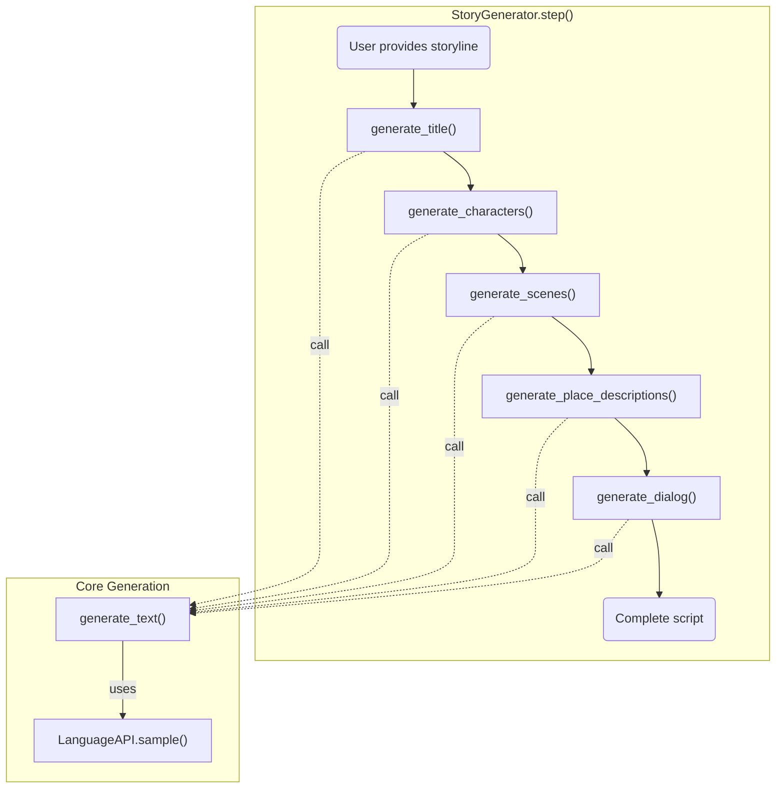
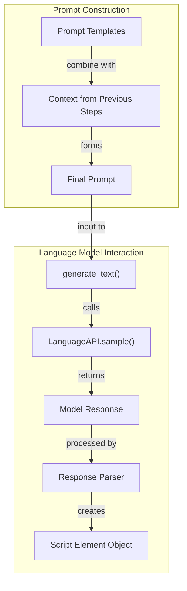
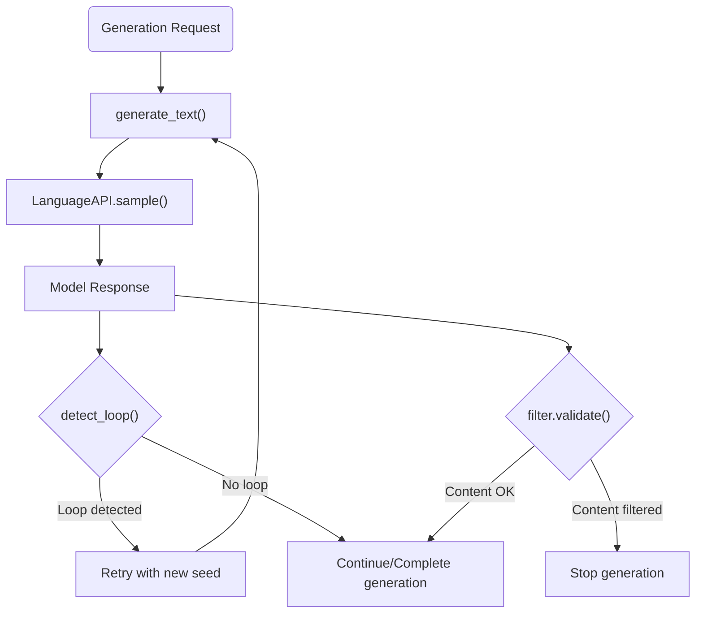

<!-- source: DeepWiki mcp.deepwiki.com · repo google-deepmind/dramatron · page 4.3 Generation Functions · fetched 2026-10-26 -->

# Generation Functions

<details>
<summary>Relevant source files</summary>

The following files were used as context for generating this wiki page:

- [README.md](README.md)
- [colab/dramatron.ipynb](colab/dramatron.ipynb)
- [dramatron-animation.gif](dramatron-animation.gif)

</details>


## Purpose and Scope

This page documents the generation functions in Dramatron, which are responsible for producing script elements through interactions with large language models. These functions form the core of Dramatron's hierarchical generation process, creating everything from titles to dialogs based on user-provided storylines. 

For information about the overall generation process and how these functions fit into the broader system architecture, see [System Architecture](#2) and [Hierarchical Generation Process](#2.2). For specific details about the `StoryGenerator` class that orchestrates these functions, see [StoryGenerator Class](#4.1).

## Core Text Generation Functions

At the heart of Dramatron's generation capability are two primary functions that handle direct interaction with language models.

### generate_text

The `generate_text` function is the main text generation function that calls the language model through the `LanguageAPI` interface. It handles various aspects of text generation:

- Accepts a generation prompt and other parameters
- Makes calls to the language model via the provided client
- Handles content filtering through an optional filter API
- Detects and mitigates text generation loops
- Respects maximum length constraints
- Stops generation when end markers are found

```python
def generate_text(generation_prompt, client, filter, sample_length, 
                  max_paragraph_length, seed, num_samples, max_num_repetitions):
    # Generate text using language model and handle potential issues
```

Parameters:
- `generation_prompt`: The text prompt to send to the language model
- `client`: LanguageAPI instance for interacting with the LLM
- `filter`: Optional FilterAPI for content moderation
- `sample_length`: Maximum length of text to sample in each API call
- `max_paragraph_length`: Overall length limit for generated content
- `seed`: Optional seed for reproducible generation
- `num_samples`: Number of samples to generate
- `max_num_repetitions`: Threshold for detecting repetition loops

Sources: [colab/dramatron.ipynb:637-698]()

### generate_text_no_loop

A simplified variant of `generate_text` that generates text without repeated prompting or loop detection.

```python
def generate_text_no_loop(generation_prompt, client, filter, sample_length, 
                         max_paragraph_length, seed, num_samples):
    # Generate text in a single call without loop detection
```

This function is primarily used for shorter, simpler generation tasks like titles.

Sources: [colab/dramatron.ipynb:702-718]()

## Generation Function Workflow

The following diagram shows how the generation functions are executed within Dramatron's hierarchical process:



Sources: [colab/dramatron.ipynb:1077-1225]()

## Hierarchical Generation Functions

Dramatron uses specialized functions for generating each element of a script. These functions build upon each other in a hierarchical manner, with each stage incorporating outputs from previous stages.

### generate_title

Generates a title based on the storyline.

```python
def generate_title(storyline, prefixes, client, filter, seed, num_samples):
    # Generate a title, return a Title object and the prefix used
```

This function:
1. Combines the title-specific prompt template with the user's storyline
2. Calls `generate_text_no_loop` with the combined prompt
3. Parses the result into a `Title` object
4. Returns both the title and the prompt used (for traceability)

Sources: [colab/dramatron.ipynb:721-739]()

### generate_characters

Generates character descriptions for the script based on the storyline.

```python
def generate_characters(storyline, prefixes, client, filter, seed, 
                       max_paragraph_length, num_samples):
    # Generate characters, return a Characters object and the prefix used
```

This function:
1. Creates a prompt combining character template and storyline
2. Calls `generate_text` to generate character descriptions
3. Parses the results into a `Characters` object
4. Returns both the characters and the prompt used

Sources: [colab/dramatron.ipynb:742-763]()

### generate_scenes

Generates scenes based on the storyline and character descriptions.

```python
def generate_scenes(storyline, character_descriptions, prefixes, client, 
                   filter, seed, max_paragraph_length, num_samples):
    # Generate scenes, return a Scenes object and the prefix used
```

This function:
1. Creates a prompt combining the scene template, storyline, and character descriptions
2. Calls `generate_text` to generate scene descriptions
3. Parses the results into a `Scenes` object
4. Returns both the scenes and the prompt used

Sources: [colab/dramatron.ipynb:766-789]()

### generate_place_descriptions

Generates descriptions for places mentioned in scenes.

```python
def generate_place_descriptions(storyline, scenes, prefixes, client, 
                               filter, seed, num_samples):
    # Generate place descriptions, return dict of Place objects and prefixes used
```

This function:
1. Extracts unique place names from the generated scenes
2. For each place, creates a prompt combining setting template and place name
3. Calls `generate_text` for each place
4. Parses results into `Place` objects
5. Returns both the place descriptions and the prompts used

Sources: [colab/dramatron.ipynb:792-822]()

### generate_dialog

Generates dialog for a scene based on the storyline, characters, and places.

```python
def generate_dialog(storyline, scenes, character_descriptions, place_descriptions, 
                   prefixes, max_paragraph_length, client, filter, 
                   max_num_repetitions, seed, num_samples):
    # Generate dialog, return dialog text and the prefix used
```

This function:
1. Assembles a comprehensive prompt including place details, characters in the scene, plot elements, and the scene's beat
2. Calls `generate_text` with loop detection enabled
3. Returns both the generated dialog and the prompt used

Sources: [colab/dramatron.ipynb:851-902]()

## Generation Function Components and Data Flow

The following diagram illustrates the components and data flow for the generation functions:

```mermaid
classDiagram
    class "StoryGenerator" {
        step()
        rewrite()
        complete()
    }
    
    class "generate_title()" {
        input: storyline
        output: Title, prompt
    }
    
    class "generate_characters()" {
        input: storyline
        output: Characters, prompt
    }
    
    class "generate_scenes()" {
        input: storyline, character_descriptions
        output: Scenes, prompt
    }
    
    class "generate_place_descriptions()" {
        input: storyline, scenes
        output: Dict[str, Place], prompts
    }
    
    class "generate_dialog()" {
        input: storyline, scenes, characters, places
        output: dialog_text, prompt
    }
    
    class "generate_text()" {
        input: prompt, client, parameters
        output: generated_text
    }
    
    class "LanguageAPI" {
        sample()
    }
    
    class "FilterAPI" {
        validate()
    }
    
    StoryGenerator --> generate_title
    StoryGenerator --> generate_characters
    StoryGenerator --> generate_scenes
    StoryGenerator --> generate_place_descriptions
    StoryGenerator --> generate_dialog
    
    generate_title --> generate_text
    generate_characters --> generate_text
    generate_scenes --> generate_text
    generate_place_descriptions --> generate_text
    generate_dialog --> generate_text
    
    generate_text --> LanguageAPI
    generate_text ..> FilterAPI
```

Sources: [colab/dramatron.ipynb:637-902]()

## Helper Functions

Several helper functions support the generation process, handling tasks like text extraction, loop detection, and prompt summarization.

### extract_elements

Extracts elements from text based on begin and end markers.

```python
def extract_elements(text, begin, end):
    # Extract substrings from text that occur between begin and end markers
```

This function is used throughout the parsing process to extract structured elements from generated text.

Sources: [colab/dramatron.ipynb:408-421]()

### prefix_summary

Assembles the summary part of the dialog prefix.

```python
def prefix_summary(storyline, scenes, concatenate_scenes_in_summary):
    # Create a summary prefix for dialog generation
```

Used to create continuity in dialog generation by summarizing previous scenes.

Sources: [colab/dramatron.ipynb:827-836]()

### detect_loop

Detects repetitive loops in generated text.

```python
def detect_loop(text, max_num_repetitions):
    # Identify repetitive patterns in generated text
```

This function helps prevent the language model from falling into repetition loops.

Sources: [colab/dramatron.ipynb:838-848]()

## Prompt Construction and Language Model Integration

The generation functions construct prompts by combining predefined templates (stored in the `prefixes` dictionary) with context from previous generation steps. The diagram below illustrates how prompts are constructed and passed to the language model:



Sources: [colab/dramatron.ipynb:637-902]()

## Content Filtering and Loop Detection

The generation functions include two important safety mechanisms:

1. **Content Filtering**: An optional `FilterAPI` can validate generated text for inappropriate content.

2. **Loop Detection**: The `detect_loop` function identifies repetitive patterns in the generated text, and `generate_text` uses this to request regeneration when repetition is detected.



Sources: [colab/dramatron.ipynb:637-698](), [colab/dramatron.ipynb:838-848]()

## Integration with StoryGenerator

The `StoryGenerator` class orchestrates the generation functions through its `step` method, which processes each level of the hierarchical generation:

1. Level 1: Title generation
2. Level 2: Character generation
3. Level 3: Scene generation
4. Level 4: Place description generation 
5. Level 5: Dialog generation

Each step calls the appropriate generation function and stores the results for use in subsequent steps. The `rewrite` and `complete` methods also use the generation functions to modify or extend existing content.

Sources: [colab/dramatron.ipynb:983-1362]()

## Generation Function Parameters

The following table summarizes the key parameters used across generation functions:

| Parameter | Description | Default Value |
|-----------|-------------|---------------|
| `storyline` | The user-provided storyline | N/A |
| `prefixes` | Dictionary of prompt templates | N/A |
| `client` | The LanguageAPI instance | N/A |
| `filter` | Optional FilterAPI for content moderation | None |
| `sample_length` | Maximum length for each LLM sampling call | 511 tokens |
| `max_paragraph_length` | Maximum overall generated text length | 1024 tokens |
| `seed` | Random seed for reproducible generation | 1 |
| `num_samples` | Number of samples to generate from the LLM | 1 |
| `max_num_repetitions` | Threshold for detecting repetitive text | 3 |

Sources: [colab/dramatron.ipynb:142-161]()

## Conclusion

The generation functions in Dramatron form the core of its script generation capabilities. They interact with large language models through a clean abstraction layer, construct appropriate prompts based on context, and handle various edge cases like content filtering and repetition detection. These functions are orchestrated by the `StoryGenerator` class to produce complete scripts in a hierarchical manner, from storyline to dialog.

---

