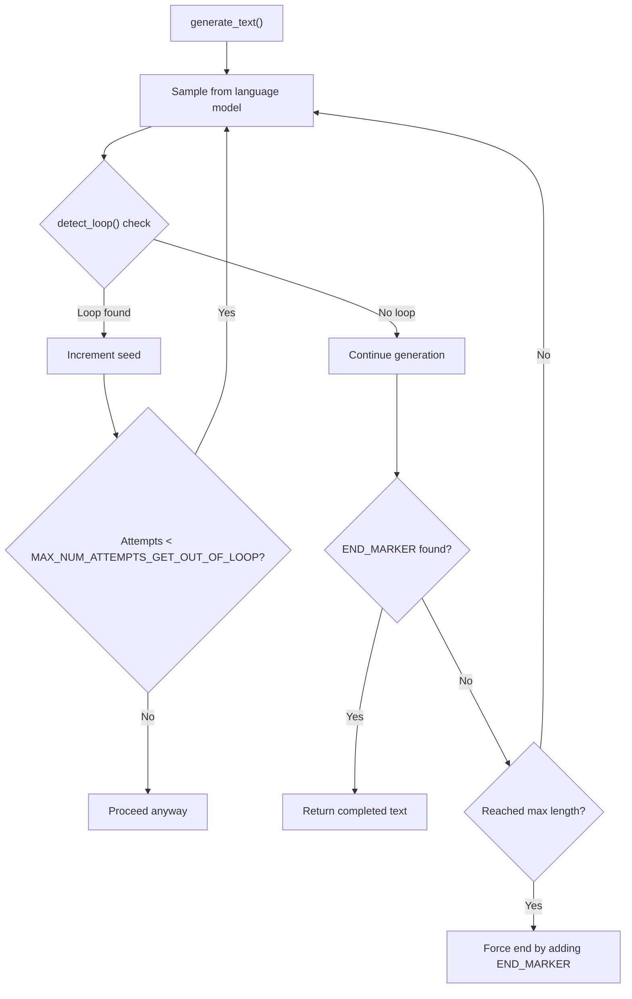
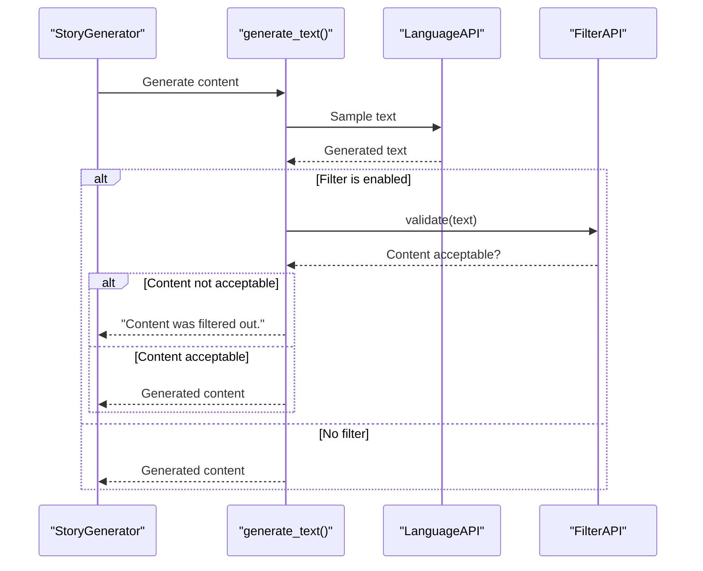
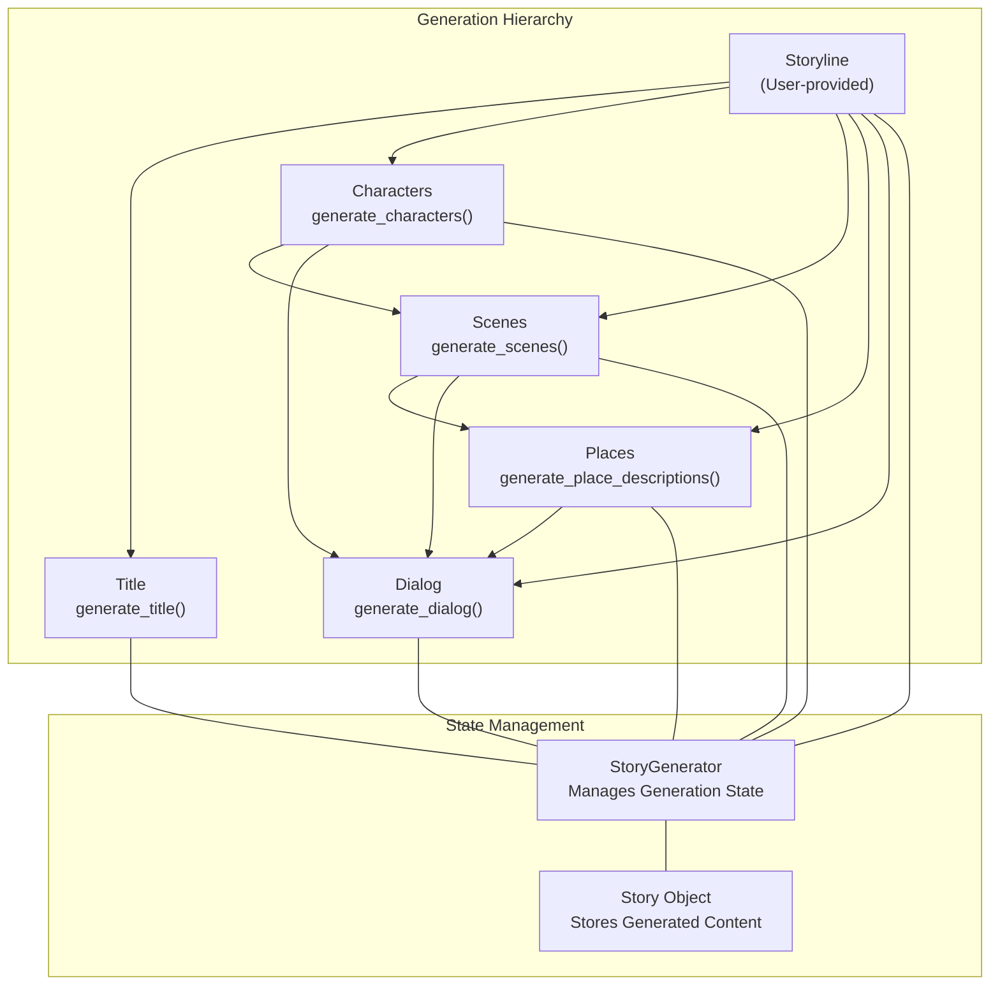
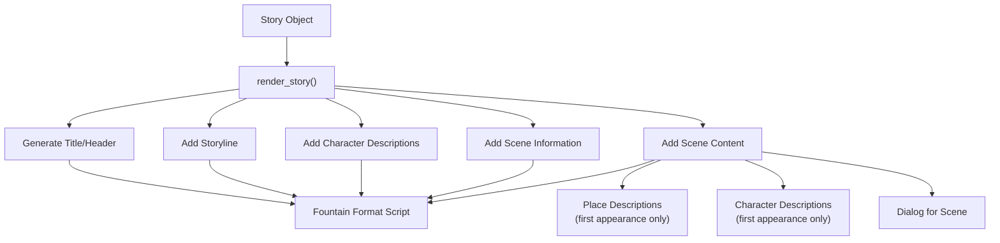
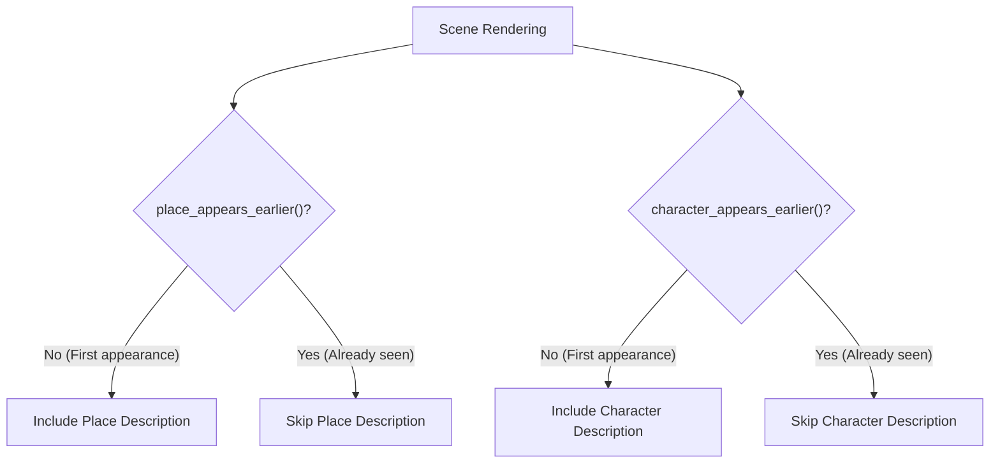
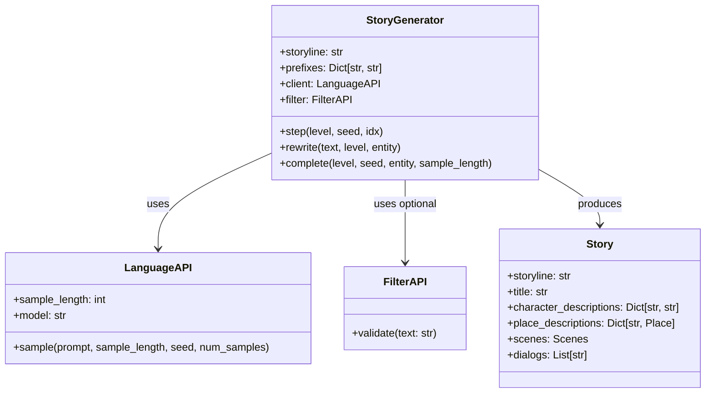

<!-- source: DeepWiki mcp.deepwiki.com · repo google-deepmind/dramatron · page 5 Advanced Topics · fetched 2026-10-26 -->

# Advanced Topics

<details>
<summary>Relevant source files</summary>

The following files were used as context for generating this wiki page:

- [README.md](README.md)
- [colab/dramatron.ipynb](colab/dramatron.ipynb)
- [docs/details.html](docs/details.html)
- [dramatron-animation.gif](dramatron-animation.gif)

</details>


## Purpose and Scope

This document covers advanced aspects of working with Dramatron that go beyond the basic usage patterns. It focuses on techniques for handling common generation issues and understanding the Fountain format output. For information about customizing prompts and adjusting generation settings, see [Customizing Prompts and Settings](#3.3). For detailed API documentation, refer to the [API Reference](#4).

## Handling Generation Issues

When working with large language models for creative text generation, several challenges can arise including repetitive patterns, inappropriate content, and incoherent outputs. Dramatron includes built-in mechanisms to address these issues.

### Loop Detection and Prevention

Text generation models often get stuck in repetitive patterns. Dramatron implements an automatic loop detection system to identify and handle these situations.

**Loop Detection Flow**



The core of this functionality is the `detect_loop()` function, which works by:

1. Splitting the generated text into blocks (separated by double newlines)
2. Counting occurrences of each block
3. If any block repeats more than `MAX_NUM_REPETITIONS` times (default: 3), a loop is detected
4. When a loop is detected, the system tries to recover by incrementing the seed value

Sources: [colab/dramatron.ipynb:838-848]()

### Content Moderation

Dramatron optionally supports content moderation through the `FilterAPI` interface. This can be implemented using services like the Perspective API to filter potentially offensive or inappropriate content.

**Content Moderation Process**



The content moderation check occurs in the `generate_text` function:

```
if filter is not None and not filter.validate(response.text):
  return 'Content was filtered out.' + END_MARKER
```

Sources: [colab/dramatron.ipynb:667-668](), [README.md:21-23]()

### Managing Repetition Through Parameter Tuning

Beyond loop detection, you can control generation quality by adjusting various parameters:

| Parameter | Default | Effect When Increased | Effect When Decreased |
|-----------|---------|----------------------|----------------------|
| `SAMPLING_TEMP` | 1.0 | More diverse, creative outputs | More focused, deterministic outputs |
| `SAMPLING_PROB` | 0.95 | More diverse token selection | More focused on highest probability tokens |
| `MAX_NUM_REPETITIONS` | 3 | More tolerance for repetition | Stricter loop detection |
| `MAX_NUM_ATTEMPTS_GET_OUT_OF_LOOP` | 3 | More attempts to fix loops | Quicker fallback to proceeding with generation |
| `MAX_PARAGRAPH_LENGTH` | 1024 | Allows longer generations | Forces earlier completion |

Sources: [colab/dramatron.ipynb:143-159]()

### Hierarchical Generation for Consistency

Dramatron uses a hierarchical generation approach to maintain consistency across longer texts. This helps prevent the "forgetting" problem common in large language models.

**Hierarchical Generation Flow**



This approach ensures that:
1. Each generation step has access to results from previous steps
2. Lower-level elements (like dialog) are informed by higher-level elements (like characters and scenes)
3. Consistency is maintained across the entire script

Sources: [colab/dramatron.ipynb:722-902](), [docs/details.html:32-37]()

## Fountain Format Output

### Understanding the Script Rendering Process

Dramatron renders the generated story into the Fountain format, a plain text markup syntax designed for screenplays. This makes the output compatible with screenwriting software while remaining human-readable.

**Script Rendering Flow**



The rendering process is handled by the `render_story` function, which organizes the story components into the proper screenplay structure:

Sources: [colab/dramatron.ipynb:437-499]()

### Fountain Format Elements

The Fountain format uses specific syntax conventions to represent screenplay elements:

| Screenplay Element | How It Appears in Output | Implementation Detail |
|-------------------|--------------------------|----------------------|
| Title and Author | At the beginning of the script | Added with specific formatting |
| Scene Headings | `INT/EXT. LOCATION - Scene #` | Generated using scene place and index |
| Place Descriptions | First time a location appears | Uses `place_appears_earlier()` to check |
| Character Introductions | First time a character appears | Uses `character_appears_earlier()` to check |
| Dialog | Character name followed by dialogue | Extracted from generated dialog text |

**Script Structure Example:**
```
Title: The Generated Title
Author: Co-written by ________ and Dramatron

====

The script is based on the storyline:
A scientist discovers time travel and must prevent a catastrophe.

Dr. Emma Stone: Brilliant physicist with a troubled past.
John Harris: Government agent assigned to monitor Emma's research.

====

INT/EXT. LABORATORY - Scene 1

A high-tech lab filled with complex equipment, computer screens displaying equations, and a prototype time machine in the center.

DR. EMMA STONE
(excitedly)
It worked! The calculations were correct!

JOHN HARRIS
(entering the room)
Dr. Stone, I need to speak with you immediately.
```

Sources: [colab/dramatron.ipynb:437-499]()

### First Appearance Tracking

Dramatron intelligently manages script elements by only including full descriptions the first time a place or character appears:



These helper functions track which elements have already appeared:

Sources: [colab/dramatron.ipynb:502-519]()

### Post-Processing the Generated Script

The Fountain format output is intended as a starting point for human writers. Typical post-processing tasks include:

| Task | Description | Consideration |
|------|-------------|---------------|
| Content Review | Check for narrative coherence | Focus on character motivations and plot logic |
| Format Cleanup | Ensure proper screenplay formatting | Fix character name capitalization, formatting |
| Dialog Editing | Make dialog sound natural | Remove repetitive phrases, add nuance |
| Scene Organization | Adjust scene structure and flow | Combine or split scenes as needed |
| Adding Directions | Include stage/camera directions | Add parentheticals for performance notes |
| Final Formatting | Convert to industry standard format | Export to PDF for professional use |

Sources: [README.md:12-15](), [docs/details.html:31-38]()

## Troubleshooting Common Issues

### Generation Quality Issues

| Problem | Possible Cause | Solution |
|---------|---------------|----------|
| Text cuts off before completion | Model generates END_MARKER too early | Increase `SAMPLE_LENGTH` or `MAX_PARAGRAPH_LENGTH` |
| Repetitive patterns not detected | Loop threshold too high | Decrease `MAX_NUM_REPETITIONS` |
| Dialog is generic/unrealistic | Insufficient context | Edit character descriptions to be more detailed |
| Inconsistent character behavior | Character descriptions not specific enough | Rewrite character descriptions with clearer traits |
| Generated content gets filtered | Content deemed inappropriate | Revise storyline/prompts to avoid sensitive topics |

### Script Format Issues

| Problem | Possible Cause | Solution |
|---------|---------------|----------|
| Missing place descriptions | Place appears with slight name variations | Standardize place names across scenes |
| Characters appear without introduction | Character name not in scene beat | Edit scene beat to explicitly mention characters |
| Dialog not attributed correctly | Character name format inconsistency | Standardize character naming in post-processing |
| Fountain syntax errors | Special characters in names or descriptions | Clean up special characters in post-processing |

Sources: [colab/dramatron.ipynb:638-698](), [colab/dramatron.ipynb:983-1027]()

## Advanced Customization Techniques

For more advanced users, Dramatron supports custom implementations of its core interfaces:

**Core Class Structure**



To implement custom language model integration or content filtering:

1. Subclass `LanguageAPI` and implement the `sample()` method
2. Subclass `FilterAPI` and implement the `validate()` method
3. Pass these custom implementations to the `StoryGenerator` constructor

Sources: [colab/dramatron.ipynb:554-631](), [colab/dramatron.ipynb:983-1027]()

---

