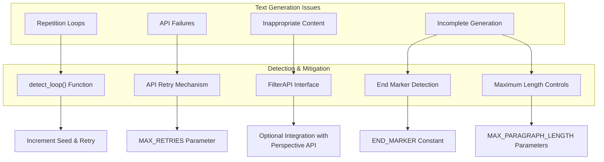
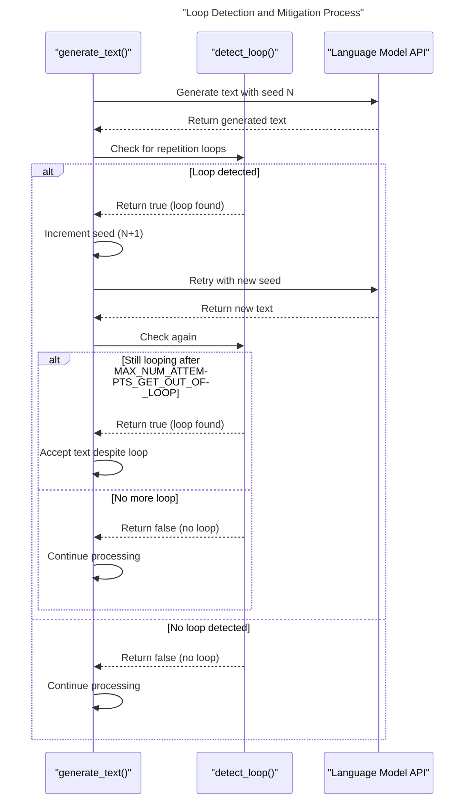
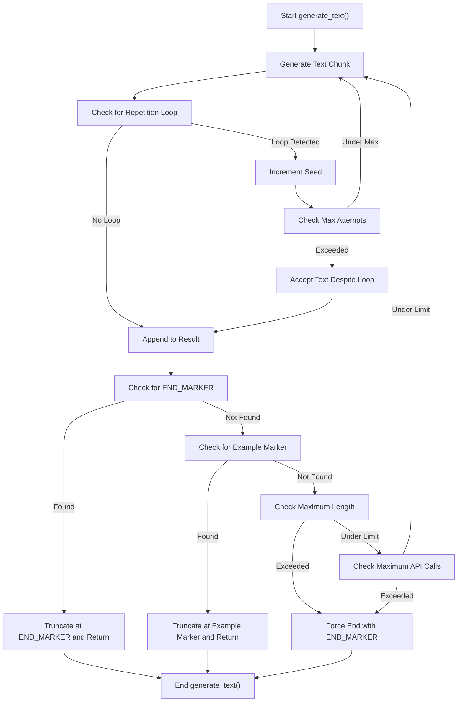
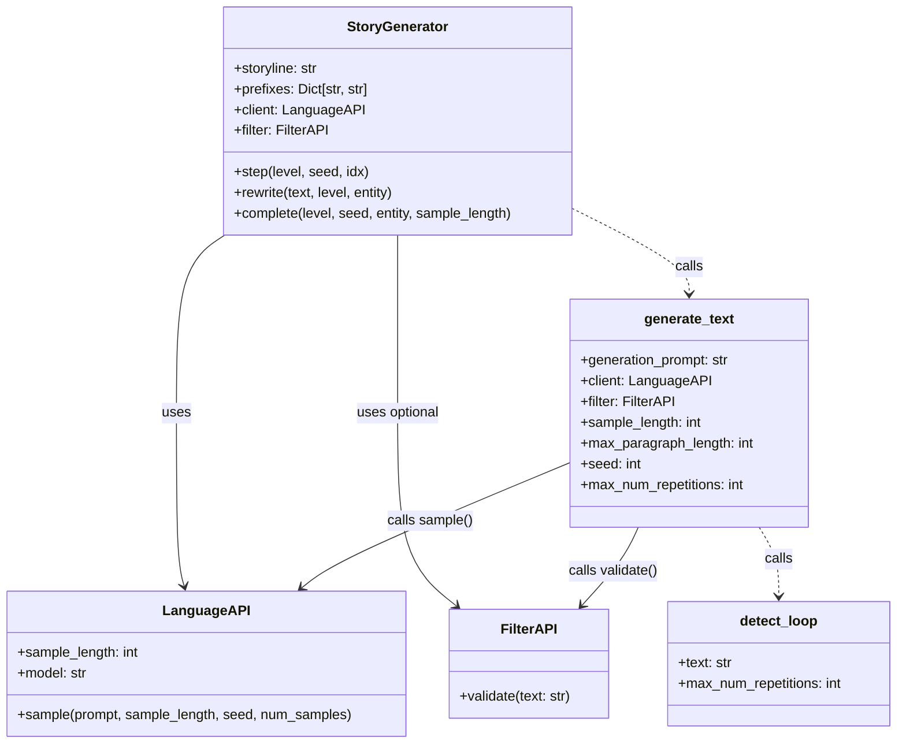

<!-- source: DeepWiki mcp.deepwiki.com · repo google-deepmind/dramatron · page 5.1 Handling Generation Issues · fetched 2026-10-26 -->

# Handling Generation Issues

<details>
<summary>Relevant source files</summary>

The following files were used as context for generating this wiki page:

- [README.md](README.md)
- [colab/dramatron.ipynb](colab/dramatron.ipynb)
- [docs/details.html](docs/details.html)
- [dramatron-animation.gif](dramatron-animation.gif)

</details>


This page documents the strategies and mechanisms Dramatron implements to handle common issues that arise during the text generation process. It covers detection and mitigation of text generation problems such as repetition loops, error handling for language model API failures, content moderation, and proper text termination. For information about the Fountain format used for script rendering, see [Fountain Format Output](#5.2).

## Text Generation Issues Overview

When generating text with large language models, several common issues can occur:

1. **Repetition loops**: The model gets stuck in a pattern of repeating the same text
2. **API failures**: The language model service becomes temporarily unavailable
3. **Inappropriate content**: The model generates offensive or inappropriate text
4. **Incomplete generation**: The text doesn't properly terminate with end markers

Dramatron includes detection and mitigation strategies for each of these issues, which are essential for reliable script generation.



Sources: [colab/dramatron.ipynb:637-698](), [colab/dramatron.ipynb:838-848](), [colab/dramatron.ipynb:625-630]()

## Loop Detection and Mitigation

The repetition loop detection mechanism is a critical component of Dramatron's text generation reliability. When generating text, especially in longer script sections like dialogues, language models can sometimes get stuck in repetitive patterns, producing the same content over and over.

### How Loop Detection Works

Dramatron uses a function called `detect_loop` to identify when the generated text contains repetitive blocks:

1. It splits the text into blocks separated by double newlines
2. It counts the occurrences of each unique block
3. If any block appears more than `MAX_NUM_REPETITIONS` times, it's considered a loop

### Loop Mitigation Strategy

When a loop is detected:

1. The system increments the random seed value
2. It attempts to generate the text again with the new seed
3. This process repeats up to `MAX_NUM_ATTEMPTS_GET_OUT_OF_LOOP` times
4. If still stuck after multiple attempts, the system accepts the looping text as a fallback

Key configuration parameters for loop handling:

| Parameter | Default | Purpose |
|-----------|---------|---------|
| `MAX_NUM_REPETITIONS` | 3 | Maximum repetitions before considering text as looping |
| `MAX_NUM_ATTEMPTS_GET_OUT_OF_LOOP` | 3 | Number of retry attempts with different seeds |

The loop detection is used within the `generate_text` function, which is called by various script element generators like `generate_dialog`.



Sources: [colab/dramatron.ipynb:838-848](), [colab/dramatron.ipynb:637-698](), [colab/dramatron.ipynb:160-162]()

## API Error Handling and Retries

When working with external language model APIs, temporary failures, rate limiting, and connectivity issues are common. Dramatron implements a resilient API interaction pattern to handle these issues gracefully.

### LanguageAPI Interface Design

The `LanguageAPI` class provides an abstraction layer for interacting with language model services. This interface includes built-in error handling mechanisms:

1. Every API call is automatically retried up to `MAX_RETRIES` times
2. Each attempt has a configurable timeout (`_TIMEOUT`)
3. Exponential backoff is implied in the implementation

The concrete implementations of this interface (such as for Google Gemini) handle the specifics of the API interactions while inheriting the retry logic.

### Configuration Parameters

| Parameter | Default | Purpose |
|-----------|---------|---------|
| `MAX_RETRIES` | 10 | Maximum number of retry attempts before giving up |
| `_TIMEOUT` | 120.0 | Maximum time (in seconds) to wait for an API response |

These parameters can be adjusted based on the reliability of the language model service being used and the requirements of the script generation process.

Sources: [colab/dramatron.ipynb:550-551](), [colab/dramatron.ipynb:569-571](), [colab/dramatron.ipynb:561-611]()

## Content Moderation

Dramatron provides a framework for content moderation through the `FilterAPI` abstract interface, which can be implemented to integrate with content filtering services.

### FilterAPI Interface

The `FilterAPI` class defines a simple interface with a `validate` method that takes text as input and determines whether it should be allowed or filtered:

```python
class FilterAPI:
  """Filter model wrapper."""

  def validate(self, text: str):
    raise NotImplementedError('validate not implemented in generic class')
```

### Integration with Content Moderation Services

While the default implementation doesn't include a specific content filter, the documentation mentions integration with Google's Perspective API as a possible implementation:

1. The Perspective API can analyze text for potentially harmful attributes like toxicity
2. A custom `FilterAPI` implementation can use these scores to reject inappropriate content
3. The filter is applied during text generation to prevent offensive output

When a `FilterAPI` is provided to `generate_text`, the generated content is validated before being returned:

```python
if filter is not None and not filter.validate(response.text):
  return 'Content was filtered out.' + END_MARKER
```

This moderation step is particularly important for Dramatron since it generates creative content that could inadvertently include sensitive or inappropriate material.

Sources: [colab/dramatron.ipynb:625-630](), [colab/dramatron.ipynb:667-668](), [README.md:72-77]()

## Generation Limiting and Termination

Ensuring that generated text properly terminates is crucial for maintaining the structure of the script. Dramatron employs several mechanisms to guarantee well-formed output.

### End Marker Detection

Each generated section of the script (title, characters, scenes, etc.) is expected to end with a specific marker (`END_MARKER`). The `generate_text` function actively looks for this marker in the generated text:

```python
# Attempt to find the END_MARKER
index = result.find(END_MARKER)
if index != -1:
  return result[:index] + END_MARKER
```

If found, the function truncates the text at the marker, ensuring clean termination.

### Maximum Length Controls

To prevent runaway generation, Dramatron implements several maximum length parameters:

| Parameter | Default | Purpose |
|-----------|---------|---------|
| `SAMPLE_LENGTH_TITLE` | 64 | Maximum length for title generation |
| `SAMPLE_LENGTH_PLACE` | 128 | Maximum length for place descriptions |
| `SAMPLE_LENGTH` | 511 | Maximum length for general generation tasks |
| `MAX_PARAGRAPH_LENGTH` | 1024 | Absolute maximum for unterminated generation |

When text generation exceeds the configured limits without finding an end marker, the system forcibly terminates the generation and appends the end marker.



Sources: [colab/dramatron.ipynb:637-698](), [colab/dramatron.ipynb:148-152](), [colab/dramatron.ipynb:154-157]()

## Configuring Generation Controls

Dramatron exposes several hyperparameters to control the generation process and handle issues. These are set in the "Dramatron hyperparameters" cell of the Colab notebook.

### Key Configuration Parameters

| Parameter | Default | Range | Purpose |
|-----------|---------|-------|---------|
| `SAMPLING_PROB` | 0.95 | 0.8-1.0 | Top-p probability for sampling |
| `SAMPLING_TEMP` | 1.0 | 0.8-1.0 | Temperature for sampling diversity |
| `MAX_NUM_REPETITIONS` | 3 | 1-10 | Maximum repetitions before considering a loop |
| `MAX_NUM_ATTEMPTS_GET_OUT_OF_LOOP` | 3 | 1-10 | Number of attempts to escape a loop |
| `MAX_RETRIES` | 10 | 1-20 | Maximum API retry attempts |
| `MAX_PARAGRAPH_LENGTH` | 1024 | 511-4096 | Maximum length for generation tasks |

### Parameter Tuning Recommendations

Different generation tasks may benefit from different parameter settings:

1. **For more creative output**:
   - Higher temperature (e.g., 1.0)
   - Higher sampling probability (e.g., 0.95)
   
2. **For more controlled output**:
   - Lower temperature (e.g., 0.8)
   - Lower sampling probability (e.g., 0.85)
   
3. **For longer scripts**:
   - Increased `MAX_PARAGRAPH_LENGTH` values
   - Higher `MAX_NUM_REPETITIONS` threshold

4. **For unreliable API connections**:
   - Increased `MAX_RETRIES` value

These parameters can be adjusted through the user interface in the Colab notebook.

Sources: [colab/dramatron.ipynb:139-162](), [colab/dramatron.ipynb:637-698]()

## Relationship to StoryGenerator Class

The issue handling mechanisms are integrated into the `StoryGenerator` class, which is the central component that orchestrates the script generation process.



The `StoryGenerator` class uses these mechanisms through its interactions with:

1. The `LanguageAPI` for text generation with retry logic
2. The optional `FilterAPI` for content moderation
3. The `generate_text` function, which includes loop detection and termination control

Sources: [colab/dramatron.ipynb:983-1039](), [colab/dramatron.ipynb:637-698](), [colab/dramatron.ipynb:838-848]()

## Summary

Dramatron implements several mechanisms to handle common text generation issues:

1. **Loop detection and mitigation**: Uses the `detect_loop` function to identify repetitive patterns and adjusts the seed to escape loops
2. **API error handling**: Provides retry logic through the `LanguageAPI` abstraction
3. **Content moderation**: Supports optional content filtering via the `FilterAPI` interface
4. **Proper text termination**: Ensures well-formed output through end marker detection and maximum length controls

These mechanisms work together to enhance the reliability of the script generation process, allowing for a smoother co-writing experience with fewer technical interruptions.

All these controls can be configured through hyperparameters in the Colab notebook interface, allowing users to adjust the generation behavior to their specific needs.

Sources: [colab/dramatron.ipynb:139-162](), [colab/dramatron.ipynb:637-698](), [colab/dramatron.ipynb:838-848](), [colab/dramatron.ipynb:625-630]()

---

