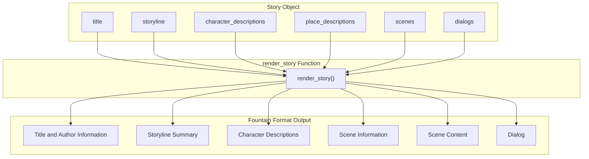
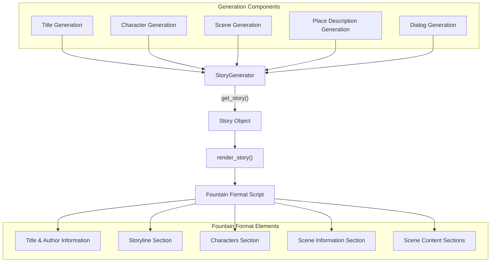

<!-- source: DeepWiki mcp.deepwiki.com · repo google-deepmind/dramatron · page 5.2 Fountain Format Output · fetched 2026-10-26 -->

# Fountain Format Output

<details>
<summary>Relevant source files</summary>

The following files were used as context for generating this wiki page:

- [README.md](README.md)
- [colab/dramatron.ipynb](colab/dramatron.ipynb)
- [dramatron-animation.gif](dramatron-animation.gif)

</details>


## Purpose and Scope

This page documents how Dramatron renders generated scripts in the Fountain format, a plain text markup language for screenwriting. This documentation explains the output formatting process, the structure of Fountain-formatted scripts in Dramatron, and how the underlying Story object is transformed into the final script. For information about the script generation process itself, see [Hierarchical Generation Process](#2.2).

Sources: [colab/dramatron.ipynb:437-499]()

## What is Fountain Format?

Fountain is a lightweight, plain text markup syntax designed specifically for writing, editing, and sharing screenplays. It allows writers to focus on content rather than formatting, while still producing professionally formatted output. Dramatron uses Fountain format as its output format because:

1. It's human-readable in plain text
2. It follows industry-standard screenplay conventions
3. It can be imported into screenwriting software like Final Draft, Highland, or Fade In
4. It separates content from presentation

Fountain uses simple markers for screenplay elements such as scene headings, action, character names, and dialogue, making it easy to both write and parse by software.

Sources: [colab/dramatron.ipynb:437-499](), [README.md:12-14]()

## Rendering Process

Dramatron converts the generated Story object into Fountain format using the `render_story` function. This function takes all the components of a story that have been hierarchically generated and arranges them according to screenplay conventions.

### Story to Fountain Transformation



Sources: [colab/dramatron.ipynb:437-499](), [colab/dramatron.ipynb:386-405]()

### Key Components of the Rendering Process

The `render_story` function handles several important aspects of the screenplay formatting:

1. **Header Information**: Includes title, author credits, and metadata
2. **Smart Rendering of Descriptions**: Only renders place and character descriptions the first time they appear
3. **Scene Formatting**: Follows standard INT/EXT scene heading conventions
4. **Dialog Integration**: Formats character dialogue according to screenplay standards

Two helper functions determine whether descriptions should be repeated:
- `place_appears_earlier`: Checks if a place has been shown before in the script
- `character_appears_earlier`: Checks if a character has been introduced before

Sources: [colab/dramatron.ipynb:437-499](), [colab/dramatron.ipynb:502-509](), [colab/dramatron.ipynb:512-519]()

## Structure of Fountain Output

The final Fountain-formatted script follows this structure:

```mermaid
classDiagram
    class "Fountain Script" {
        Title Section
        Author Credits
        Storyline Summary
        Character Descriptions
        Scene Information
        Scene Content
        INT/EXT Headings
        Place Descriptions
        Character Introductions
        Dialog
    }

    class "Title Section" {
        "Title: [script_title]"
        "Author: Co-written by ________ and Dramatron"
        Credits and Attribution
    }

    class "Scene Content" {
        "INT/EXT. [place_name] - Scene [number]"
        Place Description (first appearance only)
        Character Descriptions (first appearance only)
        Dialog Content
    }

    "Fountain Script" *-- "Title Section"
    "Fountain Script" *-- "Scene Content"
```

Sources: [colab/dramatron.ipynb:437-499]()

## Code Implementation

The Fountain format output is primarily generated in the `render_story` function. Here's a detailed breakdown of how it works:

### Main Rendering Function

The `render_story` function [colab/dramatron.ipynb:437-499]() takes a Story object and produces a formatted script string. It follows these steps:

1. Create header with title and author information
2. Add the storyline
3. Add character descriptions
4. For each scene:
   - Add scene information (place, plot element, beat)
5. For each scene:
   - Create proper INT/EXT scene heading
   - Add place description (if first appearance)
   - Add character descriptions (if first appearance)
   - Add scene dialog

### Helper Functions

Two important helper functions ensure descriptions are only shown once:

1. `place_appears_earlier` [colab/dramatron.ipynb:502-509]() - Determines if a place needs description
2. `character_appears_earlier` [colab/dramatron.ipynb:512-519]() - Determines if a character needs introduction

### Example Output Structure

```
Title: [Generated Title]
Author: Co-written by ________ and Dramatron
Dramatron was developed by Piotr Mirowski and Kory W. Mathewson, with additional contributions by Juliette Love and Jaylen Pittman, and is based on a prototype by Richard Evans.
Dramatron relies on user-provided language models.

====

The script is based on the storyline:
[Storyline text]

[Character Name]: [Character Description]

Scene 1
Place: [Place Name]
Plot element: [Plot Element]
Beat: [Beat Description]

====

INT/EXT. [Place Name] - Scene 1

[Place Description]

[Character Description]

[Dialog for Scene 1]


INT/EXT. [Place Name] - Scene 2
...
```

Sources: [colab/dramatron.ipynb:437-499]()

## Story Object to Fountain Format Mapping

The following table shows how each component of the Story object maps to elements in the Fountain format:

| Story Object Component | Fountain Format Element | Notes |
|------------------------|-------------------------|-------|
| `story.title` | `Title: [title]` | At the top of the script |
| `story.storyline` | `The script is based on the storyline: [storyline]` | After the header section |
| `story.character_descriptions` | `[Character]: [Description]` | Listed after storyline & within scenes if first appearance |
| `story.scenes` | Scene numbering and scene information | Each scene gets a number and information section |
| `scene.place` | `INT/EXT. [place] - Scene [number]` | Standard screenplay scene heading |
| `place_descriptions[scene.place].description` | Place description paragraph | Only shown on first appearance |
| `story.dialogs[i]` | Dialog content | Formatted according to screenplay conventions |

Sources: [colab/dramatron.ipynb:437-499](), [colab/dramatron.ipynb:386-405]()

## Code Flow from Generation to Output

The following diagram illustrates how generated content flows from the `StoryGenerator` through the `Story` object and finally into the Fountain format:



Sources: [colab/dramatron.ipynb:1214-1225](), [colab/dramatron.ipynb:437-499]()

## Using and Customizing Fountain Output

The Fountain-formatted output from Dramatron is designed to be:

1. **Human-readable**: Easily understood in plain text format
2. **Editable**: Ready for further refinement by the human co-writer
3. **Compatible**: Importable into professional screenwriting software
4. **Complete**: Contains all elements needed for a screenplay

The output can be saved as a plain text file with a `.fountain` extension for use with compatible software.

### Saving the Fountain Output

The generated Fountain script can be accessed by:

1. Creating a Story object with `story_generator.get_story()`
2. Rendering it with `render_story(story)`
3. Saving the resulting string to a file

Sources: [colab/dramatron.ipynb:1214-1225](), [colab/dramatron.ipynb:437-499]()

## Limitations and Considerations

When working with Dramatron's Fountain output:

1. **Formatting Limitations**: Fountain is primarily focused on screenplay format and may have limitations for other types of scripts
2. **Manual Editing**: The output will likely require editing and refinement by a human writer
3. **Special Formatting**: Complex formatting requirements may need additional manual adjustments
4. **Co-writing Paradigm**: As noted in Dramatron's documentation, the system is designed for co-writing, not autonomous script creation

Sources: [README.md:20-23](), [colab/dramatron.ipynb:437-499]()

## Conclusion

Dramatron's Fountain format output provides a standardized, screenplay-formatted representation of the generated script. By using this industry-standard format, Dramatron enables writers to easily take the generated content and integrate it into their professional workflow, supporting the co-writing paradigm that Dramatron was designed for.

The rendering process handles the complex task of organizing and formatting all the hierarchically generated content into a coherent script that follows screenwriting conventions, making it a valuable tool for writers in their creative process.

Sources: [README.md:12-17](), [colab/dramatron.ipynb:437-499]()

---

