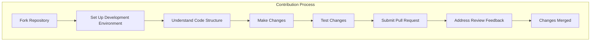
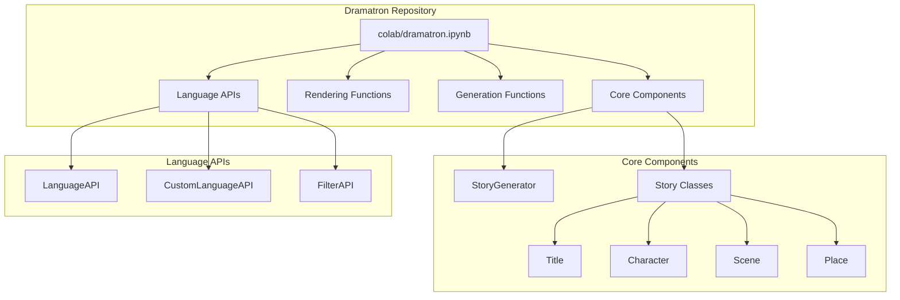
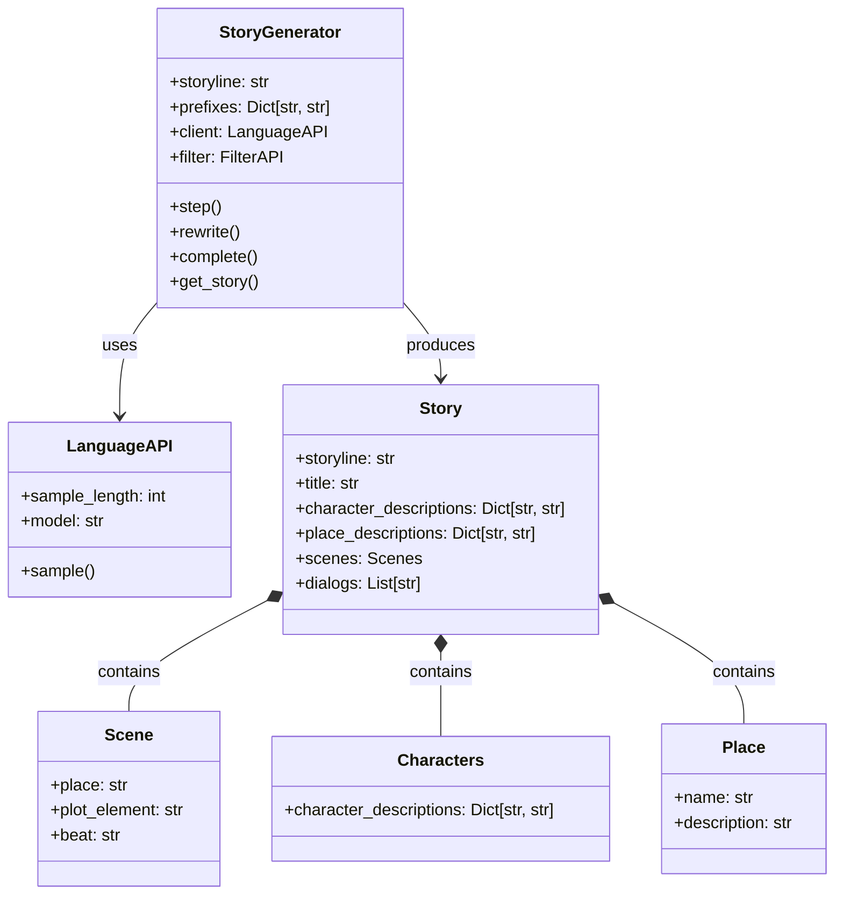
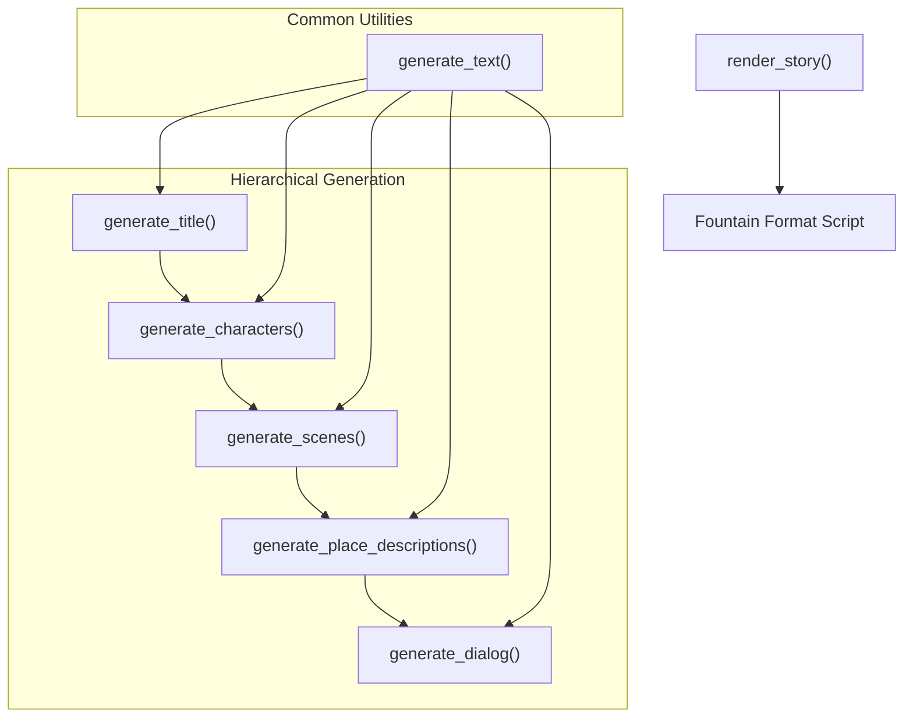
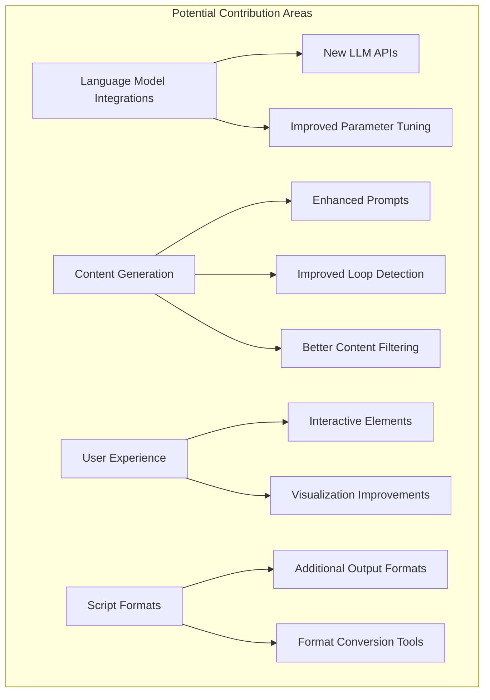

<!-- source: DeepWiki mcp.deepwiki.com · repo google-deepmind/dramatron · page 6 Contributing to Dramatron · fetched 2026-10-26 -->

# Contributing to Dramatron

<details>
<summary>Relevant source files</summary>

The following files were used as context for generating this wiki page:

- [.gitignore](.gitignore)
- [CONTRIBUTING.md](CONTRIBUTING.md)
- [README.md](README.md)
- [colab/dramatron.ipynb](colab/dramatron.ipynb)
- [dramatron-animation.gif](dramatron-animation.gif)

</details>


This document provides guidelines and instructions for contributing to the Dramatron project, a co-writing system for theatre scripts and screenplays that leverages large language models. For information about using Dramatron, refer to the [User Guide](#3).

## Overview of Contribution Process

Contributing to Dramatron involves understanding the codebase, making changes, and submitting those changes for review. This page outlines the technical aspects of contribution as well as the process requirements.



Sources: [CONTRIBUTING.md:1-25]()

## Setting Up the Development Environment

To contribute to Dramatron, you'll need to set up your development environment:

1. **Fork the repository** - Create your own fork of the repository on GitHub
2. **Clone your fork** - Clone the repository to your local machine
3. **Install dependencies** - Dramatron is primarily implemented as a Colab notebook, so you may need to install required Python libraries

Since Dramatron is primarily distributed as a Colab notebook, you can either:
- Work directly in Colab with the notebook
- Set up a local Jupyter environment for development

### Required Dependencies

Dramatron requires the following Python libraries:
- `ipywidgets`
- `requests`
- `google-generativeai` (for Google Gemini API integration)

Sources: [colab/dramatron.ipynb:76-80](), [colab/dramatron.ipynb:98-126]()

## Understanding the Codebase Structure

Before contributing, it's important to understand the structure of the Dramatron codebase and its key components.

### Codebase Organization



The main implementation of Dramatron is contained in a single Colab notebook, which includes all the necessary classes and functions for the system.

Sources: [colab/dramatron.ipynb:172-175]()

### Key Classes and Relationships

Understanding the key classes and their relationships is crucial for contributing effectively to Dramatron.



Sources: [colab/dramatron.ipynb:212-447]()

### Generation Process

Dramatron uses a hierarchical generation approach, which is implemented through a series of specialized functions:



All generation functions rely on the `generate_text()` function, which handles interactions with the language model.

Sources: [colab/dramatron.ipynb:632-697](), [colab/dramatron.ipynb:721-964]()

## How to Contribute Code

### Types of Contributions

There are several ways you can contribute to Dramatron:

1. **Bug fixes** - Fixing issues in the existing codebase
2. **Feature enhancements** - Adding new capabilities or improving existing ones
3. **Documentation improvements** - Enhancing comments, docstrings, or external documentation
4. **Performance optimizations** - Making the code more efficient
5. **Integration with new LLMs** - Adding support for additional language models

### Making Changes

When making changes to the codebase, follow these guidelines:

1. **Focus on specific areas** - Understand the specific component you're modifying
2. **Maintain compatibility** - Ensure your changes don't break existing functionality
3. **Follow coding style** - Maintain consistency with the existing code
4. **Add tests** - Include appropriate verification for your changes
5. **Update documentation** - Document your changes appropriately

For example, if you want to add support for a new language model, you would need to create a new implementation of the `LanguageAPI` class:

```python
class YourModelLanguageAPI(LanguageAPI):
    def sample(self, prompt, sample_length=None, seed=None, num_samples=1):
        # Your implementation here
        pass
```

Sources: [colab/dramatron.ipynb:554-622]()

## Contribution Process

### Contributor License Agreement

Before contributing to Dramatron, you must sign a Contributor License Agreement (CLA):

1. Visit https://cla.developers.google.com/
2. Sign the appropriate CLA (individual or corporate)
3. Only needs to be done once for Google projects

### Submitting Changes

To submit your contributions:

1. **Create a branch** - Work in a dedicated branch in your fork
2. **Make your changes** - Implement and test your changes
3. **Commit your changes** - Use clear and descriptive commit messages
4. **Create a pull request** - Submit your changes for review
5. **Respond to feedback** - Address any comments or issues raised during review

### Code Review Process

All submissions to Dramatron require review through GitHub pull requests:

1. A maintainer will review your code
2. They may suggest changes or improvements
3. Once approved, your changes will be merged into the main codebase

Sources: [CONTRIBUTING.md:15-20]()

## Testing Your Contributions

When contributing to Dramatron, it's important to test your changes thoroughly:

1. **Manual testing** - Run the notebook with your changes to verify functionality
2. **Edge cases** - Test with various inputs, including extreme or unusual cases
3. **Integration testing** - Ensure your changes work with the rest of the system

If implementing a new language model integration, test with various prompts to ensure consistent output quality.

## Community Guidelines

Dramatron follows Google's Open Source Community Guidelines. When participating in this project:

1. Be respectful and inclusive
2. Focus on constructive contributions
3. Follow technical discussions professionally
4. Adhere to the project's coding standards

Sources: [CONTRIBUTING.md:22-25]()

## Future Development Areas

If you're looking for areas to contribute to, consider these potential improvements:

1. **Enhanced prompting techniques** - Improving the quality of generated content
2. **Additional script formats** - Supporting more script formats beyond Fountain
3. **User interface improvements** - Enhancing the interaction experience
4. **Performance optimizations** - Making generation faster or more efficient
5. **Integration with popular LLMs** - Adding support for additional language models



Sources: [colab/dramatron.ipynb:60-59](), [README.md:12-27]()

## Contact and Support

If you have questions about contributing to Dramatron:

1. Open an issue on the GitHub repository
2. Contact the team at dramatron@deepmind.com

This approach ensures that your questions and discussions are visible to the entire community.

Sources: [README.md:27-27]()