# Page: Overview

# Overview

<details>
<summary>Relevant source files</summary>

The following files were used as context for generating this wiki page:

- [README.md](README.md)
- [colab/dramatron.ipynb](colab/dramatron.ipynb)
- [docs/details.html](docs/details.html)
- [docs/index.html](docs/index.html)
- [dramatron-animation.gif](dramatron-animation.gif)

</details>


This document provides a comprehensive introduction to Dramatron, a script co-writing tool that leverages large language models to assist humans in creating theatre scripts and screenplays. It explains the system's purpose, architecture, and key components that enable hierarchical script generation. For detailed information about the system's architecture, see [System Architecture](#2), and for usage instructions, refer to the [User Guide](#3).

Sources: [README.md:1-27](), [docs/details.html:30-38]()

## What is Dramatron?

Dramatron is a co-creative system designed to work alongside human authors in writing scripts for theatre and film. It uses pre-trained large language models to generate coherent text through a hierarchical approach, ensuring consistency across the entire script. Starting from a user-provided storyline (logline), Dramatron progressively generates various script elements, including title, character descriptions, plot points, location descriptions, and dialogue.

The system is explicitly designed as a co-writing tool rather than an autonomous script generator. It provides human authors with material for compilation, editing, and rewriting, serving as a source of inspiration and exploration for writers.

Sources: [README.md:11-20](), [docs/details.html:30-38](), [colab/dramatron.ipynb:41-59]()

### System Purpose

**Key Objectives:**
- Assist human writers in creating scripts through collaborative generation
- Maintain long-range consistency through hierarchical generation
- Provide creative inspiration for story development
- Support exploration of narrative alternatives

**Design Philosophy:**
- Co-writing rather than autonomous generation
- Hierarchical structure to ensure coherence
- Interactive generation allowing human intervention
- Integration with various language models through a standardized API

Sources: [README.md:11-27](), [docs/details.html:30-96]()

## System Architecture Overview

Dramatron follows a hierarchical generation approach where each layer builds upon previous elements to ensure consistency throughout the script.

**Dramatron System Architecture**
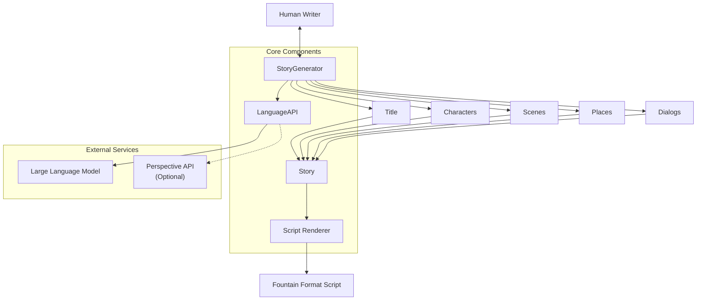

The system centers around the `StoryGenerator` class which orchestrates the script generation process, interfacing with language models through the `LanguageAPI` abstraction. The generated content is stored in a `Story` object and rendered into a screenplay in Fountain format.

Sources: [colab/dramatron.ipynb:174-862](), [README.md:11-15]()

## Hierarchical Generation Process

Dramatron's key innovation is its hierarchical approach to script generation, which ensures consistency from high-level concepts down to specific dialogue.

**Hierarchical Generation Workflow**
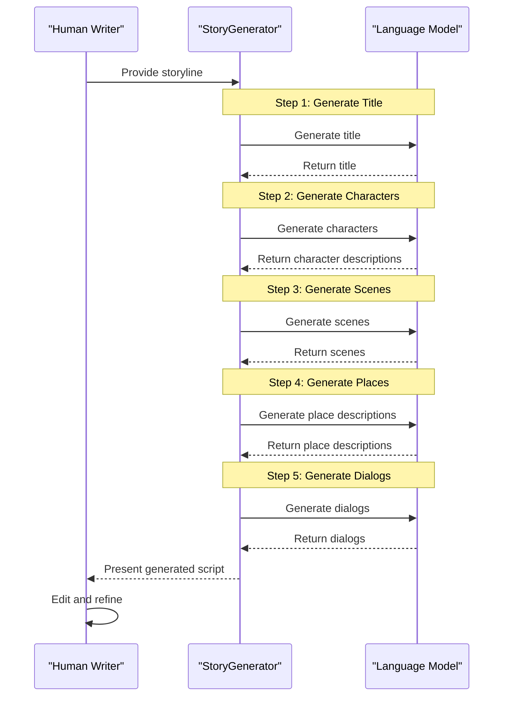

The process begins with a user-provided storyline and progresses through five main steps:
1. **Title Generation**: Creates a compelling title based on the storyline
2. **Character Generation**: Develops character descriptions
3. **Scene Generation**: Outlines the sequence of scenes with plot points
4. **Place Generation**: Creates detailed descriptions of script locations
5. **Dialog Generation**: Crafts character dialog for each scene

At each step, the human writer can review, edit, or regenerate content as needed, maintaining creative control throughout the process.

Sources: [colab/dramatron.ipynb:637-891](), [README.md:12]()

## Core Components

Dramatron consists of several key components that work together to facilitate script generation:

### Data Structures

The system uses specialized classes to represent different elements of a script:

| Class | Purpose | Key Attributes |
|-------|---------|----------------|
| `Story` | Contains all script elements | storyline, title, characters, places, scenes, dialogs |
| `Title` | Represents the script title | title text |
| `Characters` | Collection of characters | character_descriptions (Dict[name, description]) |
| `Scene` | Individual scene details | place, plot_element, beat |
| `Scenes` | Collection of scenes | scenes (List[Scene]) |
| `Place` | Location description | name, description |

Sources: [colab/dramatron.ipynb:217-406]()

### Language Model Interface

Dramatron is designed to work with various large language models through a standardized interface:

**Language API Class Diagram**
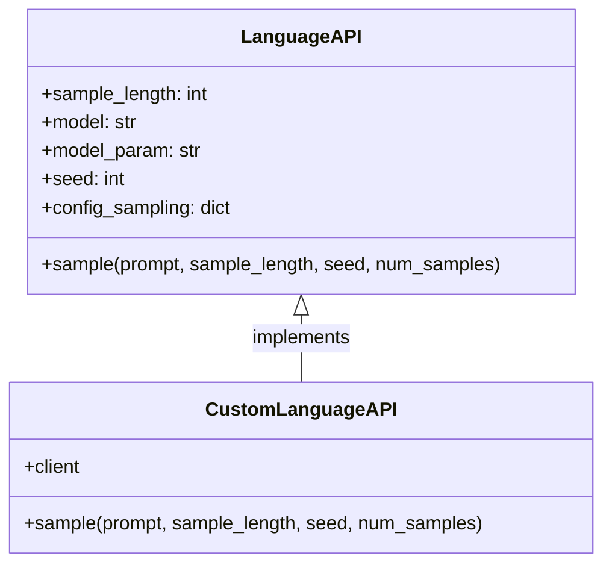

The `LanguageAPI` is an abstract class that defines the interface for interacting with language models. Users must implement a custom version (like `CustomLanguageAPI`) to connect with their preferred language model provider.

Sources: [colab/dramatron.ipynb:554-622](), [README.md:8-9]()

### Generation Functions

Dramatron uses specialized functions for generating each component of the script:

| Function | Purpose | Input | Output |
|----------|---------|-------|--------|
| `generate_title` | Creates script title | storyline | Title object |
| `generate_characters` | Creates character roster | storyline | Characters object |
| `generate_scenes` | Plans scene sequence | storyline, characters | Scenes object |
| `generate_place_descriptions` | Describes locations | storyline, scenes | Dict of Place objects |
| `generate_dialog` | Creates character dialog | storyline, scenes, characters, places | Dialog text |

Sources: [colab/dramatron.ipynb:637-891]()

## Implementation Details

Dramatron is implemented as a Python Colab notebook, making it accessible and interoperable with various language model providers. The implementation includes tools for detecting and mitigating common issues in language model generation:

1. **Loop Detection**: Identifies and prevents repetitive text generation
2. **Content Filtering**: Optional integration with Perspective API for content moderation
3. **Hierarchical Structure**: Ensures consistency between script elements
4. **Interactive Generation**: Allows human intervention at each generation step

The system outputs scripts in Fountain format, a plain text markup language designed for screenplays that is widely used in the industry.

Sources: [colab/dramatron.ipynb:174-406](), [colab/dramatron.ipynb:637-891](), [README.md:22-23]()

## Use Cases and Limitations

Dramatron is designed for specific use cases and has recognized limitations:

**Intended Use Cases:**
- Co-writing and exploring story ideas
- "World building" and narrative exploration
- Creative idea generation
- Exploring alternative stories by changing characters or plot elements

**Limitations:**
- Not designed for autonomous script generation
- Hierarchical top-down approach may not match all writing styles
- May reflect biases or stereotypes from training data
- Potential for generating content with similarities to training texts

Sources: [README.md:18-26](), [docs/details.html:30-96]()

## Conclusion

Dramatron represents an approach to human-AI collaboration in creative writing, specifically for scripts and screenplays. By leveraging the strengths of large language models within a structured hierarchical framework, it provides a tool for writers to explore narrative possibilities and accelerate their creative process. As a co-writing system, it's designed to augment rather than replace human creativity, offering inspiration and alternatives while leaving creative control in the hands of the writer.

Sources: [README.md:11-27](), [docs/details.html:80-96]()

---

# Page: System Architecture

# System Architecture

<details>
<summary>Relevant source files</summary>

The following files were used as context for generating this wiki page:

- [README.md](README.md)
- [colab/dramatron.ipynb](colab/dramatron.ipynb)
- [docs/details.html](docs/details.html)
- [dramatron-animation.gif](dramatron-animation.gif)

</details>


This document provides a comprehensive overview of Dramatron's system architecture, focusing on the core components, their relationships, and the hierarchical generation process. For specific usage instructions, please refer to the [User Guide](#3).

## Purpose and Scope

The Dramatron system is designed as a co-writing tool that leverages large language models (LLMs) to generate theatrical scripts and screenplays. Its architecture facilitates a hierarchical generation approach to maintain consistency across the entire script, while enabling collaborative interaction between human writers and the system. This document explains the technical design and implementation of the system components.

Sources: [colab/dramatron.ipynb:41-59](), [README.md:12-25]()

## System Overview

Dramatron follows a hierarchical generation approach to create consistent scripts. The system is built around a central orchestrator (`StoryGenerator`) that coordinates the generation process through an abstraction layer (`LanguageAPI`) to interact with language models. The generated content is structured into typed data objects which are ultimately rendered into a screenplay in Fountain format.

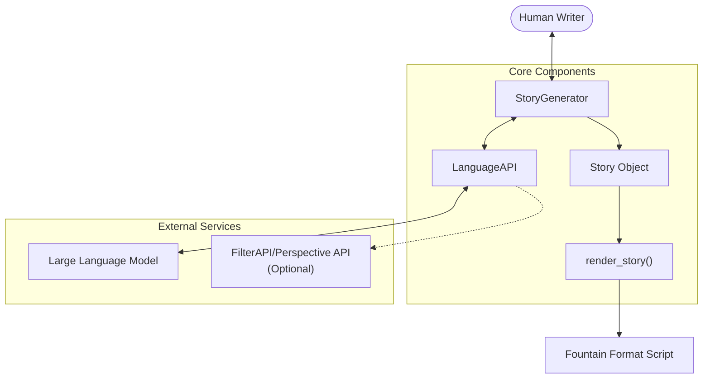

Sources: [colab/dramatron.ipynb:983-1057](), [colab/dramatron.ipynb:561-622](), [colab/dramatron.ipynb:437-499]()

## Hierarchical Generation Process

The hierarchical generation approach ensures that each element of the script builds upon previously generated content, maintaining consistency throughout the script.

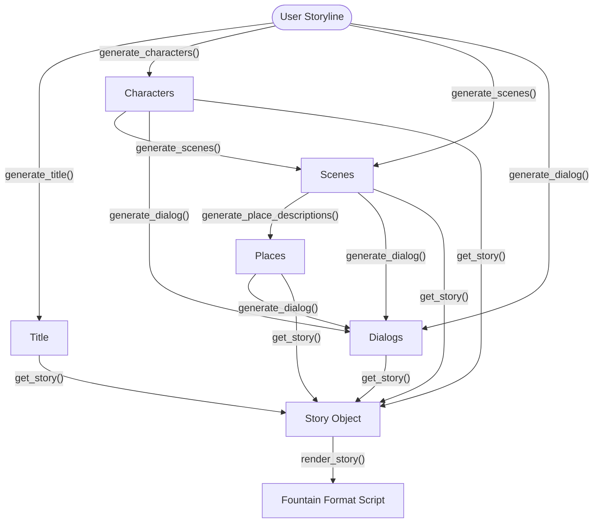

Each step in the generation process:
1. Takes inputs from previous stages
2. Constructs a specialized prompt
3. Calls the language model via the LanguageAPI
4. Parses the generated text into appropriate data structures

The StoryGenerator orchestrates this process, allowing the user to intervene at each step to guide the generation.

Sources: [colab/dramatron.ipynb:724-902](), [colab/dramatron.ipynb:1178-1218]()

## Core Components

### StoryGenerator Class

The StoryGenerator class serves as the central orchestrator in Dramatron. It manages the state of the script generation process and provides methods for stepping through the generation process, rewriting elements, and obtaining the final story.

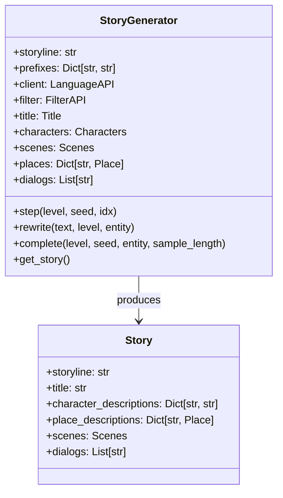

Sources: [colab/dramatron.ipynb:983-1057](), [colab/dramatron.ipynb:1178-1218](), [colab/dramatron.ipynb:386-406]()

### LanguageAPI Interface

The LanguageAPI class provides an abstraction layer for interacting with language models. It defines a common interface that can be implemented by different language model providers.

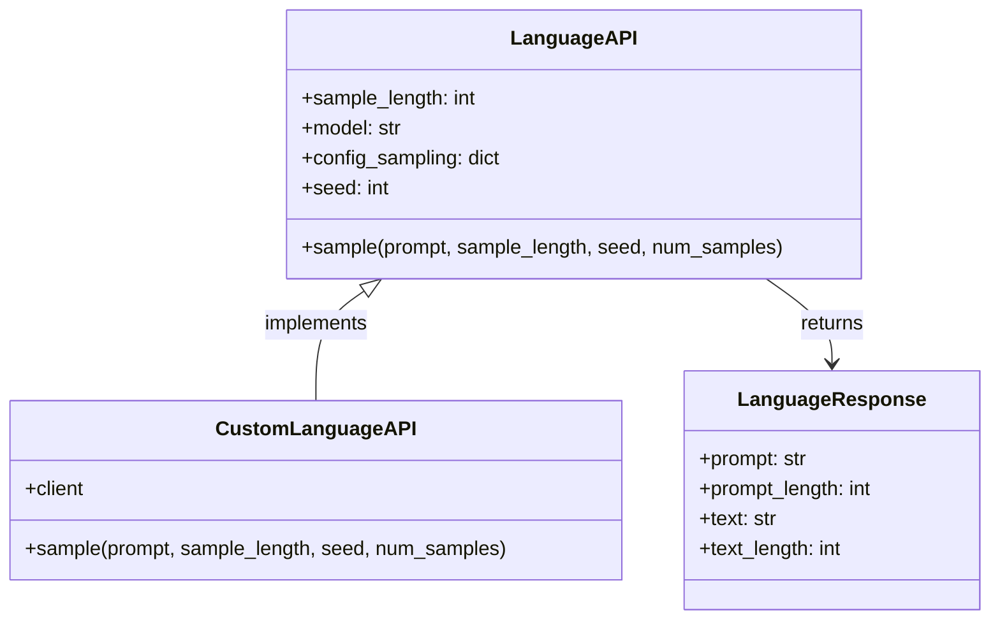

The LanguageAPI abstraction allows Dramatron to be model-agnostic, enabling users to plug in different language models by implementing the required sample method.

Sources: [colab/dramatron.ipynb:561-622](), [colab/dramatron.ipynb:554-559]()

### Script Data Structures

Dramatron uses a set of structured data types to represent the elements of a script. These are implemented as NamedTuples for type safety and clarity.

| Data Structure | Purpose | Key Properties |
|----------------|---------|----------------|
| Title | Script title | title: str |
| Character | Individual character | name: str, description: str |
| Characters | Collection of characters | character_descriptions: Dict[str, str] |
| Scene | Individual scene | place: str, plot_element: str, beat: str |
| Scenes | Collection of scenes | scenes: List[Scene] |
| Place | Location description | name: str, description: str |
| Story | Complete script | storyline, title, character_descriptions, place_descriptions, scenes, dialogs |

These data structures include methods for serialization (to_string) and deserialization (from_string) to facilitate conversion between text and structured objects.

Sources: [colab/dramatron.ipynb:217-406]()

### Generation Functions

Dramatron includes specialized functions for generating each element of a script:

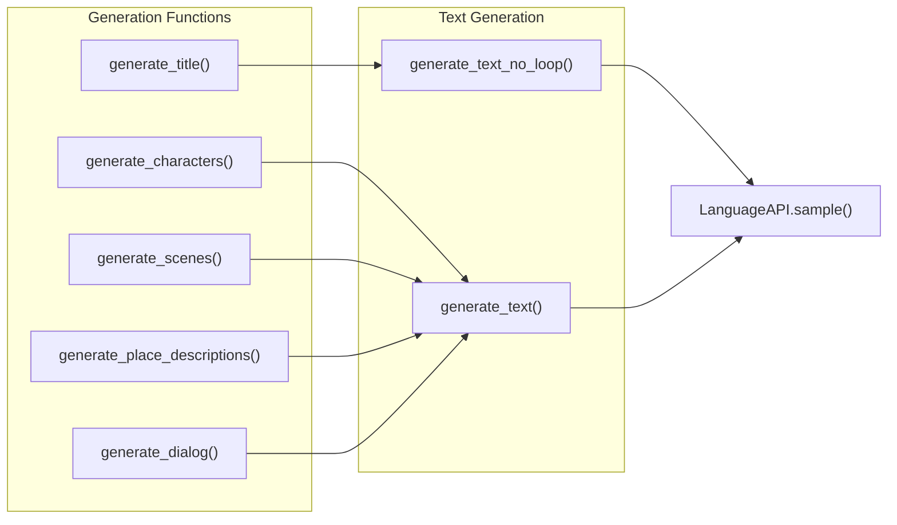

Each generation function:
1. Constructs a prompt using predefined templates and existing content
2. Calls `generate_text()` or `generate_text_no_loop()` to obtain text from the language model
3. Parses the generated text into the appropriate data structure
4. Returns the parsed object and the prompt used

The functions handle issues like repetition detection and content filtering to ensure quality output.

Sources: [colab/dramatron.ipynb:637-719](), [colab/dramatron.ipynb:724-902]()

### Rendering Function

The `render_story()` function transforms a Story object into a Fountain format script suitable for screenplay writing. It:

1. Formats the title and metadata
2. Lists character descriptions
3. Details each scene with location, characters, and dialog
4. Applies appropriate formatting according to the Fountain syntax

Sources: [colab/dramatron.ipynb:437-499]()

## User Interaction Flow

Dramatron is designed for collaborative use with a human writer, following this interaction flow:

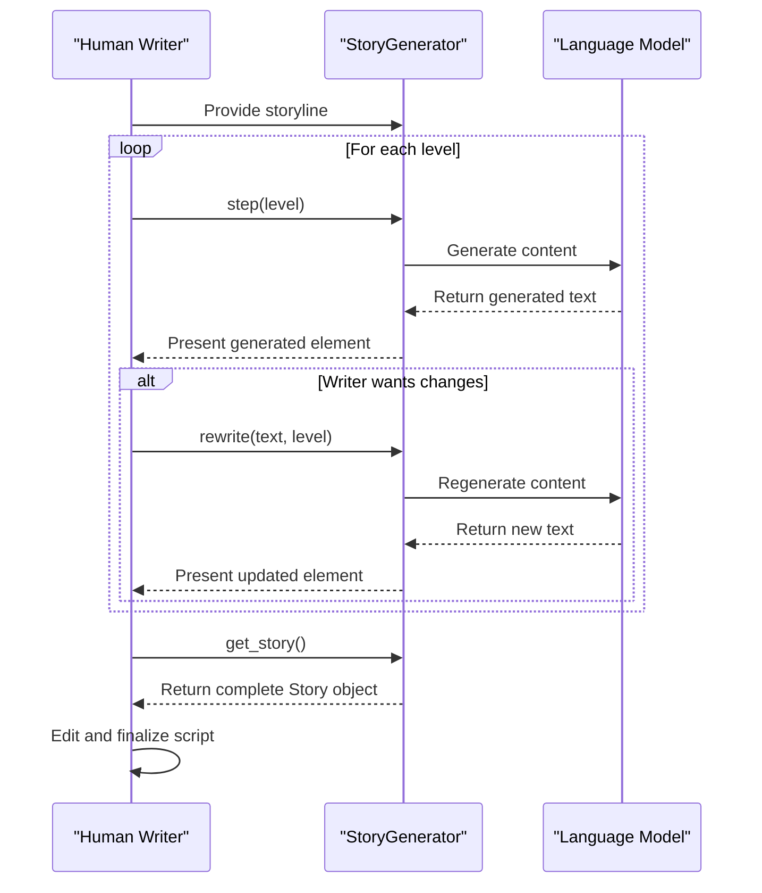

This interaction model supports the co-writing process, allowing the human writer to guide the generation while leveraging the capabilities of the language model.

Sources: [colab/dramatron.ipynb:1178-1302](), [docs/details.html:30-51]()

## Implementation Environment

Dramatron is implemented in Python and runs within a Google Colab notebook environment. This implementation choice provides:

1. Accessibility - users can run Dramatron without local installation
2. Integration with language model APIs
3. Interactive interface for the co-writing process

The system is designed to be "unplugged" from any specific language model, requiring users to implement the LanguageAPI interface to connect with their preferred model.

Sources: [README.md:7-8](), [colab/dramatron.ipynb:1-67]()

## Limitations and Considerations

The Dramatron architecture has several inherent limitations:

1. **Hierarchical Generation** - The top-down approach may not align with all writing processes
2. **Prompt Engineering** - The quality of generated content depends on carefully designed prompts
3. **Content Safety** - Generated content may reproduce biases or contain inappropriate material
4. **Potential Plagiarism** - Language models may reproduce content from their training data

Dramatron includes optional integration with the Perspective API for content moderation and provides mechanisms for rewriting to address these limitations.

Sources: [README.md:17-23](), [docs/details.html:52-77]()

## Technology Stack

Dramatron's architecture is built on these key technologies:

| Component | Technologies |
|-----------|--------------|
| Core Implementation | Python, Named Tuples, Type Annotations |
| Runtime Environment | Google Colab Notebook |
| Language Model Integration | Custom API abstraction layer |
| Output Format | Fountain screenplay format |
| Optional Moderation | Perspective API |

The system is designed to be modular, allowing components to be replaced or extended as needed.

Sources: [colab/dramatron.ipynb:97-126](), [colab/dramatron.ipynb:561-622]()

---

# Page: Core Components

# Core Components

<details>
<summary>Relevant source files</summary>

The following files were used as context for generating this wiki page:

- [README.md](README.md)
- [colab/dramatron.ipynb](colab/dramatron.ipynb)
- [dramatron-animation.gif](dramatron-animation.gif)

</details>


This document details the primary classes and modules that make up the Dramatron system, a co-writing tool for theatre scripts and screenplays. It focuses on the core architecture components and how they interact. For information about the hierarchical generation process, see [Hierarchical Generation Process](#2.2). For details about the data structures used, see [Data Structures](#2.3).

## Overview

Dramatron's architecture centers around several key components that work together to generate coherent script content. The system uses a hierarchical approach to maintain consistency across the generated elements, from title to dialog.

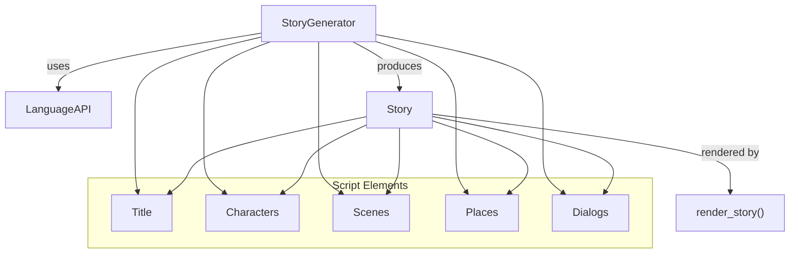

Sources: [colab/dramatron.ipynb:983-1363](), [colab/dramatron.ipynb:386-406](), [colab/dramatron.ipynb:437-499]()

## Key Classes

### StoryGenerator

The `StoryGenerator` class is the central orchestrator of the script generation process. It manages the step-by-step generation of all script elements, from title to dialogs, and stores both the generated content and the prompts used.

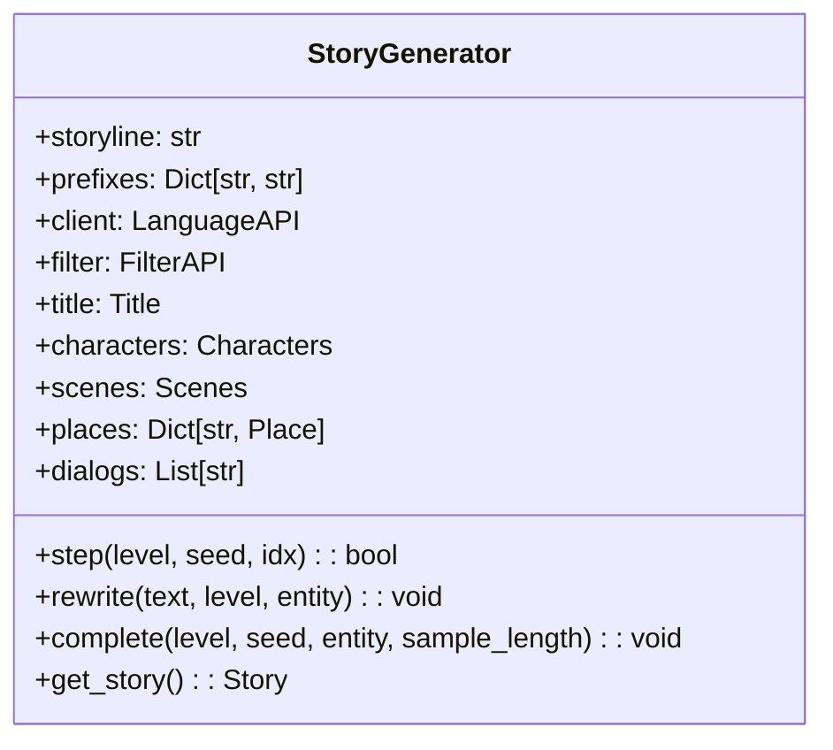

Key methods:
- `step()`: Advances the generation process to the next level
- `rewrite()`: Allows manual rewriting of any generated element
- `complete()`: Continues generation from existing content
- `get_story()`: Returns the complete Story object

Sources: [colab/dramatron.ipynb:983-1363]()

### LanguageAPI

The `LanguageAPI` is an abstract interface for interacting with large language models. It provides a unified sampling mechanism regardless of the underlying model implementation.

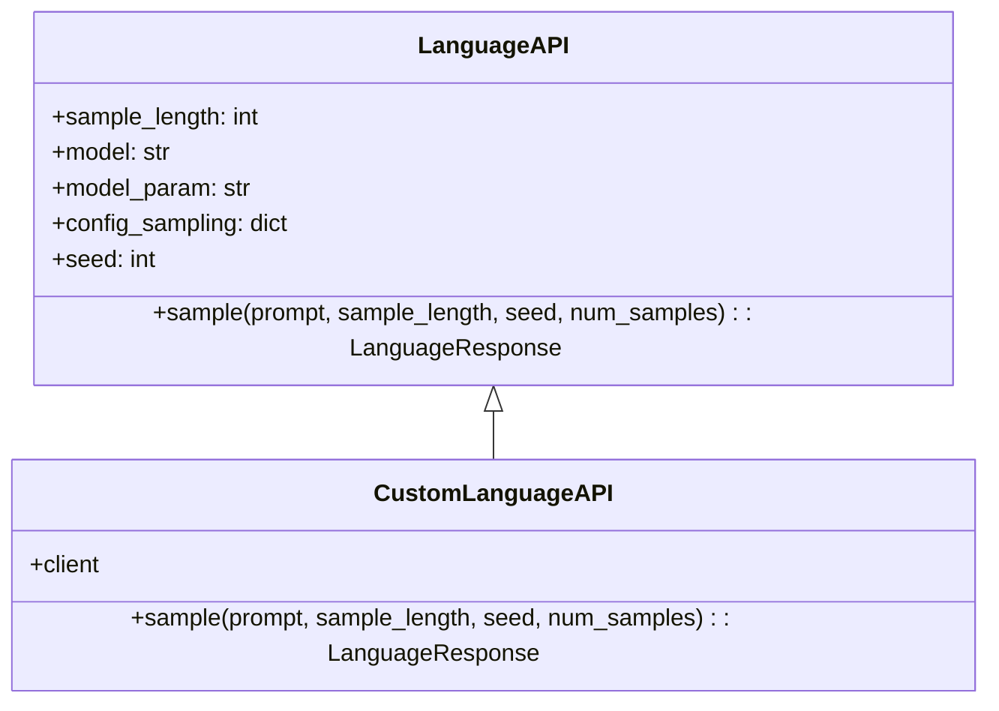

The implementation requires a concrete subclass that implements the `sample()` method to connect with a specific language model service.

Sources: [colab/dramatron.ipynb:562-623]()

### Script Elements

The core data structures that represent different parts of a script:

| Class | Description | Key Properties |
|-------|-------------|----------------|
| `Title` | Represents the script title | `title: str` |
| `Character` | Individual character | `name: str`, `description: str` |
| `Characters` | Collection of characters | `character_descriptions: Dict[str, str]` |
| `Scene` | Individual scene | `place: str`, `plot_element: str`, `beat: str` |
| `Scenes` | Collection of scenes | `scenes: List[Scene]` |
| `Place` | Location where scenes occur | `name: str`, `description: str` |
| `Story` | Complete story object | Contains all script elements |

Each class includes methods for parsing text into structured data (`from_string()`) and serializing back to text (`to_string()`).

Sources: [colab/dramatron.ipynb:217-406]()

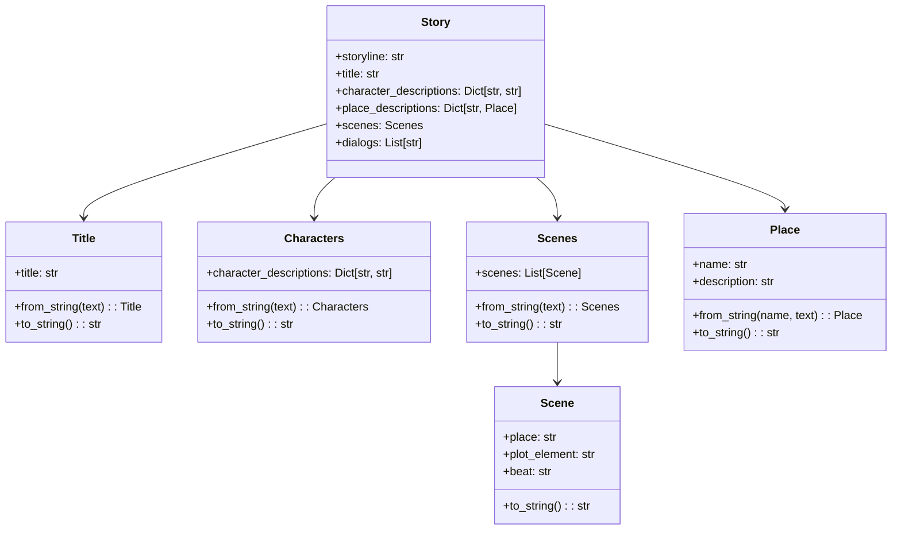

Sources: [colab/dramatron.ipynb:217-406]()

## Generation Functions

Dramatron uses specialized generation functions for each element of the script. Each function follows a similar pattern: take input context, construct a prompt, call the language model, and parse the response.

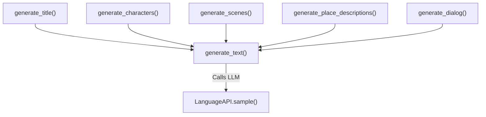

| Function | Purpose | Input | Output |
|----------|---------|-------|--------|
| `generate_text()` | Base text generation function | Prompt, client, parameters | Generated text |
| `generate_title()` | Generate script title | Storyline | Title object |
| `generate_characters()` | Generate characters | Storyline | Characters object |
| `generate_scenes()` | Generate scene sequence | Storyline, characters | Scenes object |
| `generate_place_descriptions()` | Generate place descriptions | Storyline, scenes | Dict of Place objects |
| `generate_dialog()` | Generate scene dialog | Storyline, scenes, characters, places | Dialog text |

Sources: [colab/dramatron.ipynb:637-902]()

## Rendering Functions

The final script is rendered in Fountain format using the `render_story()` function, which combines all generated elements into a properly formatted screenplay.

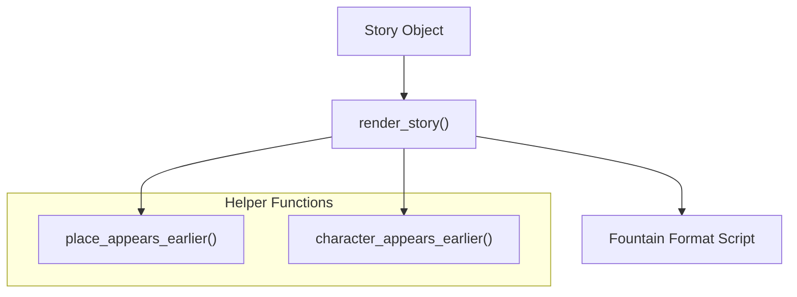

The rendering process:
1. Outputs title and metadata
2. Lists characters and their descriptions
3. Summarizes scenes
4. For each scene:
   - Outputs the scene heading
   - Includes place description (if first appearance)
   - Includes character descriptions (if first appearance)
   - Outputs the dialog

Sources: [colab/dramatron.ipynb:437-519]()

## Execution Flow

The complete generation process in Dramatron follows this sequence:

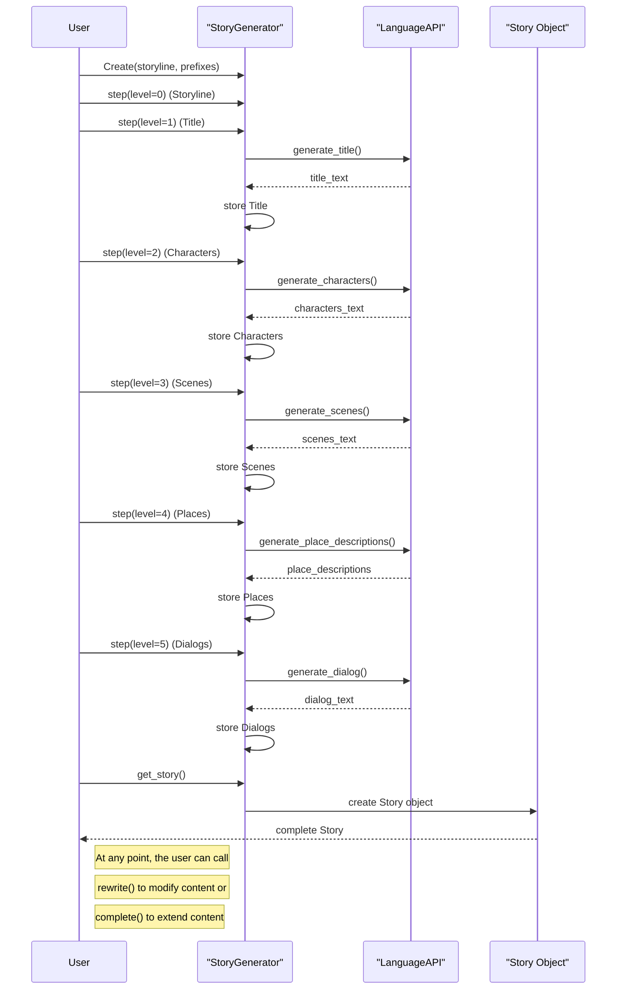

Sources: [colab/dramatron.ipynb:983-1226]()

## User Intervention

An important aspect of Dramatron is the ability for users to intervene in the generation process. The `StoryGenerator` class provides methods for human intervention:

- `rewrite(text, level, entity)`: Allows replacing generated content with user-written text
- `complete(level, seed, entity, sample_length)`: Continues generation from existing content

The system keeps track of all user interventions in an `interventions` dictionary, with timestamps as keys.

Sources: [colab/dramatron.ipynb:1227-1362]()

---

# Page: Hierarchical Generation Process

# Hierarchical Generation Process

<details>
<summary>Relevant source files</summary>

The following files were used as context for generating this wiki page:

- [README.md](README.md)
- [colab/dramatron.ipynb](colab/dramatron.ipynb)
- [docs/details.html](docs/details.html)
- [dramatron-animation.gif](dramatron-animation.gif)

</details>


## Purpose and Scope

This document explains Dramatron's hierarchical generation process, which is the core methodology used to create cohesive, long-form dramatic scripts. The hierarchical approach ensures consistency across generated content by creating elements in a specific sequence, with each new element building upon previous ones. This page focuses on the technical implementation of this generation process, including the workflow, data flow, and code structure.

For information about the data structures used to store the generated content, see [Data Structures](#2.3).

Sources: [README.md:12-13](), [docs/details.html:31-38]()

## Hierarchical Generation Overview

Dramatron uses a top-down approach to script generation, beginning with a high-level storyline and progressively adding more detailed elements. This hierarchical process helps maintain consistency throughout the generated script by ensuring that later elements (like dialog) are informed by earlier elements (like character descriptions).

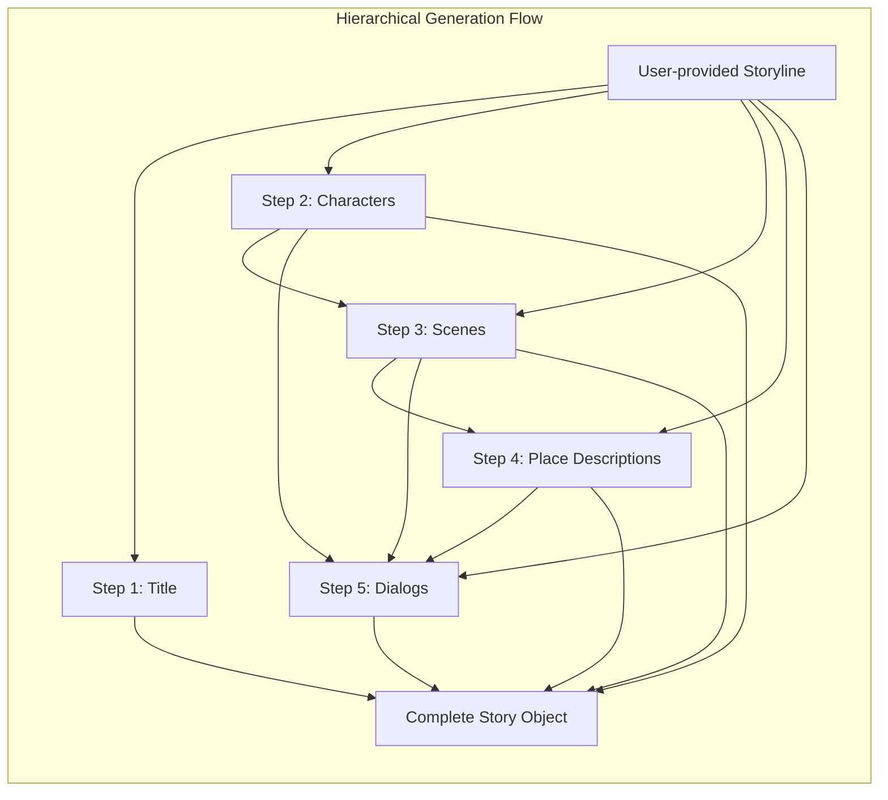

This hierarchical approach creates a dependency structure where each generation step relies on previously generated content. For example, dialog generation requires knowledge of characters, scenes, and place descriptions.

Sources: [colab/dramatron.ipynb:982-1040](), [docs/details.html:32-37]()

## Generation Workflow Steps

Let's explore each step in the hierarchical generation process:

### 1. Storyline (Starting Point)

The process begins with a user-provided storyline, which is a brief summary of the overall plot. This serves as the foundation for all subsequent generations.

- **Input**: A text string provided by the human co-writer
- **Processing**: Formatted to ensure proper ending punctuation
- **Output**: Used as a base for all future generation steps

In the code, the storyline is set in the `StoryGenerator._set_storyline` method and stored as `self._storyline`.

Sources: [colab/dramatron.ipynb:1027-1038]()

### 2. Title Generation

The first generated element is the title, which is created based on the storyline.

- **Input**: Storyline, generation prompt
- **Function**: `generate_title()`
- **Output**: A `Title` object containing the generated title

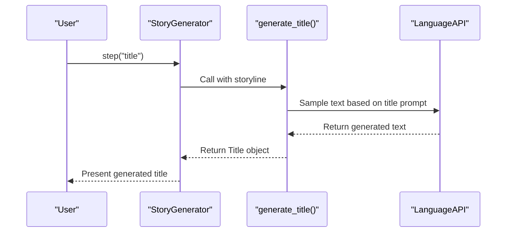

Sources: [colab/dramatron.ipynb:721-739]()

### 3. Character Generation

Next, characters are generated based on the storyline.

- **Input**: Storyline, generation prompt
- **Function**: `generate_characters()`
- **Output**: A `Characters` object containing multiple `Character` objects with names and descriptions

The character generation creates a set of characters that will appear in the script, each with a name and description that aligns with the storyline.

Sources: [colab/dramatron.ipynb:742-763]()

### 4. Scene Generation

With the storyline and characters defined, the system generates scenes.

- **Input**: Storyline, character descriptions, generation prompt
- **Function**: `generate_scenes()`
- **Output**: A `Scenes` object containing multiple `Scene` objects with place, plot element, and beat

Each scene includes a place where it occurs, a plot element (e.g., beginning, middle, conclusion), and a beat (a specific dramatic event).

Sources: [colab/dramatron.ipynb:766-789]()

### 5. Place Description Generation

For each unique place mentioned in the scenes, detailed descriptions are generated.

- **Input**: Storyline, scenes, generation prompt
- **Function**: `generate_place_descriptions()`
- **Output**: A dictionary mapping place names to `Place` objects containing descriptions

These descriptions help establish the physical setting for each scene in the script.

Sources: [colab/dramatron.ipynb:792-823]()

### 6. Dialog Generation

Finally, dialog is generated for each scene based on all previous elements.

- **Input**: Storyline, scenes, character descriptions, place descriptions, generation prompt
- **Function**: `generate_dialog()`
- **Output**: Dialog text for the scene

The dialog generation takes into account the characters present in the scene, the setting, and the dramatic beat to create appropriate conversation.

Sources: [colab/dramatron.ipynb:851-902]()

## Technical Implementation

The hierarchical generation process is primarily implemented in the `StoryGenerator` class, which coordinates all generation steps and manages their inputs and outputs.

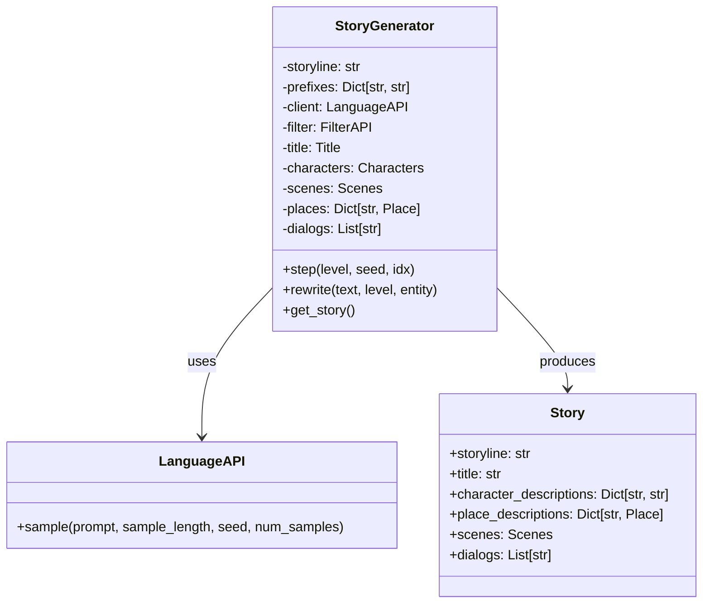

The `StoryGenerator` class maintains state for all generated elements and exposes methods to:
- Progress through generation steps (`step()`)
- Allow for human intervention and rewrites (`rewrite()`)
- Package all generated content into a final `Story` object (`get_story()`)

Each generation function (`generate_title()`, `generate_characters()`, etc.) follows a similar pattern:
1. Construct a prompt based on previous elements
2. Call the language model through the `LanguageAPI`
3. Parse the generated text into the appropriate data structure
4. Return both the structured data and the prompt used for generation

Sources: [colab/dramatron.ipynb:982-1039](), [colab/dramatron.ipynb:721-902]()

## Data Flow Between Generation Steps

The following diagram illustrates how data flows between the different stages of the hierarchical generation process:

```mermaid
flowchart TD
    subgraph "Data Flow in Hierarchical Generation"
        Storyline["Storyline (User Input)"] 
        
        subgraph "Step 1: Title Generation"
            TitleIn["Input: Storyline"]
            TitleFunc["Function: generate_title()"]
            TitleOut["Output: Title object"]
            
            TitleIn --> TitleFunc --> TitleOut
        end
        
        subgraph "Step 2: Character Generation"
            CharIn["Input: Storyline"]
            CharFunc["Function: generate_characters()"]
            CharOut["Output: Characters object"]
            
            CharIn --> CharFunc --> CharOut
        end
        
        subgraph "Step 3: Scene Generation"
            SceneIn["Input: Storyline + Characters"]
            SceneFunc["Function: generate_scenes()"]
            SceneOut["Output: Scenes object"]
            
            SceneIn --> SceneFunc --> SceneOut
        end
        
        subgraph "Step 4: Place Generation"
            PlaceIn["Input: Storyline + Scenes"]
            PlaceFunc["Function: generate_place_descriptions()"]
            PlaceOut["Output: Dict[str, Place]"]
            
            PlaceIn --> PlaceFunc --> PlaceOut
        end
        
        subgraph "Step 5: Dialog Generation"
            DialogIn["Input: Storyline + Characters + Scenes + Places"]
            DialogFunc["Function: generate_dialog()"]
            DialogOut["Output: Dialog text"]
            
            DialogIn --> DialogFunc --> DialogOut
        end
        
        Storyline --> TitleIn
        Storyline --> CharIn
        Storyline --> SceneIn
        CharOut --> SceneIn
        Storyline --> PlaceIn
        SceneOut --> PlaceIn
        Storyline --> DialogIn
        CharOut --> DialogIn
        SceneOut --> DialogIn
        PlaceOut --> DialogIn
        
        TitleOut & CharOut & SceneOut & PlaceOut & DialogOut --> StoryObj["Complete Story Object"]
    end
```

This diagram shows how each step in the generation process depends on and builds upon previous steps, creating a cohesive narrative structure.

Sources: [colab/dramatron.ipynb:721-902]()

## User Interaction Model

Dramatron's hierarchical generation is designed for human-AI collaboration. At each step in the process, the human co-writer can:

1. Review the generated content
2. Accept it as is
3. Request a regeneration with the same parameters
4. Rewrite or modify the content directly
5. Proceed to the next generation step

This interaction model is implemented in the `StoryGenerator.step()` and `StoryGenerator.rewrite()` methods, which allow for progression through the hierarchy and intervention at any stage.

```mermaid
sequenceDiagram
    participant Author as "Human Author"
    participant SG as "StoryGenerator"
    participant LLM as "Language Model"
    
    Author->>SG: Provide storyline
    
    loop For each generation level
        Author->>SG: step(level, seed)
        SG->>LLM: Generate content
        LLM-->>SG: Return generated text
        SG-->>Author: Present generated element
        
        alt Accept generation
            Author->>SG: Proceed to next step
        else Request regeneration
            Author->>SG: step(level, new_seed)
            SG->>LLM: Regenerate with new seed
            LLM-->>SG: Return new text
            SG-->>Author: Present updated element
        else Manually rewrite
            Author->>SG: rewrite(new_text, level)
            SG-->>Author: Confirm changes
        end
    end
    
    Author->>SG: get_story()
    SG-->>Author: Complete story object
```

This collaborative workflow ensures that the human author maintains creative control while leveraging the language model's capabilities to generate coherent and consistent content.

Sources: [colab/dramatron.ipynb:982-1040](), [docs/details.html:32-37](), [README.md:12-23]()

## Benefits and Limitations

### Benefits of Hierarchical Generation

1. **Consistency**: By generating elements in sequence and using previous elements as context, the hierarchical approach helps maintain consistency throughout the script.

2. **Structured Narrative**: The process naturally enforces a traditional narrative structure with defined characters, settings, and plot points.

3. **Controllable Generation**: The step-by-step process allows for targeted human intervention at each stage, rather than having to regenerate an entire script.

### Limitations

1. **Fixed Creative Process**: As noted in the documentation, "Dramatron's top-down hierarchical story generation structure does not correspond to every writer's writing process."

2. **Sequential Dependency**: Errors or weaknesses in early steps propagate to later steps, potentially amplifying issues.

3. **Formulaic Output**: The structured approach can lead to formulaic writing that follows conventional patterns too rigidly.

These limitations emphasize why Dramatron is designed specifically as a co-writing tool rather than an autonomous script generator.

Sources: [docs/details.html:56-64](), [README.md:21-22](), [docs/details.html:82-89]()

---

# Page: Data Structures

# Data Structures

<details>
<summary>Relevant source files</summary>

The following files were used as context for generating this wiki page:

- [README.md](README.md)
- [colab/dramatron.ipynb](colab/dramatron.ipynb)
- [dramatron-animation.gif](dramatron-animation.gif)

</details>


This page documents the core data structures used in Dramatron, the script co-writing system that leverages large language models to generate theatre scripts and screenplays. These data structures implement the hierarchical generation approach that ensures long-range consistency throughout the generated script.

For information about how these data structures are used in the generation process, see [Hierarchical Generation Process](#2.2). For the API reference that manipulates these data structures, see [StoryGenerator Class](#4.1).

## Key Data Structures Overview

Dramatron uses several specialized classes to represent different components of a script. These classes are organized in a hierarchical structure that mirrors the script generation process.

```mermaid
classDiagram
    Story *-- "1" Title
    Story *-- "1" Characters
    Story *-- "1" Scenes
    Story *-- "1..*" Place
    Story *-- "0..*" String: dialogs
    Characters *-- "0..*" Character
    Scenes *-- "0..*" Scene
    
    class Title {
        +String title
        +from_string(text)
        +to_string()
    }
    
    class Character {
        +String name
        +String description
        +from_string(text)
    }
    
    class Characters {
        +Dict~String, String~ character_descriptions
        +from_string(text)
        +to_string()
    }
    
    class Scene {
        +String place
        +String plot_element
        +String beat
        +to_string()
    }
    
    class Scenes {
        +List~Scene~ scenes
        +from_string(text)
        +to_string()
        +num_places()
        +num_scenes()
    }
    
    class Place {
        +String name
        +String description
        +from_string(place_name, place_text)
        +format_prefix(name)
        +format_name(name)
        +to_string()
    }
    
    class Story {
        +String storyline
        +String title
        +Dict~String, String~ character_descriptions
        +Dict~String, Place~ place_descriptions 
        +Scenes scenes
        +List~String~ dialogs
    }
```

Sources: [colab/dramatron.ipynb:217-405]()

## Story Class

The `Story` class is the central data structure that holds all components of a generated script. It serves as the container for the title, characters, scenes, places, and dialogs, providing a cohesive representation of the entire script.

```mermaid
graph TD
    Storyline["Storyline (User Input)"] --> Story

    subgraph "Story Components"
        Title["Title"]
        CharacterDesc["Character Descriptions"]
        PlaceDesc["Place Descriptions"]
        Scenes["Scenes"]
        Dialogs["Dialogs"]
    end

    Story --> Title
    Story --> CharacterDesc
    Story --> PlaceDesc
    Story --> Scenes
    Story --> Dialogs

    Scenes --> Scene1["Scene 1"]
    Scenes --> Scene2["Scene 2"]
    Scenes --> SceneN["Scene N"]

    Scene1 --> Place1["Place Reference"]
    Scene1 --> Plot1["Plot Element"]
    Scene1 --> Beat1["Beat Description"]

    PlaceDesc --> PlaceDetails["Place Name: Description"]
```

Sources: [colab/dramatron.ipynb:386-405](), [colab/dramatron.ipynb:1214-1225]()

The `Story` class is defined as a `NamedTuple` with the following attributes:

| Attribute | Type | Description |
|-----------|------|-------------|
| storyline | str | A single sentence summary of the whole plot |
| title | str | The title of the script |
| character_descriptions | Dict[str, str] | Map from character names to full descriptions |
| place_descriptions | Dict[str, Place] | Map from place names to full descriptions |
| scenes | Scenes | Collection of scenes in the script |
| dialogs | List[str] | List of dialogs, one for each scene |

The `Story` object is created by the `StoryGenerator.get_story()` method after all the hierarchical generation steps have completed.

Sources: [colab/dramatron.ipynb:386-405](), [colab/dramatron.ipynb:1214-1225]()

## Component Data Structures

### Title

The `Title` class is a simple wrapper around a string representing the script's title.

```python
class Title(NamedTuple):
    """Title class."""
    title: str
```

It provides methods for serialization and deserialization:
- `from_string(text)`: Creates a Title object from generated text
- `to_string()`: Converts the Title object to a formatted string

Sources: [colab/dramatron.ipynb:217-231]()

### Character and Characters

Characters in Dramatron are represented by two related classes:

1. `Character`: Represents an individual character with a name and description
2. `Characters`: A collection of character descriptions

```python
class Character(NamedTuple):
    """Character class."""
    name: str  # Name of the character
    description: str  # A single sentence describing the character
```

```python
class Characters(NamedTuple):
    """Characters class, containing main characters and their descriptions."""
    character_descriptions: Dict[str, str]  # A dictionary of character descriptions
```

The `Characters` class provides methods to parse generated text and extract individual characters, as well as to serialize the collection back to text.

Sources: [colab/dramatron.ipynb:238-292]()

### Scene and Scenes

Scenes are represented by two key classes:

1. `Scene`: An individual scene with place, plot element, and beat description
2. `Scenes`: A collection of Scene objects

```python
class Scene(NamedTuple):
    """Scene class."""
    place: str  # The name of the place where the scene unfolds
    plot_element: str  # Name of the plot element (e.g., Beginning, Middle, Conclusion)
    beat: str  # A short description of action/story/dramatic event occurring in the scene
```

```python
class Scenes(NamedTuple):
    """Scenes class."""
    scenes: List[Scene]  # A list of scenes
```

The `Scenes` class provides methods for parsing generated text into structured scenes and serializing the collection back to text. It also offers utility methods like `num_places()` and `num_scenes()`.

Sources: [colab/dramatron.ipynb:295-348]()

### Place

The `Place` class represents a location where scenes occur:

```python
class Place(NamedTuple):
    """Place class."""
    name: str  # Place name
    description: str  # Place description
```

It provides methods for formatting place names, parsing place descriptions from generated text, and serializing place information.

Sources: [colab/dramatron.ipynb:351-379]()

## Data Flow and Processing

The data structures in Dramatron work together to support the hierarchical generation process. The following diagram illustrates how data flows through these structures during script generation:

```mermaid
flowchart TD
    Storyline["Storyline (User Input)"] --> StoryGenerator

    subgraph "StoryGenerator Steps"
        GenTitle["generate_title()"]
        GenCharacters["generate_characters()"]
        GenScenes["generate_scenes()"]
        GenPlaces["generate_place_descriptions()"]
        GenDialogs["generate_dialog()"]
    end

    StoryGenerator --> GenTitle
    GenTitle --> Title["Title Object"]

    StoryGenerator --> GenCharacters
    GenCharacters --> Characters["Characters Object"]

    StoryGenerator --> GenScenes
    Characters --> GenScenes
    GenScenes --> Scenes["Scenes Object"]

    StoryGenerator --> GenPlaces
    Scenes --> GenPlaces
    GenPlaces --> Places["Place Objects"]

    StoryGenerator --> GenDialogs
    Characters --> GenDialogs
    Scenes --> GenDialogs
    Places --> GenDialogs
    GenDialogs --> Dialogs["Dialog Strings"]

    Title --> Story["Story Object"]
    Characters --> Story
    Scenes --> Story
    Places --> Story
    Dialogs --> Story
    Storyline --> Story
```

Sources: [colab/dramatron.ipynb:637-902](), [colab/dramatron.ipynb:1077-1225]()

## Text Extraction and Processing

Dramatron includes utility functions to extract data from generated text and process it into structured objects:

### extract_elements Function

A key utility function used by many data structure classes is `extract_elements()`, which parses text based on start and end markers:

```python
def extract_elements(text: str, begin: str, end: str) -> List[str]:
    """Extracts elements from a text string given string and ending markers."""
```

This function is used extensively by the data structure classes to parse generated text into structured data.

Sources: [colab/dramatron.ipynb:408-421]()

## Markers and Elements

Dramatron uses a series of markers and element identifiers to structure the generated text and to parse it back into data structures. These markers are defined as constants in the code:

| Marker | Purpose |
|--------|---------|
| END_MARKER | Marks the end of a generation section |
| STOP_MARKER | Marks the end of an individual element |
| CHARACTER_MARKER | Identifies character information |
| DESCRIPTION_MARKER | Identifies description text |
| SCENES_MARKER | Identifies scene information |
| DIALOG_MARKER | Identifies dialog text |
| TITLE_ELEMENT | Labels title sections |
| CHARACTERS_ELEMENT | Labels character sections |
| PLACE_ELEMENT | Labels place sections |
| PLOT_ELEMENT | Labels plot element sections |
| BEAT_ELEMENT | Labels beat sections |

These markers are used both during generation (to structure prompts) and during parsing (to extract structured information from generated text).

Sources: [colab/dramatron.ipynb:180-210]()

## Serialization and Rendering

Each data structure in Dramatron provides methods to serialize itself to text, which is particularly important for two purposes:

1. Creating prompts for the next generation step by incorporating previously generated content
2. Rendering the final script in a readable format

The `render_story()` function takes a `Story` object and transforms it into a properly formatted screenplay in the Fountain format:

```python
def render_story(story: Story) -> str:
    """Render the story in fountain format."""
```

This function provides the final output of the generation process, producing a complete script that incorporates all the elements stored in the Story object.

Sources: [colab/dramatron.ipynb:436-519]()

## Relationship to Language API

The data structures interact with the language model through the `LanguageAPI` class, which provides an abstraction layer for generating text:

```mermaid
flowchart TD
    StoryGen["StoryGenerator"] --> |Uses| LangAPI["LanguageAPI"]
    LangAPI --> |Returns| LangResp["LanguageResponse"]
    
    LangResp --> |Used to create| DS["Data Structures"]
    
    subgraph "Data Structures"
        Title
        Characters
        Scenes
        Place
    end
    
    DS --> Story["Story"]
```

The `LanguageResponse` class encapsulates the prompts sent to the language model and the generated responses:

```python
class LanguageResponse(NamedTuple):
    prompt: str
    prompt_length: int
    text: str
    text_length: int
```

This structure bridges the gap between the raw language model API and the structured data needed for script generation.

Sources: [colab/dramatron.ipynb:554-558](), [colab/dramatron.ipynb:561-622]()

## Using Data Structures in Custom Applications

When developing custom applications with Dramatron, you'll primarily interact with these data structures through the `StoryGenerator` class, which manages the creation and modification of all script components.

The typical workflow includes:

1. Creating a `StoryGenerator` with an initial storyline
2. Stepping through the generation levels to create title, characters, scenes, etc.
3. Retrieving the final `Story` object using `get_story()`
4. Rendering the story to a formatted script

This structure allows for interactive use, where human writers can provide input and modify generated content at each step of the process.

Sources: [colab/dramatron.ipynb:983-1363]()

---

# Page: User Guide

# User Guide

<details>
<summary>Relevant source files</summary>

The following files were used as context for generating this wiki page:

- [README.md](README.md)
- [colab/dramatron.ipynb](colab/dramatron.ipynb)
- [docs/details.html](docs/details.html)
- [dramatron-animation.gif](dramatron-animation.gif)

</details>


This guide provides comprehensive instructions for using Dramatron, a co-writing system for theatre scripts and screenplays that leverages large language models (LLMs). The guide walks through the setup process, explains the intended workflow, and covers customization options for the generation process. For information about the system architecture and how Dramatron works internally, see [System Architecture](#2).

## 1. Introduction to Dramatron

Dramatron is designed as a co-writing tool that assists human writers in creating theatre scripts and screenplays. It uses a hierarchical generation approach, starting from a high-level storyline and progressively generating more detailed elements of the script, including title, characters, scenes, place descriptions, and dialogue.

The system is not intended to be used autonomously but rather as a collaborative tool that provides material for human authors to compile, edit, and rewrite.

### Dramatron Workflow Overview

```mermaid
flowchart TD
    subgraph "User Input"
        A["Provide Storyline"]
    end
    
    subgraph "Hierarchical Generation"
        B["1. Generate Title"]
        C["2. Generate Characters"]
        D["3. Generate Scenes"]
        E["4. Generate Place Descriptions"]
        F["5. Generate Dialogues"]
    end
    
    subgraph "Human Intervention"
        G["Review & Edit"]
        H["Rewrite Elements"]
        I["Adjust Parameters"]
    end
    
    subgraph "Output"
        J["Fountain Format Script"]
    end
    
    A --> B
    B --> C
    C --> D
    D --> E
    E --> F
    
    B & C & D & E & F --> G
    G --> H
    H --> B & C & D & E & F
    G --> I
    I --> B & C & D & E & F
    G --> J
```

Sources: [colab/dramatron.ipynb:42-59](), [README.md:10-23]()

## 2. Setting Up Dramatron

### 2.1 Running the Colab Notebook

Dramatron is implemented as a Google Colab notebook, which provides an interactive Python environment in your browser.

1. Open the Dramatron notebook by visiting the GitHub repository and clicking on the "Open in Colab" button, or directly access it at: https://colab.research.google.com/github/deepmind/dramatron/blob/main/colab/dramatron.ipynb

2. Once in Colab, click on the "Connect" button in the top-right corner to connect to a runtime.

3. Run the license and imports cells by clicking on their respective play buttons.

### 2.2 Configuring a Language Model API

Dramatron requires access to a large language model to function. The repository comes with support for Google Gemini, but you'll need to provide your own API key.

#### Google Gemini Setup

```mermaid
sequenceDiagram
    participant User
    participant Colab as "Dramatron Colab"
    participant API as "Google AI Studio"
    participant Gemini as "Gemini LLM"
    
    User->>API: Register at AI Studio
    API-->>User: Provide API Key
    User->>Colab: Enter API Key
    Colab->>Gemini: Initialize Connection
    Gemini-->>Colab: Connection Established
    User->>Colab: Input Storyline
    Colab->>Gemini: Send Prompts
    Gemini-->>Colab: Return Generations
    Colab-->>User: Display Results
```

1. Run the "Google Gemini only: Install dependencies" cell to install the required libraries.

2. Visit [Google AI Studio](https://ai.google.dev/) to create an account and obtain an API key.

3. In the "Google Gemini Language API" section of the notebook, enter your API key in the appropriate field.

4. Configure any additional parameters for the Gemini model as needed.

Sources: [colab/dramatron.ipynb:76-86](), [colab/dramatron.ipynb:1640-1698]()

## 3. Using Dramatron

### 3.1 Co-Writing Workflow

Dramatron uses a structured, hierarchical approach to script generation. The workflow consists of the following steps:

```mermaid
graph TD
    A["1. Input Storyline"] --> B["2. Generate Title"]
    B --> C["3. Generate Characters"]
    C --> D["4. Generate Scenes"]
    D --> E["5. Generate Place Descriptions"]
    E --> F["6. Generate Dialogues"]
    F --> G["7. Render Final Script"]
    
    H["Human Review/Edit"] --> B & C & D & E & F
    
    B & C & D & E & F --> SG["StoryGenerator.step()"]
    H --> SR["StoryGenerator.rewrite()"]
    
    subgraph "StoryGenerator Methods"
        SG
        SR
    end
```

#### Step 1: Provide a Storyline

The storyline is a concise summary of your story concept, serving as the foundation for all subsequent generations.

1. In the "Generate script using Dramatron" section, enter your storyline in the provided text field.
2. A good storyline should be brief (one or two sentences) but contain the core dramatic elements of your story.

Example storyline:
```
A brilliant but reclusive mathematician discovers a formula that can predict the future, but struggles with the ethical implications of using it.
```

#### Step 2: Generate Script Elements

For each level of the script hierarchy (title, characters, scenes, places, dialogues), you will:

1. Click the "Step" button to generate that level.
2. Review the generated content.
3. If satisfied, proceed to the next level.
4. If not satisfied, use the "Rewrite" feature to regenerate that element.

#### Step 3: Edit and Refine

After generating all elements, you can:

1. Review the complete script.
2. Make manual adjustments to any part of the script.
3. Save the script in Fountain format using the provided buttons.

Sources: [colab/dramatron.ipynb:983-1039](), [colab/dramatron.ipynb:1825-1853]()

### 3.2 The StoryGenerator Interface

The `StoryGenerator` class is the main interface for interacting with Dramatron. Here are the key methods:

| Method | Description | Parameters |
|--------|-------------|------------|
| `step()` | Generate the next level of the script | `level`: script level to generate<br>`seed`: random seed (optional)<br>`idx`: index for specific generations (optional) |
| `rewrite()` | Regenerate a specific element | `text`: text to replace current generation<br>`level`: level to rewrite<br>`entity`: entity index (if applicable) |
| `complete()` | Generate content for a level | `level`: generation level<br>`seed`: random seed<br>`entity`: specific entity to generate<br>`sample_length`: max length of generation |
| `get_story()` | Return the complete story object | None |

```mermaid
classDiagram
    class StoryGenerator {
        +step(level, seed, idx)
        +rewrite(text, level, entity)
        +complete(level, seed, entity, sample_length)
        +get_story()
    }
    
    class User {
        +provide_storyline()
        +review_output()
        +edit_content()
    }
    
    User -- StoryGenerator : interacts with
```

Sources: [colab/dramatron.ipynb:983-1039](), [colab/dramatron.ipynb:1825-1906]()

## 4. Customizing the Generation Process

### 4.1 Adjusting Generation Parameters

Dramatron's behavior can be customized by modifying various parameters:

| Parameter | Description | Default Value |
|-----------|-------------|---------------|
| `DEFAULT_SEED` | Initial random seed | 1 |
| `SAMPLING_PROB` | Top-p probability for sampling | 0.95 |
| `SAMPLING_TEMP` | Temperature for generation | 1.0 |
| `SAMPLE_LENGTH_TITLE` | Max length for title generation | 64 |
| `SAMPLE_LENGTH_PLACE` | Max length for place descriptions | 128 |
| `SAMPLE_LENGTH` | Max length for other generations | 511 |
| `MAX_PARAGRAPH_LENGTH` | Max length during repeated sampling | 1024 |
| `MAX_NUM_REPETITIONS` | Max repetitions before resampling | 3 |

These parameters can be adjusted in the "Dramatron hyperparameters" section of the notebook.

Sources: [colab/dramatron.ipynb:138-163]()

### 4.2 Customizing Prompts

Dramatron uses a set of predefined prompts for each generation level. These prompts can be customized to guide the language model toward specific styles or structures:

```mermaid
graph LR
    subgraph "Prompt Types"
        A["TITLES_PROMPT"]
        B["CHARACTERS_PROMPT"]
        C["SCENE_PROMPT"]
        D["SETTING_PROMPT"]
        E["DIALOG_PROMPT"]
    end
    
    subgraph "Generation Functions"
        A --> GT["generate_title()"]
        B --> GC["generate_characters()"]
        C --> GS["generate_scenes()"]
        D --> GPD["generate_place_descriptions()"]
        E --> GD["generate_dialog()"]
    end
    
    GT & GC & GS & GPD & GD --> SG["StoryGenerator"]
```

To customize prompts:

1. Locate the "Prompt sets" section in the notebook.
2. Modify the prompt templates as needed, keeping the special markers (like `<character>`, `<dialog>`, etc.) intact.
3. Consider how your changes might affect the generation style and structure.

Sources: [colab/dramatron.ipynb:1700-1823]()

### 4.3 Using Content Moderation

Dramatron provides optional integration with the Perspective API for content moderation:

1. To enable content filtering, uncomment and configure the "Perspective API" section.
2. Obtain an API key from the [Perspective API website](https://perspectiveapi.com/).
3. Configure the moderation thresholds as needed.

Content moderation helps filter out potentially inappropriate generations, though it's still important to review all outputs manually.

Sources: [colab/dramatron.ipynb:2124-2184]()

## 5. Output and Post-Processing

### 5.1 Understanding the Fountain Format

The final script is rendered in Fountain format, a plain text markup language designed for screenplays:

| Fountain Element | Meaning | Example |
|------------------|---------|---------|
| Scene Header | Location and time | `INT/EXT. MATHEMATICIAN'S OFFICE - DAY` |
| Character Name | Character speaking | `EMMA` |
| Dialogue | Character's speech | Dialogue text without markup |
| Parenthetical | Action or direction | `(nervously)` |
| Action | Scene description | Description text without markup |

The notebook provides a function `render_story()` that automatically formats the generated content according to Fountain syntax.

Sources: [colab/dramatron.ipynb:436-543]()

### 5.2 Saving and Exporting Scripts

Dramatron provides several options for saving your work:

1. **Save to Google Drive**: Use the "Save to Google Drive" button to save the script to your Google Drive account.

2. **Download as File**: Use the "Download script" button to download the script as a text file to your local computer.

3. **Copy to Clipboard**: Some of the notebook cells will display the full script, which you can copy and paste into your preferred text editor.

The script output includes metadata such as the title, author information, and a reference to Dramatron as a co-writer.

Sources: [colab/dramatron.ipynb:1979-2019]()

## 6. Troubleshooting and Best Practices

### 6.1 Handling Common Issues

| Issue | Potential Solution |
|-------|-------------------|
| Generation loops or repetitions | Increase the `MAX_NUM_REPETITIONS` parameter or use a different random seed |
| Insufficient variety in generations | Increase the `SAMPLING_TEMP` parameter for more creative outputs |
| Script too short or incomplete | Increase the appropriate `SAMPLE_LENGTH` parameters |
| API errors | Check your API key and connection, and retry with exponential backoff |
| Content filtered out | Review your input for potentially inappropriate content or adjust moderation settings |

### 6.2 Best Practices for Co-Writing

1. **Start with a clear storyline**: The quality of the initial storyline significantly impacts all subsequent generations.

2. **Iterative refinement**: Don't expect perfect outputs on the first try. Use the rewrite feature liberally.

3. **Human editing is essential**: Dramatron is meant to be a starting point, not a finished product. Always review and edit the generated content.

4. **Vary the seed for different options**: If you're not satisfied with a generation, try using a different random seed.

5. **Check for plagiarism**: As with any LLM-generated content, it's advisable to check for unintentional copying from existing works.

Sources: [README.md:18-23](), [docs/details.html:52-79]()

```mermaid
graph TD
    subgraph "Recommended Workflow"
        A["1. Draft clear storyline"]
        B["2. Generate script elements"]
        C["3. Review each generation"]
        D["4. Rewrite as needed"]
        E["5. Edit the complete script"]
        F["6. Finalize in your preferred editor"]
        
        A --> B
        B --> C
        C -->|Satisfied| B
        C -->|Not satisfied| D
        D --> B
        B -->|All elements generated| E
        E --> F
    end
```

Sources: [README.md:10-23](), [docs/details.html:30-38]()

## 7. Additional Resources

- **GitHub Repository**: Visit the [Dramatron GitHub repository](https://github.com/google-deepmind/dramatron) for the latest updates and documentation.

- **Research Paper**: Read the paper ["Co-Writing Screenplays and Theatre Scripts with Language Models: An Evaluation by Industry Professionals"](https://arxiv.org/abs/2209.14958) for insights into how professional writers use Dramatron.

- **Contact**: For questions or feedback, contact the Dramatron team at dramatron@deepmind.com.

Sources: [README.md:25-27](), [docs/details.html:80-96]()

---

# Page: Setting Up Dramatron

# Setting Up Dramatron

<details>
<summary>Relevant source files</summary>

The following files were used as context for generating this wiki page:

- [README.md](README.md)
- [colab/dramatron.ipynb](colab/dramatron.ipynb)
- [dramatron-animation.gif](dramatron-animation.gif)

</details>


This guide explains how to set up Dramatron, a hierarchical script co-writing system that leverages large language models (LLMs) to generate theatre scripts and screenplays. This page focuses specifically on the technical setup process, including configuring the language model connection and adjusting generation parameters. For information about using Dramatron after setup, see [Co-Writing Workflow](#3.2).

## Overview of Setup Requirements

Dramatron runs as a Google Colab notebook and requires connection to a large language model to function. The system is provided "unplugged," meaning you need to implement specific interfaces to connect it to your preferred language model.

```mermaid
flowchart TD
    A["Access Colab Notebook"] --> B["Run Initial Code Blocks"]
    B --> C["Configure Language Model Interface"]
    C --> D["Set Generation Parameters"]
    D --> E["Start Using Dramatron"]
    
    subgraph "Core Setup Steps"
        B
        C
        D
    end
    
    C --- F["Implement LanguageAPI Class"]
    F --- G["Connect to External LLM Service"]
```

Sources: [colab/dramatron.ipynb:1-32](), [README.md:5-9]()

## Accessing the Colab Notebook

Dramatron is implemented as a Colab notebook, which provides an interactive Python environment in your browser.

1. Open the notebook directly via this link: [https://colab.research.google.com/github/deepmind/dramatron/blob/main/colab/dramatron.ipynb](https://colab.research.google.com/github/deepmind/dramatron/blob/main/colab/dramatron.ipynb)
2. Alternatively, visit the GitHub repository, navigate to `colab/dramatron.ipynb`, and click "Open in Colab"
3. Make sure you're signed in to a Google account
4. Click "Connect" in the top-right corner to start the Python runtime

Sources: [README.md:5-9](), [colab/dramatron.ipynb:12-20]()

## Running Initial Setup

The notebook is divided into code blocks that need to be executed sequentially. Start with the basic setup:

1. Run the "License" block to display license information and verify the notebook is working
2. Run the "Imports" block to load required Python libraries
3. Run the "Dramatron hyperparameters" block to set initial generation parameters
4. Run the "Dramatron code" block to load the system's core functionality

Each block can be executed by clicking the play button next to it, or by using Shift+Enter.

Sources: [colab/dramatron.ipynb:12-20](), [colab/dramatron.ipynb:63-75]()

## Configuring the Language Model Interface

The most critical setup step is implementing the `LanguageAPI` interface to connect Dramatron to a language model. Dramatron uses an abstraction layer that allows it to work with various LLM providers.

### Understanding the LanguageAPI Class

The `LanguageAPI` class defines the interface between Dramatron and the language model. You need to implement two key methods:

```mermaid
classDiagram
    class "LanguageAPI" {
        +__init__(sample_length, model, etc.)
        +sample(prompt, sample_length, seed, num_samples)
        +default_sample_length
        +model
        +seed
    }
    
    class "CustomLanguageAPI" {
        +client
        +__init__(client_config)
        +sample(prompt, sample_length, seed, num_samples)
    }
    
    "LanguageAPI" <|-- "CustomLanguageAPI" : implements
    "CustomLanguageAPI" --> "External LLM" : connects to
    "StoryGenerator" --> "LanguageAPI" : uses
```

The abstract `LanguageAPI` class is defined in [colab/dramatron.ipynb:561-622]() and contains:

1. `__init__` method: Initialize the language model connection with parameters like sample length, model name, and sampling configuration
2. `sample` method: The core method that sends prompts to the language model and returns generations

You need to create a custom implementation of this class that connects to your preferred language model provider.

Sources: [colab/dramatron.ipynb:561-622](), [README.md:8-9]()

### Example: Setting Up Google Gemini

The notebook includes instructions for connecting to Google's Gemini API:

1. Run the "Google Gemini only: Install dependencies" block to install the required client library
2. Create an account with Google AI Studio (https://makersuite.google.com/app/apikey)
3. Generate an API key
4. Enter your API key in the appropriate field in the notebook
5. Implement the `CustomLanguageAPI` class to use the Gemini API

Below is a simplified example of what the implementation might look like (you'll need to adapt this based on the specific Gemini API client):

```python
import google.generativeai as genai

class GeminiLanguageAPI(LanguageAPI):
    def __init__(self, api_key, sample_length=512, model="gemini-pro", **kwargs):
        super().__init__(sample_length=sample_length, model=model, **kwargs)
        genai.configure(api_key=api_key)
        self._client = genai.GenerativeModel(model_name=model)
        
    def sample(self, prompt, sample_length=None, seed=None, num_samples=1):
        if sample_length is None:
            sample_length = self.default_sample_length
            
        responses = []
        for _ in range(num_samples):
            generation = self._client.generate_content(
                prompt,
                generation_config={
                    "max_output_tokens": sample_length,
                    "temperature": SAMPLING_TEMP,
                    "top_p": SAMPLING_PROB,
                    "seed": seed
                }
            )
            
            responses.append(LanguageResponse(
                prompt=prompt,
                prompt_length=len(prompt),
                text=generation.text,
                text_length=len(generation.text)
            ))
            
        return responses
```

Sources: [colab/dramatron.ipynb:75-87](), [colab/dramatron.ipynb:19-20]()

### Connecting to Other LLM Providers

You can implement the `LanguageAPI` for other providers by following a similar pattern:

1. Install the appropriate client library for your LLM provider
2. Create a custom class that inherits from `LanguageAPI`
3. Implement the `__init__` method to establish the connection
4. Implement the `sample` method to send prompts and retrieve responses

The implementation details will vary based on the API of your chosen provider.

## Configuring Generation Parameters

Dramatron uses several parameters to control the text generation process. These are set in the "Dramatron hyperparameters" code block:

| Parameter | Default | Description |
|-----------|---------|-------------|
| `DEFAULT_SEED` | 1 | Seed for reproducible generation |
| `SAMPLING_PROB` | 0.95 | Top-p probability for sampling |
| `SAMPLING_TEMP` | 1.0 | Temperature for controlling randomness |
| `SAMPLE_LENGTH_TITLE` | 64 | Max token length for title generation |
| `SAMPLE_LENGTH_PLACE` | 128 | Max token length for place descriptions |
| `SAMPLE_LENGTH` | 511 | Max token length for other generations |
| `MAX_PARAGRAPH_LENGTH` | 1024 | Max length during repeated sampling |
| `MAX_NUM_REPETITIONS` | 3 | Loop detection threshold |

These parameters can be adjusted based on your needs and the capabilities of your language model. Higher temperature values (closer to 1.0) produce more creative but potentially less coherent text, while lower values produce more predictable output.

```mermaid
flowchart LR
    subgraph "Generation Parameters"
        A["SAMPLING_TEMP"] --- B["Randomness Control"]
        C["SAMPLING_PROB"] --- D["Diversity Control"]
        E["SAMPLE_LENGTH"] --- F["Output Length"]
        G["MAX_NUM_REPETITIONS"] --- H["Loop Detection"]
    end
    
    subgraph "Effects"
        B --- B1["Higher: More creative\nLower: More focused"]
        D --- D1["Higher: More diverse\nLower: More focused"]
        F --- F1["Limits token usage\nand generation time"]
        H --- H1["Prevents repetitive\noutput patterns"]
    end
```

Sources: [colab/dramatron.ipynb:138-162]()

## Optional: Setting Up Content Moderation

Dramatron can optionally use the Perspective API for content moderation to filter out potentially inappropriate generations.

To enable content moderation:

1. Obtain a Perspective API key from Google Cloud
2. Implement the `FilterAPI` class to connect to the Perspective API
3. Pass your `FilterAPI` implementation to the `StoryGenerator` constructor

The `FilterAPI` class is defined in [colab/dramatron.ipynb:625-632]() and requires implementing a `validate` method that checks generated text against content policies.

Sources: [colab/dramatron.ipynb:625-632](), [README.md:23]()

## Initializing Dramatron

Once you've implemented the language model interface and configured the parameters, you can initialize the `StoryGenerator` class, which is the main entry point for using Dramatron:

```mermaid
flowchart TD
    A["Configure LanguageAPI"] --> B["Initialize StoryGenerator"]
    B --> C["Provide Storyline"]
    C --> D["Generate Script Elements"]
    
    B --- E["StoryGenerator Constructor"]
    E --- F["storyline: Initial plot idea"]
    E --- G["prefixes: Text prompts"]
    E --- H["client: LanguageAPI instance"]
    E --- I["filter: Optional FilterAPI"]
```

The `StoryGenerator` is defined in [colab/dramatron.ipynb:983-1363]() and takes the following parameters:

1. `storyline`: The initial plot idea provided by the user
2. `prefixes`: A dictionary of text prompts used for different generation stages
3. `client`: An instance of your `LanguageAPI` implementation
4. `filter`: An optional instance of your `FilterAPI` implementation
5. Various other parameters controlling generation behavior

After initializing the `StoryGenerator`, you can start the co-writing process by stepping through different levels of script generation (title, characters, scenes, etc.).

Sources: [colab/dramatron.ipynb:983-1363]()

## Troubleshooting Common Setup Issues

### API Connection Problems

If you encounter issues connecting to your language model API:

1. Verify that your API key is correct and has the necessary permissions
2. Check if the model name you're using is available through your provider
3. Ensure that your implementation properly handles rate limiting and errors

### Generation Quality Issues

If the generated content isn't meeting expectations:

1. Adjust the temperature and top-p parameters to control randomness and diversity
2. Try different models if available through your provider
3. Experiment with the sample length parameters to get more detailed generations

### Performance Considerations

Dramatron makes multiple API calls to generate a complete script. Be aware of:

1. API usage costs from your provider
2. Generation time, which increases with the sample length
3. Token limits of your chosen model

If you encounter "out of memory" errors in Colab, try:
1. Disconnecting and reconnecting to reset the runtime
2. Using a runtime with more memory (if available)
3. Reducing the maximum generation lengths

Sources: [colab/dramatron.ipynb:545-560](), [colab/dramatron.ipynb:138-162]()

By following this setup guide, you should be able to configure Dramatron with your preferred language model and start the co-writing process. For information on how to use Dramatron after setup, see [Co-Writing Workflow](#3.2).

---

# Page: Co-Writing Workflow

# Co-Writing Workflow

<details>
<summary>Relevant source files</summary>

The following files were used as context for generating this wiki page:

- [README.md](README.md)
- [colab/dramatron.ipynb](colab/dramatron.ipynb)
- [docs/details.html](docs/details.html)
- [dramatron-animation.gif](dramatron-animation.gif)

</details>


This page documents the intended workflow for collaborating with Dramatron to co-write theatre scripts and screenplays. It explains the interactive process between the human author and the system, including how to guide and intervene in the generation process at various stages. For technical details about the underlying API and implementation, see [API Reference](#4).

## Overview of the Co-Writing Process

Dramatron is designed as a co-creative system where large language models work alongside human authors to generate theatrical scripts and screenplays. Rather than replacing the human creative process, Dramatron serves as a tool that provides suggestions and draft content that authors can then edit, refine, and incorporate into their work.

The co-writing workflow follows a hierarchical generation approach, where each element builds upon previous elements to ensure consistency. The human author can intervene at any stage to guide the generation process.

```mermaid
flowchart TD
    subgraph "Human Author Domain"
        HumanIdea["Initial Creative Idea"]
        HumanEdit["Human Edits & Refinements"]
        HumanEval["Human Evaluation"]
        FinalScript["Final Script"]
    end
    
    subgraph "Dramatron System"
        Storyline["1. Storyline Input"]
        Title["2. Title Generation"]
        Characters["3. Character Generation"]
        Scenes["4. Scene Structure"]
        Places["5. Place Descriptions"]
        Dialogs["6. Dialog Generation"]
    end
    
    HumanIdea --> Storyline
    Storyline --> Title
    Title --> Characters
    Characters --> Scenes
    Scenes --> Places
    Places --> Dialogs
    
    Title --> HumanEval
    Characters --> HumanEval
    Scenes --> HumanEval
    Places --> HumanEval
    Dialogs --> HumanEval
    
    HumanEval --> HumanEdit
    HumanEdit --> |Rewrite or Guide|Storyline
    HumanEdit --> |Rewrite or Guide|Title
    HumanEdit --> |Rewrite or Guide|Characters
    HumanEdit --> |Rewrite or Guide|Scenes
    HumanEdit --> |Rewrite or Guide|Places
    HumanEdit --> |Rewrite or Guide|Dialogs
    
    Dialogs --> FinalScript
    HumanEdit --> FinalScript
```

Sources: [colab/dramatron.ipynb:982-1127](). [README.md:12-23]().

## Hierarchical Generation Approach

Dramatron uses a hierarchical approach to script generation, which ensures consistency across the entire script while allowing for creative intervention at each level.

```mermaid
classDiagram
    class "StoryGenerator" {
        +storyline: str
        +title: Title
        +characters: Characters
        +scenes: Scenes
        +places: Dict[str, Place]
        +dialogs: List[str]
        +step(level, seed, idx)
        +rewrite(text, level, entity)
    }
    
    class "Story" {
        +storyline: str
        +title: str
        +character_descriptions: Dict
        +place_descriptions: Dict
        +scenes: Scenes
        +dialogs: List[str]
    }
    
    "StoryGenerator" --> "Story" : produces
    
    note for "StoryGenerator" "Main orchestration class\nthat handles the co-writing\nprocess"
    note for "Story" "The complete script data\nstructure with all elements"
```

Sources: [colab/dramatron.ipynb:386-406](). [colab/dramatron.ipynb:982-1127]().

## Step-by-Step Co-Writing Process

### 1. Starting with a Storyline

The co-writing process begins with the human author providing a storyline - a concise summary of the plot. This is the creative seed from which Dramatron will generate all subsequent elements.

**How to provide a storyline:**
- Keep it concise but descriptive
- Include the main plot points and character archetypes
- Set the tone and genre you want to explore

In the code, the storyline is provided to the `StoryGenerator` constructor:

```
story_generator = StoryGenerator(
    storyline="A detective with a troubled past investigates a series of mysterious disappearances in a small coastal town.",
    prefixes=DRAMATRON_PROMPTS,
    client=language_api,
    filter=filter_api
)
```

Sources: [colab/dramatron.ipynb:1024-1038](). [colab/dramatron.ipynb:983-1005]().

### 2. Generating and Refining the Title

Once you've provided a storyline, Dramatron can generate a title that captures the essence of your story.

**Generation process:**
1. The system takes your storyline as input
2. Uses a dedicated prompt template for titles
3. Generates a title that reflects the theme and tone
4. Presents it for your review and possible refinement

**Intervention techniques:**
- You can accept the generated title
- You can request a new generation with a different seed
- You can manually rewrite the title

```python
# Example of stepping through title generation
title, title_prompt = story_generator.step(level="title", seed=DEFAULT_SEED)
# Example of rewriting the title
story_generator.rewrite(text="The Coastal Shadows", level="title")
```

Sources: [colab/dramatron.ipynb:728-739](). [colab/dramatron.ipynb:4122-4133]().

### 3. Working with Characters

Character development is a critical part of any script. Dramatron helps by generating character descriptions that you can then refine.

**Generation process:**
1. The system takes your storyline as input
2. Generates a set of characters with names and descriptions
3. Creates relationships and motivations that align with the storyline
4. Presents them for your review and possible refinement

**Intervention techniques:**
- You can accept the generated characters
- You can request new generations
- You can manually edit character descriptions
- You can add or remove characters

```python
# Example of stepping through character generation
characters, characters_prompt = story_generator.step(level="characters", seed=DEFAULT_SEED)
# Example of rewriting a character
story_generator.rewrite(text="Detective Sarah Chen: A brilliant detective with a troubled past...", level="characters", entity="Detective Sarah Chen")
```

Sources: [colab/dramatron.ipynb:741-764](). [colab/dramatron.ipynb:4135-4160]().

### 4. Developing Scene Structure

Scenes form the backbone of your script. Dramatron helps by generating scene structures that follow dramatic principles.

**Generation process:**
1. The system takes your storyline and characters as input
2. Generates a sequence of scenes with locations and plot elements
3. Creates a dramatic arc across the scenes
4. Presents them for your review and possible refinement

**Intervention techniques:**
- You can accept the generated scene structure
- You can request new generations
- You can manually edit scene descriptions
- You can add, remove, or reorder scenes

```python
# Example of stepping through scene generation
scenes, scenes_prompt = story_generator.step(level="scenes", seed=DEFAULT_SEED)
# Example of rewriting a scene
story_generator.rewrite(text="Police Station. Beginning. Detective Chen reviews the case files of the missing persons...", level="scenes", entity=0)  # entity is the scene index
```

Sources: [colab/dramatron.ipynb:766-790](). [colab/dramatron.ipynb:4162-4189]().

### 5. Creating Place Descriptions

Vivid place descriptions help bring your script to life. Dramatron generates detailed locations based on your scenes.

**Generation process:**
1. The system takes your scenes as input
2. Identifies unique locations used in the scenes
3. Generates detailed descriptions for each location
4. Presents them for your review and possible refinement

**Intervention techniques:**
- You can accept the generated place descriptions
- You can request new generations
- You can manually edit place descriptions
- You can add details or atmosphere to locations

```python
# Example of stepping through place description generation
places, places_prompts = story_generator.step(level="places", seed=DEFAULT_SEED)
# Example of rewriting a place description
story_generator.rewrite(text="A dimly lit, cluttered office with case files stacked to the ceiling...", level="places", entity="Police Station")
```

Sources: [colab/dramatron.ipynb:792-823](). [colab/dramatron.ipynb:4191-4216]().

### 6. Crafting Dialogs

Dialogs breathe life into characters and advance the plot. Dramatron generates dialog exchanges for each scene.

**Generation process:**
1. The system takes your scenes, characters, and place descriptions as input
2. Generates dialog for each scene that advances the plot element
3. Creates character-specific speech patterns based on descriptions
4. Presents them for your review and possible refinement

**Intervention techniques:**
- You can accept the generated dialogs
- You can request new generations
- You can manually edit dialogs
- You can adjust character voices or add stage directions

```python
# Example of stepping through dialog generation
dialog, dialog_prompt = story_generator.step(level="dialogs", seed=DEFAULT_SEED, idx=0)  # idx is the scene index
# Example of rewriting dialog
story_generator.rewrite(text="DETECTIVE CHEN\nThese disappearances follow a pattern...", level="dialogs", entity=0)  # entity is the scene index
```

Sources: [colab/dramatron.ipynb:851-902](). [colab/dramatron.ipynb:4218-4252]().

## Interactive Co-Writing Sequence

The following diagram illustrates the sequence of interactions between the human author and Dramatron during a typical co-writing session:

```mermaid
sequenceDiagram
    participant "Human Author" as Author
    participant "StoryGenerator" as SG
    participant "LanguageAPI" as LLM
    
    Author->>SG: Initialize with storyline
    
    Note over Author,SG: Title Generation Phase
    Author->>SG: step(level="title", seed=seed)
    SG->>LLM: generate_title(storyline, ...)
    LLM-->>SG: Return generated title
    SG-->>Author: Present title
    alt Author wants to modify
        Author->>SG: rewrite(text="New Title", level="title")
        SG-->>Author: Updated title
    end
    
    Note over Author,SG: Character Generation Phase
    Author->>SG: step(level="characters", seed=seed)
    SG->>LLM: generate_characters(storyline, ...)
    LLM-->>SG: Return character descriptions
    SG-->>Author: Present characters
    alt Author wants to modify
        Author->>SG: rewrite(text="Modified character", level="characters", entity="Character name")
        SG-->>Author: Updated characters
    end
    
    Note over Author,SG: Similar interaction for scenes, places, and dialogs
    
    Author->>SG: get_story()
    SG-->>Author: Complete story object
    
    Author->>SG: render_story(story)
    SG-->>Author: Formatted screenplay in Fountain format
```

Sources: [colab/dramatron.ipynb:982-1127](). [colab/dramatron.ipynb:436-543]().

## The `StoryGenerator` Class

The `StoryGenerator` class is the central component that orchestrates the co-writing process. It manages the state of the story and provides methods for stepping through the generation process and rewriting elements.

Key methods for co-writing:

| Method | Purpose | Parameters |
|--------|---------|------------|
| `step()` | Generate the next element in the story | `level`: The generation level<br>`seed`: Random seed for generation<br>`idx`: Index (for scenes/dialogs) |
| `rewrite()` | Modify a generated element | `text`: New text content<br>`level`: Level to modify<br>`entity`: Entity identifier (character name, scene index) |
| `complete()` | Low-level completion | `level`: Generation level<br>`seed`: Random seed<br>`entity`: Entity to complete<br>`sample_length`: Length of completion |
| `get_story()` | Retrieve the complete story object | None |

Sources: [colab/dramatron.ipynb:982-1124](). [colab/dramatron.ipynb:4030-4291]().

## Rendering the Final Script

Once you've worked through all the generation steps and refined the content to your satisfaction, Dramatron can render the final script in Fountain format, a plain text markup language for screenwriting.

```python
# Get the complete story object
story = story_generator.get_story()

# Render the story in Fountain format
script = render_story(story)
```

The `render_story` function organizes all the elements in the standard screenplay format, including:
- Title and author information
- Character introductions
- Scene headings with locations
- Place descriptions (when a location first appears)
- Character descriptions (when a character first appears)
- Dialogs with character names and lines

Sources: [colab/dramatron.ipynb:436-519](). [colab/dramatron.ipynb:4300-4307]().

## Best Practices for Co-Writing with Dramatron

Based on research with professional writers who used Dramatron, here are some best practices for effective co-writing:

1. **Start with a clear storyline**: The more specific and detailed your initial storyline, the more coherent the generated elements will be.

2. **Intervene early and often**: Don't wait until the end to edit. Review and refine each element before moving to the next level of generation.

3. **Use Dramatron for ideation**: Professional writers found Dramatron most useful for exploration and idea generation rather than crafting finished scripts.

4. **Iterate on key elements**: If a generated element doesn't match your vision, use the `rewrite()` method or try a different seed.

5. **Take creative ownership**: Remember that Dramatron is a co-writing tool. The final artistic decisions should come from you, the human author.

6. **Review for consistency**: After generation, review the script for narrative consistency and character voice.

7. **Consider plagiarism checks**: As with any LLM-generated content, it's advisable to check the output for potential plagiarism.

Sources: [README.md:15-26](). [docs/details.html:80-96]().

## Limitations and Considerations

When co-writing with Dramatron, be aware of these limitations:

1. **Top-down structure**: Dramatron's hierarchical approach may not match every writer's creative process.

2. **Potential for stereotyping**: The system may reproduce biases found in its training data.

3. **Limited autonomy**: Dramatron is not designed to create complete scripts autonomously and works best with human guidance.

4. **Generic output**: Without significant human input, generated content may feel formulaic or clichéd.

5. **Fixed generation order**: The system follows a specific sequence (title → characters → scenes → places → dialogs) and doesn't allow for alternative workflows.

Sources: [README.md:18-23](). [docs/details.html:54-78]().

---

# Page: Customizing Prompts and Settings

# Customizing Prompts and Settings

<details>
<summary>Relevant source files</summary>

The following files were used as context for generating this wiki page:

- [README.md](README.md)
- [colab/dramatron.ipynb](colab/dramatron.ipynb)
- [dramatron-animation.gif](dramatron-animation.gif)

</details>


This page documents how to customize Dramatron's generation prompts and adjust various settings to control the output quality, style, and content. For information about the overall co-writing workflow, see [Co-Writing Workflow](#3.2). For details on setting up Dramatron with your preferred language model, see [Setting Up Dramatron](#3.1).

## Generation Parameters

Dramatron offers several parameters that control the generation process. These parameters are defined in the Colab notebook and affect the behavior of the language model during text generation.

### Core Hyperparameters

The following hyperparameters control the behavior of text generation:

| Parameter | Default | Description |
|-----------|---------|-------------|
| `DEFAULT_SEED` | 1 | Seed value for reproducible generation |
| `SAMPLING_PROB` | 0.95 | Top-p sampling probability |
| `SAMPLING_TEMP` | 1.0 | Temperature for controlling randomness |
| `SAMPLE_LENGTH_TITLE` | 64 | Maximum token length for title generation |
| `SAMPLE_LENGTH_PLACE` | 128 | Maximum token length for place descriptions |
| `SAMPLE_LENGTH` | 511 | Maximum token length for other generations |

These parameters can be adjusted in the Dramatron hyperparameters cell in the Colab notebook:

```python
#@title Dramatron hyperparameters { run: "auto" }
DEFAULT_SEED = 1  #@param {type:"integer"}
SAMPLING_PROB = 0.95  #@param {type:"slider", min:0.8, max:1.0, step:0.01}
SAMPLING_TEMP = 1.  #@param {type:"slider", min:0.8, max:1.0, step:0.01}
# ... more parameters
```

Sources: [colab/dramatron.ipynb:138-162]()

### Loop Detection and Retries

Dramatron includes parameters to handle issues like generation loops and API failures:

| Parameter | Default | Description |
|-----------|---------|-------------|
| `MAX_PARAGRAPH_LENGTH` | 1024 | Maximum paragraph length before stopping generation |
| `MAX_RETRIES` | 10 | Maximum number of retries for API calls |
| `MAX_NUM_REPETITIONS` | 3 | Maximum repetitions before detecting a loop |
| `MAX_NUM_ATTEMPTS_GET_OUT_OF_LOOP` | 3 | Maximum attempts to escape a generation loop |

Sources: [colab/dramatron.ipynb:147-161]()

## Prompt Customization

Dramatron uses a hierarchy of prompts to guide the generation process. These prompts can be customized to control the style, tone, and structure of the generated content.

### Prompt Hierarchy

The following diagram illustrates the hierarchy of prompts in Dramatron:

```mermaid
graph TD
    subgraph "Prompt Hierarchy"
        Storyline["Storyline\n(User Input)"]
        
        TitlePrompt["TITLES_PROMPT"]
        CharPrompt["CHARACTERS_PROMPT"]
        ScenePrompt["SCENE_PROMPT"]
        SettingPrompt["SETTING_PROMPT"]
        DialogPrompt["DIALOG_PROMPT"]
        
        Storyline --> TitlePrompt
        Storyline --> CharPrompt
        Storyline --> ScenePrompt
        Storyline --> SettingPrompt
        Storyline --> DialogPrompt
        
        TitlePrompt --> Title["Generated Title"]
        CharPrompt --> Characters["Generated Characters"]
        ScenePrompt --> Scenes["Generated Scenes"]
        SettingPrompt --> Places["Generated Places"]
        DialogPrompt --> Dialogs["Generated Dialogs"]
    end
    
    style Storyline fill:#f9f9f9,stroke:#333
    style TitlePrompt fill:#f9f9f9,stroke:#333
    style CharPrompt fill:#f9f9f9,stroke:#333
    style ScenePrompt fill:#f9f9f9,stroke:#333
    style SettingPrompt fill:#f9f9f9,stroke:#333
    style DialogPrompt fill:#f9f9f9,stroke:#333
```

Sources: [colab/dramatron.ipynb:728-740](), [colab/dramatron.ipynb:752-763](), [colab/dramatron.ipynb:776-789](), [colab/dramatron.ipynb:809-823](), [colab/dramatron.ipynb:882-901]()

### Customizing Prompt Templates

The `prefixes` dictionary contains templates for each generation stage. These templates guide the language model in generating specific parts of the script. The templates can be customized to change the style, format, or creative direction of the generated content.

The `StoryGenerator` class is initialized with this `prefixes` dictionary:

```python
def __init__(
    self,
    storyline: str,
    prefixes: Dict[str, str],
    max_paragraph_length: int = 1024,
    max_paragraph_length_characters: int = (MAX_PARAGRAPH_LENGTH_CHARACTERS),
    max_paragraph_length_scenes: int = (MAX_PARAGRAPH_LENGTH_SCENES),
    num_samples: int = 1,
    client: Optional[LanguageAPI] = None,
    filter: Optional[FilterAPI] = None):
```

Sources: [colab/dramatron.ipynb:989-998]()

The following diagram shows how prompts are constructed from templates and passed to the language model:

```mermaid
sequenceDiagram
    participant User as "User"
    participant SG as "StoryGenerator"
    participant LA as "LanguageAPI"
    participant LLM as "Language Model"
    
    User->>SG: Set storyline
    User->>SG: Call step(level=1)
    
    SG->>SG: Construct prompt from template
    Note right of SG: titles_prefix = prefixes['TITLES_PROMPT'] + storyline + ' ' + TITLE_ELEMENT
    
    SG->>LA: sample(prompt, sample_length, seed)
    LA->>LLM: Generate text
    LLM-->>LA: Return generated text
    LA-->>SG: Return response
    SG-->>User: Return generated title
```

Sources: [colab/dramatron.ipynb:728-739]()

## Generation Control Through StoryGenerator

The `StoryGenerator` class provides methods to control the generation process and customize outputs.

### Key Methods for Customization

1. **step(level, seed, idx)**: Advances to the next level of generation or regenerates a specific scene's dialog.
2. **rewrite(text, level, entity)**: Replaces generated content with custom text.
3. **complete(level, seed, entity, sample_length)**: Extends existing generated content.

Sources: [colab/dramatron.ipynb:1077-1212](), [colab/dramatron.ipynb:1227-1286](), [colab/dramatron.ipynb:1288-1362]()

### Generation Levels

Each level in the generation hierarchy can be customized individually:

| Level | Name | Description | Customization Method |
|-------|------|-------------|---------------------|
| 0 | storyline | The overall plot summary | `rewrite(text, level=0)` |
| 1 | title | Script title | `step(level=1, seed=X)` or `rewrite(text, level=1)` |
| 2 | characters | Character descriptions | `step(level=2, seed=X)` or `rewrite(text, level=2)` |
| 3 | scenes | Scene sequence | `step(level=3, seed=X)` or `rewrite(text, level=3)` |
| 4 | places | Place descriptions | `step(level=4, seed=X)` or `rewrite(text, level=4, entity=place_name)` |
| 5 | dialogs | Scene dialogs | `step(level=5, seed=X, idx=scene_idx)` or `rewrite(text, level=5, entity=scene_idx)` |

Sources: [colab/dramatron.ipynb:986-987](), [colab/dramatron.ipynb:1077-1212]()

The following diagram illustrates the relationship between these levels and the corresponding generation methods:

```mermaid
graph TD
    subgraph "StoryGenerator Code Entities"
        SG["StoryGenerator"]
        
        SG --> |"level=0"| Storyline["_storyline: str"]
        SG --> |"level=1"| Title["_title: Title"]
        SG --> |"level=2"| Characters["_characters: Characters"]
        SG --> |"level=3"| Scenes["_scenes: Scenes"]
        SG --> |"level=4"| Places["_places: Dict[str, Place]"]
        SG --> |"level=5"| Dialogs["_dialogs: List[str]"]
        
        Methods["Methods:
        - step()
        - rewrite()
        - complete()"]
        
        SG --- Methods
    end
    
    style SG fill:#f9f9f9,stroke:#333
    style Methods fill:#f9f9f9,stroke:#333
```

Sources: [colab/dramatron.ipynb:983-1014](), [colab/dramatron.ipynb:1077-1212](), [colab/dramatron.ipynb:1227-1362]()

## Customizing Language Model Integration

Dramatron uses the `LanguageAPI` class as an abstraction layer for language model integration. This can be customized to work with different language models.

### LanguageAPI Parameters

The `LanguageAPI` class accepts the following parameters for customization:

```python
def __init__(self,
             sample_length: int,
             model: Optional[str] = None,
             model_param: Optional[str] = None,
             config_sampling: Optional[dict] = None,
             seed: Optional[int] = None,
             max_retries: int = _MAX_RETRIES,
             timeout: float = _TIMEOUT):
```

Sources: [colab/dramatron.ipynb:564-572]()

The key parameters include:
- `sample_length`: Maximum length of generated text
- `model`: Name of the language model to use
- `config_sampling`: Dictionary of sampling parameters (e.g., temperature, top-p)
- `seed`: Random seed for reproducible generation

### Implementing Custom Language Model Integration

To customize the language model integration, you need to create a subclass of `LanguageAPI` and implement the `sample` method:

```python
def sample(self,
           prompt: str,
           sample_length: Optional[int] = None,
           seed: Optional[int] = None,
           num_samples: int = 1):
    """Sample model with provided prompt, optional sample_length and seed."""
    raise NotImplementedError('sample method not implemented in generic class')
```

Sources: [colab/dramatron.ipynb:616-622]()

The implementation of this method should interface with your chosen language model API and return a list of `LanguageResponse` objects.

## Customizing Text Markers and Formats

Dramatron uses a set of marker strings to structure the generated text. These markers can be customized to change the format of the generated content.

### Text Markers

| Marker | Default Value | Description |
|--------|---------------|-------------|
| `END_MARKER` | '**END**' | Marks the end of generated text |
| `STOP_MARKER` | '\n' | Marker for stopping generation |
| `CHARACTER_MARKER` | '**Character:** ' | Marker for character sections |
| `DESCRIPTION_MARKER` | '**Description:** ' | Marker for descriptions |
| `SCENES_MARKER` | '**Scenes:**' | Marker for scene sections |
| `DIALOG_MARKER` | '**Dialog:**' | Marker for dialog sections |
| `TITLE_ELEMENT` | 'Title: ' | Element for title |

Sources: [colab/dramatron.ipynb:194-210]()

### Rendering Customization

The output script is rendered using the `render_story` function, which converts the internal story representation to Fountain format. This function can be customized to change the output format or styling:

```python
def render_story(story: Story) -> str:
    """Render the story in fountain format."""
    # Lines building the output
    # ...
```

Sources: [colab/dramatron.ipynb:436-497]()

## Tracking and Managing Customizations

Dramatron keeps track of all modifications made to the story using the `interventions` dictionary in the `StoryGenerator` class.

### Intervention Tracking

Each time a modification is made through `step()`, `rewrite()`, or `complete()`, an entry is added to the `interventions` dictionary with a timestamp as the key:

```python
# Keep track of each step intervention.
timestamp = time.time()
self.interventions[timestamp] = 'STEP ' + str(level) + '\n'
```

Sources: [colab/dramatron.ipynb:1092-1093](), [colab/dramatron.ipynb:1281-1286](), [colab/dramatron.ipynb:1357-1362]()

### Diff Generation for Rewrites

When using `rewrite()` to modify content, Dramatron generates a diff to show the changes:

```python
def diff_prompt_change_str(prompt_before: str, prompt_after: str) -> str:
    """Return a text diff on prompt sets `prompt_before` and `prompt_after`."""
    # ...
```

Sources: [colab/dramatron.ipynb:905-919](), [colab/dramatron.ipynb:1229-1279]()

## Example: Customizing Character Generation

Here's an example of how to customize character generation in Dramatron:

1. Set up a custom prompt template for characters:
```python
custom_prefixes = {
    # ... other prompts ...
    "CHARACTERS_PROMPT": """Given a storyline, create a cast of complex, nuanced characters.
For each character, provide a name and a detailed description of their personality, motivations, and role in the story.

Storyline: """
    # ... other prompts ...
}
```

2. Initialize the StoryGenerator with your custom prompts:
```python
story_generator = StoryGenerator(
    storyline="A retired detective is drawn back into the world of crime solving when a series of murders matches the pattern of his most infamous unsolved case.",
    prefixes=custom_prefixes,
    client=language_api
)
```

3. Generate characters with a custom seed for variability:
```python
story_generator.step(level=2, seed=42)
```

4. Review and rewrite the generated characters if needed:
```python
# Get current characters
characters = story_generator.characters

# Rewrite a specific character
rewritten_text = """
**Character:** Detective John Marlow **Description:** A once-brilliant detective who retired after failing to solve the "Midnight Murderer" case. He's haunted by his failure and struggles with alcoholism, but still possesses keen observational skills.
"""
story_generator.rewrite(rewritten_text, level=2)
```

Sources: [colab/dramatron.ipynb:752-763](), [colab/dramatron.ipynb:983-998](), [colab/dramatron.ipynb:1077-1124](), [colab/dramatron.ipynb:1227-1249]()

## Conclusion

Customizing Dramatron's prompts and settings allows you to tailor the script generation process to your creative needs. By adjusting the prompt templates, generation parameters, and intervening at different levels of the generation hierarchy, you can guide Dramatron to produce content that aligns with your vision while still benefiting from its creative suggestions.

Remember that Dramatron is designed as a co-writing tool, not an autonomous script writer. The customization features are intended to enhance the collaborative writing process, allowing you to work alongside the system to create compelling scripts.

---

# Page: API Reference

# API Reference

<details>
<summary>Relevant source files</summary>

The following files were used as context for generating this wiki page:

- [README.md](README.md)
- [colab/dramatron.ipynb](colab/dramatron.ipynb)
- [dramatron-animation.gif](dramatron-animation.gif)

</details>


This document provides a comprehensive reference for the Dramatron API, which enables programmatic access to the script generation functionality of Dramatron. For an overview of Dramatron's concept and purpose, see [Overview](#1). For information on the general system architecture, see [System Architecture](#2).

## Core API Classes

Dramatron's API consists of several key classes that handle different aspects of the script generation process.

### StoryGenerator

The central class in Dramatron's API is `StoryGenerator`, which orchestrates the entire hierarchical script generation process. It maintains the state of the generated script and handles user interactions.

```mermaid
classDiagram
    class "StoryGenerator" {
        +storyline: str
        +prefixes: Dict[str, str]
        +client: LanguageAPI
        +filter: FilterAPI
        +title: Title
        +characters: Characters
        +scenes: Scenes
        +places: Dict[str, Place]
        +dialogs: List[str]
        +step(level, seed, idx): bool
        +rewrite(text, level, entity): void
        +complete(level, seed, entity, sample_length): void
        +get_story(): Story
    }
    
    "StoryGenerator" --> "LanguageAPI": uses
    "StoryGenerator" --> "FilterAPI": uses optionally
    "StoryGenerator" --> "Title": contains
    "StoryGenerator" --> "Characters": contains
    "StoryGenerator" --> "Scenes": contains
    "StoryGenerator" --> "Place": contains many
    "StoryGenerator" --> "Story": produces
```

Sources: [colab/dramatron.ipynb:983-1363]()

#### Key Methods

| Method | Parameters | Description |
|--------|------------|-------------|
| `__init__` | `storyline`, `prefixes`, `max_paragraph_length`, `max_paragraph_length_characters`, `max_paragraph_length_scenes`, `num_samples`, `client`, `filter` | Initializes a new story generator with the given storyline and configuration |
| `step` | `level`, `seed`, `idx` | Proceeds to the next level of hierarchical generation based on the specified level |
| `rewrite` | `text`, `level`, `entity` | Rewrites the content at the specified level with the new text |
| `complete` | `level`, `seed`, `entity`, `sample_length` | Continues generation at the specified level |
| `get_story` | - | Returns the complete story object containing all generated elements |

Sources: [colab/dramatron.ipynb:989-1225]()

#### Hierarchical Generation Levels

The `StoryGenerator` uses a hierarchical approach to generate script elements in the following sequence:

```mermaid
flowchart TD
    Level0["Level 0: Storyline"] --> Level1["Level 1: Title"]
    Level1 --> Level2["Level 2: Characters"]
    Level2 --> Level3["Level 3: Scenes"]
    Level3 --> Level4["Level 4: Places"]
    Level4 --> Level5["Level 5: Dialogs"]
```

Sources: [colab/dramatron.ipynb:986-987](), [colab/dramatron.ipynb:1077-1212]()

### LanguageAPI

Abstract class that serves as the interface to large language models. Any language model integration must implement this interface.

```mermaid
classDiagram
    class "LanguageAPI" {
        +sample_length: int
        +model: str
        +model_param: str
        +default_sample_length: int
        +seed: int
        +config_sampling: dict
        +sample(prompt, sample_length, seed, num_samples): List[LanguageResponse]
    }
    
    class "LanguageResponse" {
        +prompt: str
        +prompt_length: int
        +text: str
        +text_length: int
    }
    
    class "CustomLanguageAPI" {
        +client
        +sample(prompt, sample_length, seed, num_samples): List[LanguageResponse]
    }
    
    "LanguageAPI" <|-- "CustomLanguageAPI": implements
    "LanguageAPI" ..> "LanguageResponse": returns
```

Sources: [colab/dramatron.ipynb:554-622]()

#### Key Methods

| Method | Parameters | Description |
|--------|------------|-------------|
| `__init__` | `sample_length`, `model`, `model_param`, `config_sampling`, `seed`, `max_retries`, `timeout` | Initializes a new language API with the given parameters |
| `sample` | `prompt`, `sample_length`, `seed`, `num_samples` | Generates text from the language model based on the provided prompt |

Sources: [colab/dramatron.ipynb:562-621]()

### FilterAPI

Abstract class for content filtering. Can be implemented to moderate generated content.

```mermaid
classDiagram
    class "FilterAPI" {
        +validate(text): bool
    }
```

Sources: [colab/dramatron.ipynb:625-629]()

### Data Structure Classes

Dramatron uses several specialized data classes to represent different elements of a script:

```mermaid
classDiagram
    class "Story" {
        +storyline: str
        +title: str
        +character_descriptions: Dict[str, str]
        +place_descriptions: Dict[str, Place]
        +scenes: Scenes
        +dialogs: List[str]
    }
    
    class "Title" {
        +title: str
        +from_string(text): Title
        +to_string(): str
    }
    
    class "Character" {
        +name: str
        +description: str
        +from_string(text): Character
    }
    
    class "Characters" {
        +character_descriptions: Dict[str, str]
        +from_string(text): Characters
        +to_string(): str
    }
    
    class "Scene" {
        +place: str
        +plot_element: str
        +beat: str
        +to_string(): str
    }
    
    class "Scenes" {
        +scenes: List[Scene]
        +from_string(text): Scenes
        +to_string(): str
        +num_places(): int
        +num_scenes(): int
    }
    
    class "Place" {
        +name: str
        +description: str
        +from_string(place_name, place_text): Place
        +format_prefix(name): str
        +to_string(): str
    }
    
    "Story" --> "Scenes": contains
    "Story" --> "Place": contains many
    "Scenes" --> "Scene": contains many
    "Characters" --> "Character": conceptually contains
```

Sources: [colab/dramatron.ipynb:217-406]()

## Generation Functions

Dramatron includes several specialized generation functions that produce different elements of a script:

| Function | Purpose | Parameters | Returns |
|----------|---------|------------|---------|
| `generate_text` | Core text generation function | `generation_prompt`, `client`, `filter`, `sample_length`, `max_paragraph_length`, `seed`, `num_samples`, `max_num_repetitions` | Generated text as string |
| `generate_text_no_loop` | Simplified version of `generate_text` without looping | `generation_prompt`, `client`, `filter`, `sample_length`, `max_paragraph_length`, `seed`, `num_samples` | Generated text as string |
| `generate_title` | Generates a title from a storyline | `storyline`, `prefixes`, `client`, `filter`, `seed`, `num_samples` | Title object and the prompt used |
| `generate_characters` | Generates character descriptions | `storyline`, `prefixes`, `client`, `filter`, `seed`, `max_paragraph_length`, `num_samples` | Characters object and the prompt used |
| `generate_scenes` | Generates scene sequence | `storyline`, `character_descriptions`, `prefixes`, `client`, `filter`, `seed`, `max_paragraph_length`, `num_samples` | Scenes object and the prompt used |
| `generate_place_descriptions` | Generates place descriptions | `storyline`, `scenes`, `prefixes`, `client`, `filter`, `seed`, `num_samples` | Dictionary of Place objects and list of prompts used |
| `generate_dialog` | Generates dialog for a scene | `storyline`, `scenes`, `character_descriptions`, `place_descriptions`, `prefixes`, `max_paragraph_length`, `client`, `filter`, `max_num_repetitions`, `seed`, `num_samples` | Dialog text and the prompt used |

Sources: [colab/dramatron.ipynb:637-902]()

## Utility Functions

Dramatron provides several utility functions for processing and rendering script elements:

| Function | Purpose | Parameters |
|----------|---------|------------|
| `extract_elements` | Extracts elements from text using markers | `text`, `begin`, `end` |
| `strip_remove_end` | Removes end markers from text | `text` |
| `render_story` | Renders a story as a Fountain format script | `story` |
| `render_prompts` | Renders the prompts used for generation | `prompts` |
| `place_appears_earlier` | Checks if a place appears earlier in the story | `place`, `story`, `index` |
| `character_appears_earlier` | Checks if a character appears earlier in the story | `character`, `story`, `index` |
| `detect_loop` | Detects repetition loops in generated text | `text`, `max_num_repetitions` |

Sources: [colab/dramatron.ipynb:408-546](), [colab/dramatron.ipynb:838-848]()

## Script Generation Workflow

The script generation workflow in Dramatron follows a hierarchical approach where each level builds upon previous levels:

```mermaid
sequenceDiagram
    participant "User" as U
    participant "StoryGenerator" as SG
    participant "LanguageAPI" as LA
    
    U->>SG: Create with storyline
    Note over SG: Initialize generator
    
    U->>SG: step(level=0)
    SG->>LA: generate_title()
    LA-->>SG: Title
    SG-->>U: Return success
    
    U->>SG: step(level=1)
    SG->>LA: generate_characters()
    LA-->>SG: Characters
    SG-->>U: Return success
    
    U->>SG: step(level=2)
    SG->>LA: generate_scenes()
    LA-->>SG: Scenes
    SG-->>U: Return success
    
    U->>SG: step(level=3)
    SG->>LA: generate_place_descriptions()
    LA-->>SG: Places
    SG-->>U: Return success
    
    U->>SG: step(level=4)
    SG->>LA: generate_dialog() for each scene
    LA-->>SG: Dialogs
    SG-->>U: Return success
    
    U->>SG: get_story()
    SG-->>U: Complete Story object
    
    U->>SG: render_story(story)
    SG-->>U: Fountain format script
```

Sources: [colab/dramatron.ipynb:1077-1225]()

## Implementing a Custom Language Model Interface

To use Dramatron with a specific language model, you need to implement the `LanguageAPI` interface:

```python
class CustomLanguageAPI(LanguageAPI):
    def __init__(self, sample_length, model, **kwargs):
        super().__init__(sample_length, model, **kwargs)
        # Initialize your specific language model client
        self._client = YourLanguageModelClient()

    def sample(self, prompt, sample_length=None, seed=None, num_samples=1):
        # Implementation specific to your language model
        # Must return a list of LanguageResponse objects
        responses = []
        for _ in range(num_samples):
            # Generate text using your language model
            generated_text = self._client.generate(prompt, max_tokens=sample_length)
            # Create a response object
            response = LanguageResponse(
                prompt=prompt,
                prompt_length=len(prompt),
                text=generated_text,
                text_length=len(generated_text)
            )
            responses.append(response)
        return responses
```

The Dramatron Colab includes examples of language model integrations that can be used as reference when implementing your own language model interface.

Sources: [colab/dramatron.ipynb:554-622]()

## Story Object Structure

The final output of the script generation process is a `Story` object with the following structure:

```mermaid
graph TD
    Story["Story Object"] --> Storyline["storyline: str"]
    Story --> Title["title: str"]
    Story --> Characters["character_descriptions: Dict[str, str]"]
    Story --> Places["place_descriptions: Dict[str, Place]"]
    Story --> Scenes["scenes: Scenes"]
    Story --> Dialogs["dialogs: List[str]"]
    
    Scenes --> Scene1["Scene 1: Scene"]
    Scenes --> Scene2["Scene 2: Scene"]
    Scenes --> SceneN["Scene N: Scene"]
    
    Scene1 --> Place1["place: str"]
    Scene1 --> PlotElement1["plot_element: str"]
    Scene1 --> Beat1["beat: str"]
    
    Places --> Place_A["Place A: Place"]
    Places --> Place_B["Place B: Place"]
    
    Place_A --> PlaceName["name: str"]
    Place_A --> PlaceDescription["description: str"]
```

The `Story` object is used by the `render_story` function to generate a script in Fountain format, which is a plain text markup language for screenwriting.

Sources: [colab/dramatron.ipynb:386-405](), [colab/dramatron.ipynb:436-498]()

## Extending and Customizing Dramatron

Dramatron can be extended and customized in several ways:

1. **Custom Language Models**: Implement the `LanguageAPI` interface to use your preferred language model
2. **Content Filtering**: Implement the `FilterAPI` interface to add content moderation
3. **Prompt Templates**: Customize the prompt templates in the `prefixes` dictionary to guide the generation
4. **Generation Parameters**: Adjust generation parameters like temperature, sample length, etc.

See [Customizing Prompts and Settings](#3.3) for more details on how to customize the generation process.

Sources: [colab/dramatron.ipynb:562-621](), [colab/dramatron.ipynb:625-629]()

## Generation Parameters

Dramatron's generation behavior can be controlled through several parameters:

| Parameter | Default Value | Description |
|-----------|---------------|-------------|
| `DEFAULT_SEED` | 1 | Default seed for generation to ensure reproducibility |
| `SAMPLING_PROB` | 0.95 | Top-p sampling probability |
| `SAMPLING_TEMP` | 1.0 | Sampling temperature |
| `SAMPLE_LENGTH_TITLE` | 64 | Maximum length for title generation in tokens |
| `SAMPLE_LENGTH_PLACE` | 128 | Maximum length for place description generation in tokens |
| `SAMPLE_LENGTH` | 511 | Maximum length for other generations in tokens |
| `MAX_PARAGRAPH_LENGTH` | 1024 | Maximum length during repeated sampling in tokens |
| `MAX_NUM_REPETITIONS` | 3 | Maximum number of repetitions before resampling |

Sources: [colab/dramatron.ipynb:138-161]()

## Error Handling and Loop Detection

Dramatron includes mechanisms to handle potential issues during text generation:

1. **Loop Detection**: The `detect_loop` function identifies repetitive text patterns and triggers resampling
2. **Max Retries**: Limits the number of API call attempts for unavailable language models
3. **Timeout**: Sets a maximum waiting time for language model responses

For more details on handling generation issues, see [Handling Generation Issues](#5.1).

Sources: [colab/dramatron.ipynb:838-848](), [colab/dramatron.ipynb:550-551]()

---

# Page: StoryGenerator Class

# StoryGenerator Class

<details>
<summary>Relevant source files</summary>

The following files were used as context for generating this wiki page:

- [README.md](README.md)
- [colab/dramatron.ipynb](colab/dramatron.ipynb)
- [dramatron-animation.gif](dramatron-animation.gif)

</details>


## Purpose and Overview

The StoryGenerator class is the core orchestration component of Dramatron that manages the hierarchical generation of theatre scripts and screenplays. It coordinates the step-by-step creation of script elements (title, characters, scenes, places, and dialogs) using large language models through the LanguageAPI abstraction.

For information about the overall system architecture, see [System Architecture](#2).
For details on the language model interface that StoryGenerator uses, see [LanguageAPI Interface](#4.2).

Sources: [colab/dramatron.ipynb:983-1362]()

## Class Structure and Initialization

StoryGenerator is initialized with a storyline and other configuration parameters:

```python
def __init__(self,
             storyline: str,
             prefixes: Dict[str, str],
             max_paragraph_length: int = 1024,
             max_paragraph_length_characters: int = MAX_PARAGRAPH_LENGTH_CHARACTERS,
             max_paragraph_length_scenes: int = MAX_PARAGRAPH_LENGTH_SCENES,
             num_samples: int = 1,
             client: Optional[LanguageAPI] = None,
             filter: Optional[FilterAPI] = None):
```

Key attributes include:
- `_storyline`: The central storyline that guides all generation
- `_prefixes`: Dictionary of prompt templates for different generation stages
- `_client`: LanguageAPI instance that handles text generation
- `_filter`: Optional FilterAPI instance for content moderation
- `_title`, `_characters`, `_scenes`, `_places`, `_dialogs`: Generated content
- `prompts`: Storage for generation prompts
- `interventions`: Record of user interventions in the generation process

```mermaid
classDiagram
    class StoryGenerator {
        -_storyline: str
        -_prefixes: Dict[str, str]
        -_client: LanguageAPI
        -_filter: FilterAPI
        -_title: Title
        -_characters: Characters
        -_scenes: Scenes
        -_places: Dict[str, Place]
        -_dialogs: List[str]
        -prompts: Dict
        -interventions: Dict
        +__init__(storyline, prefixes, ...)
        +step(level, seed, idx)
        +rewrite(text, level, entity)
        +complete(level, seed, entity, sample_length)
        +get_story()
        -_set_storyline(storyline)
    }
```

Sources: [colab/dramatron.ipynb:989-1053]()

## Hierarchical Generation Process

The StoryGenerator implements a hierarchical, top-down approach for script generation where each element builds upon previously generated content. This process is managed by the `step()` method which handles progression through five distinct levels:

```mermaid
flowchart TD
    Start["Storyline (Level 0)"] --> Title["Title (Level 1)"]
    Title --> Characters["Characters (Level 2)"]
    Characters --> Scenes["Scenes (Level 3)"]
    Scenes --> Places["Place Descriptions (Level 4)"]
    Places --> Dialogs["Dialogs (Level 5)"]
    
    Dialogs --> Story["Complete Story Object"]
    
    subgraph "Level 1"
        Title --> generate_title["generate_title()"]
    end
    
    subgraph "Level 2"
        Characters --> generate_characters["generate_characters()"]
    end
    
    subgraph "Level 3"
        Scenes --> generate_scenes["generate_scenes()"]
    end
    
    subgraph "Level 4"
        Places --> generate_place_descriptions["generate_place_descriptions()"]
    end
    
    subgraph "Level 5"
        Dialogs --> generate_dialog["generate_dialog()"]
    end
```

The `step()` method [colab/dramatron.ipynb:1077-1212]() takes three optional parameters:
- `level`: Which generation level to execute (defaults to current level)
- `seed`: Random seed for generation (for reproducibility)
- `idx`: For dialog generation, which scene's dialog to generate

Each level calls a specialized generation function:
1. **Level 1**: Generates title from storyline using `generate_title()`
2. **Level 2**: Generates character descriptions using `generate_characters()`
3. **Level 3**: Generates scene sequence with `generate_scenes()`
4. **Level 4**: Generates place descriptions with `generate_place_descriptions()`
5. **Level 5**: Generates dialog for each scene using `generate_dialog()`

Sources: [colab/dramatron.ipynb:1077-1212](), [colab/dramatron.ipynb:721-902]()

## User Intervention Methods

StoryGenerator supports co-writing through two key intervention methods:

### The `rewrite()` Method

```python
def rewrite(self, text, level=0, entity=None):
```

Allows complete replacement of a generated element with user-provided text:
- `text`: The new content
- `level`: Which element type to modify (0=storyline, 1=title, etc.)
- `entity`: Additional identifier (e.g., place name or scene index)

### The `complete()` Method

```python
def complete(self, level=0, seed=None, entity=None, sample_length=SAMPLE_LENGTH):
```

Continues generation from existing content:
- `level`: Which element to extend
- `seed`: Random seed for generation
- `entity`: Additional identifier
- `sample_length`: Maximum length of generated continuation

Both methods record interventions in the `interventions` dictionary with timestamps, allowing for a complete history of the co-writing process.

```mermaid
sequenceDiagram
    participant "Human Author" as Author
    participant "StoryGenerator" as SG
    participant "LanguageAPI" as LM
    
    Author->>SG: Initialize with storyline
    
    loop For each generation level
        SG->>LM: Generate content via step()
        LM-->>SG: Return generated text
        SG-->>Author: Present generated element
        
        alt Author wants to modify
            Author->>SG: rewrite(text, level, entity)
            Note over SG: Replace content directly
        else Author wants more content
            Author->>SG: complete(level, seed, entity)
            SG->>LM: Request continuation
            LM-->>SG: Return additional text
            SG-->>Author: Present extended content
        end
    end
    
    Author->>SG: get_story()
    SG-->>Author: Return complete Story object
```

Sources: [colab/dramatron.ipynb:1227-1362]()

## Story Object Creation

The `get_story()` method [colab/dramatron.ipynb:1214-1225]() assembles all generated elements into a cohesive Story object:

```python
def get_story(self):
    if self._characters is not None:
        character_descriptions = get_character_descriptions(self._characters)
    else:
        character_descriptions = None
    return Story(
        storyline=self._storyline,
        title=self._title.title,
        character_descriptions=character_descriptions,
        place_descriptions=self._places,
        scenes=self._scenes,
        dialogs=self._dialogs)
```

This Story object can then be passed to the `render_story()` function to produce a formatted screenplay in Fountain format.

```mermaid
flowchart LR
    subgraph "StoryGenerator"
        storyline["_storyline"]
        title["_title"]
        characters["_characters"]
        places["_places"]
        scenes["_scenes"]
        dialogs["_dialogs"]
    end
    
    subgraph "get_story()"
        get_story["get_story() method"]
    end
    
    subgraph "Story Object"
        storyline_s["storyline"]
        title_s["title"]
        character_descriptions["character_descriptions"]
        place_descriptions["place_descriptions"]
        scenes_s["scenes"]
        dialogs_s["dialogs"]
    end
    
    storyline --> get_story
    title --> get_story
    characters --> get_story
    places --> get_story
    scenes --> get_story
    dialogs --> get_story
    
    get_story --> storyline_s
    get_story --> title_s
    get_story --> character_descriptions
    get_story --> place_descriptions
    get_story --> scenes_s
    get_story --> dialogs_s
```

Sources: [colab/dramatron.ipynb:1214-1225](), [colab/dramatron.ipynb:386-406]()

## Integration with Generation Functions

StoryGenerator delegates the actual text generation to specialized helper functions. Each function follows a similar pattern:

1. Construct an appropriate prompt using `_prefixes` and previously generated content
2. Call the language model through the `_client.sample()` method
3. Parse the generated text into the appropriate data structure
4. Return both the parsed result and the prompt used (for record-keeping)

The key generation functions are:

| Function | Purpose | Called at Level |
|----------|---------|-----------------|
| `generate_title()` | Creates a title from the storyline | 1 |
| `generate_characters()` | Creates character descriptions | 2 |
| `generate_scenes()` | Creates a sequence of scenes | 3 |
| `generate_place_descriptions()` | Creates descriptions for each place | 4 |
| `generate_dialog()` | Creates dialog for each scene | 5 |

Each of these functions ultimately relies on the core text generation function `generate_text()` [colab/dramatron.ipynb:637-698](), which handles the actual interaction with the language model, including retry logic and loop detection.

Sources: [colab/dramatron.ipynb:637-902]()

## Usage Example

Here's a basic example of using StoryGenerator to create a complete script:

```python
# Initialize with a storyline and necessary components
story_generator = StoryGenerator(
    storyline="A detective investigates a mysterious disappearance in a small town.",
    prefixes=prompt_prefixes,
    client=language_api
)

# Generate title (level 1)
story_generator.step(level=1)
print(f"Generated title: {story_generator.title_str()}")

# Generate characters (level 2)
story_generator.step(level=2)

# Generate scenes (level 3)
story_generator.step(level=3)

# Generate place descriptions (level 4)
story_generator.step(level=4)

# Generate dialog for all scenes (level 5)
story_generator.step(level=5)

# Get the complete story object
story = story_generator.get_story()

# Render as a screenplay
screenplay = render_story(story)
```

For co-writing, you can intervene at any step:

```python
# Rewrite a character description after level 2
story_generator.rewrite("**Character:** Detective Smith **Description:** A grizzled veteran detective with a troubled past and a keen eye for detail.", level=2)

# Continue generating a dialog that seems incomplete (for scene index 2)
story_generator.complete(level=5, entity=2)
```

Sources: [colab/dramatron.ipynb:983-1362]()

## Conclusion

The StoryGenerator class serves as the central orchestration component in Dramatron's hierarchical script generation process. By managing the step-by-step creation of script elements while allowing for human intervention, it enables a co-writing experience where authors can collaborate with language models to create theatrical scripts and screenplays.

For more information about the co-writing workflow and best practices, see [Co-Writing Workflow](#3.2).

---

# Page: LanguageAPI Interface

# LanguageAPI Interface

<details>
<summary>Relevant source files</summary>

The following files were used as context for generating this wiki page:

- [README.md](README.md)
- [colab/dramatron.ipynb](colab/dramatron.ipynb)
- [dramatron-animation.gif](dramatron-animation.gif)

</details>


## Purpose and Overview

The LanguageAPI interface serves as an abstraction layer between Dramatron's story generation components and the underlying large language models (LLMs). It provides a standardized way to interact with different language model providers, allowing Dramatron to remain model-agnostic while supporting various text generation backends.

This page documents the LanguageAPI class design, implementation requirements, and how to create custom language model integrations. For information about the StoryGenerator class that uses this interface, see [StoryGenerator Class](#4.1).

Sources: [colab/dramatron.ipynb:547-622]()

## Position in System Architecture

The LanguageAPI sits at a critical junction in Dramatron's architecture, serving as the translation layer between the core generation logic and external LLM services.

```mermaid
flowchart TB
    subgraph "Core Components"
        SG["StoryGenerator"]
        GF["Generation Functions"]
    end
    
    subgraph "Abstraction Layer"
        LA["LanguageAPI"]
        LR["LanguageResponse"]
    end
    
    subgraph "External LLM Services"
        LLM1["User's LLM Provider"]
        LLM2["Custom API Integration"]
    end
    
    SG -- "calls" --> GF
    GF -- "uses" --> LA
    LA -- "returns" --> LR
    LA -. "implements" .-> CLA["CustomLanguageAPI"]
    CLA -- "connects to" --> LLM1
    CLA -- "connects to" --> LLM2
    
    classDef default stroke-width:1px
```

Sources: [colab/dramatron.ipynb:547-622](), [colab/dramatron.ipynb:983-1364]()

## Class Definition

The LanguageAPI is defined as an abstract base class that provides a common interface for language model interactions. All concrete implementations must adhere to this interface.

```mermaid
classDiagram
    class LanguageAPI {
        +__init__(sample_length, model, model_param, config_sampling, seed, max_retries, timeout)
        +default_sample_length
        +model
        +model_param
        +model_metadata
        +seed
        +config_sampling
        +sample(prompt, sample_length, seed, num_samples) LanguageResponse
    }
    
    class LanguageResponse {
        +prompt: str
        +prompt_length: int
        +text: str
        +text_length: int
    }
    
    class CustomLanguageAPI {
        +client
        +sample(prompt, sample_length, seed, num_samples) LanguageResponse
    }
    
    LanguageAPI <|-- CustomLanguageAPI : implements
    LanguageAPI -- LanguageResponse : returns
```

### LanguageAPI Properties

| Property | Description |
|----------|-------------|
| `default_sample_length` | The default length for generated text samples |
| `model` | The model name being used |
| `model_param` | Additional model parameters |
| `model_metadata` | Metadata about the model (defaults to None) |
| `seed` | Random seed for reproducible generation |
| `config_sampling` | Configuration for sampling parameters |

Sources: [colab/dramatron.ipynb:561-622]()

## Core Methods

### `__init__` Method

The constructor for LanguageAPI takes several parameters that configure how the language model should behave:

```python
def __init__(self,
             sample_length: int,
             model: Optional[str] = None,
             model_param: Optional[str] = None,
             config_sampling: Optional[dict] = None,
             seed: Optional[int] = None,
             max_retries: int = _MAX_RETRIES,
             timeout: float = _TIMEOUT):
```

| Parameter | Description |
|-----------|-------------|
| `sample_length` | Length of text to sample from model |
| `model` | The model name to use |
| `model_param` | Additional model parameter |
| `config_sampling` | Sampling parameters (temperature, top-p, etc.) |
| `seed` | Random seed for sampling |
| `max_retries` | Maximum number of retries for API calls |
| `timeout` | Maximum timeout for API calls |

Sources: [colab/dramatron.ipynb:564-590]()

### `sample` Method

The most important method that must be implemented by any LanguageAPI subclass:

```python
def sample(self,
           prompt: str,
           sample_length: Optional[int] = None,
           seed: Optional[int] = None,
           num_samples: int = 1):
    """Sample model with provided prompt, optional sample_length and seed."""
    raise NotImplementedError('sample method not implemented in generic class')
```

This method should:
1. Send the prompt to a language model
2. Generate text based on the provided parameters
3. Return a `LanguageResponse` or list of responses containing the generated text

Sources: [colab/dramatron.ipynb:616-622]()

## LanguageResponse Type

The `LanguageResponse` is a named tuple that contains both the prompt and the generated text, along with their lengths:

```python
class LanguageResponse(NamedTuple):
  prompt: str
  prompt_length: int
  text: str
  text_length: int
```

Sources: [colab/dramatron.ipynb:554-559]()

## Implementing a Custom Language API

To use Dramatron with your preferred language model, you need to implement a custom class that inherits from `LanguageAPI` and implements the `sample` method. The README states that the Colab is provided "unplugged" without a language model interface.

Here's the pattern for implementing a custom language API:

```mermaid
sequenceDiagram
    participant SG as StoryGenerator
    participant CLA as CustomLanguageAPI
    participant LLM as External LLM Provider
    
    SG->>CLA: sample(prompt, sample_length, seed, num_samples)
    CLA->>LLM: Send prompt to LLM with parameters
    LLM-->>CLA: Return generated text
    CLA->>CLA: Create LanguageResponse object
    CLA-->>SG: Return LanguageResponse
```

The implementation should:
1. Handle communication with your LLM provider
2. Properly format requests according to your provider's API
3. Process responses and handle errors
4. Return the results in the expected format

Sources: [colab/dramatron.ipynb:561-622](), [README.md:7-9]()

## Usage in Story Generation

The `StoryGenerator` class uses the `LanguageAPI` to generate various elements of a script through successive calls to the language model. Here's how the components interact:

```mermaid
flowchart LR
    subgraph "Story Generation Process"
        direction TB
        GT["generate_text()"]
        GNL["generate_title()"]
        GC["generate_characters()"]
        GS["generate_scenes()"] 
        GPD["generate_place_descriptions()"]
        GD["generate_dialog()"]
    end
    
    LA["LanguageAPI"]
    
    SG["StoryGenerator"] -- "step()" --> GT & GNL & GC & GS & GPD & GD
    GT & GNL & GC & GS & GPD & GD -- "sample()" --> LA
    
    classDef default stroke-width:1px
```

Each generation function follows a similar pattern:
1. Construct a prompt using the appropriate template
2. Call the language model via the LanguageAPI interface
3. Process and structure the generated text
4. Return the structured data

Sources: [colab/dramatron.ipynb:637-902](), [colab/dramatron.ipynb:1077-1209]()

## Example: Integration with Google's Gemini API

The repository shows preparation for integration with Google's Gemini API, which requires specific dependencies:

```python
!pip install -q -U google-generativeai
```

A complete implementation would need to:
1. Import the Google Generative AI library
2. Set up authentication with an API key
3. Create a LanguageAPI subclass that uses the Gemini client
4. Implement the sample method to call Gemini and return results

Sources: [colab/dramatron.ipynb:76-80](), [colab/dramatron.ipynb:18-20]()

## Key Parameters for Generation

When using the LanguageAPI, several hyperparameters control the text generation process:

| Parameter | Default | Description |
|-----------|---------|-------------|
| `SAMPLING_PROB` | 0.95 | Top-p probability for sampling |
| `SAMPLING_TEMP` | 1.0 | Temperature for sampling |
| `SAMPLE_LENGTH` | 511 | Default max tokens for generation |
| `SAMPLE_LENGTH_TITLE` | 64 | Max tokens for title generation |
| `SAMPLE_LENGTH_PLACE` | 128 | Max tokens for place description |
| `MAX_PARAGRAPH_LENGTH` | 1024 | Max length during sampling |
| `MAX_NUM_REPETITIONS` | 3 | Loop detection threshold |

These parameters are used when calling the LanguageAPI's sample method and affect the quality and characteristics of the generated text.

Sources: [colab/dramatron.ipynb:142-156]()

## Error Handling and Robustness

The LanguageAPI implementation should handle several scenarios for robust operation:

1. **API Unavailability**: The system has a built-in retry mechanism with `MAX_RETRIES` attempts
2. **Loop Detection**: Generation functions check for repetitive text using `detect_loop()`
3. **Content Filtering**: Optional integration with filtering APIs for content moderation

A complete implementation should properly propagate errors and provide meaningful feedback to the user.

Sources: [colab/dramatron.ipynb:637-699](), [colab/dramatron.ipynb:838-848]()

## Conclusion

The LanguageAPI interface is a critical component that enables Dramatron to work with different language model providers while maintaining a consistent interface for the core generation logic. By implementing this interface, users can connect Dramatron to their preferred LLM and customize the generation process to their needs.

For implementation details of the generation functions that use this interface, see [Generation Functions](#4.3). For information about handling generation issues and content moderation, see [Handling Generation Issues](#5.1).

---

# Page: Generation Functions

# Generation Functions

<details>
<summary>Relevant source files</summary>

The following files were used as context for generating this wiki page:

- [README.md](README.md)
- [colab/dramatron.ipynb](colab/dramatron.ipynb)
- [dramatron-animation.gif](dramatron-animation.gif)

</details>


## Purpose and Scope

This page documents the generation functions in Dramatron, which are responsible for producing script elements through interactions with large language models. These functions form the core of Dramatron's hierarchical generation process, creating everything from titles to dialogs based on user-provided storylines. 

For information about the overall generation process and how these functions fit into the broader system architecture, see [System Architecture](#2) and [Hierarchical Generation Process](#2.2). For specific details about the `StoryGenerator` class that orchestrates these functions, see [StoryGenerator Class](#4.1).

## Core Text Generation Functions

At the heart of Dramatron's generation capability are two primary functions that handle direct interaction with language models.

### generate_text

The `generate_text` function is the main text generation function that calls the language model through the `LanguageAPI` interface. It handles various aspects of text generation:

- Accepts a generation prompt and other parameters
- Makes calls to the language model via the provided client
- Handles content filtering through an optional filter API
- Detects and mitigates text generation loops
- Respects maximum length constraints
- Stops generation when end markers are found

```python
def generate_text(generation_prompt, client, filter, sample_length, 
                  max_paragraph_length, seed, num_samples, max_num_repetitions):
    # Generate text using language model and handle potential issues
```

Parameters:
- `generation_prompt`: The text prompt to send to the language model
- `client`: LanguageAPI instance for interacting with the LLM
- `filter`: Optional FilterAPI for content moderation
- `sample_length`: Maximum length of text to sample in each API call
- `max_paragraph_length`: Overall length limit for generated content
- `seed`: Optional seed for reproducible generation
- `num_samples`: Number of samples to generate
- `max_num_repetitions`: Threshold for detecting repetition loops

Sources: [colab/dramatron.ipynb:637-698]()

### generate_text_no_loop

A simplified variant of `generate_text` that generates text without repeated prompting or loop detection.

```python
def generate_text_no_loop(generation_prompt, client, filter, sample_length, 
                         max_paragraph_length, seed, num_samples):
    # Generate text in a single call without loop detection
```

This function is primarily used for shorter, simpler generation tasks like titles.

Sources: [colab/dramatron.ipynb:702-718]()

## Generation Function Workflow

The following diagram shows how the generation functions are executed within Dramatron's hierarchical process:

```mermaid
flowchart TD
    subgraph "StoryGenerator.step()"
        Start("User provides storyline") --> Title_Gen["generate_title()"]
        Title_Gen --> Char_Gen["generate_characters()"]
        Char_Gen --> Scenes_Gen["generate_scenes()"]
        Scenes_Gen --> Places_Gen["generate_place_descriptions()"]
        Places_Gen --> Dialog_Gen["generate_dialog()"]
        Dialog_Gen --> Complete("Complete script")
    end

    subgraph "Core Generation"
        Title_Gen & Char_Gen & Scenes_Gen & Places_Gen & Dialog_Gen -.-> |"call"| GenText["generate_text()"]
        GenText --> |"uses"| LangAPI["LanguageAPI.sample()"]
    end

    class Start,Complete primary
```

Sources: [colab/dramatron.ipynb:1077-1225]()

## Hierarchical Generation Functions

Dramatron uses specialized functions for generating each element of a script. These functions build upon each other in a hierarchical manner, with each stage incorporating outputs from previous stages.

### generate_title

Generates a title based on the storyline.

```python
def generate_title(storyline, prefixes, client, filter, seed, num_samples):
    # Generate a title, return a Title object and the prefix used
```

This function:
1. Combines the title-specific prompt template with the user's storyline
2. Calls `generate_text_no_loop` with the combined prompt
3. Parses the result into a `Title` object
4. Returns both the title and the prompt used (for traceability)

Sources: [colab/dramatron.ipynb:721-739]()

### generate_characters

Generates character descriptions for the script based on the storyline.

```python
def generate_characters(storyline, prefixes, client, filter, seed, 
                       max_paragraph_length, num_samples):
    # Generate characters, return a Characters object and the prefix used
```

This function:
1. Creates a prompt combining character template and storyline
2. Calls `generate_text` to generate character descriptions
3. Parses the results into a `Characters` object
4. Returns both the characters and the prompt used

Sources: [colab/dramatron.ipynb:742-763]()

### generate_scenes

Generates scenes based on the storyline and character descriptions.

```python
def generate_scenes(storyline, character_descriptions, prefixes, client, 
                   filter, seed, max_paragraph_length, num_samples):
    # Generate scenes, return a Scenes object and the prefix used
```

This function:
1. Creates a prompt combining the scene template, storyline, and character descriptions
2. Calls `generate_text` to generate scene descriptions
3. Parses the results into a `Scenes` object
4. Returns both the scenes and the prompt used

Sources: [colab/dramatron.ipynb:766-789]()

### generate_place_descriptions

Generates descriptions for places mentioned in scenes.

```python
def generate_place_descriptions(storyline, scenes, prefixes, client, 
                               filter, seed, num_samples):
    # Generate place descriptions, return dict of Place objects and prefixes used
```

This function:
1. Extracts unique place names from the generated scenes
2. For each place, creates a prompt combining setting template and place name
3. Calls `generate_text` for each place
4. Parses results into `Place` objects
5. Returns both the place descriptions and the prompts used

Sources: [colab/dramatron.ipynb:792-822]()

### generate_dialog

Generates dialog for a scene based on the storyline, characters, and places.

```python
def generate_dialog(storyline, scenes, character_descriptions, place_descriptions, 
                   prefixes, max_paragraph_length, client, filter, 
                   max_num_repetitions, seed, num_samples):
    # Generate dialog, return dialog text and the prefix used
```

This function:
1. Assembles a comprehensive prompt including place details, characters in the scene, plot elements, and the scene's beat
2. Calls `generate_text` with loop detection enabled
3. Returns both the generated dialog and the prompt used

Sources: [colab/dramatron.ipynb:851-902]()

## Generation Function Components and Data Flow

The following diagram illustrates the components and data flow for the generation functions:

```mermaid
classDiagram
    class "StoryGenerator" {
        step()
        rewrite()
        complete()
    }
    
    class "generate_title()" {
        input: storyline
        output: Title, prompt
    }
    
    class "generate_characters()" {
        input: storyline
        output: Characters, prompt
    }
    
    class "generate_scenes()" {
        input: storyline, character_descriptions
        output: Scenes, prompt
    }
    
    class "generate_place_descriptions()" {
        input: storyline, scenes
        output: Dict[str, Place], prompts
    }
    
    class "generate_dialog()" {
        input: storyline, scenes, characters, places
        output: dialog_text, prompt
    }
    
    class "generate_text()" {
        input: prompt, client, parameters
        output: generated_text
    }
    
    class "LanguageAPI" {
        sample()
    }
    
    class "FilterAPI" {
        validate()
    }
    
    StoryGenerator --> generate_title
    StoryGenerator --> generate_characters
    StoryGenerator --> generate_scenes
    StoryGenerator --> generate_place_descriptions
    StoryGenerator --> generate_dialog
    
    generate_title --> generate_text
    generate_characters --> generate_text
    generate_scenes --> generate_text
    generate_place_descriptions --> generate_text
    generate_dialog --> generate_text
    
    generate_text --> LanguageAPI
    generate_text ..> FilterAPI
```

Sources: [colab/dramatron.ipynb:637-902]()

## Helper Functions

Several helper functions support the generation process, handling tasks like text extraction, loop detection, and prompt summarization.

### extract_elements

Extracts elements from text based on begin and end markers.

```python
def extract_elements(text, begin, end):
    # Extract substrings from text that occur between begin and end markers
```

This function is used throughout the parsing process to extract structured elements from generated text.

Sources: [colab/dramatron.ipynb:408-421]()

### prefix_summary

Assembles the summary part of the dialog prefix.

```python
def prefix_summary(storyline, scenes, concatenate_scenes_in_summary):
    # Create a summary prefix for dialog generation
```

Used to create continuity in dialog generation by summarizing previous scenes.

Sources: [colab/dramatron.ipynb:827-836]()

### detect_loop

Detects repetitive loops in generated text.

```python
def detect_loop(text, max_num_repetitions):
    # Identify repetitive patterns in generated text
```

This function helps prevent the language model from falling into repetition loops.

Sources: [colab/dramatron.ipynb:838-848]()

## Prompt Construction and Language Model Integration

The generation functions construct prompts by combining predefined templates (stored in the `prefixes` dictionary) with context from previous generation steps. The diagram below illustrates how prompts are constructed and passed to the language model:

```mermaid
flowchart TD
    subgraph "Prompt Construction"
        Templates["Prompt Templates"] --> |"combine with"| Context["Context from Previous Steps"]
        Context --> |"forms"| FinalPrompt["Final Prompt"]
    end
    
    subgraph "Language Model Interaction"
        FinalPrompt --> |"input to"| GenText["generate_text()"]
        GenText --> |"calls"| LangAPI["LanguageAPI.sample()"]
        LangAPI --> |"returns"| Response["Model Response"]
        Response --> |"processed by"| Parser["Response Parser"]
        Parser --> |"creates"| ScriptElement["Script Element Object"]
    end
    
    class Templates,Context,FinalPrompt prompt
    class LangAPI,Response model
    class ScriptElement output
```

Sources: [colab/dramatron.ipynb:637-902]()

## Content Filtering and Loop Detection

The generation functions include two important safety mechanisms:

1. **Content Filtering**: An optional `FilterAPI` can validate generated text for inappropriate content.

2. **Loop Detection**: The `detect_loop` function identifies repetitive patterns in the generated text, and `generate_text` uses this to request regeneration when repetition is detected.

```mermaid
flowchart TD
    Start("Generation Request") --> GenText["generate_text()"]
    GenText --> LangAPI["LanguageAPI.sample()"]
    LangAPI --> Response["Model Response"]
    
    Response --> LoopCheck{"detect_loop()"}
    Response --> FilterCheck{"filter.validate()"}
    
    LoopCheck --> |"Loop detected"| Retry["Retry with new seed"]
    FilterCheck --> |"Content filtered"| Stop["Stop generation"]
    
    LoopCheck --> |"No loop"| Continue["Continue/Complete generation"]
    FilterCheck --> |"Content OK"| Continue
    
    Retry --> GenText
    
    class Start,Continue primary
    class Retry,Stop secondary
```

Sources: [colab/dramatron.ipynb:637-698](), [colab/dramatron.ipynb:838-848]()

## Integration with StoryGenerator

The `StoryGenerator` class orchestrates the generation functions through its `step` method, which processes each level of the hierarchical generation:

1. Level 1: Title generation
2. Level 2: Character generation
3. Level 3: Scene generation
4. Level 4: Place description generation 
5. Level 5: Dialog generation

Each step calls the appropriate generation function and stores the results for use in subsequent steps. The `rewrite` and `complete` methods also use the generation functions to modify or extend existing content.

Sources: [colab/dramatron.ipynb:983-1362]()

## Generation Function Parameters

The following table summarizes the key parameters used across generation functions:

| Parameter | Description | Default Value |
|-----------|-------------|---------------|
| `storyline` | The user-provided storyline | N/A |
| `prefixes` | Dictionary of prompt templates | N/A |
| `client` | The LanguageAPI instance | N/A |
| `filter` | Optional FilterAPI for content moderation | None |
| `sample_length` | Maximum length for each LLM sampling call | 511 tokens |
| `max_paragraph_length` | Maximum overall generated text length | 1024 tokens |
| `seed` | Random seed for reproducible generation | 1 |
| `num_samples` | Number of samples to generate from the LLM | 1 |
| `max_num_repetitions` | Threshold for detecting repetitive text | 3 |

Sources: [colab/dramatron.ipynb:142-161]()

## Conclusion

The generation functions in Dramatron form the core of its script generation capabilities. They interact with large language models through a clean abstraction layer, construct appropriate prompts based on context, and handle various edge cases like content filtering and repetition detection. These functions are orchestrated by the `StoryGenerator` class to produce complete scripts in a hierarchical manner, from storyline to dialog.

---

# Page: Advanced Topics

# Advanced Topics

<details>
<summary>Relevant source files</summary>

The following files were used as context for generating this wiki page:

- [README.md](README.md)
- [colab/dramatron.ipynb](colab/dramatron.ipynb)
- [docs/details.html](docs/details.html)
- [dramatron-animation.gif](dramatron-animation.gif)

</details>


## Purpose and Scope

This document covers advanced aspects of working with Dramatron that go beyond the basic usage patterns. It focuses on techniques for handling common generation issues and understanding the Fountain format output. For information about customizing prompts and adjusting generation settings, see [Customizing Prompts and Settings](#3.3). For detailed API documentation, refer to the [API Reference](#4).

## Handling Generation Issues

When working with large language models for creative text generation, several challenges can arise including repetitive patterns, inappropriate content, and incoherent outputs. Dramatron includes built-in mechanisms to address these issues.

### Loop Detection and Prevention

Text generation models often get stuck in repetitive patterns. Dramatron implements an automatic loop detection system to identify and handle these situations.

**Loop Detection Flow**

```mermaid
flowchart TD
    A["generate_text()"] --> B["Sample from language model"]
    B --> C{"detect_loop() check"}
    C -- "Loop found" --> D["Increment seed"]
    D --> E{"Attempts < MAX_NUM_ATTEMPTS_GET_OUT_OF_LOOP?"}
    E -- "Yes" --> B
    E -- "No" --> F["Proceed anyway"]
    C -- "No loop" --> G["Continue generation"]
    G --> H{"END_MARKER found?"}
    H -- "Yes" --> I["Return completed text"]
    H -- "No" --> J{"Reached max length?"}
    J -- "Yes" --> K["Force end by adding END_MARKER"]
    J -- "No" --> B
```

The core of this functionality is the `detect_loop()` function, which works by:

1. Splitting the generated text into blocks (separated by double newlines)
2. Counting occurrences of each block
3. If any block repeats more than `MAX_NUM_REPETITIONS` times (default: 3), a loop is detected
4. When a loop is detected, the system tries to recover by incrementing the seed value

Sources: [colab/dramatron.ipynb:838-848]()

### Content Moderation

Dramatron optionally supports content moderation through the `FilterAPI` interface. This can be implemented using services like the Perspective API to filter potentially offensive or inappropriate content.

**Content Moderation Process**

```mermaid
sequenceDiagram
    participant Generator as "StoryGenerator"
    participant TextGen as "generate_text()"
    participant LM as "LanguageAPI"
    participant Filter as "FilterAPI"
    
    Generator->>TextGen: Generate content
    TextGen->>LM: Sample text
    LM-->>TextGen: Generated text
    alt Filter is enabled
        TextGen->>Filter: validate(text)
        Filter-->>TextGen: Content acceptable?
        alt Content not acceptable
            TextGen-->>Generator: "Content was filtered out."
        else Content acceptable
            TextGen-->>Generator: Generated content
        end
    else No filter
        TextGen-->>Generator: Generated content
    end
```

The content moderation check occurs in the `generate_text` function:

```
if filter is not None and not filter.validate(response.text):
  return 'Content was filtered out.' + END_MARKER
```

Sources: [colab/dramatron.ipynb:667-668](), [README.md:21-23]()

### Managing Repetition Through Parameter Tuning

Beyond loop detection, you can control generation quality by adjusting various parameters:

| Parameter | Default | Effect When Increased | Effect When Decreased |
|-----------|---------|----------------------|----------------------|
| `SAMPLING_TEMP` | 1.0 | More diverse, creative outputs | More focused, deterministic outputs |
| `SAMPLING_PROB` | 0.95 | More diverse token selection | More focused on highest probability tokens |
| `MAX_NUM_REPETITIONS` | 3 | More tolerance for repetition | Stricter loop detection |
| `MAX_NUM_ATTEMPTS_GET_OUT_OF_LOOP` | 3 | More attempts to fix loops | Quicker fallback to proceeding with generation |
| `MAX_PARAGRAPH_LENGTH` | 1024 | Allows longer generations | Forces earlier completion |

Sources: [colab/dramatron.ipynb:143-159]()

### Hierarchical Generation for Consistency

Dramatron uses a hierarchical generation approach to maintain consistency across longer texts. This helps prevent the "forgetting" problem common in large language models.

**Hierarchical Generation Flow**

```mermaid
graph TD
    subgraph "Generation Hierarchy"
        A["Storyline\n(User-provided)"] --> B["Title\ngenerate_title()"]
        A --> C["Characters\ngenerate_characters()"]
        A & C --> D["Scenes\ngenerate_scenes()"]
        A & D --> E["Places\ngenerate_place_descriptions()"]
        A & C & D & E --> F["Dialog\ngenerate_dialog()"]
    end

    subgraph "State Management"
        G["StoryGenerator\nManages Generation State"]
        H["Story Object\nStores Generated Content"]
    end

    A & B & C & D & E & F --- G
    G --- H
```

This approach ensures that:
1. Each generation step has access to results from previous steps
2. Lower-level elements (like dialog) are informed by higher-level elements (like characters and scenes)
3. Consistency is maintained across the entire script

Sources: [colab/dramatron.ipynb:722-902](), [docs/details.html:32-37]()

## Fountain Format Output

### Understanding the Script Rendering Process

Dramatron renders the generated story into the Fountain format, a plain text markup syntax designed for screenplays. This makes the output compatible with screenwriting software while remaining human-readable.

**Script Rendering Flow**

```mermaid
flowchart TD
    A["Story Object"] --> B["render_story()"]
    B --> C["Generate Title/Header"]
    B --> D["Add Storyline"]
    B --> E["Add Character Descriptions"]
    B --> F["Add Scene Information"]
    B --> G["Add Scene Content"]
    G --> G1["Place Descriptions\n(first appearance only)"]
    G --> G2["Character Descriptions\n(first appearance only)"]
    G --> G3["Dialog for Scene"]
    C & D & E & F & G --> H["Fountain Format Script"]
```

The rendering process is handled by the `render_story` function, which organizes the story components into the proper screenplay structure:

Sources: [colab/dramatron.ipynb:437-499]()

### Fountain Format Elements

The Fountain format uses specific syntax conventions to represent screenplay elements:

| Screenplay Element | How It Appears in Output | Implementation Detail |
|-------------------|--------------------------|----------------------|
| Title and Author | At the beginning of the script | Added with specific formatting |
| Scene Headings | `INT/EXT. LOCATION - Scene #` | Generated using scene place and index |
| Place Descriptions | First time a location appears | Uses `place_appears_earlier()` to check |
| Character Introductions | First time a character appears | Uses `character_appears_earlier()` to check |
| Dialog | Character name followed by dialogue | Extracted from generated dialog text |

**Script Structure Example:**
```
Title: The Generated Title
Author: Co-written by ________ and Dramatron

====

The script is based on the storyline:
A scientist discovers time travel and must prevent a catastrophe.

Dr. Emma Stone: Brilliant physicist with a troubled past.
John Harris: Government agent assigned to monitor Emma's research.

====

INT/EXT. LABORATORY - Scene 1

A high-tech lab filled with complex equipment, computer screens displaying equations, and a prototype time machine in the center.

DR. EMMA STONE
(excitedly)
It worked! The calculations were correct!

JOHN HARRIS
(entering the room)
Dr. Stone, I need to speak with you immediately.
```

Sources: [colab/dramatron.ipynb:437-499]()

### First Appearance Tracking

Dramatron intelligently manages script elements by only including full descriptions the first time a place or character appears:

```mermaid
graph TD
    A["Scene Rendering"] --> B{"place_appears_earlier()?"}
    B -- "No (First appearance)" --> C["Include Place Description"]
    B -- "Yes (Already seen)" --> D["Skip Place Description"]
    
    A --> E{"character_appears_earlier()?"}
    E -- "No (First appearance)" --> F["Include Character Description"]
    E -- "Yes (Already seen)" --> G["Skip Character Description"]
```

These helper functions track which elements have already appeared:

Sources: [colab/dramatron.ipynb:502-519]()

### Post-Processing the Generated Script

The Fountain format output is intended as a starting point for human writers. Typical post-processing tasks include:

| Task | Description | Consideration |
|------|-------------|---------------|
| Content Review | Check for narrative coherence | Focus on character motivations and plot logic |
| Format Cleanup | Ensure proper screenplay formatting | Fix character name capitalization, formatting |
| Dialog Editing | Make dialog sound natural | Remove repetitive phrases, add nuance |
| Scene Organization | Adjust scene structure and flow | Combine or split scenes as needed |
| Adding Directions | Include stage/camera directions | Add parentheticals for performance notes |
| Final Formatting | Convert to industry standard format | Export to PDF for professional use |

Sources: [README.md:12-15](), [docs/details.html:31-38]()

## Troubleshooting Common Issues

### Generation Quality Issues

| Problem | Possible Cause | Solution |
|---------|---------------|----------|
| Text cuts off before completion | Model generates END_MARKER too early | Increase `SAMPLE_LENGTH` or `MAX_PARAGRAPH_LENGTH` |
| Repetitive patterns not detected | Loop threshold too high | Decrease `MAX_NUM_REPETITIONS` |
| Dialog is generic/unrealistic | Insufficient context | Edit character descriptions to be more detailed |
| Inconsistent character behavior | Character descriptions not specific enough | Rewrite character descriptions with clearer traits |
| Generated content gets filtered | Content deemed inappropriate | Revise storyline/prompts to avoid sensitive topics |

### Script Format Issues

| Problem | Possible Cause | Solution |
|---------|---------------|----------|
| Missing place descriptions | Place appears with slight name variations | Standardize place names across scenes |
| Characters appear without introduction | Character name not in scene beat | Edit scene beat to explicitly mention characters |
| Dialog not attributed correctly | Character name format inconsistency | Standardize character naming in post-processing |
| Fountain syntax errors | Special characters in names or descriptions | Clean up special characters in post-processing |

Sources: [colab/dramatron.ipynb:638-698](), [colab/dramatron.ipynb:983-1027]()

## Advanced Customization Techniques

For more advanced users, Dramatron supports custom implementations of its core interfaces:

**Core Class Structure**

```mermaid
classDiagram
    class StoryGenerator {
        +storyline: str
        +prefixes: Dict[str, str]
        +client: LanguageAPI
        +filter: FilterAPI
        +step(level, seed, idx)
        +rewrite(text, level, entity)
        +complete(level, seed, entity, sample_length)
    }
    
    class LanguageAPI {
        +sample_length: int
        +model: str
        +sample(prompt, sample_length, seed, num_samples)
    }
    
    class FilterAPI {
        +validate(text: str)
    }
    
    class Story {
        +storyline: str
        +title: str
        +character_descriptions: Dict[str, str]
        +place_descriptions: Dict[str, Place]
        +scenes: Scenes
        +dialogs: List[str]
    }
    
    StoryGenerator --> LanguageAPI : uses
    StoryGenerator --> FilterAPI : uses optional
    StoryGenerator --> Story : produces
```

To implement custom language model integration or content filtering:

1. Subclass `LanguageAPI` and implement the `sample()` method
2. Subclass `FilterAPI` and implement the `validate()` method
3. Pass these custom implementations to the `StoryGenerator` constructor

Sources: [colab/dramatron.ipynb:554-631](), [colab/dramatron.ipynb:983-1027]()

---

# Page: Handling Generation Issues

# Handling Generation Issues

<details>
<summary>Relevant source files</summary>

The following files were used as context for generating this wiki page:

- [README.md](README.md)
- [colab/dramatron.ipynb](colab/dramatron.ipynb)
- [docs/details.html](docs/details.html)
- [dramatron-animation.gif](dramatron-animation.gif)

</details>


This page documents the strategies and mechanisms Dramatron implements to handle common issues that arise during the text generation process. It covers detection and mitigation of text generation problems such as repetition loops, error handling for language model API failures, content moderation, and proper text termination. For information about the Fountain format used for script rendering, see [Fountain Format Output](#5.2).

## Text Generation Issues Overview

When generating text with large language models, several common issues can occur:

1. **Repetition loops**: The model gets stuck in a pattern of repeating the same text
2. **API failures**: The language model service becomes temporarily unavailable
3. **Inappropriate content**: The model generates offensive or inappropriate text
4. **Incomplete generation**: The text doesn't properly terminate with end markers

Dramatron includes detection and mitigation strategies for each of these issues, which are essential for reliable script generation.

```mermaid
flowchart TD
    subgraph "Text Generation Issues"
        Loops["Repetition Loops"]
        API["API Failures"]
        Content["Inappropriate Content"]
        Incomplete["Incomplete Generation"]
    end
    
    subgraph "Detection & Mitigation"
        LoopDetect["detect_loop() Function"]
        Retry["API Retry Mechanism"]
        Filter["FilterAPI Interface"]
        EndMarker["End Marker Detection"]
        MaxLength["Maximum Length Controls"]
    end
    
    Loops --> LoopDetect
    API --> Retry
    Content --> Filter
    Incomplete --> EndMarker
    Incomplete --> MaxLength
    
    LoopDetect --> Reseed["Increment Seed & Retry"]
    Retry --> MaxRetries["MAX_RETRIES Parameter"]
    Filter --> PerspectiveAPI["Optional Integration with\nPerspective API"]
    EndMarker --> END_MARKER["END_MARKER Constant"]
    MaxLength --> MaxParaLength["MAX_PARAGRAPH_LENGTH Parameters"]
```

Sources: [colab/dramatron.ipynb:637-698](), [colab/dramatron.ipynb:838-848](), [colab/dramatron.ipynb:625-630]()

## Loop Detection and Mitigation

The repetition loop detection mechanism is a critical component of Dramatron's text generation reliability. When generating text, especially in longer script sections like dialogues, language models can sometimes get stuck in repetitive patterns, producing the same content over and over.

### How Loop Detection Works

Dramatron uses a function called `detect_loop` to identify when the generated text contains repetitive blocks:

1. It splits the text into blocks separated by double newlines
2. It counts the occurrences of each unique block
3. If any block appears more than `MAX_NUM_REPETITIONS` times, it's considered a loop

### Loop Mitigation Strategy

When a loop is detected:

1. The system increments the random seed value
2. It attempts to generate the text again with the new seed
3. This process repeats up to `MAX_NUM_ATTEMPTS_GET_OUT_OF_LOOP` times
4. If still stuck after multiple attempts, the system accepts the looping text as a fallback

Key configuration parameters for loop handling:

| Parameter | Default | Purpose |
|-----------|---------|---------|
| `MAX_NUM_REPETITIONS` | 3 | Maximum repetitions before considering text as looping |
| `MAX_NUM_ATTEMPTS_GET_OUT_OF_LOOP` | 3 | Number of retry attempts with different seeds |

The loop detection is used within the `generate_text` function, which is called by various script element generators like `generate_dialog`.

```mermaid
sequenceDiagram
    title "Loop Detection and Mitigation Process"
    participant Generator as "generate_text()"
    participant Detector as "detect_loop()"
    participant LLM as "Language Model API"
    
    Generator->>LLM: Generate text with seed N
    LLM-->>Generator: Return generated text
    Generator->>Detector: Check for repetition loops
    
    alt Loop detected
        Detector-->>Generator: Return true (loop found)
        Generator->>Generator: Increment seed (N+1)
        Generator->>LLM: Retry with new seed
        LLM-->>Generator: Return new text
        Generator->>Detector: Check again
        
        alt Still looping after MAX_NUM_ATTEMPTS_GET_OUT_OF_LOOP
            Detector-->>Generator: Return true (loop found)
            Generator->>Generator: Accept text despite loop
        else No more loop
            Detector-->>Generator: Return false (no loop)
            Generator->>Generator: Continue processing
        end
    else No loop detected
        Detector-->>Generator: Return false (no loop)
        Generator->>Generator: Continue processing
    end
```

Sources: [colab/dramatron.ipynb:838-848](), [colab/dramatron.ipynb:637-698](), [colab/dramatron.ipynb:160-162]()

## API Error Handling and Retries

When working with external language model APIs, temporary failures, rate limiting, and connectivity issues are common. Dramatron implements a resilient API interaction pattern to handle these issues gracefully.

### LanguageAPI Interface Design

The `LanguageAPI` class provides an abstraction layer for interacting with language model services. This interface includes built-in error handling mechanisms:

1. Every API call is automatically retried up to `MAX_RETRIES` times
2. Each attempt has a configurable timeout (`_TIMEOUT`)
3. Exponential backoff is implied in the implementation

The concrete implementations of this interface (such as for Google Gemini) handle the specifics of the API interactions while inheriting the retry logic.

### Configuration Parameters

| Parameter | Default | Purpose |
|-----------|---------|---------|
| `MAX_RETRIES` | 10 | Maximum number of retry attempts before giving up |
| `_TIMEOUT` | 120.0 | Maximum time (in seconds) to wait for an API response |

These parameters can be adjusted based on the reliability of the language model service being used and the requirements of the script generation process.

Sources: [colab/dramatron.ipynb:550-551](), [colab/dramatron.ipynb:569-571](), [colab/dramatron.ipynb:561-611]()

## Content Moderation

Dramatron provides a framework for content moderation through the `FilterAPI` abstract interface, which can be implemented to integrate with content filtering services.

### FilterAPI Interface

The `FilterAPI` class defines a simple interface with a `validate` method that takes text as input and determines whether it should be allowed or filtered:

```python
class FilterAPI:
  """Filter model wrapper."""

  def validate(self, text: str):
    raise NotImplementedError('validate not implemented in generic class')
```

### Integration with Content Moderation Services

While the default implementation doesn't include a specific content filter, the documentation mentions integration with Google's Perspective API as a possible implementation:

1. The Perspective API can analyze text for potentially harmful attributes like toxicity
2. A custom `FilterAPI` implementation can use these scores to reject inappropriate content
3. The filter is applied during text generation to prevent offensive output

When a `FilterAPI` is provided to `generate_text`, the generated content is validated before being returned:

```python
if filter is not None and not filter.validate(response.text):
  return 'Content was filtered out.' + END_MARKER
```

This moderation step is particularly important for Dramatron since it generates creative content that could inadvertently include sensitive or inappropriate material.

Sources: [colab/dramatron.ipynb:625-630](), [colab/dramatron.ipynb:667-668](), [README.md:72-77]()

## Generation Limiting and Termination

Ensuring that generated text properly terminates is crucial for maintaining the structure of the script. Dramatron employs several mechanisms to guarantee well-formed output.

### End Marker Detection

Each generated section of the script (title, characters, scenes, etc.) is expected to end with a specific marker (`END_MARKER`). The `generate_text` function actively looks for this marker in the generated text:

```python
# Attempt to find the END_MARKER
index = result.find(END_MARKER)
if index != -1:
  return result[:index] + END_MARKER
```

If found, the function truncates the text at the marker, ensuring clean termination.

### Maximum Length Controls

To prevent runaway generation, Dramatron implements several maximum length parameters:

| Parameter | Default | Purpose |
|-----------|---------|---------|
| `SAMPLE_LENGTH_TITLE` | 64 | Maximum length for title generation |
| `SAMPLE_LENGTH_PLACE` | 128 | Maximum length for place descriptions |
| `SAMPLE_LENGTH` | 511 | Maximum length for general generation tasks |
| `MAX_PARAGRAPH_LENGTH` | 1024 | Absolute maximum for unterminated generation |

When text generation exceeds the configured limits without finding an end marker, the system forcibly terminates the generation and appends the end marker.

```mermaid
flowchart TD
    Start["Start generate_text()"] --> GenerateChunk["Generate Text Chunk"]
    GenerateChunk --> CheckLoop["Check for Repetition Loop"]
    
    CheckLoop -->|"Loop Detected"| IncrementSeed["Increment Seed"]
    IncrementSeed --> CheckAttempts["Check Max Attempts"]
    CheckAttempts -->|"Under Max"| GenerateChunk
    CheckAttempts -->|"Exceeded"| AcceptText["Accept Text Despite Loop"]
    
    CheckLoop -->|"No Loop"| AppendText["Append to Result"]
    AppendText --> CheckEndMarker["Check for END_MARKER"]
    
    CheckEndMarker -->|"Found"| TruncateAndReturn["Truncate at END_MARKER and Return"]
    CheckEndMarker -->|"Not Found"| CheckExampleMarker["Check for Example Marker"]
    
    CheckExampleMarker -->|"Found"| TruncateExample["Truncate at Example Marker and Return"]
    CheckExampleMarker -->|"Not Found"| CheckMaxLength["Check Maximum Length"]
    
    CheckMaxLength -->|"Exceeded"| ForceEnd["Force End with END_MARKER"]
    CheckMaxLength -->|"Under Limit"| CheckMaxCalls["Check Maximum API Calls"]
    
    CheckMaxCalls -->|"Exceeded"| ForceEnd
    CheckMaxCalls -->|"Under Limit"| GenerateChunk
    
    TruncateAndReturn --> End["End generate_text()"]
    TruncateExample --> End
    ForceEnd --> End
    AcceptText --> AppendText
```

Sources: [colab/dramatron.ipynb:637-698](), [colab/dramatron.ipynb:148-152](), [colab/dramatron.ipynb:154-157]()

## Configuring Generation Controls

Dramatron exposes several hyperparameters to control the generation process and handle issues. These are set in the "Dramatron hyperparameters" cell of the Colab notebook.

### Key Configuration Parameters

| Parameter | Default | Range | Purpose |
|-----------|---------|-------|---------|
| `SAMPLING_PROB` | 0.95 | 0.8-1.0 | Top-p probability for sampling |
| `SAMPLING_TEMP` | 1.0 | 0.8-1.0 | Temperature for sampling diversity |
| `MAX_NUM_REPETITIONS` | 3 | 1-10 | Maximum repetitions before considering a loop |
| `MAX_NUM_ATTEMPTS_GET_OUT_OF_LOOP` | 3 | 1-10 | Number of attempts to escape a loop |
| `MAX_RETRIES` | 10 | 1-20 | Maximum API retry attempts |
| `MAX_PARAGRAPH_LENGTH` | 1024 | 511-4096 | Maximum length for generation tasks |

### Parameter Tuning Recommendations

Different generation tasks may benefit from different parameter settings:

1. **For more creative output**:
   - Higher temperature (e.g., 1.0)
   - Higher sampling probability (e.g., 0.95)
   
2. **For more controlled output**:
   - Lower temperature (e.g., 0.8)
   - Lower sampling probability (e.g., 0.85)
   
3. **For longer scripts**:
   - Increased `MAX_PARAGRAPH_LENGTH` values
   - Higher `MAX_NUM_REPETITIONS` threshold

4. **For unreliable API connections**:
   - Increased `MAX_RETRIES` value

These parameters can be adjusted through the user interface in the Colab notebook.

Sources: [colab/dramatron.ipynb:139-162](), [colab/dramatron.ipynb:637-698]()

## Relationship to StoryGenerator Class

The issue handling mechanisms are integrated into the `StoryGenerator` class, which is the central component that orchestrates the script generation process.

```mermaid
classDiagram
    class StoryGenerator {
        +storyline: str
        +prefixes: Dict[str, str]
        +client: LanguageAPI
        +filter: FilterAPI
        +step(level, seed, idx)
        +rewrite(text, level, entity)
        +complete(level, seed, entity, sample_length)
    }
    
    class LanguageAPI {
        +sample_length: int
        +model: str
        +sample(prompt, sample_length, seed, num_samples)
    }
    
    class FilterAPI {
        +validate(text: str)
    }
    
    class generate_text {
        +generation_prompt: str
        +client: LanguageAPI
        +filter: FilterAPI
        +sample_length: int
        +max_paragraph_length: int
        +seed: int
        +max_num_repetitions: int
    }
    
    class detect_loop {
        +text: str
        +max_num_repetitions: int
    }
    
    StoryGenerator --> LanguageAPI: uses
    StoryGenerator --> FilterAPI: uses optional
    StoryGenerator ..> generate_text: calls
    generate_text ..> detect_loop: calls
    generate_text --> LanguageAPI: calls sample()
    generate_text --> FilterAPI: calls validate()
```

The `StoryGenerator` class uses these mechanisms through its interactions with:

1. The `LanguageAPI` for text generation with retry logic
2. The optional `FilterAPI` for content moderation
3. The `generate_text` function, which includes loop detection and termination control

Sources: [colab/dramatron.ipynb:983-1039](), [colab/dramatron.ipynb:637-698](), [colab/dramatron.ipynb:838-848]()

## Summary

Dramatron implements several mechanisms to handle common text generation issues:

1. **Loop detection and mitigation**: Uses the `detect_loop` function to identify repetitive patterns and adjusts the seed to escape loops
2. **API error handling**: Provides retry logic through the `LanguageAPI` abstraction
3. **Content moderation**: Supports optional content filtering via the `FilterAPI` interface
4. **Proper text termination**: Ensures well-formed output through end marker detection and maximum length controls

These mechanisms work together to enhance the reliability of the script generation process, allowing for a smoother co-writing experience with fewer technical interruptions.

All these controls can be configured through hyperparameters in the Colab notebook interface, allowing users to adjust the generation behavior to their specific needs.

Sources: [colab/dramatron.ipynb:139-162](), [colab/dramatron.ipynb:637-698](), [colab/dramatron.ipynb:838-848](), [colab/dramatron.ipynb:625-630]()

---

# Page: Fountain Format Output

# Fountain Format Output

<details>
<summary>Relevant source files</summary>

The following files were used as context for generating this wiki page:

- [README.md](README.md)
- [colab/dramatron.ipynb](colab/dramatron.ipynb)
- [dramatron-animation.gif](dramatron-animation.gif)

</details>


## Purpose and Scope

This page documents how Dramatron renders generated scripts in the Fountain format, a plain text markup language for screenwriting. This documentation explains the output formatting process, the structure of Fountain-formatted scripts in Dramatron, and how the underlying Story object is transformed into the final script. For information about the script generation process itself, see [Hierarchical Generation Process](#2.2).

Sources: [colab/dramatron.ipynb:437-499]()

## What is Fountain Format?

Fountain is a lightweight, plain text markup syntax designed specifically for writing, editing, and sharing screenplays. It allows writers to focus on content rather than formatting, while still producing professionally formatted output. Dramatron uses Fountain format as its output format because:

1. It's human-readable in plain text
2. It follows industry-standard screenplay conventions
3. It can be imported into screenwriting software like Final Draft, Highland, or Fade In
4. It separates content from presentation

Fountain uses simple markers for screenplay elements such as scene headings, action, character names, and dialogue, making it easy to both write and parse by software.

Sources: [colab/dramatron.ipynb:437-499](), [README.md:12-14]()

## Rendering Process

Dramatron converts the generated Story object into Fountain format using the `render_story` function. This function takes all the components of a story that have been hierarchically generated and arranges them according to screenplay conventions.

### Story to Fountain Transformation

```mermaid
flowchart TD
    subgraph "Story Object"
        S_Title["title"]
        S_Storyline["storyline"]
        S_Characters["character_descriptions"]
        S_Places["place_descriptions"]
        S_Scenes["scenes"]
        S_Dialogs["dialogs"]
    end

    subgraph "render_story Function"
        Render["render_story()"]
    end

    subgraph "Fountain Format Output"
        F_Header["Title and Author Information"]
        F_Storyline["Storyline Summary"]
        F_Characters["Character Descriptions"]
        F_SceneInfo["Scene Information"]
        F_SceneContent["Scene Content"]
        F_Dialog["Dialog"]
    end

    S_Title --> Render
    S_Storyline --> Render
    S_Characters --> Render
    S_Places --> Render
    S_Scenes --> Render
    S_Dialogs --> Render

    Render --> F_Header
    Render --> F_Storyline
    Render --> F_Characters
    Render --> F_SceneInfo
    Render --> F_SceneContent
    Render --> F_Dialog
```

Sources: [colab/dramatron.ipynb:437-499](), [colab/dramatron.ipynb:386-405]()

### Key Components of the Rendering Process

The `render_story` function handles several important aspects of the screenplay formatting:

1. **Header Information**: Includes title, author credits, and metadata
2. **Smart Rendering of Descriptions**: Only renders place and character descriptions the first time they appear
3. **Scene Formatting**: Follows standard INT/EXT scene heading conventions
4. **Dialog Integration**: Formats character dialogue according to screenplay standards

Two helper functions determine whether descriptions should be repeated:
- `place_appears_earlier`: Checks if a place has been shown before in the script
- `character_appears_earlier`: Checks if a character has been introduced before

Sources: [colab/dramatron.ipynb:437-499](), [colab/dramatron.ipynb:502-509](), [colab/dramatron.ipynb:512-519]()

## Structure of Fountain Output

The final Fountain-formatted script follows this structure:

```mermaid
classDiagram
    class "Fountain Script" {
        Title Section
        Author Credits
        Storyline Summary
        Character Descriptions
        Scene Information
        Scene Content
        INT/EXT Headings
        Place Descriptions
        Character Introductions
        Dialog
    }

    class "Title Section" {
        "Title: [script_title]"
        "Author: Co-written by ________ and Dramatron"
        Credits and Attribution
    }

    class "Scene Content" {
        "INT/EXT. [place_name] - Scene [number]"
        Place Description (first appearance only)
        Character Descriptions (first appearance only)
        Dialog Content
    }

    "Fountain Script" *-- "Title Section"
    "Fountain Script" *-- "Scene Content"
```

Sources: [colab/dramatron.ipynb:437-499]()

## Code Implementation

The Fountain format output is primarily generated in the `render_story` function. Here's a detailed breakdown of how it works:

### Main Rendering Function

The `render_story` function [colab/dramatron.ipynb:437-499]() takes a Story object and produces a formatted script string. It follows these steps:

1. Create header with title and author information
2. Add the storyline
3. Add character descriptions
4. For each scene:
   - Add scene information (place, plot element, beat)
5. For each scene:
   - Create proper INT/EXT scene heading
   - Add place description (if first appearance)
   - Add character descriptions (if first appearance)
   - Add scene dialog

### Helper Functions

Two important helper functions ensure descriptions are only shown once:

1. `place_appears_earlier` [colab/dramatron.ipynb:502-509]() - Determines if a place needs description
2. `character_appears_earlier` [colab/dramatron.ipynb:512-519]() - Determines if a character needs introduction

### Example Output Structure

```
Title: [Generated Title]
Author: Co-written by ________ and Dramatron
Dramatron was developed by Piotr Mirowski and Kory W. Mathewson, with additional contributions by Juliette Love and Jaylen Pittman, and is based on a prototype by Richard Evans.
Dramatron relies on user-provided language models.

====

The script is based on the storyline:
[Storyline text]

[Character Name]: [Character Description]

Scene 1
Place: [Place Name]
Plot element: [Plot Element]
Beat: [Beat Description]

====

INT/EXT. [Place Name] - Scene 1

[Place Description]

[Character Description]

[Dialog for Scene 1]


INT/EXT. [Place Name] - Scene 2
...
```

Sources: [colab/dramatron.ipynb:437-499]()

## Story Object to Fountain Format Mapping

The following table shows how each component of the Story object maps to elements in the Fountain format:

| Story Object Component | Fountain Format Element | Notes |
|------------------------|-------------------------|-------|
| `story.title` | `Title: [title]` | At the top of the script |
| `story.storyline` | `The script is based on the storyline: [storyline]` | After the header section |
| `story.character_descriptions` | `[Character]: [Description]` | Listed after storyline & within scenes if first appearance |
| `story.scenes` | Scene numbering and scene information | Each scene gets a number and information section |
| `scene.place` | `INT/EXT. [place] - Scene [number]` | Standard screenplay scene heading |
| `place_descriptions[scene.place].description` | Place description paragraph | Only shown on first appearance |
| `story.dialogs[i]` | Dialog content | Formatted according to screenplay conventions |

Sources: [colab/dramatron.ipynb:437-499](), [colab/dramatron.ipynb:386-405]()

## Code Flow from Generation to Output

The following diagram illustrates how generated content flows from the `StoryGenerator` through the `Story` object and finally into the Fountain format:

```mermaid
flowchart TD
    SG["StoryGenerator"]
    Story["Story Object"]
    Render["render_story()"]
    Output["Fountain Format Script"]

    subgraph "Generation Components"
        Title["Title Generation"]
        Characters["Character Generation"]
        Scenes["Scene Generation"]
        Places["Place Description Generation"]
        Dialogs["Dialog Generation"]
    end

    Title --> SG
    Characters --> SG
    Scenes --> SG
    Places --> SG
    Dialogs --> SG

    SG --> |"get_story()"| Story
    Story --> Render
    Render --> Output

    subgraph "Fountain Format Elements"
        Header["Title & Author Information"]
        StorylineSec["Storyline Section"]
        CharactersSec["Characters Section"]
        SceneInfo["Scene Information Section"]
        SceneContent["Scene Content Sections"]
    end

    Output --> Header
    Output --> StorylineSec
    Output --> CharactersSec
    Output --> SceneInfo
    Output --> SceneContent
```

Sources: [colab/dramatron.ipynb:1214-1225](), [colab/dramatron.ipynb:437-499]()

## Using and Customizing Fountain Output

The Fountain-formatted output from Dramatron is designed to be:

1. **Human-readable**: Easily understood in plain text format
2. **Editable**: Ready for further refinement by the human co-writer
3. **Compatible**: Importable into professional screenwriting software
4. **Complete**: Contains all elements needed for a screenplay

The output can be saved as a plain text file with a `.fountain` extension for use with compatible software.

### Saving the Fountain Output

The generated Fountain script can be accessed by:

1. Creating a Story object with `story_generator.get_story()`
2. Rendering it with `render_story(story)`
3. Saving the resulting string to a file

Sources: [colab/dramatron.ipynb:1214-1225](), [colab/dramatron.ipynb:437-499]()

## Limitations and Considerations

When working with Dramatron's Fountain output:

1. **Formatting Limitations**: Fountain is primarily focused on screenplay format and may have limitations for other types of scripts
2. **Manual Editing**: The output will likely require editing and refinement by a human writer
3. **Special Formatting**: Complex formatting requirements may need additional manual adjustments
4. **Co-writing Paradigm**: As noted in Dramatron's documentation, the system is designed for co-writing, not autonomous script creation

Sources: [README.md:20-23](), [colab/dramatron.ipynb:437-499]()

## Conclusion

Dramatron's Fountain format output provides a standardized, screenplay-formatted representation of the generated script. By using this industry-standard format, Dramatron enables writers to easily take the generated content and integrate it into their professional workflow, supporting the co-writing paradigm that Dramatron was designed for.

The rendering process handles the complex task of organizing and formatting all the hierarchically generated content into a coherent script that follows screenwriting conventions, making it a valuable tool for writers in their creative process.

Sources: [README.md:12-17](), [colab/dramatron.ipynb:437-499]()

---

# Page: Contributing to Dramatron

# Contributing to Dramatron

<details>
<summary>Relevant source files</summary>

The following files were used as context for generating this wiki page:

- [.gitignore](.gitignore)
- [CONTRIBUTING.md](CONTRIBUTING.md)
- [README.md](README.md)
- [colab/dramatron.ipynb](colab/dramatron.ipynb)
- [dramatron-animation.gif](dramatron-animation.gif)

</details>


This document provides guidelines and instructions for contributing to the Dramatron project, a co-writing system for theatre scripts and screenplays that leverages large language models. For information about using Dramatron, refer to the [User Guide](#3).

## Overview of Contribution Process

Contributing to Dramatron involves understanding the codebase, making changes, and submitting those changes for review. This page outlines the technical aspects of contribution as well as the process requirements.

```mermaid
flowchart TD
    subgraph "Contribution Process"
        A["Fork Repository"] --> B["Set Up Development Environment"]
        B --> C["Understand Code Structure"]
        C --> D["Make Changes"]
        D --> E["Test Changes"]
        E --> F["Submit Pull Request"]
        F --> G["Address Review Feedback"]
        G --> H["Changes Merged"]
    end
```

Sources: [CONTRIBUTING.md:1-25]()

## Setting Up the Development Environment

To contribute to Dramatron, you'll need to set up your development environment:

1. **Fork the repository** - Create your own fork of the repository on GitHub
2. **Clone your fork** - Clone the repository to your local machine
3. **Install dependencies** - Dramatron is primarily implemented as a Colab notebook, so you may need to install required Python libraries

Since Dramatron is primarily distributed as a Colab notebook, you can either:
- Work directly in Colab with the notebook
- Set up a local Jupyter environment for development

### Required Dependencies

Dramatron requires the following Python libraries:
- `ipywidgets`
- `requests`
- `google-generativeai` (for Google Gemini API integration)

Sources: [colab/dramatron.ipynb:76-80](), [colab/dramatron.ipynb:98-126]()

## Understanding the Codebase Structure

Before contributing, it's important to understand the structure of the Dramatron codebase and its key components.

### Codebase Organization

```mermaid
graph TD
    subgraph "Dramatron Repository"
        A["colab/dramatron.ipynb"] --> B["Core Components"]
        A --> C["Rendering Functions"]
        A --> D["Generation Functions"]
        A --> E["Language APIs"]
    end
    
    subgraph "Core Components"
        B --> B1["StoryGenerator"]
        B --> B2["Story Classes"]
        B2 --> B2a["Title"]
        B2 --> B2b["Character"]
        B2 --> B2c["Scene"]
        B2 --> B2d["Place"]
    end
    
    subgraph "Language APIs"
        E --> E1["LanguageAPI"]
        E --> E2["CustomLanguageAPI"]
        E --> E3["FilterAPI"]
    end
```

The main implementation of Dramatron is contained in a single Colab notebook, which includes all the necessary classes and functions for the system.

Sources: [colab/dramatron.ipynb:172-175]()

### Key Classes and Relationships

Understanding the key classes and their relationships is crucial for contributing effectively to Dramatron.

```mermaid
classDiagram
    class StoryGenerator {
        +storyline: str
        +prefixes: Dict[str, str]
        +client: LanguageAPI
        +filter: FilterAPI
        +step()
        +rewrite()
        +complete()
        +get_story()
    }
    
    class LanguageAPI {
        +sample_length: int
        +model: str
        +sample()
    }
    
    class Story {
        +storyline: str
        +title: str
        +character_descriptions: Dict[str, str]
        +place_descriptions: Dict[str, str]
        +scenes: Scenes
        +dialogs: List[str]
    }
    
    class Scene {
        +place: str
        +plot_element: str
        +beat: str
    }
    
    class Characters {
        +character_descriptions: Dict[str, str]
    }
    
    class Place {
        +name: str
        +description: str
    }
    
    StoryGenerator --> LanguageAPI : uses
    StoryGenerator --> Story : produces
    Story *-- Scene : contains
    Story *-- Characters : contains
    Story *-- Place : contains
```

Sources: [colab/dramatron.ipynb:212-447]()

### Generation Process

Dramatron uses a hierarchical generation approach, which is implemented through a series of specialized functions:

```mermaid
flowchart TD
    subgraph "Hierarchical Generation"
        A["generate_title()"] --> B["generate_characters()"]
        B --> C["generate_scenes()"]
        C --> D["generate_place_descriptions()"]
        D --> E["generate_dialog()"]
    end
    
    subgraph "Common Utilities"
        F["generate_text()"] --> A
        F --> B
        F --> C
        F --> D
        F --> E
    end
    
    G["render_story()"] --> H["Fountain Format Script"]
```

All generation functions rely on the `generate_text()` function, which handles interactions with the language model.

Sources: [colab/dramatron.ipynb:632-697](), [colab/dramatron.ipynb:721-964]()

## How to Contribute Code

### Types of Contributions

There are several ways you can contribute to Dramatron:

1. **Bug fixes** - Fixing issues in the existing codebase
2. **Feature enhancements** - Adding new capabilities or improving existing ones
3. **Documentation improvements** - Enhancing comments, docstrings, or external documentation
4. **Performance optimizations** - Making the code more efficient
5. **Integration with new LLMs** - Adding support for additional language models

### Making Changes

When making changes to the codebase, follow these guidelines:

1. **Focus on specific areas** - Understand the specific component you're modifying
2. **Maintain compatibility** - Ensure your changes don't break existing functionality
3. **Follow coding style** - Maintain consistency with the existing code
4. **Add tests** - Include appropriate verification for your changes
5. **Update documentation** - Document your changes appropriately

For example, if you want to add support for a new language model, you would need to create a new implementation of the `LanguageAPI` class:

```python
class YourModelLanguageAPI(LanguageAPI):
    def sample(self, prompt, sample_length=None, seed=None, num_samples=1):
        # Your implementation here
        pass
```

Sources: [colab/dramatron.ipynb:554-622]()

## Contribution Process

### Contributor License Agreement

Before contributing to Dramatron, you must sign a Contributor License Agreement (CLA):

1. Visit https://cla.developers.google.com/
2. Sign the appropriate CLA (individual or corporate)
3. Only needs to be done once for Google projects

### Submitting Changes

To submit your contributions:

1. **Create a branch** - Work in a dedicated branch in your fork
2. **Make your changes** - Implement and test your changes
3. **Commit your changes** - Use clear and descriptive commit messages
4. **Create a pull request** - Submit your changes for review
5. **Respond to feedback** - Address any comments or issues raised during review

### Code Review Process

All submissions to Dramatron require review through GitHub pull requests:

1. A maintainer will review your code
2. They may suggest changes or improvements
3. Once approved, your changes will be merged into the main codebase

Sources: [CONTRIBUTING.md:15-20]()

## Testing Your Contributions

When contributing to Dramatron, it's important to test your changes thoroughly:

1. **Manual testing** - Run the notebook with your changes to verify functionality
2. **Edge cases** - Test with various inputs, including extreme or unusual cases
3. **Integration testing** - Ensure your changes work with the rest of the system

If implementing a new language model integration, test with various prompts to ensure consistent output quality.

## Community Guidelines

Dramatron follows Google's Open Source Community Guidelines. When participating in this project:

1. Be respectful and inclusive
2. Focus on constructive contributions
3. Follow technical discussions professionally
4. Adhere to the project's coding standards

Sources: [CONTRIBUTING.md:22-25]()

## Future Development Areas

If you're looking for areas to contribute to, consider these potential improvements:

1. **Enhanced prompting techniques** - Improving the quality of generated content
2. **Additional script formats** - Supporting more script formats beyond Fountain
3. **User interface improvements** - Enhancing the interaction experience
4. **Performance optimizations** - Making generation faster or more efficient
5. **Integration with popular LLMs** - Adding support for additional language models

```mermaid
graph TD
    subgraph "Potential Contribution Areas"
        A["Language Model Integrations"] --> A1["New LLM APIs"]
        A --> A2["Improved Parameter Tuning"]
        
        B["Content Generation"] --> B1["Enhanced Prompts"]
        B --> B2["Improved Loop Detection"]
        B --> B3["Better Content Filtering"]
        
        C["User Experience"] --> C1["Interactive Elements"]
        C --> C2["Visualization Improvements"]
        
        D["Script Formats"] --> D1["Additional Output Formats"]
        D --> D2["Format Conversion Tools"]
    end
```

Sources: [colab/dramatron.ipynb:60-59](), [README.md:12-27]()

## Contact and Support

If you have questions about contributing to Dramatron:

1. Open an issue on the GitHub repository
2. Contact the team at dramatron@deepmind.com

This approach ensures that your questions and discussions are visible to the entire community.

Sources: [README.md:27-27]()