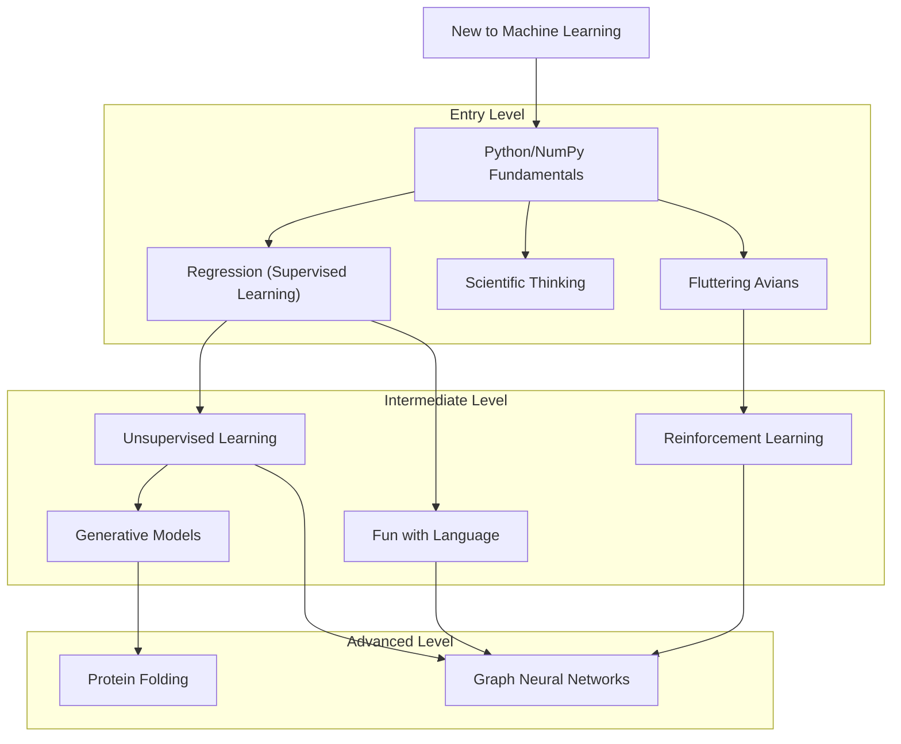
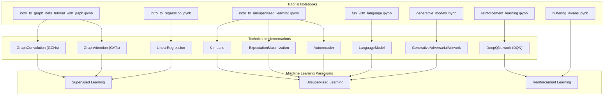
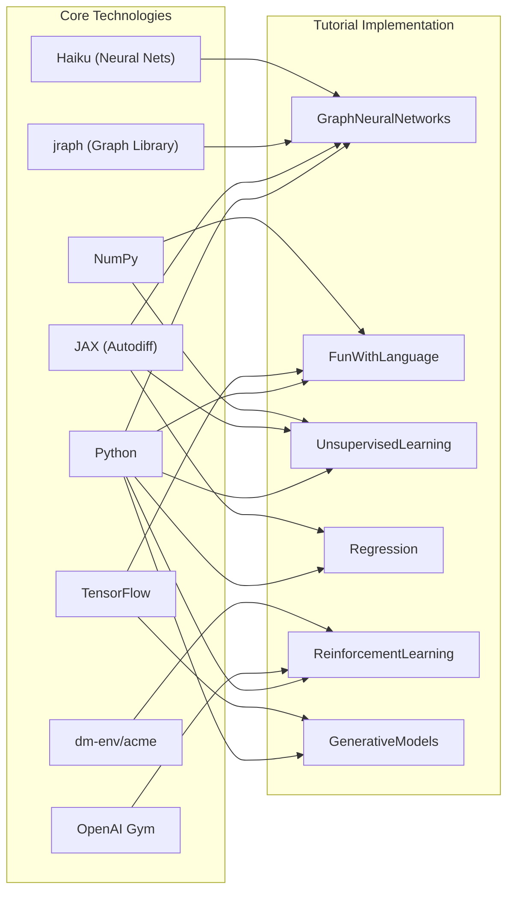

<!-- source: DeepWiki mcp.deepwiki.com · repo google-deepmind/educational · page 1 Overview · fetched 2026-10-26 -->

# Overview

<details>
<summary>Relevant source files</summary>

The following files were used as context for generating this wiki page:

- [CONTRIBUTING.md](CONTRIBUTING.md)
- [LICENSE](LICENSE)
- [README.md](README.md)

</details>


## Purpose and Scope

The DeepMind Educational repository is a comprehensive collection of educational tutorials designed to teach machine learning concepts to audiences with varying levels of prior knowledge. This repository aims to democratize machine learning education by providing accessible, interactive resources that enable anyone—including those with no machine learning background—to engage with and learn fundamental concepts in artificial intelligence and machine learning.

The repository contains Jupyter notebooks covering a wide range of topics from basic machine learning principles to advanced techniques like Graph Neural Networks and Language Models. All tutorials are available as interactive notebooks that can be launched via Google Colab, allowing learners to experiment with code and concepts in a browser-based environment without requiring local installation.

For detailed information about specific tutorials, see the dedicated pages for [Graph Neural Networks](#2), [Language Models](#3), [Unsupervised Learning](#4), [Supervised Learning: Regression](#5), [Reinforcement Learning](#6), and [Additional Educational Examples](#7).

Sources: [README.md:1-13]()

## Repository Structure

The DeepMind Educational repository is organized into two main sections: Introductory Tutorials and Summer Schools Tutorials. Each section serves different educational purposes and targets different audience levels.

```mermaid
flowchart TD
    subgraph "DeepMind Educational Repository"
        README["README.md (Main Entry Point)"]
        
        subgraph "Introductory Tutorials"
            FA["Fluttering Avians"]
            FWL["Fun with Language"]
            GM["Generative Models"]
            PF["Protein Folding"]
            RL["Reinforcement Learning"]
            ST["Scientific Thinking"]
        end
        
        subgraph "Summer Schools Tutorials"
            PYTHN["Introduction to Python/NumPy"]
            REG["Introduction to Regression"]
            UL["Introduction to Unsupervised Learning"]
            RLS["Introduction to Reinforcement Learning"]
            GNN["Introduction to Graph Neural Nets"]
        end
        
        META["Contributing and License Information"]
    end
    
    README --> "Introductory Tutorials"
    README --> "Summer Schools Tutorials"
    README --> META
```

### Introductory Tutorials

These tutorials are designed to introduce machine learning concepts through engaging, application-focused examples:

| Tutorial | Focus | Key Concepts |
|----------|-------|--------------|
| Fluttering Avians | Game-based learning | Evolutionary algorithms, agents, optimization |
| Fun with Language | Natural language processing | Language models, text generation, message decoding |
| Generative Models | AI and creativity | GANs, image generation, style transfer |
| Protein Folding | Biological applications | Structure prediction, visualization |
| Reinforcement Learning | Agent-based learning | RL environments, DQN, policy optimization |
| Scientific Thinking | Methodological principles | Scientific method, experimentation, validation |

Sources: [README.md:15-50]()

### Summer Schools Tutorials

These tutorials provide more structured learning materials originally developed for various machine learning summer schools and educational events:

| Tutorial | Focus | Key Concepts |
|----------|-------|--------------|
| Introduction to Python/NumPy | Programming foundations | Python basics, NumPy operations, tensor transformations |
| Introduction to Regression | Supervised learning | Linear models, optimization, autodiff with JAX |
| Introduction to Unsupervised Learning | Unsupervised methods | Density estimation, clustering, dimensionality reduction |
| Introduction to Reinforcement Learning | Sequential decision making | Q-learning, DQN, environment design |
| Introduction to Graph Neural Nets | Graph-structured data | Graph theory, GCNs, GATs, jraph library |

Sources: [README.md:52-92]()

## Learning Pathways

The repository supports multiple learning pathways depending on the learner's background and goals. The following diagram illustrates recommended progression routes through the tutorials:



Sources: [README.md:63-92]()

## Machine Learning Concepts Coverage

The repository covers a comprehensive range of machine learning paradigms and techniques. The following diagram maps tutorials to fundamental machine learning concepts:



Sources: [README.md:15-92]()

## Key Technologies

The tutorials in the repository utilize several key technologies and libraries for implementing machine learning concepts:



Sources: [README.md:62-92]()

## Using the Tutorials

All tutorials in the repository are provided as Jupyter notebooks that can be run via Google Colab. Each notebook contains:

1. **Theoretical explanations** of the machine learning concepts
2. **Code implementations** with step-by-step walk-throughs
3. **Interactive exercises** for hands-on learning
4. **Visualizations** to aid understanding of complex concepts

To use the tutorials:
1. Click on the "Open In Colab" badge for the tutorial you want to explore
2. The notebook will open in Google Colab in your browser
3. Run the cells sequentially to follow the tutorial
4. Experiment by modifying code to deepen your understanding

Sources: [README.md:12-13]()

## Contributors and License

The DeepMind Educational repository is maintained by volunteers and is released under the Apache 2.0 License. Contributions to the repository are welcome through pull requests, bug reports, and feature requests.

For information about contributing to the project, see [Contributing and License](#8).

Sources: [README.md:94-107](), [CONTRIBUTING.md:1-28](), [LICENSE:1-202]()

---

