<!-- source: DeepWiki mcp.deepwiki.com · repo google-deepmind/educational · page 2 Graph Neural Networks · fetched 2026-10-26 -->

# Graph Neural Networks

Relevant source files

The following files were used as context for generating this wiki page:

- [colabs/summer_schools/intro_to_graph_nets_tutorial_with_jraph.ipynb](colabs/summer_schools/intro_to_graph_nets_tutorial_with_jraph.ipynb)

## Purpose and Scope

This document provides a comprehensive guide to Graph Neural Networks (GNNs) as implemented in the DeepMind Educational repository. It focuses on the implementation and application of GNNs using the `jraph` library with JAX. The material covers fundamental graph concepts, different graph prediction tasks, and implementations of Graph Convolutional Networks (GCN) and Graph Attention Networks (GAT) with practical applications.

For information about other neural network implementations in the repository, see [Reinforcement Learning](#6) and [Language Models](#3).

## Fundamental Graph Concepts

A graph consists of nodes (vertices) and edges that connect nodes. Formally, a graph is defined as G = (V, E) where V is the set of vertices and E is the set of edges.

Graphs can be either **directed** (edges have a direction) or **undirected** (edges have no direction). For example, a citation network would be represented as a directed graph, while a friendship network would typically be undirected.

Key graph terminology:
- **Degree**: Number of edges incident on a node
- **In-degree**: Sum of incoming edges to a node
- **Out-degree**: Sum of outgoing edges from a node

Graphs can be represented in several ways:
1. **List of edges**: Pairs (u,v) indicating an edge from node u to node v
2. **Adjacency matrix**: A binary square matrix A where A[u,v]=1 if there's a connection between nodes u and v
3. **Adjacency list**: An array of lists where the ith list contains all nodes directly connected to node i

Graph representation diagram:

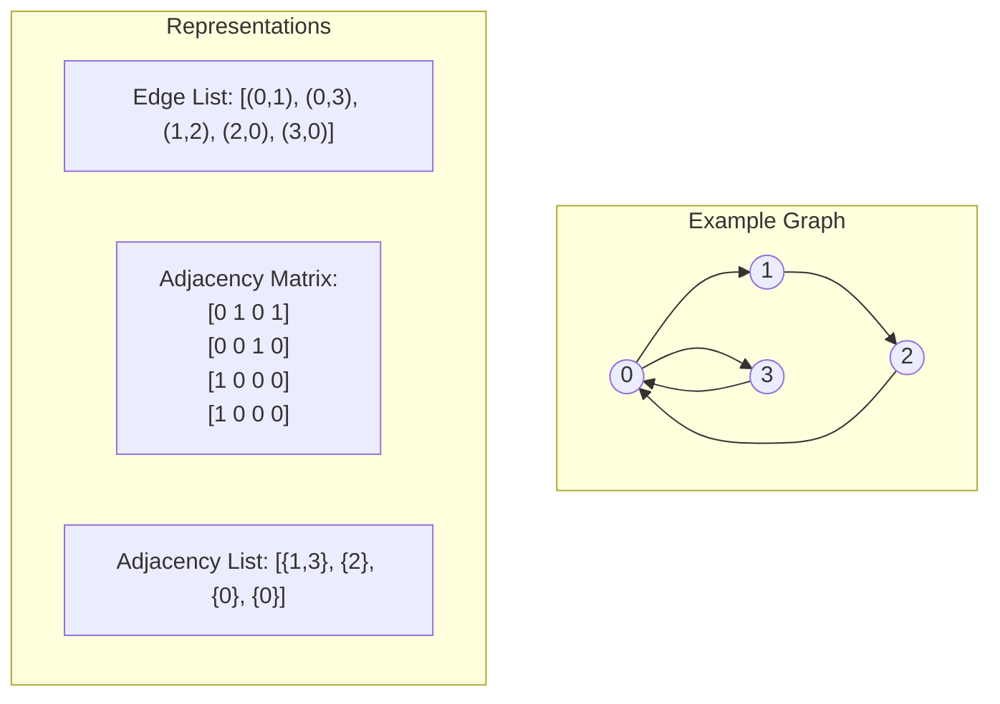

Sources: [colabs/summer_schools/intro_to_graph_nets_tutorial_with_jraph.ipynb:111-164]()

## Graph Prediction Tasks

GNNs can address three main types of prediction tasks:

1. **Node Classification**: Predicting properties of individual nodes (e.g., paper topics in a citation network)
2. **Link Prediction/Edge Classification**: Predicting whether an edge exists between nodes (e.g., friendships in a social network)
3. **Graph Classification**: Classifying entire graphs (e.g., properties of molecules)

Graph prediction tasks diagram:

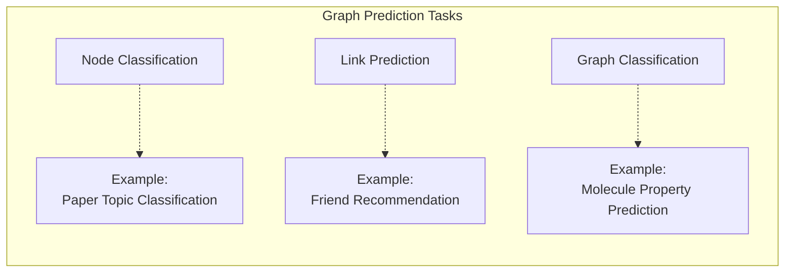

Sources: [colabs/summer_schools/intro_to_graph_nets_tutorial_with_jraph.ipynb:168-186]()

## Introduction to the jraph Library

`jraph` is a lightweight library for working with GNNs in JAX. The main data structure is `GraphsTuple`, which represents graphs and their features.

### GraphsTuple Structure

In `GraphsTuple`, edges are represented by two arrays of node indices: **senders** (source nodes) and **receivers** (destination nodes). Each index in these arrays corresponds to one edge, e.g., edge `i` goes from `senders[i]` to `receivers[i]`.

A `GraphsTuple` contains:
- `nodes`: Node features
- `edges`: Edge features
- `senders`: Indices of sender nodes for each edge
- `receivers`: Indices of receiver nodes for each edge
- `n_node`: Number of nodes per graph
- `n_edge`: Number of edges per graph
- `globals`: Global graph features

GraphsTuple structure diagram:

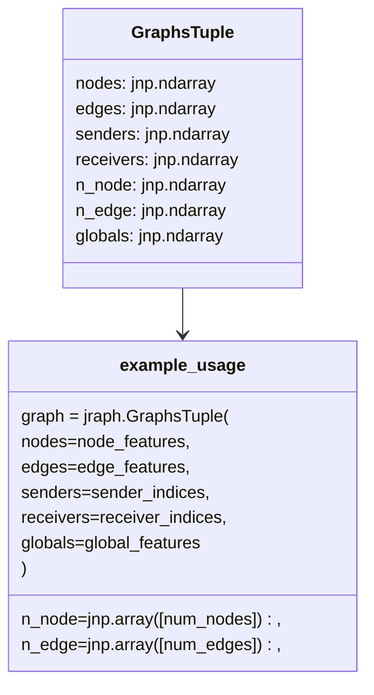

Sources: [colabs/summer_schools/intro_to_graph_nets_tutorial_with_jraph.ipynb:196-213](), [colabs/summer_schools/intro_to_graph_nets_tutorial_with_jraph.ipynb:257-266]()

### Creating and Visualizing Graphs

`jraph` provides utilities for creating and manipulating graphs. The example below shows how to create a simple directed graph with 4 nodes and 5 edges:

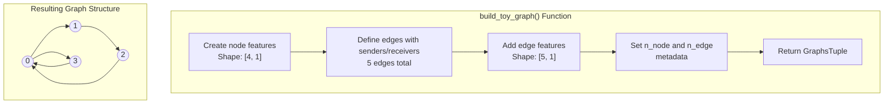

Sources: [colabs/summer_schools/intro_to_graph_nets_tutorial_with_jraph.ipynb:222-266](), [colabs/summer_schools/intro_to_graph_nets_tutorial_with_jraph.ipynb:395-419]()

## Graph Convolutional Network (GCN)

A Graph Convolutional Network applies convolution operations to neighborhoods in a graph structure. Unlike standard CNNs that operate on regular grids, GCNs work on irregular graph structures.

### How GCN Works

GCN consists of two main steps:

1. **Message Computation**: Each node computes a feature vector (using an MLP)
2. **Message Aggregation**: Each node aggregates messages from its neighborhood to update its features

The key difference from CNNs is that GCNs apply the same weights to all neighbors (order-invariant), while CNNs assign different weights to each spatial position.

GCN operation diagram:

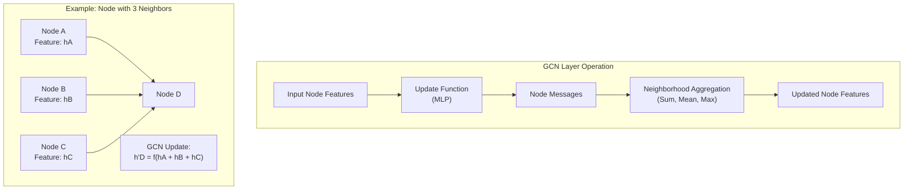

Sources: [colabs/summer_schools/intro_to_graph_nets_tutorial_with_jraph.ipynb:438-464]()

### GCN Implementation Components

A complete GCN implementation includes several key components:

1. **Node Update Function**: Transforms node features (typically an MLP)
2. **Self-Edges**: Optional edges connecting nodes to themselves
3. **Normalization**: Usually symmetric normalization based on node degrees to prevent numerical instabilities

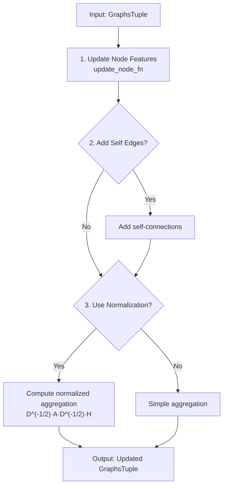

Sources: [colabs/summer_schools/intro_to_graph_nets_tutorial_with_jraph.ipynb:754-829]()

### Multi-Layer GCN Models

By stacking multiple GCN layers, nodes can incorporate information from larger neighborhoods (beyond 1-hop neighbors). This is similar to how stacking CNN layers expands the receptive field.

The `GraphConvolution` function in the repository provides a configurable GCN layer implementation with options for:
- Custom node update functions
- Different aggregation methods
- Adding self-edges
- Symmetric normalization

Sources: [colabs/summer_schools/intro_to_graph_nets_tutorial_with_jraph.ipynb:878-916]()

## Graph Attention Networks (GAT)

Graph Attention Networks extend GCNs by introducing an attention mechanism that learns to weigh the importance of different neighbor features during aggregation. This addresses a limitation in GCNs where all neighbors contribute equally.

### How GAT Works

In a GAT, each node's update is a weighted sum of its neighbors' features:

h'_i = ∑_(j ∈ N(i)) α_ij · W · h_j

Where:
- α_ij is the attention coefficient between nodes i and j
- W is a weight matrix
- h_j is the feature vector of node j

The attention mechanism computes coefficients through these steps:
1. Transform node features with a learnable weight matrix
2. Compute attention scores using a function of connected nodes' features
3. Normalize scores with softmax to get attention weights
4. Use weights for a weighted sum of neighbor features

GAT mechanism diagram:

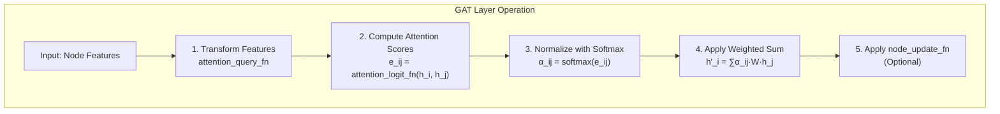

Sources: [colabs/summer_schools/intro_to_graph_nets_tutorial_with_jraph.ipynb:1281-1335]()

### GAT Implementation in jraph

The GAT implementation in jraph requires:
- `attention_query_fn`: Function to transform node features
- `attention_logit_fn`: Function to compute attention logits 
- `node_update_fn`: Function to update nodes after aggregation
- `add_self_edges`: Whether to add self-connections

The implementation calculates attention weights via softmax and applies them to create weighted node representations.

Sources: [colabs/summer_schools/intro_to_graph_nets_tutorial_with_jraph.ipynb:1346-1416](), [colabs/summer_schools/intro_to_graph_nets_tutorial_with_jraph.ipynb:1436-1449]()

## Practical Applications

The tutorial demonstrates three practical applications of GNNs, each corresponding to a different graph prediction task:

### Node Classification: Zachary's Karate Club

This example uses a small social graph where nodes represent karate club members and edges represent interactions. The task is to predict which instructor each member follows.

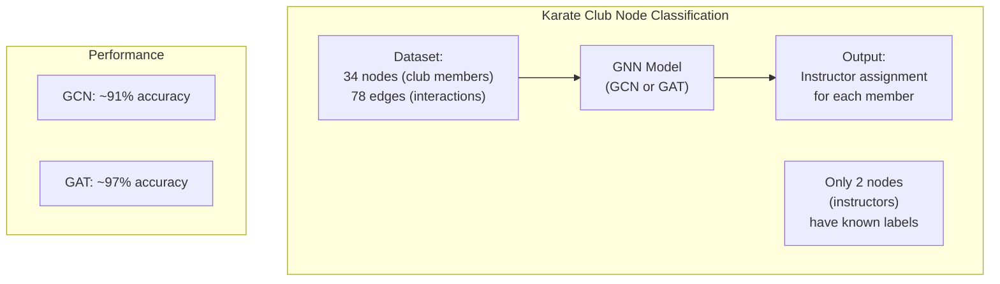

Sources: [colabs/summer_schools/intro_to_graph_nets_tutorial_with_jraph.ipynb:949-1271]()

### Graph Classification: MUTAG Molecules

This example classifies molecular graphs based on their mutagenic effects.

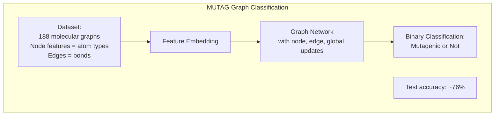

Sources: [colabs/summer_schools/intro_to_graph_nets_tutorial_with_jraph.ipynb:1603-2017]()

### Link Prediction: CORA Citation Network

This example predicts whether a citation exists between pairs of scientific papers.

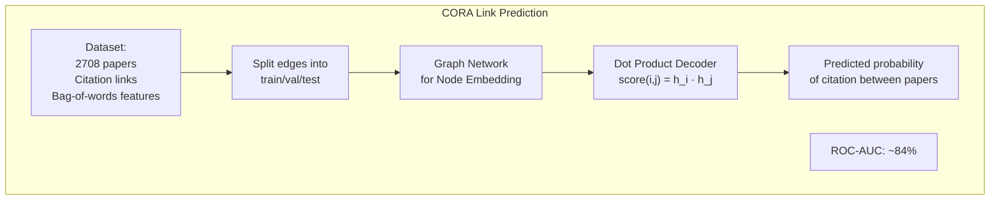

Sources: [colabs/summer_schools/intro_to_graph_nets_tutorial_with_jraph.ipynb:2022-2488]()

## Graph Adversarial Attacks

The tutorial briefly introduces graph adversarial attacks, where small, carefully crafted perturbations to the graph structure or node features can fool GNN models.

Special challenges for graph adversarial attacks include:
1. **Discrete nature of graphs**: Unlike continuous pixel values, graph structure is discrete
2. **Node interdependence**: Perturbing one node can affect predictions for others
3. **Defining "imperceptibility"**: It's harder to define what makes a graph perturbation imperceptible

Sources: [colabs/summer_schools/intro_to_graph_nets_tutorial_with_jraph.ipynb:2496-2571]()

## Implementation Architecture

The following diagram shows the key components and their relationships in the jraph implementation:

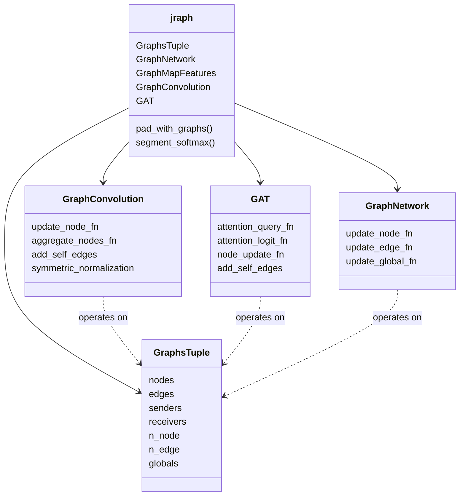

## Summary

This document covered Graph Neural Networks as implemented in the DeepMind Educational repository using the jraph library with JAX. Key topics included:

- Fundamental graph concepts and representations
- Different types of graph prediction tasks
- GNN architectures: Graph Convolutional Networks and Graph Attention Networks
- Practical applications across node classification, graph classification, and link prediction
- Implementation details using the jraph library

The tutorial demonstrates how to build and train models for various graph-based tasks using real-world datasets.

Sources: [colabs/summer_schools/intro_to_graph_nets_tutorial_with_jraph.ipynb:2578-2586]()

---

