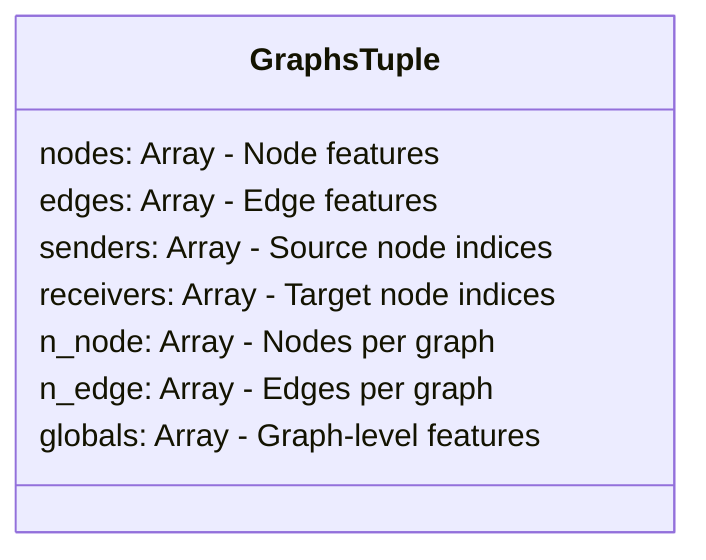
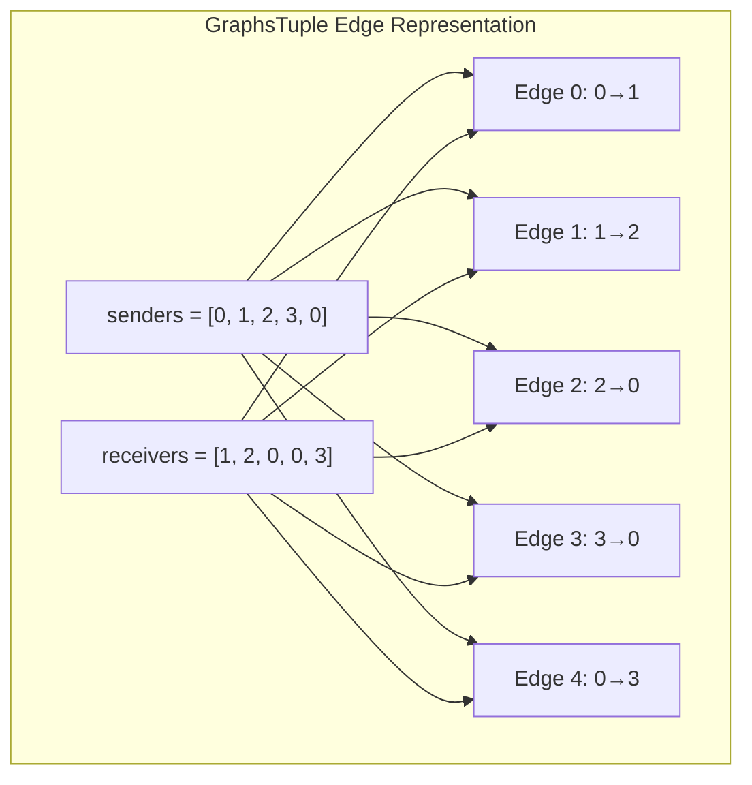
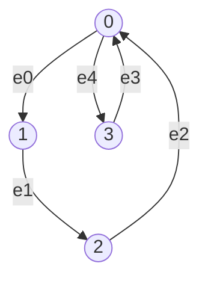
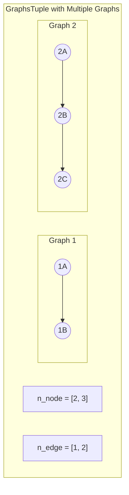
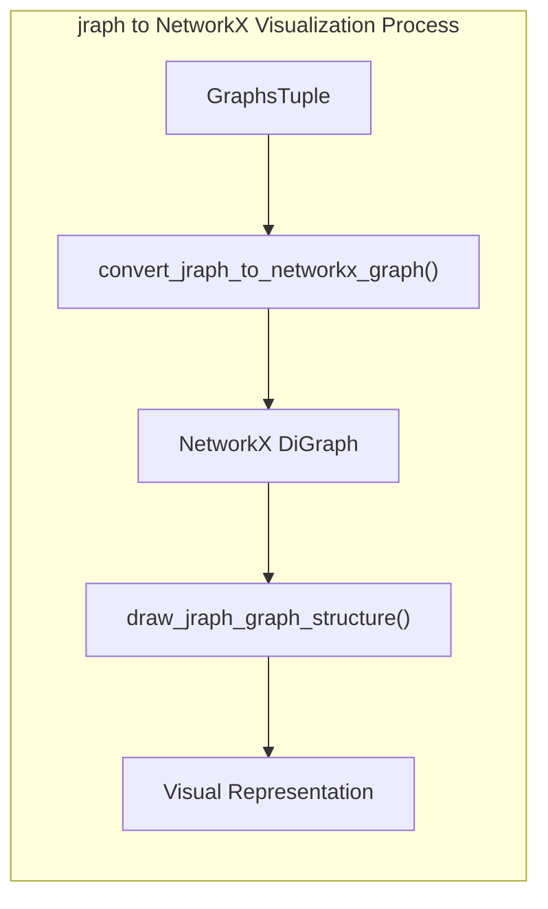
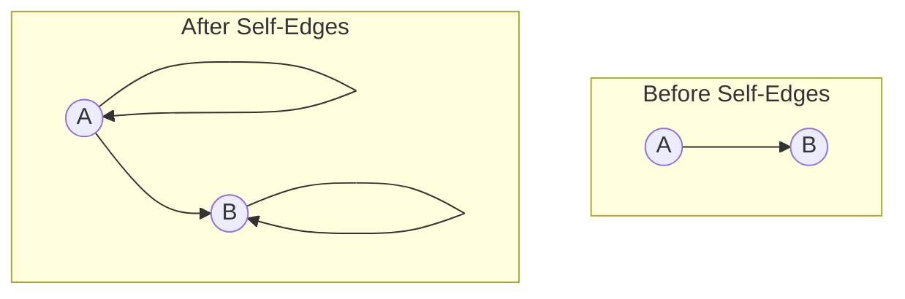
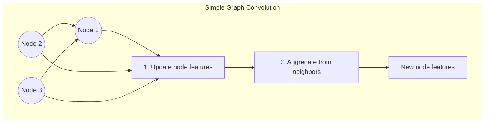
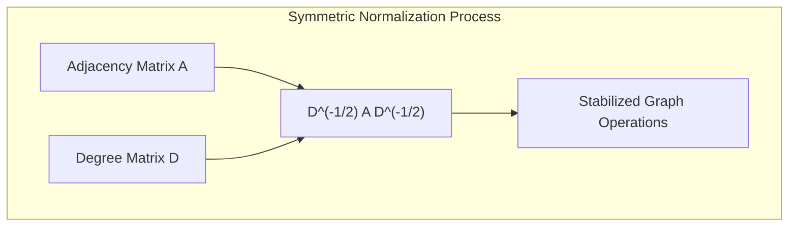
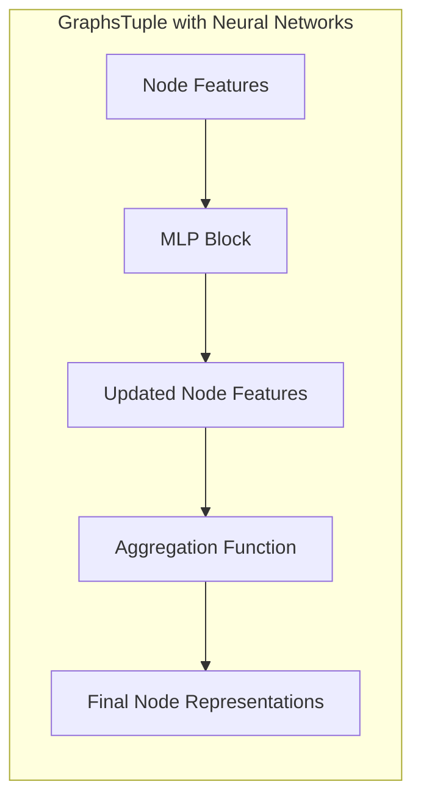
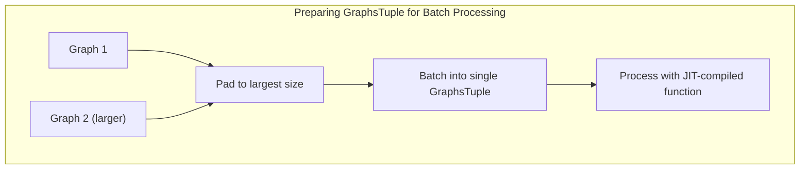

<!-- source: DeepWiki mcp.deepwiki.com · repo google-deepmind/educational · page 2.1 GraphsTuple and Basic Graph Operations · fetched 2026-10-26 -->

# GraphsTuple and Basic Graph Operations

<details>
<summary>Relevant source files</summary>

The following files were used as context for generating this wiki page:

- [colabs/summer_schools/intro_to_graph_nets_tutorial_with_jraph.ipynb](colabs/summer_schools/intro_to_graph_nets_tutorial_with_jraph.ipynb)

</details>


## Purpose and Scope
This document explains the `GraphsTuple` data structure from the jraph library and the basic operations that can be performed on graphs using this structure. The `GraphsTuple` is a fundamental component for representing and manipulating graphs in jraph, which is essential for implementing Graph Neural Networks (GNNs) with JAX.

For information about more advanced graph operations and neural network layers, see [Graph Convolutional Networks](#2.2) and [Graph Attention Networks](#2.3).

Sources: [colabs/summer_schools/intro_to_graph_nets_tutorial_with_jraph.ipynb:193-206]()

## GraphsTuple Data Structure

The `GraphsTuple` is the core data structure for representing graphs in jraph. It efficiently encapsulates all components needed to define one or more graphs within a single structure, making it ideal for batch processing in JAX.

### Components of a GraphsTuple



A `GraphsTuple` consists of:
- `nodes`: Features associated with each node
- `edges`: Features associated with each edge
- `senders`: Array of indices indicating source nodes of each edge
- `receivers`: Array of indices indicating destination nodes of each edge
- `n_node`: Array specifying the number of nodes in each graph 
- `n_edge`: Array specifying the number of edges in each graph
- `globals`: Global features/attributes for each graph

In jraph, edges are represented using two aligned arrays: `senders` (source nodes) and `receivers` (destination nodes). Each index corresponds to one edge - edge `i` goes from node `senders[i]` to node `receivers[i]`.

Sources: [colabs/summer_schools/intro_to_graph_nets_tutorial_with_jraph.ipynb:193-206](), [colabs/summer_schools/intro_to_graph_nets_tutorial_with_jraph.ipynb:199-211]()

### Relationship to Graph Theory Representations

In graph theory, there are several common ways to represent a graph:
1. Adjacency matrix
2. Adjacency list
3. Edge list

The `GraphsTuple` uses an approach similar to an edge list representation, where edges are stored as pairs of source and destination nodes. However, it extends this concept by adding features to nodes, edges, and the graph as a whole.



Sources: [colabs/summer_schools/intro_to_graph_nets_tutorial_with_jraph.ipynb:111-161]()

## Creating a Graph with GraphsTuple

Let's examine how to create a simple directed graph with 4 nodes and 5 edges using the `GraphsTuple` structure.

### Example: Four-Node Directed Graph



The code to create this graph is in the `build_toy_graph()` function:

1. First, node features are defined. In this example, node `i` has feature `[2*i]`
2. Edge connections are defined through the `senders` and `receivers` arrays
3. Edge features are optionally added
4. The number of nodes and edges are specified
5. Optional global features can be added
6. All components are combined into a `GraphsTuple`

In this example:
- Node features: `[[0.], [2.], [4.], [6.]]` (one feature per node)
- Edge definitions: senders `[0, 1, 2, 3, 0]` and receivers `[1, 2, 0, 0, 3]`
- Edge features: `[[5.], [6.], [7.], [8.], [8.]]`
- Number of nodes and edges: `n_node=[4]` and `n_edge=[5]`
- Global feature: `[[1]]`

Sources: [colabs/summer_schools/intro_to_graph_nets_tutorial_with_jraph.ipynb:222-266]()

## Basic Graph Operations

### Inspecting GraphsTuple Properties

Once a `GraphsTuple` is created, its properties can be inspected to understand the graph structure:

```python
# Number of nodes - returns an array where the length corresponds to 
# the number of graphs stored in the GraphsTuple
graph.n_node  # Returns [4] for our example

# Number of edges
graph.n_edge  # Returns [5] for our example

# Node features
graph.nodes  # Returns [[0.], [2.], [4.], [6.]] for our example

# Edge features
graph.edges  # Returns [[5.], [6.], [7.], [8.], [8.]] for our example

# Senders (source node indices)
graph.senders  # Returns [0, 1, 2, 3, 0] for our example

# Receivers (destination node indices)
graph.receivers  # Returns [1, 2, 0, 0, 3] for our example

# Graph-level features
graph.globals  # Returns [[1]] for our example
```

Sources: [colabs/summer_schools/intro_to_graph_nets_tutorial_with_jraph.ipynb:289-373]()

### Multiple Graphs in One GraphsTuple

A key feature of `GraphsTuple` is its ability to store multiple graphs in a single structure, which is particularly useful for batch processing in deep learning. The `n_node` and `n_edge` fields indicate how many nodes and edges belong to each graph.



Sources: [colabs/summer_schools/intro_to_graph_nets_tutorial_with_jraph.ipynb:199-211]()

### Visualizing Graphs

To visualize a `GraphsTuple`, it needs to be converted to a NetworkX graph, which has built-in drawing capabilities.



The conversion process involves:
1. Extracting nodes, edges, receivers, and senders from the GraphsTuple
2. Creating a NetworkX DiGraph
3. Adding nodes and edges with their features
4. Using NetworkX drawing functions to visualize the graph

Sources: [colabs/summer_schools/intro_to_graph_nets_tutorial_with_jraph.ipynb:378-430]()

## Graph Operations for Neural Networks

The `GraphsTuple` structure is designed to work efficiently with graph neural network operations. Common operations include:

### Adding Self-Edges

Self-edges connect nodes to themselves, which is useful in graph neural networks to ensure nodes include their own features in message passing.



The `add_self_edges_fn` function adds self-edges by concatenating the existing receivers and senders with arrays containing self-connections for all nodes:

```python
def add_self_edges_fn(receivers, senders, total_num_nodes):
    """Adds self edges. Assumes self edges are not in the graph yet."""
    receivers = jnp.concatenate((receivers, jnp.arange(total_num_nodes)), axis=0)
    senders = jnp.concatenate((senders, jnp.arange(total_num_nodes)), axis=0)
    return receivers, senders
```

Sources: [colabs/summer_schools/intro_to_graph_nets_tutorial_with_jraph.ipynb:693-698]()

### Graph Convolution and Aggregation

A fundamental operation in graph neural networks is aggregating information from neighboring nodes. In its simplest form, this involves:
1. Updating node features (typically with a neural network)
2. Aggregating features from neighboring nodes



The `apply_simplified_gcn` function demonstrates this process:
```python
def apply_simplified_gcn(graph: jraph.GraphsTuple) -> jraph.GraphsTuple:
  # Unpack GraphsTuple
  nodes, _, receivers, senders, _, _, _ = graph

  # 1. Update node features
  # For simplicity, we will first use an identify function here
  update_node_fn = lambda nodes: nodes
  nodes = update_node_fn(nodes)

  # 2. Aggregate node features over nodes in neighborhood
  # Equivalent to jnp.sum(n_node), but jittable
  total_num_nodes = tree.tree_leaves(nodes)[0].shape[0]
  aggregate_nodes_fn = jax.ops.segment_sum

  # Compute new node features by aggregating messages from neighboring nodes
  nodes = tree.tree_map(lambda x: aggregate_nodes_fn(x[senders], receivers,
                                    total_num_nodes), nodes)
  out_graph = graph._replace(nodes=nodes)
  return out_graph
```

Sources: [colabs/summer_schools/intro_to_graph_nets_tutorial_with_jraph.ipynb:483-502]()

### Normalizing Graph Operations

Normalization is important when working with graphs of varying structures. Symmetric normalization helps stabilize learning by accounting for varying node degrees.



This normalization process helps prevent issues like exploding or vanishing gradients during neural network training, especially when nodes have widely varying numbers of connections. It is implemented in the `GraphConvolution` function as part of the graph convolution operation.

The mathematical formulation is:
- Let A be the adjacency matrix defining the edges of the graph
- Define the degree matrix D as a diagonal matrix with D_ii = sum_j A_ij
- Normalize by D^(-1/2)AD^(-1/2)

Sources: [colabs/summer_schools/intro_to_graph_nets_tutorial_with_jraph.ipynb:704-726](), [colabs/summer_schools/intro_to_graph_nets_tutorial_with_jraph.ipynb:754-829]()

## Making GraphsTuple Work with Neural Networks

The `GraphsTuple` data structure can be used with neural networks by defining trainable functions that transform its components. Here's a simple example of applying an MLP (Multi-Layer Perceptron) to update node features:



This approach allows for flexible, learnable transformations of graph components, which is the foundation of Graph Neural Networks.

Sources: [colabs/summer_schools/intro_to_graph_nets_tutorial_with_jraph.ipynb:595-620](), [colabs/summer_schools/intro_to_graph_nets_tutorial_with_jraph.ipynb:646-673]()

## Batching and Padding GraphsTuples

For efficient processing, especially with JAX's JIT compilation, it's often necessary to batch and pad graphs to a consistent size:



Padding involves:
1. Determining the maximum number of nodes and edges
2. Adding dummy nodes and edges to smaller graphs
3. Updating the n_node and n_edge arrays accordingly

This enables efficient batch processing of multiple graphs through JAX's JIT compilation.

Sources: [colabs/summer_schools/intro_to_graph_nets_tutorial_with_jraph.ipynb:1758-1786]()

## Conclusion

The `GraphsTuple` data structure provides a flexible and efficient way to represent graphs for machine learning tasks. It encapsulates all the necessary components of a graph (nodes, edges, and their features) in a format that works well with JAX's functional programming model. Understanding this fundamental data structure is essential for working with Graph Neural Networks and implementing various graph-based algorithms in jraph.

---

