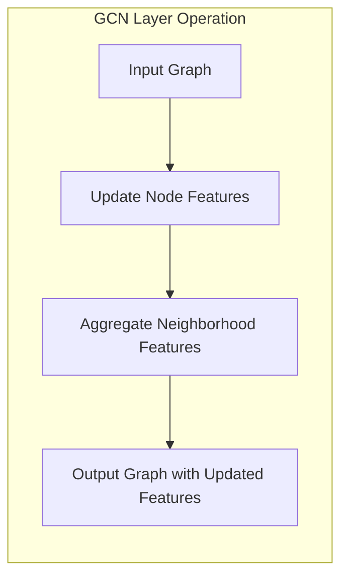
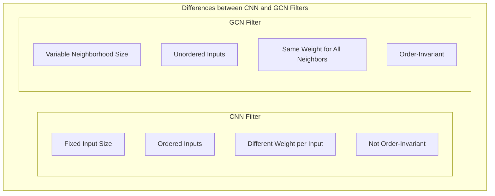
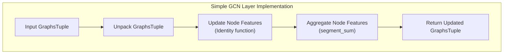
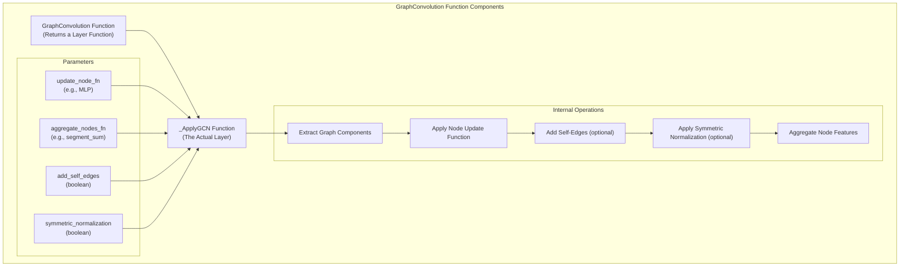
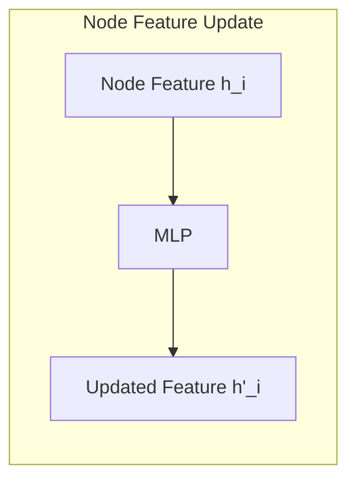
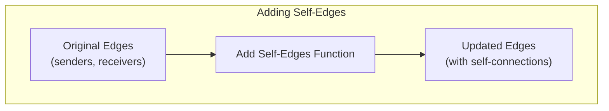
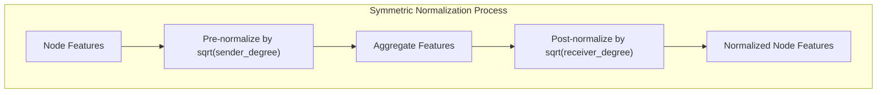
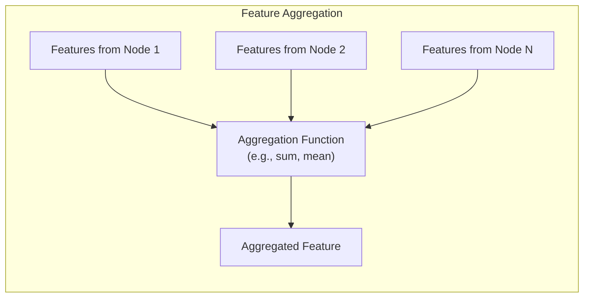
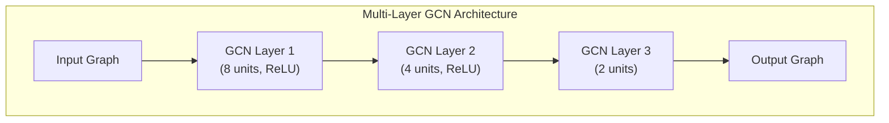
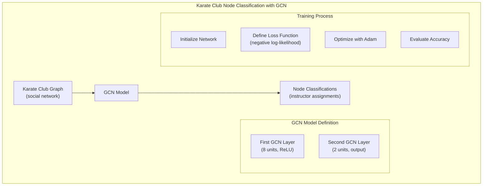

<!-- source: DeepWiki mcp.deepwiki.com · repo google-deepmind/educational · page 2.2 Graph Convolutional Networks · fetched 2026-10-26 -->

# Graph Convolutional Networks

<details>
<summary>Relevant source files</summary>

The following files were used as context for generating this wiki page:

- [colabs/summer_schools/intro_to_graph_nets_tutorial_with_jraph.ipynb](colabs/summer_schools/intro_to_graph_nets_tutorial_with_jraph.ipynb)

</details>


This document provides a technical explanation of Graph Convolutional Networks (GCNs) as implemented in the DeepMind Educational repository. It covers the theory behind GCNs, their implementation using the jraph library, and how to build multi-layer GCN models. For information about Graph Attention Networks, which are an extension of GCNs with attention mechanisms, see [Graph Attention Networks](#2.3).

## Introduction to Graph Convolutional Networks

Graph Convolutional Networks (GCNs) are a type of graph neural network designed to process and learn from graph-structured data. Introduced by Kipf et al. (2017), GCNs extend the concept of convolution operations from grid-structured data (like images) to irregular graph structures.

The core functionality of GCNs is to learn representations of nodes in a graph by aggregating information from their neighborhoods. Unlike traditional convolutional filters in CNNs that have a fixed number of inputs, GCNs can handle varying neighborhood sizes and maintain permutation invariance.

Sources: [colabs/summer_schools/intro_to_graph_nets_tutorial_with_jraph.ipynb:437-463]()

## GCN Layer Operation

The basic GCN layer performs two key steps:

1. **Update node features**: Create a feature vector for each node (e.g., using an MLP).
2. **Message-passing/aggregation**: For each node, calculate a new feature vector based on the features from nodes in its neighborhood.



Sources: [colabs/summer_schools/intro_to_graph_nets_tutorial_with_jraph.ipynb:437-463]()

### Comparison with CNN Filters

GCNs differ from traditional CNNs in several important ways:



In a CNN, each input to the filter has its own learned weight, making the operation sensitive to the order of inputs. In contrast, GCNs apply the same transformation to all neighbors and then aggregate, making the operation invariant to the order of neighbors.

Sources: [colabs/summer_schools/intro_to_graph_nets_tutorial_with_jraph.ipynb:437-463]()

## Implementation in jraph

The implementation of a GCN layer in the repository is based on the jraph library and follows the architecture described in the original GCN paper.

### Simple GCN Layer

A basic implementation of a GCN layer is first demonstrated:



This simplified implementation demonstrates the core operations without trainable parameters.

Sources: [colabs/summer_schools/intro_to_graph_nets_tutorial_with_jraph.ipynb:483-502]()

### Full GCN Layer

The complete GCN layer implementation includes additional components to make it configurable and effective:



Sources: [colabs/summer_schools/intro_to_graph_nets_tutorial_with_jraph.ipynb:754-829]()

### Key Components

#### 1. Node Feature Update

This step transforms each node's features using a neural network, typically an MLP (Multi-Layer Perceptron):



The node update function is customizable and passed as a parameter to the GCN layer.

Sources: [colabs/summer_schools/intro_to_graph_nets_tutorial_with_jraph.ipynb:603-619]()

#### 2. Self-Edges

Self-edges connect nodes to themselves, ensuring that a node's own features are included in the aggregation step:



Adding self-edges is implemented by concatenating the node indices to both the senders and receivers arrays.

Sources: [colabs/summer_schools/intro_to_graph_nets_tutorial_with_jraph.ipynb:693-698]()

#### 3. Symmetric Normalization

To address the issue of nodes having different numbers of neighbors, normalization is applied based on node degrees:



Symmetric normalization helps stabilize training by preventing feature magnitudes from exploding or vanishing.

Sources: [colabs/summer_schools/intro_to_graph_nets_tutorial_with_jraph.ipynb:704-727](), [colabs/summer_schools/intro_to_graph_nets_tutorial_with_jraph.ipynb:799-821]()

#### 4. Aggregation

The aggregation step combines features from neighboring nodes:



Common aggregation functions include summation, mean, and max operations.

Sources: [colabs/summer_schools/intro_to_graph_nets_tutorial_with_jraph.ipynb:499-500](), [colabs/summer_schools/intro_to_graph_nets_tutorial_with_jraph.ipynb:814-816]()

## Building Multi-Layer GCN Models

To create more powerful models and capture higher-order neighborhood information, multiple GCN layers can be stacked:



Each layer in the stack allows the model to incorporate information from nodes at increasing distances. For example, with 3 layers, a node's representation can include information from nodes up to 3 hops away.

Sources: [colabs/summer_schools/intro_to_graph_nets_tutorial_with_jraph.ipynb:877-915]()

## Code Implementation

The core implementation of the GCN layer is found in the `GraphConvolution` function:

```python
def GraphConvolution(update_node_fn: Callable,
                     aggregate_nodes_fn: Callable = jax.ops.segment_sum,
                     add_self_edges: bool = False,
                     symmetric_normalization: bool = True) -> Callable:
  """Returns a method that applies a Graph Convolution layer."""
  
  def _ApplyGCN(graph: jraph.GraphsTuple) -> jraph.GraphsTuple:
    """Applies a Graph Convolution layer."""
    nodes, _, receivers, senders, _, _, _ = graph
    
    # Update node features
    nodes = update_node_fn(nodes)
    
    # Add self-edges if requested
    if add_self_edges:
      conv_receivers, conv_senders = add_self_edges_fn(receivers, senders,
                                                     total_num_nodes)
    else:
      conv_senders = senders
      conv_receivers = receivers
    
    # Apply symmetric normalization if requested
    if symmetric_normalization:
      # Pre-normalize by sqrt of sender degree
      nodes = tree.tree_map(
          lambda x: x * jax.lax.rsqrt(jnp.maximum(sender_degree, 1.0))[:, None],
          nodes,
      )
      # Aggregate the pre-normalized nodes
      nodes = tree.tree_map(
          lambda x: aggregate_nodes_fn(x[conv_senders], conv_receivers,
                                       total_num_nodes), nodes)
      # Post-normalize by sqrt of receiver degree
      nodes = tree.tree_map(
          lambda x:
          (x * jax.lax.rsqrt(jnp.maximum(receiver_degree, 1.0))[:, None]),
          nodes,
      )
    else:
      # Just aggregate without normalization
      nodes = tree.tree_map(
          lambda x: aggregate_nodes_fn(x[conv_senders], conv_receivers,
                                       total_num_nodes), nodes)
    
    return graph._replace(nodes=nodes)
  
  return _ApplyGCN
```

This implementation follows the mathematical formulation from the original GCN paper, where the symmetric normalization is represented as:

$$D^{-\frac{1}{2}}AD^{-\frac{1}{2}}H$$

Where:
- $A$ is the adjacency matrix
- $D$ is the degree matrix
- $H$ is the node feature matrix

Sources: [colabs/summer_schools/intro_to_graph_nets_tutorial_with_jraph.ipynb:754-829]()

## Node Classification Example

A common application of GCNs is node classification. The repository includes an implementation for the Zachary's Karate Club dataset:



The model is trained to predict which instructor each student will join based on the social network structure, with only the two instructors' assignments known a priori.

Sources: [colabs/summer_schools/intro_to_graph_nets_tutorial_with_jraph.ipynb:1092-1109](), [colabs/summer_schools/intro_to_graph_nets_tutorial_with_jraph.ipynb:1129-1168]()

## Implementation vs Mathematical Formulation

This table maps the mathematical formulation of GCNs to the corresponding implementation in the code:

| Mathematical Concept | Code Implementation |
|----------------------|---------------------|
| Node feature matrix $H$ | `graph.nodes` |
| Adjacency matrix $A$ | Represented by `senders` and `receivers` |
| Degree matrix $D$ | Computed with `count_edges` function |
| Weight matrix $W$ | Implemented in `update_node_fn` |
| Normalized adjacency $D^{-\frac{1}{2}}AD^{-\frac{1}{2}}$ | Implemented with pre- and post-normalization steps |
| Non-linearity $\sigma$ | Implemented in `update_node_fn` (e.g., ReLU) |
| Layer update $H^{(l+1)} = \sigma(D^{-\frac{1}{2}}AD^{-\frac{1}{2}}H^{(l)}W^{(l)})$ | Full `_ApplyGCN` function |

Sources: [colabs/summer_schools/intro_to_graph_nets_tutorial_with_jraph.ipynb:754-829]()

## Practical Usage and Performance

When applying GCNs to real-world graph problems, several considerations can affect performance:

1. **Node feature initialization**: Meaningful initial features can significantly improve model performance
2. **Self-edges**: Including self-connections helps retain a node's own information
3. **Normalization**: Symmetric normalization helps stabilize training
4. **Depth**: Adding more layers incorporates information from more distant nodes but may lead to over-smoothing
5. **Model size**: The width of layers (number of units) affects model capacity

On the Karate Club dataset, a simple 2-layer GCN can achieve approximately 91% accuracy for node classification.

Sources: [colabs/summer_schools/intro_to_graph_nets_tutorial_with_jraph.ipynb:1177-1190]()

## Summary

Graph Convolutional Networks provide an effective way to process graph-structured data by generalizing convolution operations to irregular graph domains. The implementation in jraph allows for flexible configuration of GCN layers, with options for custom node update functions, aggregation methods, self-edges, and normalization approaches.

By stacking multiple GCN layers, models can capture increasingly complex graph patterns and incorporate information from larger neighborhoods, making them suitable for a wide range of graph learning tasks including node classification, link prediction, and graph classification.

---

