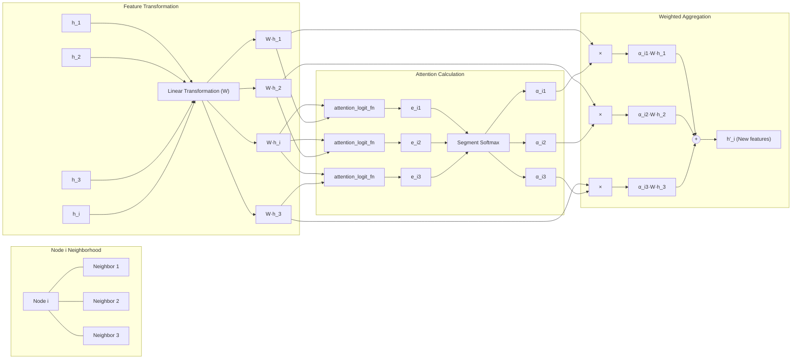
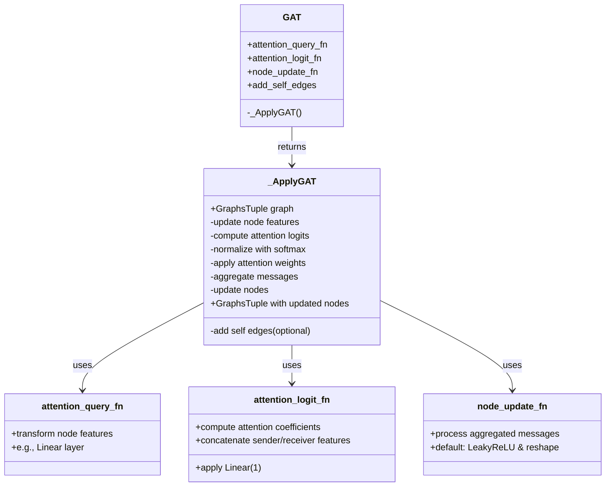

<!-- source: DeepWiki mcp.deepwiki.com · repo google-deepmind/educational · page 2.3 Graph Attention Networks · fetched 2026-10-26 -->

# Graph Attention Networks

<details>
<summary>Relevant source files</summary>

The following files were used as context for generating this wiki page:

- [colabs/summer_schools/intro_to_graph_nets_tutorial_with_jraph.ipynb](colabs/summer_schools/intro_to_graph_nets_tutorial_with_jraph.ipynb)

</details>


## Purpose and Scope

This document explains Graph Attention Networks (GATs), a key architecture in graph neural networks that introduces attention mechanisms to weigh the importance of different neighbors during message passing. Unlike Graph Convolutional Networks (GCNs) (covered in [Graph Convolutional Networks](#2.2)), which treat all neighbors equally, GATs learn to assign different importance to different nodes in a neighborhood. This page covers the theory behind GATs, their implementation in the jraph library, and their advantages over GCNs.

Sources: [colabs/summer_schools/intro_to_graph_nets_tutorial_with_jraph.ipynb:1278-1417]()

## Limitations of GCNs

Graph Convolutional Networks have a fundamental limitation: they weigh messages from all neighboring nodes equally during aggregation. This equal weighting can cause loss of node-specific information, particularly when:

1. Multiple nodes share the same neighborhood but have different features
2. Some neighbors are more relevant than others for a specific prediction task
3. The number of edges connecting to a node is large

As noted in the codebase:

> In the GCN layer, the messages from all its neighbours and the node itself are equally weighted. This may lead to loss of node-specific information.

This limitation is particularly problematic as the number of GCN layers increases, as node representations become increasingly homogenized within local neighborhoods.

Sources: [colabs/summer_schools/intro_to_graph_nets_tutorial_with_jraph.ipynb:1279-1286]()

## The Attention Mechanism

GATs introduce an attention mechanism that allows the network to learn how to weigh different node features from the neighborhood when computing new node features. This mechanism is similar to the attention used in Transformers.

### Attention Mathematics

The output node features in a GAT layer are computed as:

$$\vec{h}'_i = \sum_{j \in \mathcal{N}(i)} \alpha_{ij} \mathbf{W} \vec{h}_j$$

Where:
- $\vec{h}_i$ is the feature vector of node $i$
- $\mathcal{N}(i)$ is the neighborhood of node $i$
- $\alpha_{ij}$ is the attention coefficient between nodes $i$ and $j$
- $\mathbf{W}$ is a weight matrix for the linear transformation

The attention coefficients $\alpha_{ij}$ are calculated using:

1. First, compute raw attention scores $e_{ij}$:
   $$e_{ij} = \mathrm{attention\_fn}(\mathbf{W}\vec{h}_i, \mathbf{W}\vec{h}_j)$$

2. Then, normalize using softmax to get attention weights:
   $$\alpha_{ij} = \frac{\exp(e_{ij})}{\sum_{k \in \mathcal{N}(i)}\exp(e_{ik})}$$

In the implementation, the attention function concatenates the transformed node features and applies a single-layer feedforward network:
$$\mathrm{attention\_fn}(\mathbf{W}\vec{h}_i, \mathbf{W}\vec{h}_j) = \text{LeakyReLU}(\vec{\mathbf{a}}^T[\mathbf{W}\vec{h}_i || \mathbf{W}\vec{h}_j])$$

Sources: [colabs/summer_schools/intro_to_graph_nets_tutorial_with_jraph.ipynb:1292-1337]()

## GAT Architecture

### Diagram: Graph Attention Mechanism



Sources: [colabs/summer_schools/intro_to_graph_nets_tutorial_with_jraph.ipynb:1292-1337]()

### Diagram: GAT Implementation in jraph



Sources: [colabs/summer_schools/intro_to_graph_nets_tutorial_with_jraph.ipynb:1345-1417]()

## Implementation in jraph

In the codebase, GAT is implemented as a function that returns a method that applies a Graph Attention Network layer. The main components are:

1. **`attention_query_fn`**: A function that transforms node features (typically a linear layer)
2. **`attention_logit_fn`**: A function that computes attention logits from sender and receiver node features
3. **`node_update_fn`**: A function that processes the aggregated messages (optional, default uses LeakyReLU)
4. **`add_self_edges`**: Boolean that determines whether to add self-edges for aggregation

### The GAT Function

The main GAT function is defined as:

```python
def GAT(attention_query_fn: Callable,
        attention_logit_fn: Callable,
        node_update_fn: Optional[Callable] = None,
        add_self_edges: bool = True) -> Callable:
  """Returns a method that applies a Graph Attention Network layer."""
  # ...
```

This function returns `_ApplyGAT`, which is a method that takes a GraphsTuple and returns an updated GraphsTuple with transformed node features.

### Attention Computation

The attention mechanism is implemented in the `_ApplyGAT` method. Key steps include:

1. Transform node features using `attention_query_fn`
2. Add self-edges if specified
3. Compute attention logits between sender and receiver nodes
4. Normalize using segment softmax
5. Apply attention weights to sent attributes
6. Aggregate messages to receiver nodes
7. Apply node update function to the aggregated messages

A simple `attention_logit_fn` that computes attention coefficients:

```python
def attention_logit_fn(sender_attr: jnp.ndarray, receiver_attr: jnp.ndarray,
                       edges: jnp.ndarray) -> jnp.ndarray:
  del edges
  x = jnp.concatenate((sender_attr, receiver_attr), axis=1)
  return hk.Linear(1)(x)
```

Sources: [colabs/summer_schools/intro_to_graph_nets_tutorial_with_jraph.ipynb:1345-1417](), [colabs/summer_schools/intro_to_graph_nets_tutorial_with_jraph.ipynb:1436-1442]()

## Using GAT in the Repository

### Creating a GAT Layer

To create a GAT layer, you need to define the functions for attention query, attention logits, and node updates:

```python
gat_layer = GAT(
    attention_query_fn=lambda n: hk.Linear(8)(n),  # Applies W to the node features
    attention_logit_fn=attention_logit_fn,
    node_update_fn=None,  # Use default
    add_self_edges=True,
)
```

### Building a GAT Network

For more complex tasks, you can define a network with multiple GAT layers:

```python
def gat_definition(graph: jraph.GraphsTuple) -> jraph.GraphsTuple:
  """Defines a GAT network for the karate club node classification task."""
  
  def _attention_logit_fn(sender_attr, receiver_attr, edges):
    del edges
    x = jnp.concatenate((sender_attr, receiver_attr), axis=1)
    return hk.Linear(1)(x)

  # First GAT layer
  gn = GAT(
      attention_query_fn=lambda n: hk.Linear(8)(n),
      attention_logit_fn=_attention_logit_fn,
      node_update_fn=None,
      add_self_edges=True)
  graph = gn(graph)

  # Second GAT layer
  gn = GAT(
      attention_query_fn=lambda n: hk.Linear(8)(n),
      attention_logit_fn=_attention_logit_fn,
      node_update_fn=hk.Linear(2),  # Output dim is 2 for binary classification
      add_self_edges=True)
  graph = gn(graph)
  return graph
```

Sources: [colabs/summer_schools/intro_to_graph_nets_tutorial_with_jraph.ipynb:1443-1467](), [colabs/summer_schools/intro_to_graph_nets_tutorial_with_jraph.ipynb:1484-1515]()

## Performance Comparison: GAT vs GCN

The repository includes a comparison of GAT and GCN on the Zachary's Karate Club dataset for node classification. The task is to predict which instructor each student belongs to, given only the assignments of the two instructors themselves.

### Accuracy Comparison

| Model | Accuracy |
|-------|----------|
| GCN   | ~91%     |
| GAT   | ~97%     |

GAT consistently outperforms GCN on this task due to its ability to learn which connections are more important for classification.

### Training Process

The training process for both models is similar:
1. Define the network architecture (GCN or GAT)
2. Initialize parameters and optimizer
3. Compute loss based on the log-likelihood of known node assignments
4. Update parameters using gradient descent
5. Evaluate accuracy by comparing predictions with ground truth

The main benefit of GAT is visible in the faster convergence and higher final accuracy.

Sources: [colabs/summer_schools/intro_to_graph_nets_tutorial_with_jraph.ipynb:1527-1542]()

## Conclusion and Advanced Applications

Graph Attention Networks represent a powerful extension to graph neural networks by incorporating attention mechanisms. Their ability to assign varying importance to different neighbors makes them particularly effective for:

1. **Node classification** - As demonstrated in the Karate Club example
2. **Graph classification** - Used in molecular property prediction (MUTAG dataset)
3. **Link prediction** - Used in citation networks (CORA dataset)

GATs can be further extended with multi-head attention, where multiple independent attention mechanisms are applied and their results concatenated or averaged.

The implementation in jraph provides a flexible framework for creating and experimenting with GAT architectures for various graph learning tasks.

Sources: [colabs/summer_schools/intro_to_graph_nets_tutorial_with_jraph.ipynb:1473-1596]()

---

