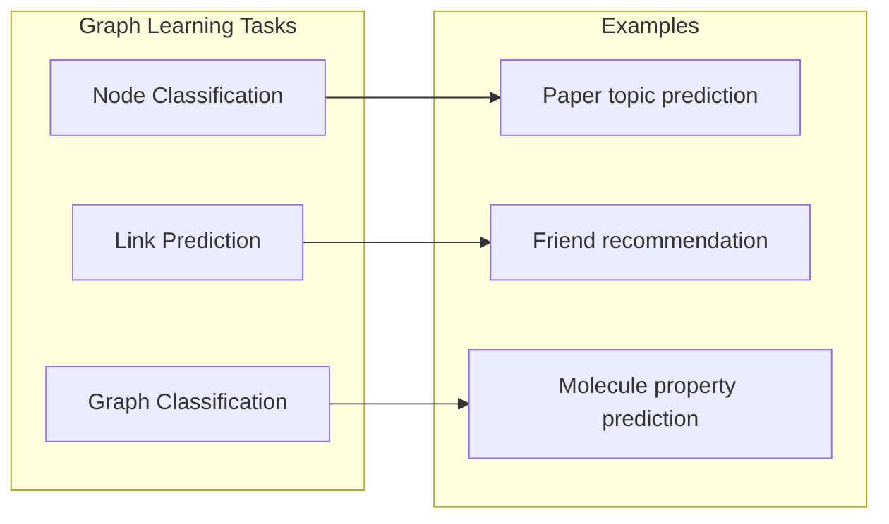
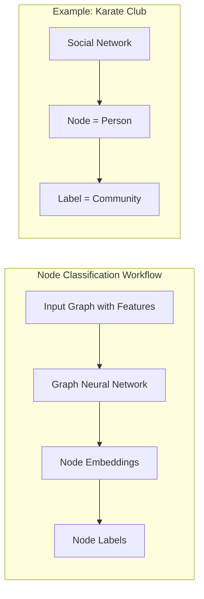
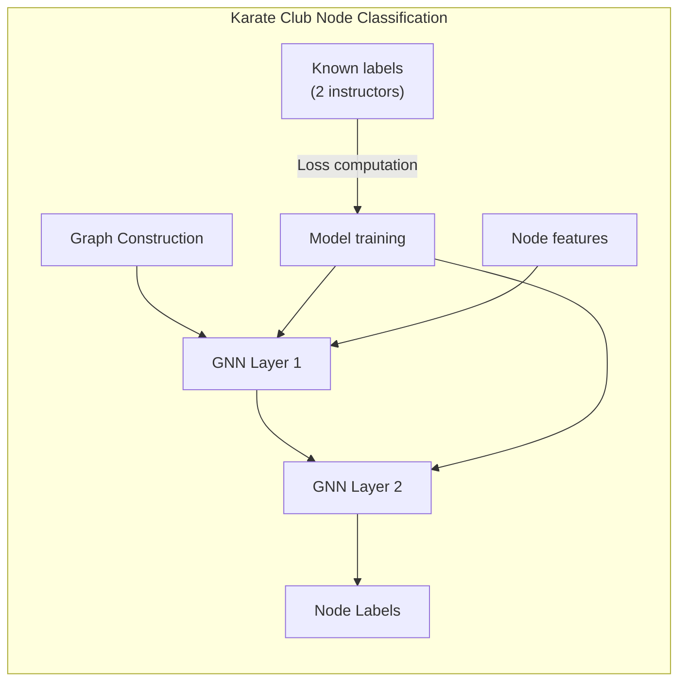
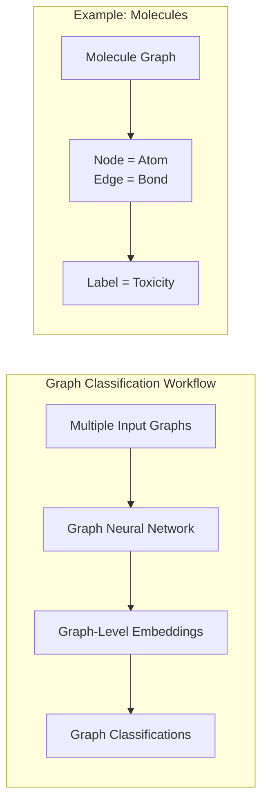
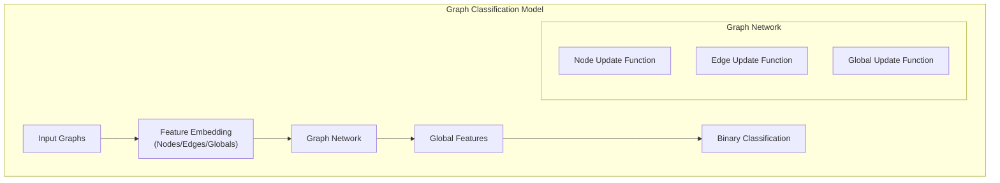
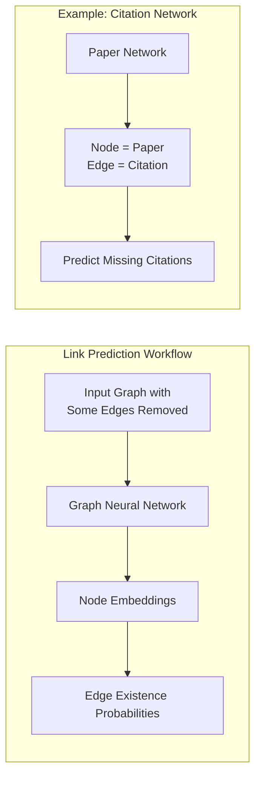
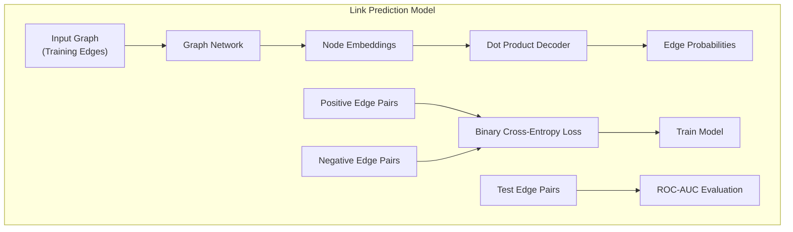

<!-- source: DeepWiki mcp.deepwiki.com · repo google-deepmind/educational · page 2.4 Graph Learning Tasks · fetched 2026-10-26 -->

# Graph Learning Tasks

<details>
<summary>Relevant source files</summary>

The following files were used as context for generating this wiki page:

- [colabs/summer_schools/intro_to_graph_nets_tutorial_with_jraph.ipynb](colabs/summer_schools/intro_to_graph_nets_tutorial_with_jraph.ipynb)

</details>


This document provides an overview of the different graph learning tasks implemented in the Graph Neural Networks tutorial. It focuses on the three primary tasks in graph machine learning: node classification, graph classification, and link prediction. For information about the fundamental graph models used in these tasks, such as Graph Convolutional Networks (GCNs) and Graph Attention Networks (GATs), please see [Graph Convolutional Networks](#2.2) and [Graph Attention Networks](#2.3).

## Overview of Graph Prediction Tasks

Graph machine learning tasks fall into three main categories based on what we're trying to predict:



1. **Node Classification**: Predicting properties or labels of nodes in a graph (e.g., topic of a paper in a citation network)
2. **Link Prediction / Edge Classification**: Predicting whether an edge exists between two nodes (e.g., friendship recommendation in a social network)
3. **Graph Classification**: Predicting properties of entire graphs (e.g., toxicity of a molecule represented as a graph)

Sources: [colabs/summer_schools/intro_to_graph_nets_tutorial_with_jraph.ipynb:167-186]()

## Node Classification

Node classification involves assigning labels to nodes in a graph based on their features and the graph structure.

### Task Definition

In node classification:
- **Input**: A graph with node features (and potentially edge features)
- **Output**: Labels or properties for each node (or a subset of nodes)
- **Goal**: Learn to predict node labels using both node features and graph structure



### Example: Zachary's Karate Club

The tutorial implements node classification using Zachary's karate club dataset, a social network representing interactions between members of a karate club.

- **Dataset**: 34 nodes (club members), with edges representing interactions outside of class
- **Task**: Predict which of two instructors each student would follow after a conflict
- **Training approach**: Only the labels of the two instructors are used during training



This task is implemented twice in the tutorial - once using a Graph Convolutional Network (GCN) and once using a Graph Attention Network (GAT).

Sources: [colabs/summer_schools/intro_to_graph_nets_tutorial_with_jraph.ipynb:942-1271]()

### Model Architecture and Implementation

The GCN for node classification uses:
1. A first layer with ReLU activation and 8 output features
2. A second layer with 2 output features (since there are 2 classes)

```
def gcn_definition(graph: jraph.GraphsTuple) -> jraph.GraphsTuple:
  gn = GraphConvolution(
      update_node_fn=lambda n: jax.nn.relu(hk.Linear(8)(n)),
      add_self_edges=True)
  graph = gn(graph)

  gn = GraphConvolution(
      update_node_fn=hk.Linear(2))
  graph = gn(graph)
  return graph
```

The GAT model similarly has two layers but uses attention mechanisms to weight the importance of different neighbors.

Training involves:
- Using only the two known instructor labels to compute the loss function
- Optimizing the model to maximize log-likelihood of these assignments
- Evaluating by comparing predicted labels with ground truth for all nodes

Sources: [colabs/summer_schools/intro_to_graph_nets_tutorial_with_jraph.ipynb:1093-1109](), [colabs/summer_schools/intro_to_graph_nets_tutorial_with_jraph.ipynb:1129-1168]()

## Graph Classification

Graph classification involves predicting labels or properties for entire graphs rather than individual nodes.

### Task Definition

In graph classification:
- **Input**: A set of graphs, each with node and potentially edge features
- **Output**: A label or property for each entire graph
- **Goal**: Learn to classify graphs based on their structure and features



### Example: MUTAG Dataset (Molecules)

The tutorial implements graph classification using the MUTAG dataset of molecular graphs.

- **Dataset**: 188 molecule graphs where nodes represent atoms and edges represent bonds
- **Task**: Binary classification of molecules based on their mutagenic effect
- **Approach**: Learn graph-level representations that capture the structural and feature information

Sources: [colabs/summer_schools/intro_to_graph_nets_tutorial_with_jraph.ipynb:1625-1644](), [colabs/summer_schools/intro_to_graph_nets_tutorial_with_jraph.ipynb:1717-1721]()

### Model Architecture and Implementation

The graph classification model uses a Graph Network architecture with:

1. Feature embedding layers for nodes, edges, and globals
2. Node update function with MLP layers (128 units with ReLU, then 128 units)
3. Edge update function with similar structure
4. Global update function that outputs 2 logits (for binary classification)



Key implementation aspects:
- Graphs of different sizes are padded to the nearest power of two for batch processing
- Cross-entropy loss is used for binary classification
- ROC-AUC is used to evaluate model performance

Sources: [colabs/summer_schools/intro_to_graph_nets_tutorial_with_jraph.ipynb:1810-1845](), [colabs/summer_schools/intro_to_graph_nets_tutorial_with_jraph.ipynb:1866-1885](), [colabs/summer_schools/intro_to_graph_nets_tutorial_with_jraph.ipynb:1905-1948]()

## Link Prediction

Link prediction involves predicting whether an edge exists or should exist between two nodes in a graph.

### Task Definition

In link prediction:
- **Input**: A graph with some edges potentially missing
- **Output**: Probability scores for potential edges
- **Goal**: Predict which edges are likely to exist but are not yet observed



### Example: CORA Citation Network

The tutorial implements link prediction using the CORA citation network dataset.

- **Dataset**: 2708 papers with 1433-dimensional feature vectors (bag-of-words)
- **Task**: Predict whether a citation (edge) exists between two papers
- **Approach**: Split existing edges into train/val/test sets and generate "negative edges" (non-existing edges)

Sources: [colabs/summer_schools/intro_to_graph_nets_tutorial_with_jraph.ipynb:2038-2052](), [colabs/summer_schools/intro_to_graph_nets_tutorial_with_jraph.ipynb:2069-2085]()

### Model Architecture and Implementation

The link prediction model:

1. Uses a Graph Network with node update functions (MLP with 128 and 64 units)
2. Generates node embeddings through message passing
3. Computes edge scores using dot products between node embeddings
4. Applies sigmoid function to get probabilities



Key implementation aspects:
- Training involves positive edges (existing in training set) and randomly sampled negative edges
- Evaluation uses ROC-AUC to measure performance across different threshold values
- The decoder is a simple dot product between node embeddings, capturing node similarity

Sources: [colabs/summer_schools/intro_to_graph_nets_tutorial_with_jraph.ipynb:2233-2262](), [colabs/summer_schools/intro_to_graph_nets_tutorial_with_jraph.ipynb:2293-2331](), [colabs/summer_schools/intro_to_graph_nets_tutorial_with_jraph.ipynb:2400-2465]()

## Comparison of Tasks and Approaches

The following table summarizes the key differences between the three graph learning tasks implemented in the tutorial:

| Aspect | Node Classification | Graph Classification | Link Prediction |
|--------|---------------------|----------------------|-----------------|
| **Target** | Labels for nodes | Labels for entire graphs | Edge existence probabilities |
| **Example Dataset** | Zachary's Karate Club | MUTAG (Molecules) | CORA (Citation Network) |
| **Model Output** | Node-level embeddings | Graph-level embeddings | Node embeddings + edge scores |
| **Decoder** | Linear classifier on node embeddings | Linear classifier on graph embeddings | Dot product between node pairs |
| **Loss Function** | Cross-entropy on node labels | Cross-entropy on graph labels | Binary cross-entropy on edge existence |
| **Evaluation Metric** | Accuracy | Accuracy | ROC-AUC |

### Choosing the Right Task

When working with graph data, the choice of task depends on your prediction goal:

1. Choose **Node Classification** when:
   - You need to predict properties of individual entities (nodes)
   - The graph structure provides context for these predictions
   - Example: Topic classification of papers in a citation network

2. Choose **Graph Classification** when:
   - You need to make predictions about entire graphs
   - The overall structure and composition determine the label
   - Example: Predicting molecule properties from their atomic structure

3. Choose **Link Prediction** when:
   - You need to predict relationships between entities
   - You want to complete a partially observed graph
   - Example: Recommending new friends in a social network

Sources: [colabs/summer_schools/intro_to_graph_nets_tutorial_with_jraph.ipynb:167-186](), [colabs/summer_schools/intro_to_graph_nets_tutorial_with_jraph.ipynb:942-971](), [colabs/summer_schools/intro_to_graph_nets_tutorial_with_jraph.ipynb:1625-1637](), [colabs/summer_schools/intro_to_graph_nets_tutorial_with_jraph.ipynb:2032-2037]()

---

